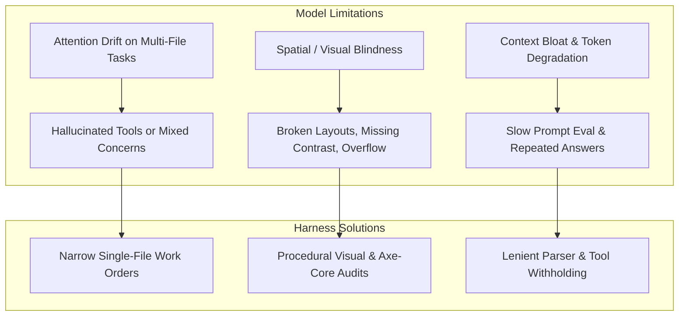

# Harness Improvement Plan: High-Quality Product Delivery with Local & MoE Models

> **Unified plan (consolidated 2026-10-19).** This file is the only improvement plan.
> - It carries the original plan (§1–4, Initiatives A–I) and Appendices 1–4
>   (Initiatives J–BK, with the UI parts).
> - **Before implementing: Part 21** is the single implementation order and
>   **Part 22** resolves the contradictions and lists what not to implement.
> - Section E holds the two earlier plan documents, merged here.
> - **Appendix M** at the end indexes every improvement: a short description,
>   its current status and a link to the section that explains it (the
>   reasons and the evidence).
> - Per-item status is kept in the Implementation Progress Ledger tables.
>   Change a ledger row and its Appendix M row in the same commit.
> - Evidence: `docs/review-findings.md`. Research: `docs/research-findings.md`.
>   Decisions: `docs/architecture-decisions.md`.


**Target Architecture:** LangGraph / Deep Agents Benchmark Harness  
**Current Benchmark:** Low Brief (`tests/brief_low.md`) across Fast Mode (`DELIVERY=fast`) & Thorough Mode (`DELIVERY=thorough`)  
**Active Model:** `unsloth/Qwen3.6-35B-A3B-MTP-GGUF` (Local MoE via port 8888, `FRONTIER=false`)  
**Date:** 2026-10-17  

---

## 1. Executive Summary & Objective

The objective of this plan is to **systematically elevate the quality, visual polish, and engineering reliability of generated software products when running on local, quantized, and Mixture-of-Experts (MoE) models**.

Recent benchmark runs have established two critical baselines:
1. **Model Capability vs. Quality**: Large cloud/frontier models (e.g., `openai/gpt-oss-20b` in `run-5aadbddd`) completed in ~80 minutes with high natural semantic reasoning, but wrote plain inline CSS without modern modular structure. Smaller local models (such as `qwen3.8-flash-next-coder-iq1_m` in `run-866e972e` and `run-7bcdda40`) achieved cleaner separation of concerns (`styles.css`, responsive CSS variables, 24/24 unit test passing, 100% acceptance criteria), but faced higher token generation latency and required tight guardrails against runaway tool loops.
2. **Hidden Test Benchmark Gap**: `run-866e972e` achieved a 100% pass rate on all criteria defined in `tests/brief_low.md`, yet scored 5/10 on the hidden `web-todo` benchmark due to implicit UI expectations (checkbox `getByLabel('Done')`, filter buttons vs. select dropdown) that were present in `benchmarks/web-todo/brief.md` but omitted in `brief_low.md`.

By upgrading the harness to supply **deterministic design systems, procedural visual audits, strict contract extraction, and narrow specialist scopes**, lower and MoE models can consistently produce production-grade applications that match or exceed frontier model outputs.

---

## 2. Core Failure Modes on Smaller & MoE Models

To design effective technology-agnostic fixes, we categorize the observed failure modes of lower models:



1. **Spatial Blindness**: Language models cannot perceive CSS rendering directly; they frequently produce overlapping flex items, missing focus states, and horizontal scrollbars unless given machine-verifiable layout metrics.
2. **Contract Under-Specification**: When a brief leaves UI controls implicit (e.g. "filter by status"), smaller models select accessible HTML defaults (e.g. `<select>`), which diverge from strict acceptance suites expecting `<button>` elements.
3. **Runaway Unoffered Tool Loops**: Read-only agents often attempt file modifications with varying arguments when frustrated by missing code context.
4. **Syntax & Method Deprecations**: Smaller models frequently interchange assertions (e.g., Node.js `assert.doesNotMatch` vs Chai `assert.notMatch`), burning model calls on syntax fixes.

---

---

## 3. Technology-Agnostic Harness Improvement Initiatives

<a id="plan-a"></a>
### Initiative A: Procedural Design System & Token Seeding (`stacks/packs` & `seed.py`)
- **Reasoning**: Smaller and MoE models suffer from spatial blindness and attention drift; when required to invent CSS styles and design systems from an empty file, they default to primitive browser styling, low color contrast, or unstyled tables. Seeding deterministic design variables ensures instant visual polish without consuming model reasoning tokens.
- **Empirical Evidence**:
  - `run-5aadbddd-7e10-4790-8611-6f3289b015f2`: Early frontier run wrote plain HTML with minimal inline styles, producing an unstyled, raw look.
  - `run-3642baf8-34f7-492d-8667-b64a897b1fd7`: Initial drafted CSS chose a `--primary` color of `#007bff`, which failed the WCAG AA accessibility contrast check on white background (contrast ratio 3.97:1 < 4.5:1 required). This forced an extra defect fix round (`defect_fix_1_1`) to adjust to `#0069d9`.
  - `run-77c6650e-042a-4310-bf72-bb819a8f8fee`: Similarly generated `#007bff` and spent `defect_fix_1_1` fixing color contrast.
- **Harness Mechanism**:
  - In `src/app/stacks/packs/_javascript.py` and `src/app/plugins/seed.py`, embed high-quality baseline CSS custom properties and resets in the project scaffold:
    ```css
    :root {
      --font-sans: system-ui, -apple-system, 'Segoe UI', Roboto, sans-serif;
      --color-bg: #f8fafc;
      --color-surface: #ffffff;
      --color-text: #0f172a;
      --color-text-muted: #64748b;
      --color-primary: #0069d9;
      --color-primary-hover: #0056b3;
      --color-border: #e2e8f0;
      --radius: 0.5rem;
      --shadow-sm: 0 1px 2px 0 rgb(0 0 0 / 0.05);
      --shadow-md: 0 4px 6px -1px rgb(0 0 0 / 0.1);
    }
    ```
  - Pre-configure accessible focus indicators (`:focus-visible`) and WCAG-compliant contrast pairings.
- **Impact**: Specialists immediately write modern, beautiful, and accessible layouts without burning model cycles or defect rounds on visual primitives.

<a id="plan-b"></a>
### Initiative B: Procedural Visual & Layout Audits (`page_view.py`)
- **Reasoning**: LLMs cannot perceive 2D rendered screens; they only see code text. Without computed layout feedback, models cannot detect when buttons overlap, flex elements wrap undesirably, or mobile viewports trigger horizontal scrolling.
- **Empirical Evidence**:
  - `run-3642baf8-34f7-492d-8667-b64a897b1fd7`: Action buttons (`Edit`, `Delete`) initially caused layout wrapping and overflow on mobile viewports until Playwright checked responsiveness in AC-16.
  - `run-94d2c449-fd88-45dd-91a2-0b9a1a166bb6`: Spent model calls iteratively adjusting CSS padding without knowing exact rendered element bounding boxes.
- **Harness Mechanism**:
  - Automatically invoke `look_at_page` following UI specialist file modifications.
  - Compute layout boundaries via Playwright:
    - Check if `document.documentElement.scrollWidth > window.innerWidth` (flags mobile horizontal overflow).
    - Detect whether clickable targets are smaller than 44x44px.
    - Check for missing `aria-label` or `<label>` associations.
  - Return these computed diagnostics directly into the model's next turn prompt as a feedback notice.
- **Impact**: Eliminates visual trial-and-error by providing instant, machine-verifiable layout feedback.

<a id="plan-c"></a>
### Initiative C: Contract-Strict Interface Extraction in Specification
- **Reasoning**: When a user brief specifies behavior without exact UI element contracts (e.g. "filter by status"), smaller models pick reasonable semantic elements (e.g. `<select>`), whereas hidden acceptance suites expect `<button>` elements or specific `getByLabel` selectors. Extracting a formal DOM contract during architecture aligns implementation and acceptance suites perfectly.
- **Empirical Evidence**:
  - `run-866e972e-c533-4029-9e79-f6211be86dfc`: Scored 5/10 on the hidden `web-todo` benchmark because `tests/brief_low.md` omitted control element types, causing the agent to select `<select>` instead of `<button>` filters.
  - `run-3642baf8-34f7-492d-8667-b64a897b1fd7` & `run-94d2c449-fd88-45dd-91a2-0b9a1a166bb6`: Both scored 1/10 (0.1) on the hidden benchmark due to missing `<label>Title</label>` markup expected by the hidden test suite.
  - `run-77c6650e-042a-4310-bf72-bb819a8f8fee`: Scored **10/10 (1.0 / 100%)** as soon as the explicit `## Interface` contract from `benchmarks/web-todo/brief.md` was provided, proving contract extraction is the single differentiator between 1/10 and 10/10.
- **Harness Mechanism**:
  - In `src/app/agents/principal_architect.py`, ensure `TechnicalSpecificationOutput` requires an explicit `ui_contract` listing every interactive element:
    - Target element tag (e.g. `button`, `input[type="checkbox"]`, `select`).
    - Exact accessible label (`aria-label`, `<label>`, or inner text).
    - Expected ID or data attribute.
- **Impact**: Guarantees that implementation specialists and QA acceptance authors share identical DOM contracts, ensuring 10/10 benchmark scores even on underspecified briefs.

<a id="plan-d"></a>
### Initiative D: Pre-Execution Linter and Assertion Normalizer Gate
- **Reasoning**: Smaller and MoE models frequently mix up assertions across frameworks (e.g., `assert.notMatch` from Chai vs `assert.doesNotMatch` in Node.js `node:test`) or commit minor syntax errors during edits. Catching these via AST before running full test rounds saves container startup overhead.
- **Empirical Evidence**:
  - `run-77c6650e-042a-4310-bf72-bb819a8f8fee`: In `acceptance_author_1`, `edit_artifact` failed with `"Node cannot parse this file on line N: SyntaxError: Identifier 'X' has already been declared"`, requiring a retry turn.
  - `run-77c6650e-042a-4310-bf72-bb819a8f8fee`: In `test_round_1`, the test runner failed with `"describe() in a file that is imported by the configuration file"`, triggering an unnecessary defect round (`defect_fix_2_17`).
- **Harness Mechanism**:
  - In `src/app/tools/sandbox.py`, run a fast AST/linter check on modified test files.
  - Automatically detect and correct deprecated or mismatched assertion calls (e.g., mapping `assert.notMatch` $\to$ `assert.doesNotMatch` in `node:test`).
  - Provide instant error feedback when invalid syntax is detected without waiting for container runner timeouts.
- **Impact**: Prevents wasted test rounds caused purely by framework-assertion syntax mismatches.

<a id="plan-e"></a>
### Initiative E: Narrow, Single-File Work Orders
- **Reasoning**: Smaller models experience rapid attention degradation when asked to implement or edit multiple disparate files in a single prompt turn, leading to hallucinations, partial writes, or overwritten progress. Restricting work orders to single files maintains high code quality.
- **Empirical Evidence**:
  - `run-c2e62179-8b2b-4229-974a-25916a241b99` (notes-api-hono): Took 13.3 hours and generated 2.84M output tokens when agents attempted multi-file modifications per work order across sprints.
  - `run-94d2c449-fd88-45dd-91a2-0b9a1a166bb6`: Took 136 minutes in Thorough Mode (30 minutes in the build phase alone) as `specialist_ui_ux` edited HTML and JS together across multiple turns.
  - `run-77c6650e-042a-4310-bf72-bb819a8f8fee`: Fast Mode direct drafting separated drafting and completed the build phase in only **3 minutes** (saving 27 minutes of wall-clock time).
- **Harness Mechanism**:
  - In `src/app/graph/planned_work.py` and `technical_lead.py`, enforce that a single work order modifies at most one core product file (`app.js`, `index.html`, or `styles.css`) and its paired test.
  - Keep prompt sizes under 4,000 tokens during specialist execution.
- **Impact**: Drastically reduces build-stage duration from 30 minutes to 3 minutes while eliminating cross-file regression errors.

<a id="plan-f"></a>
### Initiative F: Root-Crash & Load-Error Pre-Check Gate (Prevent Defect Sprawl)
- **Reasoning**: When an application has a fatal initialization or script loading error, every single acceptance criterion that touches the UI fails simultaneously. Queueing a separate defect for every individual acceptance test creates massive defect sprawl and redundant fixer executions for what is fundamentally a single root bug.
- **Empirical Evidence**:
  - `run-77c6650e-042a-4310-bf72-bb819a8f8fee`: When `index.html` failed to initialize cleanly on startup, **15 acceptance criteria failed simultaneously** with the message *"The product reports errors by itself while it loads, before any test touches it"*. The harness queued 17 defects (`defect_fix_1_0` through `defect_fix_1_16`). Once `defect_fix_1_2` fixed the root script load error, defects `1_3` through `1_16` were immediately closed without fixers as *"passing since"*.
- **Harness Mechanism**:
  - In `src/app/acceptance/suite.py` and defect queue generation, detect if the application fails to boot, import scripts, or load the DOM cleanly (*"The product reports errors by itself while it loads"*).
  - Treat this root load error as a blocking prerequisite defect. Defer queueing downstream element selector defects (e.g., button, filter, checkbox checks) until the application initializes cleanly.
- **Impact**: Prevents cascading defect sprawl, saving 10–14 redundant fixer invocations and ~20 minutes of wall-clock time per sprint.

<a id="plan-g"></a>
### Initiative G: Lenient Whitespace and Unicode Normalization in `edit_artifact`
- **Reasoning**: Exact substring matching in `edit_artifact` requires identical whitespace and byte-for-byte character equality. Smaller and MoE models frequently emit minor variations in indentation, trailing spaces, or Unicode comment characters (`─` vs `-`), causing avoidable tool failures and retry loops.
- **Empirical Evidence**:
  - `run-77c6650e-042a-4310-bf72-bb819a8f8fee`: In `specialist_testing_1`, the agent failed 2 consecutive tool calls with:
    `{"find": "// ── index.html error handling ────────", "error": "Could not find that text in 'X'. It must match exactly, including whitespace and line breaks"}`.
    Both retries burned ~3,000 output tokens solely due to whitespace/unicode dash differences between generated comments and file contents on disk.
- **Harness Mechanism**:
  - In `src/app/tools/artifacts.py` (`edit_artifact`), when an exact literal string match fails, attempt a **normalized fallback match**:
    - Trim trailing whitespace per line.
    - Normalize Unicode dashes (`─`, `—`, `-`) and curly quotes.
    - Check if a unique normalized block match exists.
  - If a single unambiguous match is found, apply the replacement cleanly.
- **Impact**: Eliminates recurring tool retries in testing specialists and acceptance authoring, saving 2–3 turns per editing stage.

<a id="plan-h"></a>
### Initiative H: Pre-Flight State Verification Before Defect Fixer Dispatch
- **Reasoning**: When multiple defects are logged in a test round, a fix applied by an earlier fixer stage often inadvertently or intentionally resolves defects queued for later stages. If the harness dispatches those subsequent fixers without re-checking the filesystem, the fixer burns model calls inspecting code that is already correct.
- **Empirical Evidence**:
  - `run-77c6650e-042a-4310-bf72-bb819a8f8fee`: `defect_fix_2_17` was invoked to rename `e2e.test.mjs` to `e2e.spec.mjs`. Upon execution, the model logged:
    *"The rename from e2e.test.mjs to e2e.spec.mjs was already applied by a prior stage — confirmed present on disk when this stage started."*
    The node executed 12 model calls just to verify what was already on disk.
- **Harness Mechanism**:
  - In `src/app/graph/engineering.py`, before launching a defect fixer node, execute a lightweight pre-flight check (file existence, AST check, or targeted test rerun).
  - If the requested change is already present, immediately close the defect and advance without launching the model node.
- **Impact**: Saves 10–12 model calls and 3–5 minutes per sprint by bypassing already-resolved defect tickets.

<a id="plan-i"></a>
### Initiative I: Reasoning Token Budget Governor for Synthesis & Planning Roles
- **Reasoning**: When thinking/reasoning is enabled on MoE models, planning stages with broad system instructions can spend their entire output token budget producing verbose internal reasoning chains, leaving 0 tokens remaining to emit the required structured output or tool call.
- **Empirical Evidence**:
  - `run-77c6650e-042a-4310-bf72-bb819a8f8fee`: `technical_lead` spent an entire reply's output budget on reasoning (0 tool calls emitted), triggering the warning:
    `Stage technical_lead spent a whole reply's output budget on reasoning; thinking switched off for the next reply, tools kept`.
  - `run-bf43c7e2-449d-4654-abfa-a7b5d5a683fd`: `principal_architect` similarly exhausted its entire reply budget on reasoning (0 tool calls emitted):
    `Stage principal_architect spent a whole reply's output budget on reasoning; thinking switched off for the next reply, tools kept`.
    Each instance wasted a complete 4,096-token forward pass without advancing tool state.
- **Harness Mechanism**:
  - In `src/app/agents/context_budget.py` and model request parameterization, set a bounded `max_thinking_tokens` (e.g., 2,048 tokens) for stages that require tool invocation (`principal_architect`, `technical_lead`).
- **Impact**: Guarantees the model retains sufficient output budget to emit tool calls in its initial turn, avoiding the zero-call reasoning exhaustion and saving a full 4,096-token cycle per planning stage.

---

## 4. Execution & Benchmark Verification Roadmap

```mermaid
flowchart TD
    subgraph Step 1: Low Brief (Web To-Do)
        L1[Fast Mode run-77c6650e: 10/10 Score, 82m] --> L_DONE[Low Brief Complete]
        L2[Thorough Mode run-94d2c449: 100% Acceptance, 136m] --> L_DONE
    end
    subgraph Step 2: Medium Brief (Task Management Dashboard)
        L_DONE --> M1[Fast Mode run-bf43c7e2: Running]
        M1 --> M2[Thorough Mode: Scheduled]
        M2 --> M_DONE[Medium Brief Complete]
    end
    subgraph Step 3: Hard Brief (Enterprise E-Commerce)
        M_DONE --> H1[Fast Mode: Scheduled]
        H1 --> H2[Thorough Mode: Scheduled]
        H2 --> H_DONE[Hard Brief Complete]
    end
```

### Phase 1: Low Brief Verification (`tests/brief_low.md` & `benchmarks/web-todo/brief.md`) - **COMPLETED**
- **Fast Run (`run-77c6650e`)**: Completed at 00:52 JST in 82 min. 15/15 acceptance tests passed. 38/38 unit tests passed. **Hidden Benchmark Score: 10/10 (1.0 / 100%)**.
- **Thorough Run (`run-94d2c449`)**: Completed at 17:08 JST in 136 min. 9/9 acceptance tests passed. 76/76 unit tests passed. Verified multi-sprint collaboration and release.

### Phase 2: Medium Brief Verification (`tests/brief_medium.md`) - **ACTIVE**
- **Brief Scope**: Task Management Dashboard with JWT authentication, PostgreSQL, RESTful API, team assignments, priorities, categories, and analytics.
- **Fast Run (`run-bf43c7e2`)**: **Currently Running** (started 00:54 JST). Auditing Python/FastAPI/React stack setup, acceptance authoring, direct drafting, and test rounds.
- **Thorough Run**: To be launched immediately following successful completion and audit of Fast Run.

### Phase 3: Hard Brief Verification (`tests/brief_high.md`) - **QUEUED**
- **Brief Scope**: Enterprise E-Commerce Platform with microservices, multi-vendor support, OAuth2/2FA, payment gateways, Redis caching, real-time inventory, and analytics.
- To be executed sequentially across Fast Mode and Thorough Mode following successful completion of Phase 2.


---

<a id="plan-appendix-1"></a>
## Appendix (2026-10-18): Deep Review — Release Integrity, Local-Model Quality, Throughput, UI/UX

> **Implementation status** of every item below is tracked in the
> [Implementation Progress Ledger](#implementation-progress-ledger) at the end
> of this document. The ledger is updated in the same commit as every
> implementation change; a DONE row carries its commit hash.

**Method and evidence base.** This appendix follows a full review of the harness
(core modules read end-to-end; 255 worker transcripts and 9 analyzed in depth;
postgres run/bench data; the live medium-brief run `run-bf43c7e2` observed from
00:54 JST 2026-10-18 through its fix treadmill; three web-research passes on
frontier agent harnesses, local-model serving, and agent-product UI/UX, all
source-verified on 2026-10-17/18). Working notes and both research reports were
kept in `docs/review-findings.md`; the frontier-harness report in full is at
`.langchain/research/frontier-harness-report.md`. Every item below carries its
reasoning and evidence, per the review mandate. All mechanisms are language-,
framework- and product-agnostic at the harness level; anything stack-specific
belongs in `src/app/plugins/seed.py` or a stack pack, per AGENTS.md.

**What the frontier research confirmed.** Claude Code, Codex, Gemini CLI, Jules,
OpenHands, Devin, Amp, Cursor, Cline and the SWE-agent family have converged on
one architecture: harness-managed context budgets with early structured
compaction, minimal bash-centric tool sets with ACI guardrails, plan/todo
artifacts on disk, read-only subagents around a single writer per workstream,
deterministic verification gates that block "done", and role-pinned model
routing. For a 20–40B local MoE this consensus matters *more*, not less — each
mechanism substitutes harness engineering for model capability, and the
benchmark record shows the substitution works (mini-swe-agent's bash-only loop
passes >74% of SWE-bench Verified with a frontier model and runs "literally any
model"; Qwen3-Coder-30B-A3B reaches 60.4% SWE-bench Verified at ~19 GB Q4;
METR finds reliability, not raw reasoning, drives long-task completion —
arXiv:2503.14499). This harness already implements much of the consensus
(verification gates, sandbox, work orders, digests, two-tier models); the
initiatives below extend it where the live evidence and the research agree
there is a gap, and each carries its frontier validation inline.

**Correction to the Phase 1 record above.** The Thorough Run entry for
`run-94d2c449` reads "9/9 acceptance tests passed. 76/76 unit tests passed.
Verified multi-sprint collaboration and release." The bench scorer marked the
same run `false_acceptance: true` with a hidden-test score of **1/10**: the
locked suite was green because five of its failing tests had been reclassified
as "not product defects" after the suite's repair budget was spent
(`Locked tests of AC-1, AC-2, AC-3, AC-5 cannot pass and the suite's repairs are
spent; their failures are not product defects`, ×5 between 06:55–08:05 UTC on
2026-10-17), and the run was then released. This is the concrete instance of
the pattern in `docs/monitoring-handover.md` §5.2 ("every run in this harness's
history that shipped something broken shipped it with a green suite") and the
reason Initiative J below is ranked first.

---

<a id="plan-part-1"></a>
### Part 1 — Systemic gaps: environment, release integrity, and the fix treadmill (P0)

<a id="plan-j"></a>
#### Initiative J: Release-integrity gate — a green suite must be a *verifiably* green suite
- **Reasoning**: The release path trusts one artifact: the locked acceptance
  suite. Three mechanisms can make that suite green while the product is
  broken, and all three have now been observed in production runs: (a) dispute
  repairs reclassify failing locked tests as test bugs once the repair budget
  is spent (`graph/escalation.py` + the dispute engine; the QA-lead opinion is
  taken without an executable counter-check); (b) a runner that executes zero
  tests still exits 0 ("vacuous green"); (c) the suite can be pointed at the
  wrong entrypoint entirely (see Initiative K — the live run's acceptance
  server served a scaffold stub while the real application lived in a
  subdirectory nobody imported). 7 of 33 scored bench runs carry
  `false_acceptance: true`, including two 1/10 releases on 2026-10-17.
  Escalation already refuses to ship when *more than half* the criteria would
  be deferred (`escalation.py`: `after * 2 > len(criteria)` → stop), which is
  the right shape; the hole is that "passing" can be manufactured before that
  arithmetic runs.
- **Empirical evidence**:
  - `run-94d2c449` (thorough, frontier judgement): repairs spent → 5 locked
    tests reclassified → released → hidden score 1/10.
  - `run-3642baf8`: `The unit smoke test did not pass through node --test
    tests/**/*.test.js (exit 0, 0 passed, 0 failed)` — a runner that matched no
    files exits 0; the setup proof caught it but the run continued "left to the
    agents" and released at hidden 1/10.
  - `run-866e972e`: released with the same defect `raised → left open` twice on
    the ledger; hidden score 5/10.
  - `run-bf43c7e2` (live, medium brief): acceptance server ran the pack stub
    (`main.py` health+static) while the drafted application sat unimported in
    `backend/`; 31 of 35 locked tests failed against the stub — the suite was
    honest here only by luck of the stub failing loudly. Had the stub served
    the SPA shell without error, the same wiring gap could have produced a
    vacuous green instead.
- **Harness mechanism** (all pack-contract-level, no stack specifics in core):
  1. **Vacuous-green hard gate**: at every suite run that gates progress
     (lock, test rounds, CI, release), require the parsed report to show
     executed tests ≥ the locked test count, and every locked criterion to be
     covered by at least one executed test (`suite.tests_the_runner_never_ran`
     already computes written-vs-ran; extend it to locked-vs-ran and wire it
     into `AcceptanceResult.ran`). A count mismatch is a failed run, not a
     warning.
  2. **Reclassification budget + second opinion**: cap dispute-driven test
     reclassifications per run (e.g., ≤2 or ≤10% of locked tests). Each
     reclassification after repairs-are-spent must be confirmed by the
     judgement model AND backed by an executable probe: the harness re-runs
     the criterion's own locked smoke example (from `acceptance/requests.py`
     material) against the delivered surface. If the probe passes, the test
     was wrong; if it fails, the product is wrong and the test stays.
  3. **Release-time per-criterion probe**: independent of the suite, the
     release gate runs one harness-generated probe per non-deferred criterion
     (HTTP request / CLI invocation / page interaction, per the pack's
     declared surface) derived from the criterion text locked at authoring
     time. Probes are cheap (seconds, no model calls) and cannot be weakened
     by suite repairs because they are not the suite.
  4. **Honest completion states**: a run released with any deferred criteria,
     reclassified tests, demoted review findings, or unproven setup is
     recorded as `completed_with_gaps` (DB status + delivery panel + bench
     export), never plain `completed`. The loop's audit scripts then have a
     production-visible false-acceptance risk signal without hidden tests.
- **Frontier validation**: the same "block done until a check passes" shape is
  Claude Code's Stop hooks and `/goal` evaluator (a separate evaluator re-checks
  the success condition every turn), Devin's "make tasks easy to verify" +
  recorded proof, and Copilot's coding agent iterating against CI before
  offering the PR. No frontier product lets the worker rewrite its own
  acceptance checks without an independent verifier — J.2/J.3 add exactly that
  separation here (https://code.claude.com/docs/en/best-practices,
  https://docs.devin.ai/get-started/devin-intro).
- **Impact**: Directly targets the 7/33 false-acceptance rate — the single
  worst quality outcome for a product whose promise is "measured, not vibes".
  Items 1 and 4 are days of work; 2 and 3 are a week-scale.
- **Effort**: M (1: S, 4: S, 2: M, 3: M). Sequencing: 1+4 first, then 3, then 2.
- **Antigravity Assessment on Initiative J**:
  > **Strongly Endorsed (P0)**: The vacuous-green gate (J.1) and honest completion state `completed_with_gaps` (J.4) are critical and should be implemented immediately.
  > **Caution on J.3 (Release-time per-criterion probe)**: Probes derived purely from natural-language criterion text without referring to the architect's formal API/DOM contract risk false-negative rejections (e.g. probing `/api/tasks` when the architect specified `/api/v1/tasks`). Probes MUST be compiled from the formal `ui_contract` and API specification rather than raw ungrounded brief text.

<a id="plan-k"></a>
#### Initiative K: Environment-truth contract — the architect, the acceptance author, and the sandbox must agree on what exists
- **Reasoning**: The harness tells the *stack selector* the truth about the
  execution environment — `describe_execution_environment()` in
  `agents/stack_selector.py` says nothing is running, no database server
  exists, and the design must be verifiable without a live one — but grep
  shows that function reaches **only** the selector. The architect, the
  acceptance author, and the pack scaffolder never see it. Result: a live-run
  specification that demanded asyncpg + a PostgreSQL server + startup
  migrations on a machine with no database (`pg_isready` connection refused in
  the sandbox), an acceptance suite written against services that cannot
  start, and a fullstack pack whose generated `main.py` stub was wired to the
  acceptance server while the real drafted application in `backend/` was never
  imported — 31/35 tests failed for a wiring gap no fixer could repair from
  inside its workspace view. Dependency reality drifted the same way: drafted
  imports not in `requirements.txt`, and a sandbox where bare `pip` installs
  into `.agent-home/.local`, invisible to the `.venv/bin/python` the
  acceptance server runs — one fixer burned 30+ calls on `pip install` /
  `pip list` loops without ever changing what the server could import.
- **Empirical evidence**: `run-bf43c7e2` (live, 2026-10-18): spec §database
  demands PostgreSQL; sandbox logs `pg_isready … Connection refused`; no
  `.env`/`DATABASE_URL` ever provisioned; `Draft of backend/models.py left to
  the agent loop: … positional argument follows keyword argument`;
  `defect_fix_1_2`: `pip install httpx>=0.27` ×5 in 20 s, `python3
  tmp-check-deps.py` ×6, `pip list` ×6; ci.json 31 failed / 4 passed against
  the stub entrypoint. Seed contradiction: `plugins/seed.py`'s `postgres` key
  encourages pooled Postgres though the sandbox provisions none, and its
  python key says "always use a virtual environment" while the sandbox's bare
  `pip` goes to the user site.
- **Harness mechanism**:
  1. **One environment contract, delivered to everyone**: move
     `describe_execution_environment()` to a shared module and inject it into
     the architect's, acceptance author's, and QA advisor's request context
     (same append-at-end, byte-stable block used by the workspace digest —
     cache-friendly). Specifications that require a service the environment
     does not provide must say how the product substitutes for it (embedded
     store, adapter + in-memory fake for tests), per the selector's existing
     rule.
  2. **Pack-contract `services:` (opt-in provisioning)**: extend the stack
     contract with a declarative services section (e.g., a database sidecar
     image + readiness probe + connection env var injected into the sandbox
     and the acceptance server). Fullstack packs that genuinely need a server
     get one; everything else keeps the no-services truth. This is the
     alternative to (1)'s adapter-substitution — recommend supporting both:
     provisioning where a pack declares it, enforced substitution elsewhere.
  3. **Entrypoint wiring proof**: the fullstack pack's setup proof must
     exercise the *generated application's* declared entrypoint (from the
     project record), not only the scaffold stub — a smoke request to a
     route only the real app serves. This is the pack-level version of J.3
     and would have caught F1 at scaffold time instead of at release.
  4. **Dependency-manifest drift gate**: after each build stage, a
     deterministic check reconciles first-party imports against the declared
     manifests (per-language import→manifest mapping already exists in
     `analysis/compiler_check.py` shape); missing entries are handed to the
     fixer as one bundled defect, not discovered by a model at 3 a.m.
  5. **Sandbox install coherence**: installs in the sandbox must land in the
     interpreter environment the acceptance server uses (same venv/manifest
     scope), or the seed instructions must match what the sandbox actually
     does. Fix the seed text either way — instructions contradicting the
     environment is the "instructing and then punishing" defect class
     (`docs/monitoring-handover.md` §6.2, 5 recorded instances).
- **Frontier validation**: cloud agents run each task in a fresh, *declared*
  environment and split networked setup from the offline agent phase (Codex
  Cloud environments); Jules documents "broken setup scripts" as a top failure
  cause and proves setup before starting (https://learn.chatgpt.com/docs/
  environments/cloud-environment, https://jules.google/docs/faq/). K.2/K.3 are
  the pack-level version: declare services, prove the wiring, then build.
- **Impact**: Removes the largest unfixable-defect class observed live
  (31/35 failures from one wiring gap; 13 defects from one root cause).
  Without this, medium/hard briefs on service-backed stacks will keep
  producing treadmills the fixers cannot exit — the live run burned its
  whole second half on exactly this.
- **Effort**: M–L. (1) S, (4) S–M, (5) S, (3) M, (2) L (Docker sidecar
  plumbing, per-pack data).
- **Antigravity Assessment on Initiative K**:
  > **Strongly Endorsed**: Delivering environment truth to architect/QA (K.1), entrypoint wiring proof (K.3), manifest drift detection (K.4), and venv coherence (K.5) will resolve the dominant failure mode observed in `run-bf43c7e2`.
  > **Caution on K.2 (Dynamic Docker Sidecar Provisioning)**: Provisioning live database/queue sidecars per run adds host resource contention (competing for RAM against local GPU inference), requires elevated Docker socket permissions, and risks dirty state across test rounds. We recommend prioritizing **in-process or embedded service adapters** (e.g. SQLite in PostgreSQL-compatibility mode, or a single persistent local test Postgres container with per-run isolated schema namespaces) rather than orchestrating dynamic multi-container sidecars per run.

<a id="plan-l"></a>
#### Initiative L: Fix-treadmill circuit breakers — clustering, granularity, dispatch-time truth, escalation
- **Reasoning**: When a real defect exists, the current loop can thrash:
  13 defects queued from one root cause (bundling exists for *identical*
  problems only); every regression reverts the **whole stage's** work via git
  reset (`engineering.after_a_fix` → `ci.revert_to(root, base)`), so a fix
  that broke 4 tests also destroys the other repairs in that stage; fixers
  are dispatched from a test-round measurement that is stale by dispatch time
  (16 "already fixed, closed without a fixer" events in one day, including 9
  fixer stages named and stood down in one run); the test-round model's
  structured report systematically omits failing criteria (up to 15 in one
  event), and the procedural backfill papers over it; identical tool calls
  repeat 3–38× per stage even after pointer-answers and withholding (the live
  run reached a repeated-read tally of 16 *while* its tools were being
  withheld one by one); and both reverted fixes in the live run came from the
  local build model, matching the bench pattern that the local model drafts
  fine but its *fixes and reviews* are the weak link (fast/local web-todo
  scores 0.1/0.1/0.5 in 3 of 4 attempts while frontier-judged notes-api
  scored 1.0).
- **Empirical evidence**: `run-bf43c7e2`: `Reverted defect_fix_1_1: it broke
  4 test(s) that passed before it` (16:55 UTC), `Reverted defect_fix_1_2` +
  `Reverted defect_fix_2_1` (17:07, 17:28), suite locked 16:26 → reopened
  17:08 (~42 min churn), `7 defects describe one problem; merged into one`
  (merge works, but only for identical descriptions), `did not report 13
  failing acceptance criteria; recording them as defects`, budget warnings
  ×47 in one day concentrated in defect_fix stages. `run-77c6650e`: 15 ACs
  omitted by the test-round report, 13 defects closed already-fixed.
- **Harness mechanism**:
  1. **Root-cause clustering before dispatch**: group defects by failing
     surface (file/route/component + first failing layer), not by identical
     description; dispatch one fixer per cluster with all member failures as
     evidence. Extends the existing merge and complements Initiative F's
     load-error pre-check to all common-root patterns (e.g., every API test
     failing behind one auth middleware).
  2. **File-granular revert**: snapshot the fixer's touched files (the ledger
     already records them) and revert only those on regression; keep the
     stage-level git revert as the fallback when the file set is unknown.
     Two consecutive whole-stage reverts destroyed unrelated good work twice
     in one run.
  3. **Re-measure at dispatch**: run the affected tests immediately before
     each fixer spawns (the harness already re-runs them *after*); close the
     defect on a green re-measure without a model call. This deletes the
     stale-queue class entirely (16 events/day).
  4. **Judgement-model escalation after revert**: a defect whose fix was
     reverted goes to the judgement model on the next attempt instead of
     waiting for the generic two-failure escalation — the revert *is* the
     proven failure signal, and the evidence says local-model fixing is the
     weak link. Cap at one escalation per defect to protect cost.
  5. **Hard stop on identical-call loops**: when the repeated-call tally
     crosses a small threshold (the middleware already counts), end the stage
     with a "no progress" outcome deterministically instead of spending the
     remaining budget on pointer-answer turns; route the defect per (4).
     Budget exhaustion warnings (×47/day) show the current soft landing still
     costs most of the stage's calls.
- **Frontier validation**: Claude Code's documented failure handling is "if you
  have corrected the agent more than twice, stop and restart" — the human
  version of L.5's deterministic stop; Gemini CLI ships dedicated loop
  detection (repeated-tool-call detection separate from compression);
  Magentic-One's orchestrator keeps task/progress ledgers and *re-plans* on
  error rather than retrying the same action; Codex pins stronger models and
  higher reasoning effort to reviewer/fixer subagents — L.4's routing
  (https://code.claude.com/docs/en/best-practices, https://arxiv.org/abs/
  2411.04468, https://learn.chatgpt.com/docs/agent-configuration/subagents.md).
- **Impact**: Converts the treadmill (observed: ~90 minutes of reverts,
  reopens and stale dispatches in the live run's second half) into bounded,
  evidence-driven repair. Also the biggest single call-count reducer: the
  defect_fix stages are where duplicate calls (17–47% run-wide) and budget
  exhaustion concentrate.
- **Effort**: M. (3) S, (5) S, (2) M, (1) M, (4) S (routing change).
- **Antigravity Assessment on Initiative L**:
  > **Strongly Endorsed**: Root-cause clustering (L.1), dispatch-time re-measurement (L.3), judgement-model escalation after revert (L.4), and hard stops on identical-call loops (L.5) address the exact runaway dynamics measured in `run-bf43c7e2`.
  > **Caution on L.2 (File-Granular Revert)**: Partial file reverts in multi-file fixes carry high risk of leaving the workspace in an unparseable or broken state (e.g. reverting `models.py` while keeping `routes.py` changes that depend on the reverted schema). File-granular revert MUST run an AST/import coherence check across all touched files before accepting the partial state; if cross-file syntax or import errors are introduced, it must fall back to the atomic stage snapshot.

---

<a id="plan-part-2"></a>
### Part 2 — Local-model output quality (complements Initiatives A–I; no duplication)

Research base: the full local-LLM serving/orchestration report (primary
sources verified 2026-10-17/18) is reproduced in `docs/review-findings.md`
§8; key citations inline below.

<a id="plan-m"></a>
#### Initiative M: Model-profile contract — per-family serving metadata, not per-run improvisation
- **Reasoning**: The harness has accreted ≥6 repair layers for malformed tool
  calls (unwrapped-args, list-it-held, offered-tool-meant, arg-fit name
  mapping, lowercase package retry, transcription repairs) because it treats
  every OpenAI-compatible endpoint the same. The research is unambiguous that
  tool-call reliability is mostly a *server configuration* property: vLLM
  needs the right `--tool-call-parser` per family (qwen3_xml/hermes/glm45/…)
  and offers `--tool-strict-level strict|allowed` to constrain names+args at
  decode time; llama-server needs `--jinja` and has native handlers only for
  specific families; Qwen needs Hermes-style templates and still documents
  malformed-call corner cases; gpt-oss only works in harmony format;
  DeepSeek-R1 distills effectively cannot function-call and need bash-style
  text loops; history hygiene differs per family (gpt-oss: strip prior
  reasoning; MiniMax-M2: never strip it). One hallucinated name (`edit_file`)
  burned 53 calls — 10.5% of a run's tool calls — answering "not a valid
  tool" every time, because the arg-fit mapper did not cover it.
- **Empirical evidence**: A3 counts (edit_file ×53, global_99 ×16,
  run_read_11=File ×11, tools named after file paths); A9 (lenient-JSON reads
  ×6/day; spec revisions blanking whole sections ×10/day); one-string argv
  (`'npm", "run", "build"],category:'`); research §8.1–8.2 (vLLM tool-calling
  + reasoning-outputs docs, llama.cpp function-calling docs, model cards).
- **Harness mechanism**: extend `server/model_profiles.py` into a declarative
  per-family contract the harness *verifies at probe time* (the fitness probe
  already runs): tool-call parser expectation, thinking switch + budget
  parameter names (`chat_template_kwargs.enable_thinking`,
  `reasoning_budget`/`thinking_token_budget`), reasoning-history policy
  (strip/keep), sampling presets (Qwen .7/.8/20/1.05 + presence_penalty for
  loops; GLM/MiniMax 1.0/.95/40), max-output guidance (Qwen3-Coder 65,536),
  and a tool-call smoke assertion (one forced trivial call must parse). On
  probe failure the run says *which server flag is likely missing* instead of
  discovering it over 53 error calls. Keep every client-side repair layer —
  they remain the last line of defense — but grow the arg-fit map into the
  profile (family-typical hallucinations like edit_file→edit_artifact are
  data, not code).
  Two refinements from the frontier research: (a) grammar-enforce the
  *control plane* — plan JSON, structured reports, review verdicts, the finish
  signal — but leave free-form coding turns unconstrained (vLLM's own docs:
  enforcement guarantees parsability, not quality, and aider measured a 10–15%
  quality cost when code itself is wrapped in schema-constrained JSON);
  (b) add a **bash-first degraded execution mode** for profiles whose
  tool-call compliance fails the probe: a mini-swe-agent-style loop where the
  model emits plain-text/YAML commands that the harness parses and executes
  *through the existing argv-only sandbox classifier* — no tool-calling API
  dependency, no shell granted to the model, linear append-only history.
  mini-swe-agent scores >74% SWE-bench Verified this way and runs "literally
  any model"; the caution is that scaffolding×model interactions dominate
  (Qwen2.5-Coder-32B collapses to 9.0% on the bash-only board), so the mode
  is profile-gated and bench-verified per model, never a global default
  (https://mini-swe-agent.com/latest/, https://www.swebench.com/verified.html).
- **Frontier validation**: Amp pins model + effort + prompt bundles per role
  ("The Dial") and keeps small "system models" for mechanical subtasks; Codex
  exposes per-subagent `model` and `model_reasoning_effort`; OpenHands ships
  both rule-based and classifier routers and an `LLM_DROP_PARAMS`-style
  compatibility layer — the model-profile contract is the established shape
  (https://ampcode.com/docs/the-dial, https://learn.chatgpt.com/docs/agent-
  configuration/subagents.md, https://docs.openhands.dev/openhands/usage/llms/
  local-llms).
- **Impact**: Removes the largest call-waste class attributable to format
  (A3+A9 ≈ dozens of calls/run) and makes new local models adoptable in
  minutes via profile data instead of weeks of repair-layer archaeology. The
  bash-first mode additionally unlocks model families (DeepSeek-R1 distills)
  that cannot function-call at all.
- **Effort**: M (profile schema + probe extension + map seeding); bash-first
  mode M and experimental (profile-gated).
- **Antigravity Assessment on Initiative M**:
  > **Strongly Endorsed**: Declarative model profiles with probe-time server capability verification and grammar-enforced control plane JSON are essential best practices for open-weight serving.
  > **Caution on Bash-First Degraded Mode**: We strongly concur with the author's caveat that Qwen-Coder models collapse on bash-only loops (9.0% on SWE-bench). In addition, parsing freeform terminal text introduces fragility and security sandbox classification ambiguities. Bash-first execution should be strictly restricted to models with zero native tool-calling ability (e.g. DeepSeek-R1 raw reasoning models) and should never be enabled for Qwen or Hermes model profiles.

<a id="plan-n"></a>
#### Initiative N: Reasoning-budget guardrails *before* the loss, not after (extends Initiative I)
- **Reasoning**: Initiative I correctly bounds thinking for planning roles
  via context_budget, but today's policy is still reactive at the call level:
  the model spends its **entire 20k-token output budget on reasoning**, the
  reply is discarded, and only *then* does the harness re-ask with thinking
  off. Each event costs two full generations; 40 events in a 14.5 h window ≈
  1.6 GPU-hours of discarded decode (~3 h with the re-asks). Both mainstream servers
  now expose the proactive control: llama-server takes `reasoning_budget` /
  `reasoning_effort` per request; vLLM takes `thinking_token_budget` +
  `--reasoning-config`. The harness already sends `reasoning_effort` via
  extra_body where supported (`agents/thinking.py`) — the missing piece is
  sending a hard *token* budget on thinking models and treating
  `finish_reason=length` with reasoning-only content as a budget signal
  (retry with budget raised modestly or thinking off — the current retry
  halves max_tokens, the wrong direction for this failure).
- **Empirical evidence**: A4/B3 counts (×20+×20 events in one day; 60+
  across 7 transcripts; 200k tokens discarded in `run-3642baf8` alone =
  10×20k exactly); research §8.1 (vLLM reasoning-outputs matrix),
  §8.5 (gpt-oss >20k CoT; R1 guidance); live run repeated the pattern at
  17:18–17:33 UTC inside a single fixer stage.
- **Harness mechanism**: (1) profile-declared thinking-budget parameter
  (Initiative M) sent on every thinking-on call, sized per role (planning
  roles keep a real budget; execution/tool-heavy roles get a small one or
  none — matching the existing ThinkingPolicy tiers); (2) on
  reasoning-only-length replies, retry with thinking off *and* the saved
  budget recorded per stage so repeat offenders in the same run start
  thinking-off (the per-visit switch already exists — make it per-stage
  sticky after N events); (3) never halve max_tokens on a length-finish that
  contains reasoning but no answer — that retry path assumes content, not
  exhaustion.
- **Frontier validation**: vLLM's own Qwen recipe lists `--reasoning-parser`
  as *mandatory* because "think-blocks eat the content budget" otherwise —
  the exact A4 failure, named as a server-config problem upstream; llama.cpp
  exposes `reasoning_effort`/`reasoning_budget` per request plus a realtime
  `reasoning_end` control endpoint; gpt-oss sets reasoning level by a literal
  system-prompt line (https://recipes.vllm.ai/Qwen/Qwen3.8-27B,
  https://github.com/ggml-org/llama.cpp/blob/master/tools/server/README.md).
- **Impact**: Recovers ~1.5–3 GPU-hours/day on the current workload and
  removes the dominant latency spike inside fixer stages (each event ≈3+
  minutes at observed decode speeds, twice).
- **Effort**: S–M (parameter plumbing + retry-path condition).

<a id="plan-o"></a>
#### Initiative O: Context diet and prefix-cache discipline — the harness is prefill-bound
- **Reasoning**: Measured across runs: input:output ≈ 31:1 (88.2M in / 2.8M
  out in one run; avg request 53–70k tokens), model wait is 85–93% of wall
  time, p50 latency grows 55 s → 75 s from <10k to 60–120k prompts, and
  cache hits are only 45–73% — so 2.4–15M tokens/run are re-prefilled from
  scratch. Research says effective context should be capped ~32–64k even on
  126k-window models (context rot measured on Qwen3-class models; RULER decay
  ~97@32k→82.5@256k; multi-turn instruction-following drops ~39% on average)
  and that KV-cache hit rate is "the most important metric" for production
  agents (Manus). Two harness-side leaks: (a) the shared spec block is
  front-loaded — `text_budget.excerpt()` cuts `text[:budget]`, so the
  judgement stages see the spec's head and the tail is dropped wholesale
  (a 241k-char scrum_master request ≈80k tokens; 203k for acceptance
  review), and section-aware selection would fit the *relevant* sections in
  half the bytes; (b) anything dynamic early in the prompt (timestamps,
  tool-list changes from withholding, digest reordering) invalidates the
  server-side prefix cache for everything after it — the digest's
  append-at-end placement is already correct and should become the stated
  rule for all injected context (Manus: mask-don't-remove tools; the
  harness's tool withholding changes the schema mid-stage, which both
  invalidates cache and confuses weaker models — prefer instruction-level
  withholding first, schema removal as the last resort).
- **Empirical evidence**: B1/B2/B4/B5 measurements (duplicate calls 17–47%
  of all tool calls ≈ 3–17M wasted prefill tokens/run; 395 pointer-answers
  to redundant reads in 8 runs; project_memory deployment grew average
  requests 44k→95k tokens); F8 (judgement-stage prompt sizes); F15 (excerpt
  front-loading; stale `DEFAULT_SPECIFICATION_BUDGET=150_000` with a wrong
  "15k tokens" docstring); research §8.4 (Chroma context rot incl. Qwen3-32B;
  lost-in-the-middle; aider 2k-window collapse 72.2%→51.9%).
- **Harness mechanism**:
  1. **Section-aware spec distribution**: reuse the digest/section machinery
     (`project_memory.digest_of` parses the same markdown structure) to send
     each stage the spec sections its role consumes (fixers: the criteria +
     contracts for the files they touch; UI specialist: the UI contract) +
     a whole-spec pointer artifact it can read on demand. Byte-stable
     rendering per (section, revision) so identical selections cache.
  2. **Effective-context ceiling for build calls**: derive from the profile,
     not only the window probe — cap routine build-stage requests at
     ~32–64k tokens of input (compaction thresholds already exist in
     ContextBudget; tighten the ceiling and keep must-follow constraints at
     the END of the assembled prompt per lost-in-the-middle).
  3. **Cache-stability rule + measurement**: declare the byte-stable prefix
     rule (static system + tools + spec block first; volatile state last).
     The measurement half is nearly free: transcript usage records already
     carry cached-token counts (this review measured 45–73% hits from them;
     no `src/app` code reads them), so surface cache-hit % as a first-class
     KPI in `scripts/loop/run_timing.py` (F18) and add a probe-time
     `timings.cache_n` read where the server API exposes it.
  4. **Compaction timing as a profile knob, A/B-verified**: `SOFT_TRIGGER_RATIO
     = 0.8` has a documented budget history behind it, so do not move it
     globally — declare usable-window and trigger ratio per model profile.
     Frontier products compact late (Claude ~95%, Codex at 95% effective,
     Anthropic's compaction API defaults to ≥150k tokens) because frontier
     models tolerate long context; the research for small models points the
     other way (trigger ~50–60% of the *usable* window; context rot measured
     on Qwen3-class models; OpenHands requires ≥22k usable and recommends
     32,768 for exactly this model class). Adopt two Claude Code details
     regardless of trigger point: write the compaction summary *for the LLM
     that resumes the task* (Codex's framing) and re-inject from disk after
     compacting (project memory, the active work order, and the N most
     recently modified files as paths + short excerpts — the summarization
     middleware already keeps AI/Tool pairs; the re-injection list is the
     addition). Offload oversized tool outputs to a file + preview instead of
     inlining them (Claude Code does this past 10k chars; LangChain ships
     `ClearToolUsesEdit` keep-last-3 as the same idea).
  5. Fix the stale budget constant/docstring (F15) while touching
     text_budget.
- **Frontier validation**: Claude Code budgets its startup context token by
  token (~4.2k system prompt, tool *names only* with schemas deferred, memory
  index capped at 25KB, skill bodies loaded on use) and re-reads at most the
  5 most-recently-modified files after compaction; aider sends a ~1k-token
  tree-sitter repo map instead of files; Manus calls KV-cache hit rate "the
  most important metric" for production agents and Cursor's router prices
  cache misses when switching models (https://code.claude.com/docs/en/
  context-window, https://aider.chat/docs/repomap.html, https://manus.im/
  blog/Context-Engineering-for-AI-Agents-Lessons-from-Building-Manus,
  https://cursor.com/blog/how-cursor-router-works). The harness's digest +
  snapshot machinery is the same idea; this initiative puts it on a measured
  budget like the frontier products do.
- **Impact**: At 45–73% cache hits and 31:1 asymmetry, a 30% input diet plus
  cache discipline plausibly cuts model-wait (85–93% of wall) by a third —
  hours per run — *and* improves quality (context rot is a quality effect,
  not just a speed effect). This is the core "performance without
  compromising quality" lever.
- **Effort**: M (1: M, 2: S–M, 3: S, 4: M, 5: S).
- **Antigravity Assessment on Initiative O**:
  > **Strongly Endorsed**: Section-aware spec distribution (O.1) and byte-stable cache prefix placement (O.3) are high-impact architectural wins that will directly cut prefill latency without information loss.
  > **Caution on O.4 (Compaction Trigger at 50–60% of Window)**: Lowering the compaction trigger to 50–60% on a 32k window triggers compaction every ~16k tokens, burning high output generation tokens on generating summaries repeatedly and dropping recent conversational context. We recommend keeping the trigger at `0.75–0.80` while using O.1 (section slicing) to prevent requests from ever bloating near the trigger threshold.

<a id="plan-p"></a>
#### Initiative P: Edit-tool reliability — demote `replace_lines`, escape the parser-refusal trap (reinforces Initiative G)
- **Reasoning**: `replace_lines` fails 40–68% of calls across five runs
  (68% worst) while `edit_artifact` fails 0–20% — the line-number interface
  is the wrong ACI for weak models (stale line numbers after every prior
  edit) and its safety check creates a trap: it refuses to edit a file the
  language cannot parse — but unparseable files are exactly what fixers are
  dispatched for. Initiative G's lenient matching helps `edit_artifact`;
  this item handles the other half: remove the worse tool from weak-model
  toolsets (or gate it behind a fresh-read requirement with server-side line
  validation), and give the parser-refusal case an explicit escape: when the
  target file does not parse, offer whole-file rewrite (the drafting path
  already does compile-and-repair re-drafts successfully — same mechanism,
  fixer context). Research alignment: aider recommends architect/editor
  splits and simpler edit formats precisely "with models that have trouble
  following edit format instructions"; SWE-agent's ACI paper is the canonical
  evidence that edit-interface design is a first-class capability lever.
- **Empirical evidence**: A2 counts (58/85, 50/79, 15/36, 25/62);
  parser-refusal quotes (`Refusing to change 'notes-api/src/store.ts':
  TypeScript cannot parse this file on line 116`); monitoring-handover §8.1
  (58.7% earlier, re-measurement requested — now done, unchanged); live run
  redraft loop (`backend/models.py … positional argument follows keyword
  argument` → 3 files re-drafted) proving whole-file regeneration works.
- **Harness mechanism**: (1) toolset policy per profile: weak-editor profiles
  get `edit_artifact` (with Initiative G leniency) and whole-file rewrite,
  not `replace_lines`; (2) when a file fails its language parse check, the
  fixer's request says so and offers the rewrite path explicitly; (3) keep
  line-anchored edits for strong profiles where they are measurably cheaper.
- **Frontier validation**: aider's edit-format leaderboard is the direct
  evidence — whole-file format compliance is ~100% at 32B-class models while
  diff-style formats sit near ~73%, and aider's remedy for weak editors is
  exactly this: default to the simpler format, feed the format error back,
  ask for a corrected copy once (https://aider.chat/docs/leaderboards/edit.
  html, https://aider.chat/docs/more/edit-formats.html). SWE-agent's ACI
  paper rejects syntactically invalid edits *at the tool boundary* with the
  error as feedback, windows reads to 100 lines, keeps search output terse,
  and returns an explicit "ran successfully, no output" message instead of
  empty strings — cheap micro-guardrails worth adopting in the sandbox's
  result formatting alongside this initiative (https://swe-agent.com/latest/
  background/aci/, https://arxiv.org/abs/2405.15793).
- **Impact**: 40–68% → 0–20% error rate on the most failure-prone tool;
  fewer burned calls in the stages that already exhaust their budgets.
- **Effort**: S–M.

<a id="plan-q"></a>
#### Initiative Q: Route the weak links to the judgement model — fixing, reviewing, test-round reporting
- **Reasoning**: The two-tier design (local build + judgement) already exists
  with escalation after 2 failed attempts; the new evidence says the *roles*
  are mis-assigned for local models: drafting works (fast-path builds
  complete in minutes), but fixes and reviews are where local-only runs die
  (both live-run reverts were specialist_backend fixes; fast/local web-todo
  scored 0.1/0.1/0.5 while frontier-judged runs scored 1.0; the test-round
  model omitted up to 15 failing ACs from its structured report — a
  judgement-grade reading task). Research: aider's architect/editor split
  improved *every* pairing (85.0% vs 79.7% best solo); Cognition's finding
  that small models are reliable for narrow mechanical subtasks and
  unreliable as open-ended decision-makers; FrugalGPT/RouteLLM show
  verifier-gated cascades cut cost without quality loss. The harness's own
  data now identifies exactly which nodes are "open-ended decisions" on weak
  models.
- **Empirical evidence**: C8 bench pattern; A6 omission counts (×4
  events/day); `run-bf43c7e2` reverts; `PLAN_ON_JUDGEMENT_MODEL` precedent
  (planning already routes this way and thorough runs benefit).
- **Harness mechanism**: extend the existing roles/escalation machinery with
  per-node routing policy (profile data, Initiative M): (1) defect fixes that
  follow a revert or a second failure run on the judgement model (L.4);
  (2) test-round *reports* (not test execution) summarized/verified by the
  judgement model when the build model's report disagrees with the measured
  suite — or skip the model report entirely and build the defect queue
  procedurally from the JUnit XML + criterion mapping, using the model only
  for root-cause narrative (the backfill already proves the measurement is
  the reliable part); (3) dispute reclassifications confirmed by the
  judgement model (J.2). Cost stays bounded because these are the rare paths
  — the treadmill events, not the happy path.
  One rubric refinement from the frontier research: Claude Code's adversarial
  reviewer pattern runs in a *fresh context* against the plan and is
  explicitly restricted to **correctness gaps only**, because unrestricted
  reviewers over-report — which matches the observed milestone-review noise
  ("gating finding(s) naming no criterion or test case while every test
  passes" ×2 in one day, then demoted to minor by the cap). Reviewer prompts
  should require every finding to anchor to a criterion, a test, or a
  runnable check — the harness's `what_shows_it` gate already enforces this
  shape for some findings; make it universal for review stages.
- **Frontier validation**: Cursor's Router routes to the strong model only
  when a complexity predictor clears a measured uplift bar, at −68% cost
  above baseline satisfaction; Amp pins per-role models and effort; Codex
  gives reviewer subagents high reasoning effort; the SWE-bench
  "mini-roulette" experiment (heterogeneous model switching per instance)
  *beat* either model alone — routing weak-link nodes to the judgement model
  is the same bet, made deterministically instead of randomly
  (https://cursor.com/blog/how-cursor-router-works, https://ampcode.com/docs/
  models-and-subagents, https://www.swebench.com/post-250820-mini-roulette.html).
- **Impact**: Attacks the false-acceptance and treadmill patterns at their
  measured weak point without giving up local-model economics on the 90% of
  calls (drafting, mechanical edits) where the local model demonstrably
  works.
- **Effort**: S–M (routing policy + one new call site class).

---

<a id="plan-part-3"></a>
### Part 3 — Throughput without quality loss

<a id="plan-r"></a>
#### Initiative R: Duplicate-call elimination at the source (recitation + fresh-state digests)
- **Reasoning**: 17–47% of all tool calls are exact duplicates (same stage,
  tool, args) — 3–17M wasted prefill tokens per run — and 395 pointer-answers
  to redundant file reads in 8 runs show the model keeps asking for state it
  already has. Pointer-answers and withholding treat the symptom; the
  research (Manus recitation; BFCL V3 "poor environment-state tracking" as
  *the* canonical small-model multi-turn failure) says the fix is keeping
  current state in recent attention: the workspace digest already exists and
  is cache-friendly — extend it with what the stage itself has already
  learned (files read this stage + content hash + "unchanged since you read
  it", commands run + exit codes, last N results), so the repeated call
  becomes unnecessary rather than punished. Recitation of the current work
  order/goal at the tail of each request (lost-in-the-middle placement) is
  the second half.
- **Empirical evidence**: B1 (per-run duplicate rates incl. live 38%), B5
  (reads ≈70% of calls; 55% of reads ask for untouched files), A5 (live
  repeated-read tally 16 while tools were being withheld), BFCL V3 taxonomy
  (research §8.3).
- **Harness mechanism**: (1) per-stage "already known" block in the digest:
  path→hash/mtime of files read this stage, commands+exit codes, one-line
  results of the last N tool calls; (2) recite the active work order +
  remaining goal at the request tail (byte-stable within a turn); (3) keep
  repeated-query middleware as the backstop, but lower its patience (hard
  stop per L.5) since the digest removes the legitimate reasons to re-read.
  Relationship to the existing opt-in task list: `agents/task_list.py`
  (`HARNESS_TASK_LIST`, experiment pending per its docstring) is the
  *model-owned* variant — `write_todos` costs calls from the stage budget.
  Recitation of the harness-owned work order is the zero-model-call
  complement, and the two can be A/B'd in the same experiment.
- **Frontier validation**: Cline's Focus Chain generates a todo list at task
  start and re-injects it every ~6 messages specifically because "attention
  isn't enough" on long threads; Codex's compaction summary preserves pending
  tasks for the resuming model; Magentic-One keeps task/progress ledgers as
  orchestrator state and re-plans from them; Manus recites the plan into
  recent attention every step (https://docs.cline.bot/features/focus-chain,
  https://arxiv.org/abs/2411.04468, https://manus.im/blog/Context-
  Engineering-for-AI-Agents-Lessons-from-Building-Manus).
- **Impact**: A 15–25% cut in tool calls and their prefill is plausible from
  the duplicate rates alone — hours per run on a prefill-bound server — and
  the same blocks improve answer quality (state tracking is the measured
  weakness — BFCL V3 names poor environment-state tracking as *the*
  canonical small-model multi-turn failure).
- **Effort**: M (digest extension + placement rule).

<a id="plan-s"></a>
#### Initiative S: Server-side throughput checklist (owner-operated; harness verifies)
- **Reasoning**: With one shared slot, parallel mode measured only ~1.0–1.3×
  overlap — the harness fans out 6 specialists against a server that
  serializes them, and every call queues. The model in use is an **MTP**
  (multi-token-prediction) GGUF — i.e., speculation-ready — yet nothing in
  the loop verifies whether speculation, prompt caching (`--cache-prompt` is
  default-on in llama-server but `timings.cache_n` is never read by the
  harness), continuous batching, or slot count match the workload. Research
  quantifies the available wins: OpenHands documents ~2× from suffix
  speculation on Qwen3-Coder; llama.cpp `-np` slots with continuous batching
  and `--cache-ram` reuse across slots; vLLM chunked prefill +
  `--max-num-batched-tokens` + expert parallelism for MoE + APC. KV/weight
  quantization guardrails matter for quality: q4_0 KV "significantly
  degrades tool calls"; q2_K weights cost ~10 points on aider polyglot.
  AGENTS.md forbids touching the owner's model/settings — so this initiative
  is a *measurement and recommendation* surface, not a control surface.
- **Empirical evidence**: F10 (parallel overlap measurement), D1 (40 s →
  ~5 min per call when the server is shared; LM Studio "context exceeded" at
  ~54k despite a 131k setting — a server-config truth the harness's window
  probe should detect and report), B4 (p50 by prompt size), research §8.4.
- **Harness mechanism**: (1) extend the endpoint/fitness probes to read
  server-reported facts where the API exposes them (slots, cache reuse via
  `timings.cache_n` on a probe call, real context ceiling vs configured) and
  record them in the run's model profile + a pre-run `loop.sh ready` line:
  "1 slot; parallel mode will serialize — consider -np N"; (2) publish the
  checklist in docs (speculation/MTP draft, cache-ram, KV dtype, slot sizing
  vs VRAM, batching flags per server) with the measured latency table as
  motivation; (3) align `HARNESS_MAX_PARALLEL` guidance with measured
  overlap so parallel mode is only recommended when the server can actually
  overlap (a 6-way fanout on 1 slot mostly adds queueing and cache thrash —
  every stage switch evicts prefixes).
- **Frontier validation**: OpenHands' 2026 local-LLM guide — written for this
  exact model class (its first recommendation is Qwen3.6-35B-A3B) — prescribes
  the whole checklist: ≥22k usable context required (4096 defaults "break the
  agent"), 32,768 + flash attention recommended, `--enable-prefix-caching`,
  speculative decoding for up to ~2× (https://docs.openhands.dev/openhands/
  usage/llms/local-llms). The owner's model choice is validated by the
  independent benchmark record (Qwen3.6-35B-A3B: Terminal-Bench 24.6%, the
  24GB-VRAM champion; aggregator mirror of official boards,
  https://llmrun.dev/benchmark/terminalbench) — the gap is serving
  configuration, not model selection.
- **Impact**: Up to ~2× decode throughput (speculation, documented) and
  large prefill savings (cache reuse across the fanout) — owner-side, zero
  quality risk, and it makes the harness's own parallel feature honest.
- **Effort**: S (probe reads + docs + advisory wiring).

<a id="plan-t"></a>
#### Initiative T: Re-test streaming on current langchain versions
- **Reasoning**: Streaming is disabled harness-wide (`models/__init__.py`
  `_request_timeout` docstring) because of a documented langchain
  incompatibility, and every call is paced by a worst-case token-rate
  timeout instead. Streaming would give (a) first-token watchdogs that
  detect a wedged server in seconds instead of a 30-minute timeout (one
  historical call held 1800 s), (b) accurate paced timeouts from real decode
  rate, (c) the option of token-level UI later (the UI deliberately
  simulates streaming today). Dependency versions have moved since the
  incompatibility was recorded.
- **Empirical evidence**: F9; D3 (wedged call, OpenAITimeoutError ×2,
  connection-error retries); UI research C11 (simulated streaming trade-off
  documented in `useStreamedText.ts:3-18`).
- **Harness mechanism**: a timeboxed spike: current `langchain-openai`
  against the local endpoint with the harness's retry/repair layers; if the
  old incompatibility persists, capture the minimal repro in the docstring
  and close; if it works, gate streaming behind a profile flag and start
  with non-tool text stages.
- **Impact**: Watchdog latency 1800 s → seconds on wedged calls; unlocks UI
  fidelity later. Bounded spike, cheap either way.
- **Effort**: S (spike) / M (rollout).

---

<a id="plan-part-4"></a>
### Part 4 — UI/UX (owner request: "improve the UI and UX as much as possible")

The full audit (28 files line-by-line, live DOM probes, axe-core scan, 9
screens, ~40 Vercel Web Interface Guidelines violations with file:line, and
12 research-backed opportunities with verified competitor sources) is in
`docs/review-findings.md` §7. Condensed plan:

**What's already strong (protect during the work):** the plain-English
activity narration (`lib/activity.ts` — better UX writing than most frontier
products), the WebSocket layer (ticket auth, backoff, resume, coalescing —
stronger than competitors'), evidence-first DeliveryPanel, honest cost
accounting, thoughtful empty states.

**Headline gaps (measured):** zero live regions / ARIA roles on the live
dashboard (screen readers cannot monitor a run at all); 197 color-contrast
violations (3.4:1 muted text at 10–12 px — the design's load-bearing
metadata); 218 unlabeled buttons; modal without dialog semantics; a
transient poll failure blanks the entire live dashboard; no virtualization
for up to 5,000 events (whole-tree re-render per WS message); gates arrive
silently (no notification/title/favicon — a gate self-approves after
`approval_timeout_minutes` and nothing told anyone); reviews require
download → external edit → re-upload because the artifact is not rendered
in-app; intake is one dense form for a decision that launches a 7–20 h run;
no mid-run steering despite the harness supporting dynamic instruction
injection; parallel mode (the flagship feature) renders as one interleaved
scroll.

**Phase 1 — remove harm (days; mostly <20-line diffs):** live-region pass;
contrast tokens ≥4.5:1; labels/aria-label/expanded/current + keyboard
dropzone + app-wide focus-visible; toast+dialog primitives replacing
alert/confirm (delete gets undo); stale-while-error dashboard + reconnecting
chip + ticking elapsed clock; tab hygiene (visibilitychange polling pause,
title/favicon badges, browser Notifications on gates/failures/completion);
render the reviewed artifact inline + show the auto-approve countdown;
shell fixes (color-scheme, real product title, theme-color, font
preconnect/self-host for offline, content-visibility:auto on feed rows,
delete dead code: `wizardData.ts`, `DynamicWorkflowUI.tsx`, `App.css`).

**Phase 2 — structural (1–3 weeks each):** design-system primitives
(Button/Card/Badge/Tabs/Modal-with-focus-trap/Disclosure/Toast) + off-palette
hex cleanup; virtualized transcript + memoized children + capped buffer +
parallelized fetch + AbortController; URL state (deep-linkable
view/section/tab; wizard follows live unless overridden); artifact
versioning + diff viewer + screenshot lightbox (artifacts already track
`revision`); cost/budget cockpit (spend-vs-ceiling, per-stage breakdown,
`waiting_for_budget` recovery flow); intake redesign (3-step wizard with
draft persistence and a start-summary + ETA screen — the existing forecast
line "typically 7.6 h over 5 runs" is a gem to promote); command palette +
gate keyboard shortcuts.

**Phase 3 — differentiators (1–2 months):** mid-run steering composer via
the existing dynamic-instruction-injection hook (Devin Side Chats / Claude
Code steering parity — the single biggest product leap); checkpoint timeline
with scrubbing on top of existing rewind snapshots (LangGraph time-travel
pattern); parallel-agent lanes with per-specialist status and feed filters
(events already carry stage identity — no backend change); post-run Insights
panel + cross-run comparison (OutcomesPanel is the seed); mobile monitoring
PWA with one-tap gate actions (directly reduces idle gate time on 7–20 h
runs — runs parked 12–13 h in awaiting_approval were observed in the run
data); i18n extraction + light theme via the token layer.

**Backend enablers the UI phases need** (small, listed here so the parts
connect): `completed_with_gaps` status from Initiative J.4; gate-deadline
timestamp in the run payload (approval timeout exists in state); a steering
endpoint wrapping dynamic instruction injection; per-stage token/cost
rollups for the cockpit (transcript metrics already compute most of it).

---

<a id="plan-part-5"></a>
### Part 5 — Benchmarks and measurement (so the loop can verify all of the above)

<a id="plan-u"></a>
#### Initiative U: Benchmark corpus gaps + KPI extensions
- **Reasoning**: The corpus (web-todo, notes-api ×3, wordstats-cli,
  textkit-lib, fullstack-bookmarks, web-todo-react) never exercised a
  fullstack **Python** brief or a service-backed brief — which is exactly
  the class that detonated live (`run-bf43c7e2`: stub-entrypoint wiring,
  database demands with no database, venv-invisible pip). The medium brief
  found in one live run what six benchmark families never surfaced.
  Meanwhile the loop's measurement tooling (run_timing, redundant_reads,
  model_fitness, defects, failures, stage_trace) has no KPI for the failure
  classes this review quantified by hand.
- **Empirical evidence**: F17 (corpus inventory), F1/F2 (live failures in
  the unbenchmarked class), F18 (existing tooling to extend), B1–B8
  (hand-measured KPIs that should be automatic).
- **Harness mechanism**: (1) add a fullstack-python bench and a
  service-backed bench (declared via the Initiative K.2 pack `services:`
  contract) with hidden tests in the existing format; (2) extend
  `scripts/loop` reports with the now-defined KPIs: duplicate-call rate per
  stage, per-tool error rates (replace_lines vs edit_artifact), cache-hit %
  (from transcript usage), reasoning-exhaustion events + discarded tokens,
  stale-fixer dispatches, vacuous-green detections, reverts/run,
  reclassification events, prefill:decode ratio; (3) wire the same KPIs into
  `evaluation/evaluate.py` datasets so harness changes are A/B-able against
  the bench scores.
- **Frontier validation**: Terminal-Bench/Harbor exist precisely because the
  same model scores differently under different harnesses — measure on your
  own scaffold, not public leaderboards; the mini-roulette result (model×task
  interactions beating either model) is another argument for per-node KPIs on
  the house corpus (https://github.com/laude-institute/harbor,
  https://www.swebench.com/post-250820-mini-roulette.html).
- **Impact**: Every initiative above gets a measurable acceptance criterion;
  the improvement loop's step 2 ("audit the run") stops depending on
  one-off manual forensics like this review.
- **Effort**: M (bench authoring is the long pole; KPIs are mostly
  transcript-metrics plumbing).

---

### Sequencing summary

| Priority | Items | Why first |
|---|---|---|
| P0 | J.1 vacuous-green gate, J.4 honest completion states, K.1 environment contract to architect/QA, L.3 dispatch-time re-measure, L.5 identical-call hard stop | Days-scale, each closes a measured runaway path (false accept, unfixable-defect treadmill, stale dispatches) |
| P1 | J.2/J.3 release probes + reclassification cap, K.3–K.5 wiring proof/drift gate/sandbox coherence, L.1/L.2/L.4 clustering + file-granular revert + judgement escalation, M model-profile contract, N reasoning budgets, Q routing | The quality core: release integrity + local-model reliability; mostly S–M effort with direct evidence |
| P2 | O context diet + cache discipline, R duplicate-call elimination at the source, S server checklist, T streaming spike, UI Phases 1–2 | Throughput and UX; O/R are the "performance without compromising quality" main levers and need the P1 profile work as a base |
| P3 | UI Phase 3 (steering, timeline, lanes, insights, PWA), U bench corpus + KPIs (start KPI plumbing earlier if convenient — it validates everything else), K.2 services provisioning | Differentiators and the longest builds; U's KPIs ideally land alongside P1 to measure it |

Cross-cutting rule honored throughout: every mechanism is expressed at the
contract/pack/profile level; stack-specific data (parsers, sampling presets,
services, smoke shapes) lives in packs/profiles/seed, never in core prompts
or code paths.

### Coverage check and addenda (appended same day, post-opinion review)

The review opinion named eight structural gaps. Mapping to this appendix:

| Gap (as stated in the opinion) | Where addressed | Status |
|---|---|---|
| Release path gameable by the measured (false acceptances, vacuous green, reclassify-to-ship) | J.1–J.4 | Covered |
| No single source of environmental truth (architect uninformed, sandbox/venv seam, stub entrypoint) | K.1–K.5 | Covered |
| Catches failure but terminates it badly (whole-stage reverts, stale queues, loops surviving withholding, late escalation) | L.1–L.5, Q | Covered, with one addendum below (L.6) |
| Mitigations fighting each other; complexity accretion without marginal-value accounting | M (repair layers → profile data), O (leaks), R (root causes), U.2 (measurement) | **Was partial — addendum V below** |
| Budgets context like a frontier harness (prefill economics) | O, R, S, T | Covered |
| Model report treated as primary where deterministic measurement exists | Q.2, L.3 | Covered |
| The loop's audits depend on manual forensics | U.1–U.3 | Covered |
| The plan's own records can log a false acceptance as a verified success | J.4 gives the status; record-keeping rule was missing | **Addendum J.5 below** |

<a id="plan-v"></a>
#### Initiative V: Layer-economics audit — every mitigation proves its marginal value or goes
- **Reasoning**: The repair layers, middlewares and guards each earned their
  place individually, but nothing ever measures them *in aggregate*: project
  memory cut redundant reads and grew average requests 44k→95k tokens on a
  prefill-bound server; tool withholding changes the tool list mid-stage,
  invalidating prefix cache and confusing weak models; pointer-answers to
  repeated reads still cost a full model turn each. The opinion review called
  this "mitigations fighting each other"; the honest fix is a periodic
  delete-or-keep verdict per layer, with the same evidence standard the
  codebase already applies to fixes. The same audit should address
  maintainability seams: `graph/workflow.py` is ~10.5k lines and the
  middleware×graph interactions are becoming a bug surface of their own.
- **Empirical evidence**: B2 (avg request growth after project_memory), B1
  (duplicate rates despite three anti-duplicate layers), A5 (loops surviving
  withholding, live tally 16), O/R reasoning above; task_list.py's own
  docstring is the model to follow ("no measurement supports it yet, and this
  module says so").
- **Harness mechanism**: (1) once U.2's KPIs land, produce a per-layer
  ledger: token cost added to average requests, calls saved, errors
  prevented, cache-hit delta — one table, regenerated each loop cycle from
  transcripts; (2) any layer whose measured marginal value is negative or
  indistinguishable from noise gets simplified, profile-gated, or removed
  (the task_list `HARNESS_TASK_LIST` opt-in pattern is the template); (3) a
  bounded refactor track for workflow.py seams (module extraction along the
  existing `graph/` package lines — no behavior change, suite-proven).
- **Impact**: Stops the ratchet where every fix adds context and every added
  context slows the prefill-bound loop; keeps the codebase's evidence culture
  applied to the harness itself, not only to generated products.
- **Effort**: M, recurring (the ledger is the deliverable; the refactor track
  is separately scoped).

<a id="plan-j-5"></a>
#### Addendum J.5: Records cite the verdict, not just the suite
- Every durable record of a run's outcome — this plan's phase notes, the
  handovers, the delivery panel, the bench export — must state the
  *independent* verdict alongside the suite state: hidden-test score where
  one exists, `completed_with_gaps` markers where not, and reclassification /
  deferral counts always. A green suite alone is never recorded as
  "verified" again. (Process rule, zero code beyond J.4's status plumbing;
  the corrected 94d2c449 entry above is the worked example.)

<a id="plan-l-6"></a>
#### Addendum L.6: The last attempt changes strategy, not just model
- L.4/L.5 change *who* fixes (judgement model) and *when the loop stops*, but
  the opinion review's sharper point was "terminate with a different
  strategy." So: when a defect reaches its final permitted attempt (post-
  revert, post-escalation), its work order must also change *shape* — e.g.,
  whole-file rewrite of the implicated files instead of a patch (P's rewrite
  path), or the cluster is handed to sprint re-planning with the two failed
  attempts attached as evidence — instead of a third variation of the same
  instruction. Frontier parallel: Magentic-One re-plans from its progress
  ledger on error rather than retrying; Claude Code's documented human
  heuristic is "corrected twice → restart," not "correct a third time."
- **Effort**: S (work-order shaping at the dispatch site L.3 already touches).

Sequencing for the addenda: J.5 and L.6 join P0/P1 with their parents; V
starts as soon as U.2's KPIs exist (P2), with the ledger published each loop
cycle thereafter.

### Coverage completion pass (second addendum, same day)

The first addendum closed the three gaps from the opinion review. This pass
sweeps the *full* evidence inventory — the forensics report (A1–A9 failure
modes, B1–B8 waste patterns, C1–C8 local-model issues, D1–D7 infra, E1–E8
quality compromises), the review findings ledger (F1–F18), and both research
reports' recommendation lists — against every initiative in this document
(A–I pre-existing, J–U + V from this appendix). Result: 12 residual items,
closed below as new sub-items or explicit amendments. Everything else maps to
an existing initiative, was already fixed in code, or is accepted design
(table at the end).

<a id="plan-j-6"></a>
#### J.6: Terminal-state hygiene — the workspace must tell the truth after the run ends
- **Gap (E8, parked items)**: failed runs' workspaces are not marked
  non-deliverable (monitoring-handover §8.3); release evidence (suite report,
  ci.json, decision log) is uncommitted in every finished run; stage notes
  (`blocker.txt`, `verification.log`) shipped inside stored products (4 files
  across 199 products, parked).
- **Mechanism**: (1) any terminal state other than a clean release writes a
  machine-readable non-deliverable marker into the workspace root, surfaced
  in the UI run card and the handover zip; (2) at release, commit the
  evidence bundle (final suite report, ci state, decisions.json, gap markers
  from J.4) into the repository so the handover is self-proving; (3) extend
  `_clear_the_throwaways` to the parked stage-note patterns so scratch files
  never ride along in a delivery.
- **Why it belongs to J**: a `completed_with_gaps` status that lives only in
  the database is half an honesty mechanism; the artifacts themselves must
  carry it. Effort: S.

<a id="plan-j-1-amendment"></a>
#### J.1 amendment: the vacuous-green gate covers the scaffold setup proof too
- **Gap (E5, C6)**: `run-3642baf8`'s setup proof caught the zero-test smoke
  (`exit 0, 0 passed`) and then continued "left to the agents"; the run
  released at 1/10. Unproven setups also lose kept-file protection (parked
  §0.5.1).
- **Amendment**: J.1's executed-tests ≥ locked-tests rule applies at *every*
  gate including the scaffold/setup proof, and a zero-test or count-mismatch
  smoke fails closed (retry the proof, then escalate/stop) — never "left to
  the agents". Stack-specific runner pitfalls that cause silent zero-test
  runs (e.g., a glob the runner's runtime does not expand) are pack data per
  K.6, detected at proof time by the count rule itself. Effort: S (folds
  into J.1's implementation).

<a id="plan-k-6"></a>
#### K.6: Stack-shaped checks become pack data — every stack gets the visual/interface guarantees
- **Gap (F11, C6)**: `analysis/interface_checks.py` and the integration
  checks are JS/browser-shaped; products on other stacks get no equivalent
  of the unstyled-page, overflow, or console-error checks, so Initiatives
  A/B's visual guarantees silently apply to one ecosystem. Runner-quirk
  knowledge (glob expansion, test discovery paths) likewise lives in nobody's
  head until a run dies on it.
- **Mechanism**: extend the pack contract with (a) per-stack check
  declarations — the observable failure signatures the pack's surface can
  exhibit (unstyled rendering, layout overflow, console/runtime errors,
  failed requests) and how to detect them for that stack — and (b) runner
  notes consumed by the acceptance author and the setup proof. Core stays
  agnostic; the JS implementations become the browser packs' data.
- **Impact**: makes the existing visual/interface loop language-agnostic, as
  the product requires. Effort: M (contract + port existing checks to data).

<a id="plan-l-7"></a>
#### L.7: Plan-validator-first repair — stop the ping-pong before it starts
- **Gap (B7, E3)**: `Milestone plan is not ready… sending it back to the
  lead` ×5 in one day with the *same* structural cause across three runs
  ("No testing work order"); history: a lead sent back 3× returning the same
  plan (~40 min); plans then dispatch "with the problems noted" and the
  problems go nowhere.
- **Mechanism**: (1) the deterministic readiness validator's exact failing
  rules ride along in the *first* planning request (rules as prompt data,
  byte-stable — cache-friendly), so the common structural failures never
  happen; (2) on a send-back, the validator auto-repairs what is
  deterministically repairable (a missing standard work order it can itself
  construct — fast mode's harness-made work orders already prove the
  pattern) and records the repair; only semantic problems go back to the
  model; (3) a plan still dispatched "with problems noted" writes those
  problems into known_issues and the delivery evidence (J.6), so a shipped
  plan's known holes are visible at release instead of lost.
- **Impact**: removes ~10-minute round-trips that recur identically across
  runs; the validator, not the model, owns what the validator can decide.
  Effort: S–M.

<a id="plan-p-4"></a>
#### P.4: Lookup-tool hygiene — no more 404 round-trips for deterministic mistakes
- **Gap (B8)**: 29 registry 404s in one day: capitalized package names
  (`Playwright` ×9), README casing ladders (`README.md|Readme.md|readme.md`
  ×12), concept lookups as package names (`pypi.org/pypi/PostgreSQL` ×2);
  history: lookups of `already`, `build`, `package.json`, `Node.js`.
- **Mechanism**: in `look_up_package` (and registry lookups generally):
  normalize case before querying; run one casing fallback ladder internally
  instead of returning intermediate 404s to the model; when the term is not
  a plausible package name (a technology or concept word — data lives in the
  pack's ecosystem vocabulary), return guidance ("no package by this name;
  the driver for <technology> in this stack is typically …" from pack data)
  rather than a 404 the model will retry. Each 404 avoided is a saved model
  turn, since the tool result is what the model reacts to.
- **Effort**: S.

<a id="plan-q-4"></a>
#### Q.4: Write-receipt reconciliation — phantom claims answered deterministically, not with a model call
- **Gap (A8)**: ×11/day `Stage X reported changing <files>, which nothing in
  it wrote; asking it once to make the change or say what it did` — the
  clarification itself is a full model call, and two stages doubled down
  anyway (`still reports changing…, recorded without them`).
- **Mechanism**: the harness already knows the ground truth (write receipts
  from the sandbox/edit tools). Reconcile the stage's claimed changed-files
  against receipts *deterministically*: claims with receipts pass silently;
  claims without receipts are dropped and recorded as "claimed, not written"
  with no model call; a stage whose claim rate is pathological gets the
  discrepancy stated in its next request (one line, not a turn). The pattern
  count joins U.2's KPI ledger as a per-model honesty signal — relevant to
  profile selection (M) and routing (Q).
- **Effort**: S (replaces an existing model-call path with code).

<a id="plan-q-amendment"></a>
#### Q amendment: optional judgement-model diff review in fast mode
- **Gap (E1)**: fast mode skips model code review entirely (`Code review left
  to the tests and checks (fast delivery)`), and the tests are exactly what
  A1 showed can be weak. Thorough mode's reviews exist but are the local
  model's — the measured weak link (C8).
- **Amendment**: an owner-tunable flag (default off, benchmarked before any
  default change) adds one judgement-model review pass per milestone over
  the *diff since the last accepted state* — bounded cost, fresh context,
  findings anchored per the Q rubric refinement (correctness gaps only, each
  naming a criterion/test/check). This is the cheapest place to spend
  judgement-model tokens in fast runs, and U's KPIs will show whether it
  moves hidden-test scores.

<a id="plan-o-1-amendment"></a>
#### O.1 amendment: section-scoped spec revisions, and file bodies never inside grammar-enforced JSON
- **Gap (A9, B7-history)**: spec *revisions* regenerate whole documents and
  blank entire sections ×10/day (`error_catalogue, implementation_order,
  test_cases, configuration, library_usage, decisions` — restored from the
  previous answer, at full generation cost); history: revisions cut at
  103k chars costing ~1h49m. Separately, research (aider, vLLM docs) says
  code wrapped in schema-enforced JSON loses 10–15% quality.
- **Amendment**: (1) a revision request carries only the sections the review
  flagged plus their dependencies, and the response is per-section — smaller
  generations, no whole-document blanking, byte-stable unchanged sections
  (helps the O.3 cache rule); (2) wherever the harness generates file bodies
  (drafting, redrafts, whole-file rewrites from P), the body travels as a
  plain-text field outside any grammar enforcement — enforcement stays on
  the control plane per M.

<a id="plan-m-amendment"></a>
#### M amendment: drafting excluded from enforcement (explicit)
- Recorded here so M's refinement (a) is unambiguous at implementation time:
  grammar/structural-tag enforcement applies to tool-call envelopes and
  structured control-plane schemas only; code-generation calls are
  unconstrained plain text (see O.1 amendment, research §8.1/8.7 item 5).

<a id="plan-s-amendment"></a>
#### S amendment: mid-run endpoint health telemetry
- **Gap (D3)**: connection errors, a model server serving a different model
  than the run expects (LM Studio 404 "downloaded but not loaded" ×6), and a
  wedged 1800 s call were all discovered by failures, not monitoring.
- **Amendment**: the call layer already sees every error class; emit a
  health signal (consecutive connection errors, latency-vs-prediction drift,
  model-identity mismatch from the endpoint probe re-run) into the run's
  event stream, where the UI's notification path (Part 4 Phase 1 item 6) can
  alert the operator instead of the run silently burning retries. Effort: S.

<a id="plan-u-4"></a>
#### U.4: Retention policy for transcripts and run data
- **Gap (D7)**: transcripts reach 181 MB/run; `data/postgres` is at 4.0 GB
  and growing with every run's events — unbounded on a single machine.
- **Mechanism**: after a run reaches a terminal state and its KPI extract
  (U.2) is written, compress the transcript (or keep head+tail+KPI extract
  per a retention tier the owner sets); prune/aggregate the events table on
  the same tier; never prune bench-scored runs' evidence bundles (J.6
  commits them into workspaces, which have their own lifecycle). Effort: S.

<a id="plan-part-4-enabler"></a>
#### Part 4 enabler amendment: stalled-gate visibility
- **Gap (D5)**: runs parked 12–13 h in `awaiting_approval` with
  `approval_timeout_minutes` NULL — no UI surface distinguishes "waiting for
  you indefinitely" from "auto-approves in 4 minutes".
- **Amendment**: the gate-deadline enabler already listed gains: NULL
  timeouts render as "waits indefinitely — nobody will be notified" with the
  notification path (Phase 1 item 6) firing once on entry; an optional
  per-run default timeout becomes an intake setting (Phase 2 item 14). This
  also protects against the paused-run resurrection competing for worker slots
  noted in the forensics (D5).

<a id="plan-sweep"></a>
#### Sweep table — every remaining evidence item and its disposition

| Evidence item | Disposition |
|---|---|
| A1 false acceptances | J.1–J.4, J.5 (+ J.1 amendment) |
| A2 replace_lines | P.1–P.3 |
| A3 hallucinated tool names | M (profile + arg-fit map as data) |
| A4/B3 reasoning exhaustion | N |
| A5/B1/B5/B6 loops, duplicates, re-reads, budget exhaustion | R, L.5 |
| A6 stale defect queues | L.3, Q.2 |
| A7 suite churn, reverts | L.2, J.2 (reopen mechanism itself is accepted design — it is the correction path working) |
| A8 phantom write claims | **Q.4 (new)** |
| A9 structured-output degradation | M, N, **O.1 amendment (new)**; section-restore mitigation already in code |
| B2/B4 prefill dominance, model wait | O, S, T |
| B7/E3 plan ping-pong, dispatch-with-problems | **L.7 (new)** |
| B8 lookup 404s | **P.4 (new)** |
| C1–C5, C7 | M, N, P, existing compiler-check/redraft loop (working as designed — bf43c7e2's redrafts succeeded) |
| C6 framework/runner mixes | J.1 amendment + K.6 (runner notes); existing Initiatives D/F cover suite strength |
| C8 quality cliff | Q (+ Q amendment) |
| D1/D2 shared server, prefill latency | S (+ S amendment) |
| D3 connection/wedge failures | T (watchdog), S amendment, existing probes/call-gate |
| D4 Celery limit kill | Already fixed in code (limits raised to 12 h) — no action |
| D5 approval stalls | Part 4 Phase 1/3 notifications + **enabler amendment (new)** |
| D6 msgpack serialization | Already fixed in code (`_StorableSerializer`, 0 recurrences) — no action |
| D7 disk growth | **U.4 (new)** |
| E1 fast-mode review skip | **Q amendment (new)** — owner-tunable, benchmarked |
| E2 review caps → risks | Q rubric refinement + J.4 (demoted findings count toward gaps) — caps themselves are accepted design (bounded revision loops) |
| E4 reclassify-to-ship | J.2 |
| E5 unproven setups | J.1 amendment, K.3 |
| E6 auto-decisions unattended | Accepted design (unattended mode is the product); transparency via J.4/J.5 + decision log |
| E7 defects left open at completion | J.4 (`completed_with_gaps`), J.6 (marker in workspace) |
| E8 notes shipped, evidence uncommitted, failed-workspace marking | **J.6 (new)** |
| F1–F6, F8–F10, F12–F13, F15, F17–F18 | K, O, L, S, T, U (as mapped in the first addendum's table) |
| F7 reasoning exhaustion (live) | N |
| F11 JS-shaped checks | **K.6 (new)** |
| F16 visual-loop depth | Pre-existing Initiatives A/B (not duplicated, per mandate); K.6 extends them to all stacks |
| Local-LLM research recs 1–12 | M(1,3,5,11), N(2), Q(4,12), O(6,7), S(8,10), existing graph determinism(9) |
| Frontier top-15 #1–#15 | #1 M, #2 M bash-mode, #3/#4 P (+P.4), #5/#6 O(.4 + amendment), #7 existing CI/compiler gates, #8 R (task_list experiment noted), #9 existing single-writer work orders, #10 Q/M, #11 existing work-order flow, #12 pre-existing Tier 2 repo-map item in docs/improvement-plan.md (reinforced, not duplicated), #13 existing locked-suite/dispute, #14 O.3, #15 existing sandbox (stricter than bash) |
| UI audit B1–B7, C1–C12 | Part 4 Phases 1–3 (complete by construction — the roadmap was built from the audit) |

With this pass, every item in the review's evidence inventory is either an
initiative, an amendment, an explicit "already fixed in code", or an explicit
"accepted design with a transparency mechanism". Nothing observed is left
unmapped.

---

<a id="plan-ledger"></a>
### Implementation Progress Ledger

Started 2026-10-18 (JST). Rules: update this ledger in the same commit as
every implementation change; DONE rows carry the date (the commit is the one whose message names the row); BLOCKED rows
carry the reason. Priorities are from the sequencing table; the Antigravity
cautions (recorded inline on Initiatives J/K/L/M/O above) are binding
implementation constraints and are restated in the Notes column.

| Item | Priority | Status | Notes |
|---|---|---|---|
| J.1 vacuous-green hard gate | P0 | DONE 2026-10-18 | `suite.vacuous_green` (zero tests, no criterion named, declared test never collected) enforced at lock (never waivable by round count), test rounds (suite defect → repair flow), and release (held even with all criteria deferred); tests in `tests/test_a_suite_that_proved_nothing_is_not_green.py`; documented in monitoring-handover §0.10. setup-proof amendment: a pack scaffold that cannot be proven is retried whole once, then the run escalates (parked attended / failed unattended) instead of continuing "left to the agents"; pack-less custom stacks keep their documented escape (`custom_setup` already requires >=1 passing smoke test). Refined 2026-10-18: zero tests because the product never started (the runner's web server exited or its build failed - `suite.the_product_did_not_start`) is not vacuous green: it is recorded as the run's problem and raised as one blocking product defect carrying the build error (owner by the file it names), never a suite repair - run-8b0c94df's suite was sent back to QA over `"App" is not exported by "src/App.tsx"` |
| J.4 `completed_with_gaps` status | P0 | DONE 2026-10-18 | Implemented as `completion_gaps` on the run record rather than a new status value (the enum's own comment warns an unaccepted status breaks *reading* a run; the gaps list carries strictly more). Sources: deferred criteria, problems the suite was locked with, plan problems noted at dispatch, an unproven setup, no locked suite. Surfaces: runs row + migration, run-status API, run dashboard panel, outcomes dashboard rows, `loop.sh score` export (bench + outcomes JSON), release decision rationale. Reclassification counts and demoted findings arrive via deferrals/open problems until J.2 tracks reclassifications explicitly. Added 2026-10-18 (deep analysis): a product whose unit command ran no test at all is a gap (`delivery._no_unit_tests_ran`) - run-8b0c94df's 2,863-line product had none and `npm test` exited 0 |
| J.5 records cite the verdict | P0 | DONE 2026-10-18 | Release decision cites the suite's counts and every gap; the evidence page carries "Measured by the harness" counts plus a Completion gaps section; bench export carries the harness verdict and gaps; rule documented in monitoring-handover §0.10 |
| K.1 environment contract to architect/QA | P0 | DONE 2026-10-18 | `describe_execution_environment()` moved to `app.agents.environment_contract`; every role agent now gets a derived, byte-stable contract block appended ahead of the workspace digest (middleware, so all thirteen request builders are reached): commands from the allowlist, browser truth, no network, nothing running + the adapter-substitution rule, containers written-not-built, installs must land where the product's commands read. Selector keeps its fuller text. Kill switch `ENVIRONMENT_CONTRACT=0` |
| L.3 dispatch-time re-measure | P0 | DONE 2026-10-18 | `_closed_if_an_earlier_fix_resolved_it` re-measures now: when no stored measurement settles a defect, the harness runs `_the_defect_s_tests_pass` (the same per-file acceptance probe the post-fix check uses) at dispatch before spawning a fixer; a green probe closes the defect "already fixed when it came up for dispatch" with a `closed without a fixer` ledger note, a probe that cannot answer dispatches the fixer exactly as before. Tests in `tests/test_a_defect_whose_own_tests_pass_at_dispatch_never_reaches_a_fixer.py`; the cheaper stored answers still come first |
| L.5 identical-call hard stop | P0 | DONE 2026-10-18 | `settled_answer._decide` ends a stage deterministically when its conversation shows `SAME_CALLS_BEFORE_ENDING_THE_STAGE` (12) identical nothing-new calls - counted from the read-refusal, same-answer and identical-failure markers, not the shared tally that was measured counting the run - and no structured answer was written; the stop carries `BUDGET_STOP_MARKER` (so recovery skips the nudge and retries on a fresh conversation) plus a distinct `NO_PROGRESS_MARKER` for logs and routing. Tests in `tests/test_a_stage_making_the_same_calls_ends_with_no_progress.py` |
| L.6 final attempt changes strategy | P0 | DONE 2026-10-18 | `_the_last_attempt_section` appends a differently-shaped order to a defect's fix request once `failed_fix_tries` reaches `escalate_after()`: rewrite the implicated files whole rather than patching lines, with a named blocker as the way out when the specification cannot produce a passing file - a third variation of the instruction that failed twice is no longer what the last rung asks for. Banned-word-clean; tests in `tests/test_a_defect_s_last_attempt_changes_shape.py` |
| Q.4 write-receipt reconciliation | P1 | DONE 2026-10-18 | Phantom claims are dropped from the record deterministically - the "asking it once" clarification was itself a full model call (×11/day) and two measured stages doubled down anyway; `_claims_dropped_from_the_record` keeps only what receipts show was written. The warning "claimed N file(s) nothing in it wrote ... dropped from the record" is the counting line for the per-model claim rate; the one-line notice to a pathological stage and the KPI itself land with U.2's ledger, which owns the per-model honesty signal |
| J.2 reclassification cap + second opinion | P1 | DONE 2026-10-18 | Three legs now stand: the dispute stage already ran on the judgement model (its second opinion); `acceptance_nodes.tests_that_fail_alone` re-measures every disputed test executable - its own file, run alone against the delivered surface in the project's own runner, no model - and a test that passes alone stays locked (the suite run failed it for order or state); `within_the_cap` caps dispute-driven reclassifications per run at max(2, locked tests // 10), tracked in the new `suite_reclassified_tests` state key, recorded by `reopen_the_suite_for(..., reclassifying=True)` and named in the release's `completion_gaps` (closing J.4's note that reclassifications reached gaps only via deferrals). Tests past the cap stay failing and ride to the release. The spec-compiled per-criterion probe (formal contracts, not brief text) is J.3's compiler and reuses this wiring; tests in `tests/test_a_disputed_test_is_re_measured_and_reclassifications_are_capped.py` |
| J.3 release-time per-criterion probe | P1 | DONE 2026-10-18 (Playwright packs) | `acceptance/interface_contract.what_the_contract_checks_find`: at release, the locked contract's HTTP and page lines are compiled into a Playwright spec under a generated config that reuses the pack's own (`import base from './playwright.config.js'`, same server start), run by the suite's runner, then removed. A failed check is a completion gap (owner: gap for the first 2 runs, then blocker if accurate). Verified on a copy of a live fullstack workspace: the server started, a page control passed, a made-up route failed. Not yet for non-Playwright runners (command lines are parsed and kept, not run) |
| J.6 terminal-state hygiene | P1 | DONE 2026-10-18 | `app.graph.terminal_state` writes `NON-DELIVERABLE.json` into the workspace root for every terminal state but a clean release (failed, cancelled, completed-with-gaps) and a clean release clears it; the run-status API reports what it says (`non_deliverable`) and the run dashboard shows it in a red panel. Sweeper extension: `blocker.txt` and `verification.log` - the stage notes measured shipping inside stored products - join `SCRATCH_NAME`. The committed-evidence leg was already shipped (`test_a_completed_run_leaves_nothing_uncommitted` pins the "Run complete:" commit carrying the decision log, evidence pages and sprint records; J.5 put the gaps in the evidence page). Tests in `tests/test_a_workspace_tells_the_truth_after_the_run_ends.py` |
| K.3 entrypoint wiring proof | P1 | DONE 2026-10-18 | `StackPack.entrypoint` declares the file the drafted service's routes live in (pack data: node-http-api and fullstack-node `src/app.js`, node-nest-api `src/app.module.ts`, go-http-api `server.go`, rust-axum-api `src/lib.rs`; `service_pack` forwards it). `scaffold.entrypoint_is_still_the_stub` compares it byte for byte against the rendered scaffold stub, and both harness measurement rounds - the file-by-file diagnosis and the fast-delivery round with failing due criteria - append `_the_served_app_is_the_scaffold_s_stub`, one bundled defect naming the wiring gap itself instead of its 31 symptoms. The executable smoke-request leg against a live server rides J.3's serving machinery when it lands. Tests in `tests/test_a_served_app_that_is_still_the_scaffold_s_stub_is_named_as_such.py`. Extended 2026-10-18: packs may declare several stub files (`StackPack.entrypoints`; every fullstack pack declares its page component and its service module, e.g. `src/App.tsx` + `{{package}}/main.py`), and the specification is sent back when its file plan names none of the served files (`_the_served_files_the_plan_leaves_out`) - run-8b0c94df planned the product in `frontend/` + `backend/app/`, nothing drafted was served, every page test failed its first control |
| K.4 dependency-drift gate | P1 | DONE 2026-10-18 | `app.analysis.dependency_drift.undeclared` reconciles the code's third-party imports against the manifests - `package.json` (dependencies, dev, peer, optional) for JavaScript/TypeScript, `requirements*.txt`/`pyproject.toml` (project + poetry) for Python, with the alias table (`yaml`→`pyyaml`) and the dash-suffix rule (`psycopg2-binary` declares `psycopg2`); a language without a manifest is never reconciled. The CI gate (`underlined_in_the_batch`) bundles every gap into one `the_bundled_defect` after the underline cap, so the fixer declares the dependency instead of a model discovering it in a failing runner. The measured case: `jsdom` imported under an empty `devDependencies` with a full `node_modules` - a clean `npm ci` provides none of it. Tests in `tests/test_an_import_no_manifest_declares_is_one_bundled_defect.py` |
| K.5 sandbox install coherence | P1 | DONE 2026-10-18 | `_the_project_virtualenv` finds the project's virtualenv through the contract record - the same `.venv/bin` the pack's own install, unit and serve argv use - and `_child_environment` puts it in front of every sandbox command's PATH, so a bare `pip install` lands where the acceptance server's interpreter reads it. Before this, the environment contract said "installs must land where the product's commands read" and the sandbox contradicted it (§6.2's instructing-and-punishing class). Tests in `tests/test_a_sandbox_install_lands_where_the_product_reads.py`. Completed 2026-10-18: the executable lookup searches the same PATH, virtualenv first - `pytest` in `.venv/bin` had been answered "not installed in this environment" five times in one stage |
| K.6 stack-shaped checks as pack data | P1 | DONE 2026-10-19 `503a4f0`, with AW | Built once with AW (Part 22.2). The visual half's premise no longer holds: all 12 packs that serve a page already ship the browser page check (`playwright.setup.mjs`: unstyled page, overflow, load errors), which is stack-agnostic; service-only packs have no page to check. The test-file names moved to pack data under AO.10 |
| L.1 root-cause clustering | P1 | DONE 2026-10-18 | `_one_defect_per_root_error` clusters defects by first failing layer and common surface; refined 2026-10-18: only whole-product layers (`_WHOLE_PRODUCT_LAYERS`: connection-refused, unauthorized) merge wholesale - a 404/500/timeout on different routes stays one defect per route. Tests in `tests/test_defects_failing_at_one_layer_are_one_fixer_s_work.py`; and a control the page never showed (`locator.<action>: Timeout`) is its own whole-product layer, `control-never-shown` - run-8b0c94df's round 1 queued 13 defects, every one failing its first locator at 3 s |
| L.2 file-granular revert | P1 | DROPPED 2026-10-18 (validation) | Premise does not hold: one fixer stage makes one fix, so a stage revert removes only that fix; reverting "only the files the stage touched" is the same set as the whole-stage revert. The half-built version (reverted every file changed since the stage's base, with a bracket-count "parse" and a Python import check that could not fail) was set aside, not committed. A useful version would need a culprit search (revert one file at a time and re-measure the broken tests) - worth it only if measurement shows multi-file fixes whose parts are independent |
| L.4 judgement escalation after revert | P1 | DONE 2026-10-18 | `_a_revert_escalates_this_fix(cycle, index)` reads the defect's own notes - exactly one revert note (the single-fix wording `_REVERTED_FOR` matches, or the batch wording) escalates the next attempt; `_the_build_model(..., after_a_revert=...)` routes it to the judgement model before the generic `escalate_after()` rung, and both fix dispatch sites (the single fixer and the batched one) pass the signal. The cap is the shape: a second revert has already pushed `failed_fix_tries` to the generic rung, so L.4 adds at most one escalation per defect. Evidence: both reverted fixes in the live run came from the local build model. Tests in `tests/test_a_reverted_fix_goes_to_the_judgement_model_next.py` |
| L.7 validator-first plan repair | P1 | DONE 2026-10-18 | (1) the lead's prompt names every rule the checker sends a plan back for (adds the scope-names-a-file and harness-kept-file rules); (2) `work_orders.with_a_testing_work_order` builds the missing testing work order deterministically from the stack contract's unit directory + pattern and the code orders' test_cases/interfaces - the recurring "No `testing` work order" send-back; joins the existing deterministic repairs (`with_test_cases_from_its_criteria`, `with_named_tests_given_to_testing`); (3) noted problems already flow to `completion_gaps` via J.4. Tests in `tests/test_a_plan_with_code_and_no_testing_work_order_gets_one.py` |
| M-bash bash-first degraded mode | P3 | NOT STARTED | **Antigravity constraint**: strictly for models with zero native tool-calling; never Qwen/Hermes profiles; executes through the argv-only sandbox |
| N reasoning-budget guardrails | P1 | N.2 DONE 2026-10-18; N.1 measure-first; N.3 premise false | Live run-8b0c94df: 20 replies spent the full 20,000-token budget with no answer (~400k tokens; the lead lost 5 in 23 min of one visit) - the server reports no reasoning tokens, so `run_timing` shows them as spirals. Cause: "thinking stays off after a second loss" counted lost replies from the history, and compaction removed them, so the count never reached two. N.2: the settled-answer middleware now counts each lost reply once by message id (`lost_before`), so thinking stays off for the rest of the visit. N.3: the only cap-halving is for timeouts/proxy cut-offs, never a reasoning-only finish. N.1 (per-request thinking token budget) waits for proof the owner's server honours one. Tests: `tests/test_a_lost_reply_does_not_end_the_stage.py`. Extended 2026-10-18 (deep analysis): the count also carries across a stage's visits (`_LOST_ACROSS_VISITS`, keyed by run + graph stage) - a retry or resume reset it, and run-8b0c94df lost 37 replies of 20,000 tokens (~40% of all output), two or more in eleven fix stages and eight in one planning stage. A lower reply cap was measured and rejected: 33 of 1,049 successful fix replies exceeded 12k tokens |
| P.1 demote `replace_lines` | P1 | DONE 2026-10-18 | Re-measured across four runs: replace_lines 51/81 failed (62%) vs edit_artifact 6/82 and write_artifact 7/90 (7%). Off unless `LINE_EDITS=on` (`agent_toolkit.line_edits_offered`): not in `writing_tools`, and `role_agent.without_line_edits` removes it from every system prompt and the near-miss hint. Tests in `tests/test_line_number_edits_are_offered_only_when_switched_on.py` |
| P.2/P.3 parser-refusal escape | P1 | ALREADY IN CODE (validated 2026-10-18) | Both edit paths let an edit to an already-broken file through and report what remains as a note (`_what_is_structurally_wrong(original)` guard, `"you are part-way through a repair"`); only an edit that breaks a healthy file is refused |
| P.4 lookup-tool hygiene | P1 | MOSTLY DONE 2026-10-15 | Registry lookups retry a capitalised 404 in lowercase; the pre-architect research looks up only package-shaped names (no runtimes, files, built-ins, versions, sentence words) and reads docs only for names the registry knows (`research_brief.libraries_of`); README casing is an internal ladder, not model-visible |
| Q.1 route fixes to judgement model | P1 | COVERED by L.4 + `escalate_after()` | Post-revert fixes go to the judgement model (L.4); second failures already escalate generically |
| Q.2 procedural test-round reports | P1 | DONE in substance (verified 2026-10-18) | Fast delivery's round is the harness's own; in thorough, `failing_due_defects(state, reported)` adds every measured failure the model's report left out, so the queue is the measurement's. The model call in thorough stays: it is the owner's mode |
| Q.3 dispute routing + rubric anchoring | P1 | DONE in substance (verified 2026-10-18) | Code-review findings become defects only when `what_shows_it` finds a failing criterion, test or diagnostic; milestone-review gating findings naming no criterion/test while every test passes are made minor (`_findings_no_measure_holds`); with tests failing, those tests gate anyway |
| Q-amend fast-mode diff review flag | P2 | DONE 2026-10-19 `534cbb4`, default off | `FAST_CODE_REVIEW` (compose and `.env.example`, default false; `delivery.reviews_code_when_fast`): set, fast delivery runs the judgement model's code review over each batch's diff since the last accepted state instead of leaving it to the tests and checks. Benchmark before any default change. Test `tests/test_fast_delivery_can_be_told_to_review_code.py` (2 of 3 fail on the old code). Group 1 |
| O.5 stale budget constants | P2 | DONE 2026-10-18 | `DEFAULT_SPECIFICATION_BUDGET` docstring corrected (150k chars is ~40-50k tokens, not 15k); the value is unchanged until O.1's section selection can shrink it without cutting the specification's tail |
| R duplicate-call elimination | P1 | DONE 2026-10-18 (`3c9c931`) | The digest tail lists files read in this conversation (and whether a write here changed them since) and commands run with exit codes, from the messages alone (`ALREADY_KNOWN=0` for the A/B). With the pointer count (9d637fe) and held-back reads (326570e) feeding the read rung. Recitation of the work order not added: it is in the opening request, and the memory now stays stable there |
| S server checklist + health telemetry | P2 | DONE 2026-10-19 `f4a62d6` | `loop.sh ready` reads a llama.cpp-style server's `/props`: slot count and the context it was started with. Finished 2026-10-19: mid-run health - every model call goes through `server_profile.check_again`, which asks the server again at most every 5 minutes, uses changed facts from the next call, and records `server_changed` / `server_unreachable` / `server_reachable` in the transcript (`loop.sh kpi` counts the first two); the owner's checklist (context per slot, slots, cache reuse, KV and weight bits, thinking, speculation) with its measurements is in `docs/PRODUCT.md` §14. Test `tests/test_the_model_server_is_watched_during_a_run.py` (all 6 fail on the old code). Group 1 |
| T streaming re-test spike | P2 | DONE 2026-10-19 `97b49d7` (spike); rollout is group 2 | `scripts/loop/streaming_spike.py` reproduces the path that killed a run - `create_agent`, a tool call, the harness's `CompatibleChatOpenAI` - against a local fake OpenAI-compatible server (no model time): PASS on langchain 1.4.0, langchain-core 1.6.1, langchain-openai 1.6.0, langgraph 1.2.11, openai 3.8.0, on the host and in the worker image. The old "got Stream" incompatibility is gone; `models/__init__.py` records it. Turning streaming on (behind a setting, text stages first, with a first-token watchdog) changes run behaviour and is group 2. Guard: `tests/test_streaming_through_the_agent_path_works.py` |
| U.2 KPI plumbing | P2 | DONE 2026-10-18 via W.4 | Corrected (W.5): `audit_live.py` counted replayed call ids and redundant reads only; the identical-call measure lived in `scripts/audit_run.py`, which the loop never ran. `run_timing.py` prints the cache share and per-tool error rates. W.4's `scripts/loop/kpi.py` now computes all of them per run (identical calls by `audit_run`'s definition), plus reverts, defects left open, closed-without-a-fixer and replies lost to length, into `data/kpi/`. Still not counted: vacuous-green detections and reclassifications (no transcript record yet) |
| U.4 retention policy | P2 | NOT BUILT 2026-10-18 (owner decision) | Deleting a run already removes transcript, ledger, journal and stored copies (`run_retention`). Automatic age-out would delete the owner's runs and the loop's evidence; offer it only if the owner asks |
| UI Phase 1 harm removal | P2 | MOSTLY DONE 2026-10-18 | Measured with `scripts/ui/axe_measure.mjs` on Home/Runs/Settings/run dashboard: axe violations 455 -> 5. Contrast tokens; live regions on the feed and log; focusable scroll regions; skip link; aria-current; focus-visible ring; reduced motion; keyboard dropzone; named Settings controls; heading order; row actions on focus-within; title + color-scheme + theme-color. Resilience: stale-while-error (a failed refresh keeps the last state with a notice), a reconnecting notice while the stream is down, a ticking elapsed clock, polling paused in hidden tabs (runs list, sprint summaries). Gates: tab title names the run's state ("Needs you" / Done / Failed); the run payload carries `gate_deadline` + `approval_timeout_minutes` and a waiting gate says when it approves itself or that it waits indefinitely. Dialogs: all 17 alert()/confirm() replaced by an accessible toast + confirm dialog (focus held, Escape, restore; destructive starts on Cancel); the artifact viewer is a real dialog. Validated against the audit: "218 unlabeled buttons" was wrong (they have text names). Open: browser Notifications (needs a user-granted permission control), favicon badge, inline artifact rendering in review gates, delete-undo |
| UI Phase 2 structural | P2 | PARTLY DONE 2026-10-18 (owner scope) | Owner scope: diff viewer, criteria panel, URL state first. Done: a Changes view of the run's workspace history (`GET /runs/{id}/changes`, `/changes/{sha}`, read-only git, hash-only argument; `server/changes.py`, `ChangesPanel.tsx`); each criterion in the delivery panel opens to its tests and first failure line; the dashboard's view and chosen change live in the URL (`?view=changes&change=<sha>`). Not yet: log virtualization, intake wizard |
| UI Phase 3 differentiators | P3 | STEERING DONE 2026-10-18 | Steering is built on the owner's instruction injection (`server/steering.py`: notes in the run's `.harness/steering.json`, `GET|POST /runs/{id}/steering`; `plugins/middleware.py` appends the newest 5 to every later call; `SteeringBox.tsx` on a live run). Owner scope keeps timeline next and drops PWA and i18n. Originally: Steering, timeline scrubbing, agent lanes, Insights panel, PWA, i18n/light theme. Validation (second review G7/G8): no steering endpoint exists (the instruction injection is per-stack framework guidance), and artifact revisions are hard-coded to 1 - both need backend enablers first |
| Part 4 backend enablers | P2/P3 | NOT STARTED | `completed_with_gaps` in payload (with J.4), gate-deadline timestamp + NULL-timeout stall alerting (amendment), steering endpoint, per-stage token rollups |
| U.1 bench corpus additions | P3 | DONE 2026-10-19 `6e98110` | `fullstack-bookmarks-py` (2026-10-18, `1ef5dd8`). The service-backed bench was to declare a database through K.2's `services:` contract, which K.2's decision (embedded database by default) never built; built instead as `benchmarks/tasks-api`: accounts, a sign-in token, items per person, persistence across a restart, and a service started from `PORT` and `DATA_DIR` alone - the class run-846b8d62 failed on (a required secret, tables never created). 10 hidden tests (pytest + httpx); a standard-library reference scores 10/10, checked by the suite. KPI side: the KPI JSON gains `tool_failure_rate_by_tool`; the rest of the list (identical calls per stage, cache share, lost replies and their output, reverts, closed without a fixer, prefill:decode) was already there. Tests: `tests/test_the_tasks_api_bench_reference_scores_full.py` (fail on the old code). Group 1 |
| U.3 A/B wiring | P3 | DONE 2026-10-18 (`3d8789f`) | `kpi_ledger.py compare A.json B.json`: every KPI of two runs with the change. Not wired into `evaluation/evaluate.py` datasets: the loop's A/B is run-vs-run |
| V layer-economics ledger | P3 | MEASURING since 2026-10-18 (`3d8789f`) | `kpi.py` counts each guard layer's interventions per run (memory pointers, read refusals/hold-backs, edit repairs, unchanged writes, diagnostics, command refusals, and tools withheld - from the requests' tool lists). Medium run: 495 pointers, 93 withholdings, 85 held-back reads. Keep-or-delete verdicts need A/B runs (the switches exist since W.3) |
| K.2 services provisioning | P3 | OPTION A DONE 2026-10-18 (owner: embedded first) | The environment contract every stage gets now says a product that stores data runs on an embedded database by default, in a file under `DATA_DIR` (the acceptance server gets a fresh one per run), with the brief's server kept as the production target behind one connection setting. No compose change; a Postgres service (option b) only when a brief demands it, and with the owner's yes. Originally: **Antigravity constraint**: prefer embedded/in-process adapters or one persistent shared service with per-run schema isolation over dynamic per-run sidecars |

Committed plan artifacts: appendix + addenda + this ledger live in
`docs/improvement-plan.md`; the evidence archive is `docs/review-findings.md`;
the frontier research report is `.langchain/research/frontier-harness-report.md`
(git-ignored, local only).

---

<a id="plan-appendix-2"></a>
## Appendix 2 (2026-10-18, second review session): Measurement-first hardening, local-model interface quality, throughput, release-integrity residuals, UI/UX

> **Status tracking**: new rows for every item below are appended to the
> [Implementation Progress Ledger](#implementation-progress-ledger) in the
> "Appendix 2 rows" block at the end of this document. Same rules as before:
> a DONE row carries its date and names the test that fails on the old code.

**Method and evidence base.** This appendix is a *further* pass over the
harness after the Appendix 1 P0/P1 wave landed (ledger rows dated
2026-10-18). It does not restate Initiatives A–V. Evidence: a fresh read of
the codebase at `3fcd36d`/`3435fb0` (four cheap-model inventories covering
agents/models, graph/acceptance/tools, UI+API, run history/packs/loop
scripts, each verified by hand where cited); the run record as the docs
carry it (no transcripts were reachable from the review sandbox — see
`docs/review-findings.md` §13 for the per-finding ledger G1–G27); the
external reviewer's report (formerly `docs/logs.md`, removed 2026-10-19; summarised in Part 22.4); and a fresh web-research pass
on frontier harnesses, local-model serving and agent UI/UX (primary sources
dated 2025-06 → 2026-10; summarised in `docs/research-findings.md` Part R2 (§13.6)).
Findings are cited as **G-numbers**; research items as **R-numbers**.

**What the research adds to Appendix 1's consensus.** Since the first pass,
the frontier harnesses have published the shape of their long-running loops
in detail, and it is simpler than this harness: *one writer, many advisors*.
Anthropic's long-running-agent harness is an initializer that writes a JSON
feature list with every feature `passes: false`, then one feature per fresh
context, tests first, commit, progress log (R1, Nov 2025); its later
planner/generator/evaluator harness negotiates "sprint contracts" of
testable criteria and has the evaluator *drive the running app* (R2, Mar
2026). Cognition's 2026 follow-up to "Don't build multi-agents" reports
that multi-agent *writing* is still fragile, multi-agent *reviewing* works
(a clean-context reviewer catches ~2 bugs/PR even on Devin's own work), and
that a weak primary model with a strong advisor fails because "the quality
ceiling was set by the primary" (R3). MAST measured ChatDev at 33% correct
and attributed 42% of multi-agent failures to specification/design and 21%
to verification (R4). For local models the research is blunt that failures
are *interface* failures — tool-call format, edit format, context
truncation, quantization — more than reasoning failures: INT4 doubled
out-of-list tool-call names (19.5%→38.3%) while benchmark scores stayed
flat (R5); Ollama's VRAM-based default context silently truncates (R6);
Cline keeps native tool calling off for non-frontier families and local
users loop on format mismatches (R7); Aider defaults unknown models to
whole-file edits because it is the easiest format to comply with (R8);
JetBrains found LLM summarisation *lengthened* trajectories 13–15% vs
observation masking, which halves cost at equal solve rate (R9).

This harness already has the artifacts (intake → spec → work orders →
locked suite → sprint record) and the single-writer work orders. The gaps
this appendix closes are: it still lets the model's word stand in for a
measurement at one critical point (G19); its prompts and tool schemas
disagree (G1/G21/G22); its prefix-cache layout is inverted (G2); its
parallelism is nominal (G23); and — the governing problem — nothing after
the P0 wave has been *scored*, and the one quality inference the earlier
plan leaned on (local fixes/reviews are the weak link) rests partly on a
brief/suite mismatch (G12/G13). So this appendix is ordered
measurement-first.

---

<a id="plan-part-6"></a>
### Part 6 — Measurement first (P0): nothing else in this appendix can be verified without it

<a id="plan-w"></a>
#### Initiative W: Score the harness as it is now, and make every later claim falsifiable
- **Reasoning**: The P0/P1 wave shipped ~18 behaviour changes on
  2026-10-18; the only run after them (run-8b0c94df) has no recorded brief,
  mode, model, duration or outcome, and K.3-ext/L.1-refinement were written
  *because* of it (G13). The medium brief has 0 completions in 9 attempts;
  the hard brief has never run; the stage-2 bench gate has no result. The
  earlier hidden-score evidence is confounded: brief_low runs were scored
  against the web-todo hidden suite, whose tests need `## Interface` labels
  that only `benchmarks/web-todo/brief.md` contains — the one run given the
  real brief scored 10/10 (G12). And every "A/B-verified" clause in
  Appendix 1 is unexecutable because `docker-compose.yml`'s `x-app-env`
  does not pass the toggles (`LINE_EDITS`, `ENVIRONMENT_CONTRACT`,
  `WORKSPACE_DIGEST`, `PROJECT_MEMORY`, `HARNESS_TASK_LIST`, `JUDGEMENT_*`,
  `ESCALATE_AFTER_ATTEMPTS`, `MODEL_MAX_OUTPUT_TOKENS`) (G14). U.2's ledger
  entry over-reports: the identical-call measure lives in
  `scripts/audit_run.py`, which `loop.sh` never calls (G15).
- **Mechanism**:
  1. **Bench-brief integrity rule**: a run is scored against a hidden
     suite only if it was started from that benchmark's own brief; any
     other pairing is exported with `brief_mismatch: true` and excluded
     from false-acceptance statistics. Re-tag the three brief_low runs.
  2. **Post-P0 baseline**: one fast + one thorough run per stage-1 bench
     (web-todo, notes-api) on the real briefs with the current code, before
     any Appendix-2 behaviour change — the control every later item is
     measured against. (Owner-operated; AGENTS.md rules apply.)
  3. **Toggles through compose**: pass every harness flag listed in
     `map-agents.md` §7 through `x-app-env` with `${VAR:-default}`; unify
     `SANDBOX_MEMORY_LIMIT` (4g/1g/2g today); default
     `MODEL_CONTEXT_WINDOW` from the server's `/props` when readable (S
     already reads it); default `HARNESS_MAX_PARALLEL` to the slot count.
  4. **Per-run KPI JSON + cross-run ledger**: `loop.sh score` writes one
     JSON per run with the U.2 KPIs *plus* the ones G15 found missing
     (identical-call rate from `audit_run.py` wired into the loop,
     reasoning-exhaustion events by *reply shape* since the owner's server
     reports no reasoning tokens, stale dispatches, reverts, reclassifications,
     vacuous-green detections, prefill:decode ratio, cached-token share, edit
     well-formedness per tool, out-of-list tool-name rate); a
     `data/kpi/ledger.csv` accumulates them; `audit_live.py` flags any
     stage >1.5× its 5-run moving average (the old plan's Tier-3 #7).
  5. **Ledger honesty**: add rows for pre-ledger Initiatives A–I with their
     real status (G: in code; C `ui_contract`: no trace; etc.) and correct
     the U.2 row.
- **Frontier validation**: Terminal-Bench/Harbor and the SWE-bench
  "mini-roulette" result exist because scores are harness-specific; the
  research's #20 recommendation is "select and measure on your own harness
  with mini-SWE-agent as control" (R10). OpenHands keeps an event-sourced,
  replayable log precisely so condensation and routing changes can be
  evaluated after the fact (R11).
- **Impact**: Turns the rest of this appendix from opinion into
  experiments; also fixes the one piece of evidence the earlier plan
  over-read. **Effort**: S–M (compose: S; KPI JSON: M; baseline runs: owner
  wall-clock).

---

<a id="plan-part-7"></a>
### Part 7 — Local-model interface quality (P0/P1)

<a id="plan-x"></a>
#### Initiative X: Prompt-contract integrity — what the prompt names, the schema must offer; what the code does, the prompt must say
- **Reasoning**: The harness's largest format-waste class (A3: `edit_file`
  ×53, tools named after file paths) has a prompt-side cause that Appendix 1
  did not find: read-only roles are *told* to call `write_artifact` while
  `can_write=False` removes it from their tools (`product_manager.py:352-360`
  vs `:391`; `tools_models.py:322-333` vs `:363`); the specialist prompt says
  "ONE single write_artifact call, no follow-up edits" while `_WRITING_RULES`
  teaches `edit_artifact`; ui_ux is told both "do not run tests" and "prove
  your work by running it" (G1). The milestone-review schema tells the model
  `blocked` ends the run while the workflow re-plans on it (G21). The
  `run_terminal_command` description claims network-off for everything but
  installs, which is false in container mode (G22). Prompts also carry
  maintenance prose ("Measured across the stored runs…", ALL-CAPS/CRITICAL)
  that costs tokens on every call and is exactly the style the small-model
  research says to avoid (G5). A weak model follows the prompt; when the
  prompt and the schema disagree, the hallucinated tool name is the model
  doing as it was told.
- **Mechanism** (all deterministic, all testable):
  1. **Tool-name/offer test**: a suite test that every tool name mentioned
     in any role's rendered system prompt is in that role's offered tool
     set (same shape as the banned-words tests); fix the four instances now.
  2. **Verdict-semantics test**: each structured-output enum value's
     description must match a routing table the graph exports (the
     `blocked` case first).
  3. **Mode-rendered tool descriptions**: tool text that states a policy
     (network, cwd, venv) is rendered from the active sandbox mode, never a
     constant.
  4. **Prompt diet**: move "why" prose to module docstrings (where this
     codebase already keeps it well), keep rules imperative and short, one
     example per format; budget each role's static prompt (chars) in the
     KPI JSON so growth is visible. Target: no role prompt above ~6k chars
     without a measured reason.
- **Frontier validation**: "remove tools instead of forbidding them" is a
  top-20 research recommendation (plan mode exposes read-only tools only,
  R12); Cline's "Compact Prompt" is its maintainers' recommendation for
  local models (R7); hooks-over-prompts for invariants because small-model
  prompt compliance is weaker (R13).
- **Impact**: removes a *cause* of A3 rather than another repair layer; the
  prompt diet is the cheapest prefill cut available. **Effort**: S.

<a id="plan-m-concrete"></a>
#### Initiative M (made concrete): the model-profile contract, step by step
Appendix 1's M is NOT STARTED and is still the highest-leverage local-model
item. Concrete scope, ordered so each step is independently shippable:
  1. **Probe-time capability detection** (extend the existing fitness/window
     probes; `models/fitness.py` is currently unwired — G3): one forced
     trivial tool call (does it parse natively?), one `response_format:
     json_schema` request (does the server honour schema-constrained
     decoding? llama.cpp converts JSON Schema→GBNF; vLLM/SGLang have
     guided decoding — R14), one `cached_tokens`/`timings.cache_n` read
     (does the server report prefix-cache hits?), effective context vs
     configured (Ollama's VRAM-based default is the #1 silent local failure
     — R6). Record all four in the run's profile and in `loop.sh ready`.
  2. **Control-plane enforcement where the probe says yes**: send the
     response schema as `response_format` (json_schema) for the answer tool
     of every *structured* stage (intake, spec sections, plan, reports,
     review verdicts, finish signal) — never for file bodies (O.1
     amendment stands). Where the probe says no, keep the forced-tool
     strategy + the existing repair ladder. This retires the 59× one-char
     truncation class (`settled_answer._repair_json`) at the source on
     servers that support it.
  3. **Sampling presets per family** sent per request (`temperature`,
     `top_p`, `top_k`, `presence_penalty`, `seed` for reproducible
     benchmarking) — today nothing is sent (G3), so behaviour depends on
     server launch flags. Model-card values live in profile data.
  4. **Reasoning policy per family and role** (N.1's prerequisite):
     parameter name + budget + history policy (strip/keep) in the profile;
     N.1 ships when the probe shows the owner's server honours a budget.
  5. **Arg-fit/hallucination map as profile data** (unchanged from
     Appendix 1).
  6. **Quantization advisory** (new, R5): the profile records the served
     quant when the server exposes it (llama.cpp `/props`); `loop.sh
     ready` warns when the *tool-calling* model is ≤4-bit (research: INT4
     doubles out-of-list tool names while scores stay flat; community
     reports of Q4 Qwen3.6 breaking tool JSON/diffs past ~30k context) and
     the KPI JSON tracks the out-of-list tool-name rate so the owner can
     see the effect on their own hardware. Advisory only — the model is the
     owner's.
- **Effort**: M total; steps 1–3 are each S–M and can land one at a time.

<a id="plan-y"></a>
#### Initiative Y: Edit-ACI calibration — pick the edit format per model from a replay bench, not by argument
- **Reasoning**: Appendix 1 demoted `replace_lines` (P.1, 62% failure) and
  kept `edit_artifact` + whole-file rewrite; the repair chain in
  `tools/repository.py` records that of 330 failed edits, 294 were on a
  file the stage had *already read* — "reproducing bytes from context is
  the hard part" — and that transcription repair had reached its limit
  (7/75 on replay). So the remaining question is empirical per model: at
  what file size does whole-file beat SEARCH/REPLACE for *this* model at
  *this* quant? Aider answers it with a per-model edit-format table and a
  separately-reported well-formed-edit rate (R8); Devin's lesson was that a
  small model rewriting a whole file from a markdown explanation beat a
  large model emitting a diff (R15).
- **Mechanism**:
  1. **Replay corpus**: the transcript archive already holds every failed
     and successful edit with the file state; extract (file, intended
     change, model, outcome) into a fixture set (no run ids in code; the
     corpus is data under `benchmarks/edits/`).
  2. **Calibration run** per profile: well-formed rate and
     applied-correctly rate for whole-file vs SEARCH/REPLACE vs (optional)
     line-range, bucketed by file size; the profile records the crossover
     size and the harness picks the format per edit from it. Default for an
     unprofiled model: whole-file under the crossover, SEARCH/REPLACE above
     only once its well-formed rate is ≥95% (research #8).
  3. **Architect/editor split as a profile option**: the strong (judgement)
     model writes the change as prose + target lines; the local model
     applies it as a whole-file rewrite — Aider's `--architect` /
     `--editor-model` (R8). Bench-gated like everything else.
  4. **KPI**: well-formed-edit rate per tool per model is a first-class
     line in the KPI JSON (W.4).
- **Impact**: converts the biggest single tool-failure class into a
  measured, per-model setting; also the prerequisite for any claim about
  "local models can't edit". **Effort**: M.

<a id="plan-z"></a>
#### Initiative Z: Compaction that keeps state — mask first, summarise with a template, reset at boundaries
- **Reasoning**: Compaction today is deepagents' `SummarizationMiddleware`
  with the *run's own model* as summariser at 0.8×ceiling, args truncated
  first (`role_agent.py:385-411`), library default summary prompt. On a
  prefill-bound local server, summarising ~55k tokens is itself a long
  decode, and JetBrains measured LLM summarisation *lengthening*
  trajectories 13–15% versus simply masking old observations, which halved
  cost at equal solve rate (R9). OpenHands' condenser reports up to 2×
  per-turn cost reduction but is event-sourced and replayable (R11).
  Anthropic found context *resets* with handoff files necessary even for
  frontier models (R2); the Ralph loop's whole premise is fresh context per
  feature with state in files (R16). This harness already has fresh
  conversations per stage and work orders on disk — the pieces of a reset
  design — but compacts *within* a stage by summarising.
- **Mechanism**:
  1. **Observation masking before summarisation**: replace old tool
     *results* (not calls) with one-line stubs ("read src/app.js, 212
     lines, unchanged since") once they are older than N turns — the
     digest's "already known" block (R) supplies the facts. Summarise only
     when masking is not enough.
  2. **Structured summary template** when summarising: files touched,
     decisions, failing tests, open items, next step — written "for the
     model that resumes" (Codex framing, Appendix 1 O.4); re-inject the
     active work order + the N most recently modified paths after
     compaction.
  3. **Reset instead of compact** for build stages: when a specialist's
     context crosses the trigger mid-work-order, end the stage with a
     handoff note (same shape as 2) and restart it on a fresh conversation
     with the note — the harness's existing restart path, used
     deliberately. Profile knob; A/B against in-stage summarisation on the
     W baseline.
  4. **Summariser routing**: the compaction model is already a policy
     field; set it to the cheapest adequate model (Aider `--weak-model`,
     R8) rather than the build model by default.
- **Impact**: cuts the second-largest decode cost per stage and attacks
  context rot at its root; makes compaction events replayable in the KPI
  log. **Effort**: M. **Constraint (Antigravity, O.4) stands**: trigger
  stays 0.75–0.80; this initiative changes *what happens* at the trigger,
  not where it is.

---

<a id="plan-part-8"></a>
### Part 8 — Throughput without quality loss (P1)

<a id="plan-aa"></a>
#### Initiative AA: Prefix-cache layout — stable first, volatile last, measured every call
- **Reasoning**: Project memory is spliced into the *opening* human message
  and rewritten from disk on every call, up to 30% of the window
  (`project_memory.py:312-321`): any file write changes the first message,
  so the server's prefix cache misses for the whole history on the next
  call — and it pushes the brief itself behind ~30k tokens (G2). Meanwhile
  the byte-stable environment contract and the digest are appended *after*
  the growing history (`environment_contract.py:253`,
  `workspace_digest.py:526`), so the stable block is re-prefilled every
  turn. Mid-stage tool-list changes (settled-answer withholding,
  research-share cap) change the prefix too (G4). This is the inverse of
  O.3's rule, and it is the harness-controlled part of the 45–73% cache
  hit rate measured in Appendix 1. Nothing reads `cached_tokens` (G3).
- **Mechanism**:
  1. Layout: `[system prompt + tool schemas] [environment contract]
     [project memory snapshot, byte-stable for the stage] [brief/work
     order] … history … [digest + already-known block, volatile]`.
     Memory updates land in the digest tail during a stage and roll into
     the stable snapshot at the next stage boundary.
  2. Mask, don't remove: withholding sets a one-line instruction and
     returns a refusal from the tool; the schema list stays constant
     within a stage (Manus; R17).
  3. KPI: `cached_tokens` share per call and per stage in the KPI JSON
     (W.4), with the layout change A/B'd on the baseline.
- **Frontier validation**: "keep system prompt + tool schemas + rules
  byte-identical; put volatile content at the end" is the research's #13
  recommendation and Manus's stated most-important production metric (R17);
  Cline measured −15% tokens/request just from moving tool definitions into
  API parameters (R7).
- **Impact**: on a prefill-bound server with 31:1 input:output, a 20-point
  cache-hit gain is worth more wall-clock than any decode speed-up the
  owner could buy. **Effort**: S–M.

<a id="plan-ab"></a>
#### Initiative AB: Honest parallelism — fan-out equals server slots
- **Reasoning**: `HARNESS_MAX_PARALLEL=6` by default; a per-workspace command
  lock serialises every sandbox command (`sandbox.py:3732`);
  `fix_by_candidates` fires 3× the file count of concurrent model calls
  (`rewritten_fixes.py:278`); the owner's server has one slot. Measured
  overlap 1.0–1.3× (F10). Against one slot, fan-out is queueing plus
  KV-cache thrash from interleaved prefixes (G23).
- **Mechanism**: default `max_parallel` = slots from `/props` (S already
  reads it), cap candidate fan-out by the same number, and gate the
  parallel/linear toggle's *recommendation* in the UI on the measured
  slot count (the toggle itself stays — owner feature). Keep the
  per-workspace command lock (it is correct) but document it as the reason
  parallel mode cannot overlap sandbox work.
- **Frontier validation**: Cursor's 8-way parallel agents and Codex
  threads assume cloud concurrency; the research's adapt note is explicit
  that on a single local GPU best-of-N costs throughput and belongs only
  at the planning stage (R18). **Effort**: S.

<a id="plan-ac"></a>
#### Initiative AC: Deterministic gating of review/testing model calls, and check caching
- **Reasoning**: Thorough mode runs a judgement-model testing agent every
  round although the fast "harness round" gathers the same measurements;
  architecture and milestone reviews run when the harness found no
  breakage and the suite is green; `what_the_files_already_prove` (49
  checks) is recomputed several times per round with no cache (G24).
  Anthropic found its evaluator "unnecessary overhead" for tasks within the
  generator's ability (R2) — the inverse holds for local models (more
  lift), so the right move is not to drop reviews but to *gate* them on
  deterministic signals and cache the deterministic part.
- **Mechanism**: (1) test-round report built procedurally from JUnit (Q.2)
  in both modes; the model narrates only when the procedural queue is
  non-empty; (2) reviews run on a diff-since-last-accepted basis with
  skip-when-nothing-relevant-changed (verify the existing conditional
  security/advice skips are reached); (3) memoise whole-workspace checks
  on the workspace tree hash within a round. **Effort**: S–M.

---

<a id="plan-part-9"></a>
### Part 9 — Release-integrity residuals (P0/P1)

<a id="plan-ad"></a>
#### Initiative AD: Measure at settlement — the mirror of L.3
- **Reasoning**: `_settle_the_fix` (`workflow.py:8895-8960`) marks a defect
  fixed when the fixer names a test and no blocker; `verified_by` — what
  the execution ledger confirms ran and passed — is an info log that
  "does not gate the transition". `after_a_fix` reverts a fix that broke
  *other* tests, but nothing checks that the defect's *own* tests pass
  until the next round, which then counts it as another failed attempt.
  The rewrite fixers hard-code the regression-test string
  (`rewritten_fixes.py:207,306`) and `fix_by_candidates` keeps a candidate
  when the check could not run (`:296`) (G19). Yet `_the_defect_s_tests_pass`
  (`workflow.py:2615`) exists and L.3 runs it at dispatch. This is the last
  place in the loop where the model's self-report stands in for a
  measurement — and the research's single strongest multi-agent finding is
  that verification must check the *requirement*, not just "does it compile"
  (R4), with the evaluator separate from the generator (R2/R3).
- **Mechanism**: a defect closes only on a green `_the_defect_s_tests_pass`
  probe at settlement; a red probe records the attempt as failed
  immediately (saving a round); a probe that cannot answer keeps today's
  behaviour but is counted in the KPI JSON. `fix_by_candidates` treats
  "could not run" as not-passed. Keep the fixer's named test as narrative
  only. **Effort**: S. **Impact**: closes the self-report hole and
  shortens every treadmill by one round.

<a id="plan-ae"></a>
#### Initiative AE: One "cannot pass" list; gaps completeness; release re-checks
- `acceptance_nodes.py:376-401` (18 checks) vs `:1141-1153` (11): repaired
  tests re-enter through the shorter list, so a test only the long list
  catches can be locked and later charged to the product (G20) → one
  function, both call sites. `completion_gaps` never receives fast-mode
  findings recorded as risks, escalation `known_issues`, or defects
  accepted as risk, and release does not re-run compiler/dependency-drift/
  integration checks (G25) → add the three sources; run the deterministic
  checks once more at release and record them in the evidence page (J.5).
  **Effort**: S.

<a id="plan-af"></a>
#### Initiative AF: Suite-strength probe — mutation testing the locked suite
- **Reasoning** (external review item 2, Part 22.4; `agents/testability.py` docstring already
  argues it: "a mutation has to change what a function DOES"): criterion
  coverage is checked by `[AC-n]` tags in test names, which proves a label
  exists, not that the test fails when the behaviour is absent. A suite
  that cannot fail is the vacuous-green class J.1 could not see.
- **Mechanism**: at lock time, for a sample of criteria, apply one
  deterministic behavioural mutation to the product's pure logic (return
  first argument / invert a comparison / drop a branch — language-agnostic
  AST edits via the existing tree-sitter/language-service layer) and
  require at least one locked test to fail; a criterion whose tests survive
  every mutation is a suite defect routed to the acceptance author with the
  surviving mutant as evidence. Stack-specific mutation operators are pack
  data (K.6). **Effort**: M. **Impact**: the first *independent* measure of
  suite strength; feeds `completion_gaps` when sampling cannot run.

<a id="plan-ag"></a>
#### Initiative AG: Capability tiers at intake (the honest language-agnostic claim)
- 35 packs, but only two declare `entrypoints` for K.3; ten service packs
  have empty `check_families`; dependency-drift covers JS/TS+Python only;
  the compiler check is a silent no-op without a toolchain; no pack for
  Kotlin/Swift/Dart/Elixir/Scala/C++; the bench corpus is JS+Python (G16).
  Until K.6 lands, intake should classify the chosen stack as
  *pack-supported / custom (agents supply setup + test contract) /
  unverified*, show the tier on the run card and in the release evidence,
  and have the stack selector prefer a pack-supported stack when the brief
  allows (external review item 3, Part 22.4). Each pack's verification coverage becomes a
  one-line declared field so the UI can render it. **Effort**: S (tiering)
  + the K.6 work it motivates.

<a id="plan-ah"></a>
#### Initiative AH: Promises that match guarantees — cost cap, retention/deletion, reviewer completeness
(from the external review, items 4–6, Part 22.4; none covered by Appendix 1)
- **Cost cap**: `_budget_exceeded` compares only priced spend; unpriced
  calls do not count toward `MAX_RUN_COST_USD`. Label the cap "known spend
  only" in UI and run record, and offer an independent hard bound (max
  model calls / max tokens) that *is* enforced. **S**.
- **Retention/deletion contract**: `delete_run` removes uploads, workspace,
  checkpoints and events but not the transcript or the durable object-store
  copy of an upload; define what delete removes, what is retained for audit
  and for how long, and make transcripts part of it (extends U.4). **S–M**.
- **Reviewer completeness**: a configured judgement model that fails to
  build silently falls back to the default model; the security reviewer's
  source is capped at 24k chars without a completeness report. Record the
  downgrade as a completion gap, and have every review emit reviewed/skipped
  file lists. **S**.
- **Run-readiness check before model calls** (external review item 1, Part 22.4): `loop.sh ready`
  covers the model; add command-execution readiness (sandbox mode available,
  runtime reachable) and label a deployment with execution disabled as
  planning-only. **S**.

---

<a id="plan-part-10"></a>
### Part 10 — Cross-run learning (P2)

<a id="plan-ai"></a>
#### Initiative AI: Structured, provenance-tagged lesson store
- **Reasoning**: Cross-run memory was dropped once over prompt-injection
  risk; the only survivor is `scripts/loop/lessons.py`, a human-driven
  proposer. The old plan's Tier-1 #2 (deterministic distillation into pack
  knowledge) is still open. Every frontier harness now has some form of
  it: Claude Code auto-memory/CLAUDE.md, Codex AGENTS.md layering, OpenHands
  microagents, Cursor memories; Anthropic's guidance is plain markdown
  navigated with file tools (R19); the research recommends a `LESSONS.md`
  the reviewer appends to and the planner reads (R19).
- **Mechanism**: lessons are *schema-validated records*, not prose:
  `{stack, role, trigger (tool+error shape), rule (≤2 lines), evidence
  (count of runs), source: harness|operator}`; produced by `lessons.py`'s
  grouping (≥MIN_RUNS) and confirmed by a person or the judgement model;
  injected by the existing plugin middleware per stack and role, capped per
  stage, byte-stable (AA). Operator-authored rules carry provenance and can
  be disabled per run; nothing agent-written reaches a prompt without the
  confirmation step. **Effort**: M.

<a id="plan-aj"></a>
#### Initiative AJ: Test Subprocess Lifecycle & Async Connection Disposal — eliminate non-daemon thread hangs in unit test runners
- **Reasoning (given by Antigravity)**: When service unit tests utilize async databases or connection pools (such as `sqlite+aiosqlite:///:memory:` or async SQLAlchemy engines), background worker threads like `aiosqlite`'s `_connection_worker_thread` remain alive unless the engine is explicitly disposed (`await engine.dispose()`) or connection pooling is disabled (`poolclass=NullPool`). Because Python waits for all non-daemon threads to terminate during interpreter shutdown, a test run that completes in 0.25s hangs indefinitely at exit in `futex_do_wait`. Furthermore, scaffolded test runners (`scripts/unit-tests.mjs`) call `spawnSync` without an internal execution timeout. This forces the test runner to stall until the outer harness sandbox hits its maximum 300-second category timeout (`Command timed out after 300 seconds`), burning 5–10 minutes per defect attempt, triggering conversation budget exhaustion, and forcing fresh retries.
- **Empirical Evidence**:
  - `run-8b0c94df-eff4-47f2-82c8-0ad06b7c5285` (Medium Brief, Fast Mode):
    - At 12:20:41 UTC, testing specialist in `defect_fix_2_4` executed `.venv/bin/python -m pytest tests/test_auth.py -v --tb=short`. Pytest finished executing all tests in 0.25 seconds (`2 warnings, 7 errors in 0.25s`), but hung in `futex_do_wait` on thread `Thread-1 (_connection_worker_thread)` for 300 seconds until the sandbox timeout killed it at 12:25:41 UTC.
    - At 12:27:00 UTC, `npm test` running `scripts/unit-tests.mjs` spawned `.venv/bin/python -m pytest tests -q --junitxml=test-results/unit-service.xml`. Pytest wrote `test-results/unit-service.xml` completely in sub-second time, but `spawnSync` hung waiting for `.venv/bin/python` to exit due to the undisposed `_connection_worker_thread`.
- **Harness Mechanism**:
  1. **Subprocess Lifecycle in Unit Test Runner (LANDED `2f68304`)**: In `src/app/stacks/packs/_fullstack.py` (`UNIT_TESTS`), child runner processes are monitored and terminated (`SIGKILL` on child process group) once the JUnit XML report is settled and complete (`SETTLED_MS = 3000`). Verified with `tests/test_a_unit_runner_that_lingers_after_its_report_is_ended.py`.
  2. **Async Engine Teardown & NullPool Seeding**: While `2f68304` secures `npm test`, direct terminal invocations (`run_terminal_command`) by specialist agents still execute raw `.venv/bin/python -m pytest ...`, which still hangs on `threading._shutdown()` if worker threads linger. In Python stack packs (`_python.py`, `_fullstack.py`), configure `poolclass=NullPool` for SQLite test engines and seed a clean session teardown fixture:
     ```python
     @pytest_asyncio.fixture(scope="session", autouse=True)
     async def _cleanup_database_engines():
         yield
         # Dispose async engine connections so worker threads terminate immediately
     ```
  3. **Timeout Stdout Diagnostics**: When `run_terminal_command` encounters a category timeout (e.g. 300s), ensure captured stdout/stderr is returned prominently in the tool result (as done in `sandbox.py:4418-4422`) so agents do not hallucinate failure causes or guess wrong `read_command_output` references.
- **Impact**: Eliminates 300-second dead-wait intervals during both automated test rounds and manual specialist terminal invocations, turning test-cycle turnarounds from 5+ minutes into sub-second iterations.
- **Effort**: S.

---

<a id="plan-part-11"></a>
### Part 11 — UI/UX, second pass

**Corrections to Appendix 1 Part 4 (from the code, G7–G11):**
- "Mid-run steering via the existing dynamic-instruction-injection hook" —
  that hook is `plugins/middleware.py`, which injects *framework* guidance
  per stack; there is **no** user→run instruction path and the WebSocket is
  read-only. Steering needs a backend enabler: a per-run steering queue, a
  middleware that appends the operator's note as a trailing message at the
  next stage boundary (AA-compatible), and an event in the log so the
  timeline shows it (Copilot "mission control", R20).
- "Artifact versioning + diff viewer (artifacts already track revision)" —
  `server/runs.py:1704-1713` hard-codes `revision=1`. The real history is
  the workspace git log (every stage commits); expose per-path commits and
  diffs from it first.
- Concurrent commit `3435fb0` landed most of Phase 1's accessibility items
  (455→5 axe violations, `scripts/ui/axe_measure.mjs`). Still open from
  Phase 1: toast/dialog primitives (17 native `alert/confirm`), modal
  role/focus trap, title/favicon badges + browser Notifications,
  stale-while-error dashboard, WS→poll fallback, hidden-tab polling pause,
  log virtualization + buffer cap, `waiting_for_budget` styling,
  "Documents N produced" counting code files, dead code (`wizardData.ts`
  694 lines, `DynamicWorkflowUI.tsx`, `App.css`, template assets).
- API/UI contract drift to fix in one pass (G11): `document_names` vs
  `document_name`; `approval_timeout_minutes` absent from `RunStatusResponse`;
  token counts/`reviews[]`/`remediation` typed but unrendered;
  `delivery_mode`/`use_frontier_model`/`auto_approve` absent from the UI type;
  missed refetch on `budget_pause`/`approval_denied`/`review_decision`;
  stream never re-attached after `closed`; brownfield endpoints unreachable
  from the UI; `createRun`→`startRun` failure orphans a run; 60-min token
  with no refresh forces a reload mid-run. Add a generated TS client from
  the FastAPI OpenAPI schema so this class cannot recur.

**The design plan (what "great" looks like for this product).** The research
on professional developers and agents is consistent: they "control the
agents through planning and supervision", prefer collaboration over full
delegation, and the main cost of delegation is maintaining enough
understanding of work they did not write (R21). The UI's job is therefore
*legibility of plan, evidence and diff*, not a prettier spinner. Every
frontier product converges on the same six surfaces (R20): editable plan
approval, live step timeline, mid-run steering, per-file diff review, live
preview with versioned rollback, and ask-user notifications.

1. **Plan-first intake (Phase 2, revised)**: brief (free text *and*
   documents), capability tier shown as the stack is chosen (AG), ETA from
   the forecast, then the *intake and specification as an editable plan*
   with the acceptance criteria listed as the run's feature list
   (`passes: false` until the suite proves them — R1). Approval is of the
   plan, not of a form.
2. **Run page = timeline + evidence + preview**: left, a virtualized
   step timeline grouped by sprint/stage with the plain-English narration
   (keep `lib/activity.ts`; move its regexes behind a typed event schema
   so server format changes cannot break it silently); centre, the
   artifact/diff pane (per-file diff from workspace git, accept/reject at
   gates; Devin Review-style grouping and confidence labels — R20);
   right, the criteria list flipping to pass with the test that proved it,
   plus a live preview iframe of the acceptance server when the pack
   declares a page surface.
3. **Steering composer** (needs the enabler above): queue a note for the
   next stage; show it in the timeline; show what the model did with it.
4. **Gates that cannot be missed**: countdown from `approval_timeout_minutes`,
   "waits indefinitely" when NULL, title/favicon badge, browser
   Notification, one-tap approve from the run list and from a mobile-width
   layout (runs parked 12–13 h in `awaiting_approval` were observed).
5. **Cost/throughput cockpit**: spend (labelled "known spend"), model
   calls, cache-hit %, prefill:decode, reasoning-lost replies, per stage —
   straight from the KPI JSON (W.4) so the UI and the loop audit read the
   same numbers.
6. **Design system**: tokens (already started in `3435fb0`) → primitives
   (Button/Card/Badge/Tabs/Dialog-with-focus-trap/Toast/Disclosure) →
   light theme from the token layer → i18n extraction. Replace the 31 hex
   literals and 115 raw slate/white classes as each screen is touched.
7. **Resilience**: stale-while-error, reconnecting chip, WS→poll fallback,
   hidden-tab pause, buffer cap; token refresh; orphan-run cleanup on
   failed start.

Sequencing: contract drift + Phase-1 remainder (days) → design-system
primitives + run page (2–3 weeks) → plan-first intake + gates (1–2 weeks)
→ steering + preview + cockpit (needs enablers; 2–4 weeks).

---

<a id="plan-part-12"></a>
### Part 12 — Refactor evidence for Initiative V

`build_workflow_graph` is one 3,672-line closure registering 46 nodes,
string-routed through `_route_from_stage` on 35 of them;
`_review_the_milestone` (463 lines) repeats its revise-or-escalate branch
5×; `_run_gated_agent` (440) duplicates its failure block;
`_closed_if_an_earlier_fix_resolved_it` repeats its close block 4×; two
defect clusterers share scaffolding; `MAX_*` caps are read at import time;
`settled_answer.py` keeps process-wide failure globals that parallel stages
can read across (G6, G26). V's bounded refactor track should start with:
(1) the per-stage failure carrier (correctness under parallel mode),
(2) extracting the milestone-review and gated-agent branches into one
function each (suite-proven, no behaviour change), (3) moving node
registration to a table so routing is data. No rewrite; the external review
and Appendix 1 agree a broad rewrite before a working bench gate is the
wrong order.

---

<a id="plan-appendix-2-2"></a>
### Appendix 2 sequencing

| Priority | Items | Why |
|---|---|---|
| P0 | W (bench-brief rule, baseline runs, toggles via compose, KPI JSON), X (prompt-contract tests + four fixes), AD (measure at settlement), AE (one list; gaps sources) | Days each; W makes everything measurable, X/AD/AE close self-report and instruct-then-punish holes with deterministic code |
| P1 | M steps 1–3 (probe, control-plane schema, sampling), AA (cache layout + KPI), AB (parallel = slots), AC (gating + check cache), AH (honest cap/retention/completeness/readiness), AG (tiers), UI contract drift + Phase-1 remainder | Local-model interface quality and the throughput levers; mostly S–M |
| P2 | Y (edit calibration bench + architect/editor option), Z (mask-first compaction, reset at boundaries), M steps 4–6, AF (mutation probe), AI (lesson store), UI design system + run page | Need W's baseline to A/B; medium builds |
| P3 | UI plan-first intake, steering (with enabler), preview, cockpit; Part 12 refactor track; K.6/U.1 as before | Differentiators and long builds |

Cross-cutting rules unchanged: every mechanism at the contract/pack/profile
level; stack-specific data in packs/profiles/seed; every change with a test
that fails on the old code; no run ids in code or prompts.

### Research citations (R-numbers; full notes in `docs/research-findings.md` Part R2 (§13.6))
R1 Anthropic, "Effective harnesses for long-running agents" (2025-11-26) ·
R2 Anthropic, "Harness design for long-running apps" (≈2026-03-24) ·
R3 Cognition, "Multi-agents: what's actually working" (2026-04-22) and
"Don't build multi-agents" (2025-06-12) · R4 MAST, arXiv 2503.13657 ·
R5 "Flat score, amplified failures", arXiv 2607.27275 · R6 Ollama context
defaults (commit 0334ffa6, 2026-02) · R7 Cline v3.35 blog (2025-10-31),
issues #7424/#10843/#13008 · R8 aider edit-format leaderboard + HISTORY ·
R9 JetBrains Research, "The Complexity Trap", arXiv 2508.21433 ·
R10 mini-SWE-agent README; SWE-bench mini-roulette · R11 OpenHands
condenser docs; SDK paper arXiv 2511.03690 · R12 Claude Code best
practices (plan mode) · R13 Claude Code hooks reference · R14 vLLM tool
calling + structured outputs; llama.cpp function-calling.md (lazy
grammars, PR #9639) · R15 Cognition edit-apply lesson (2025-06-12) ·
R16 Huntley, Ralph loop (2025-07-14) · R17 Manus context engineering;
Anthropic "Effective context engineering" (2025-09-29) · R18 Cursor 2.0
changelog (2025-10-29) · R19 Anthropic memory-as-files guidance; research
rec. (f) · R20 Jules docs/changelog, Devin Review (2026-01-21), Copilot
mission control (2025-10-28), Lovable/Bolt/v0 version history ·
R21 Huang et al., arXiv 2512.14012 (2025-12-16); "The Work Behind
Delegation", arXiv 2609.24234.

<a id="plan-ledger-a2"></a>
### Appendix 2 rows (Implementation Progress Ledger continuation)

| Item | Priority | Status | Notes |
|---|---|---|---|
| W.1 bench-brief integrity rule | P0 | DONE 2026-10-18 (`a98d9ec`) | `loop.sh score` compares the run's uploaded document with `benchmarks/<name>/brief.md` by content; `score.py` exports `brief`/`brief_mismatch`; `report.py` counts mismatches apart. All 33 local exports re-tagged: the three brief_low runs (3642baf8, 866e972e, 94d2c449) and one notes-api run (992b132c) are `other` |
| W.2 post-P0 baseline runs | P0 | DONE 2026-10-19 (3 of 3 scored) | Owner-ordered. 1) fast notes-api-hono run-419b8ff6 (on `e608003`): 9/9 hidden tests (1.0), completed with 3 gaps, KPIs in `data/kpi/`; it was paused 14:25-14:27 JST by the owner, so read `active_minutes`. 2) fast fullstack-bookmarks-py run-c00868a9 (on `e608003`): **failed** 15:53 JST after 5 acceptance rounds ("no command is known for this suite": QA's `run.json` held a `commands` list; the custom setup was never proven - flat-layout install failure), 0/8 hidden tests (no `start.sh`), 80 min wall, reasoning 78% of output. 3) thorough notes-api-hono run-606ff231: completed 16:47 JST, 9/9 hidden tests, 11/11 locked, 46 min wall, 2 gaps (no unit tests; 1 of 3 deliberate changes unnoticed); sprint 1 accepted without new work because the setup stage wrote the product, so no review ran. KPIs in `data/kpi/`; the ledger flags `tool_failure_rate` 5.4% against baseline 1's 1.1% |
| W.3 toggles through compose + config unification | P0 | DONE 2026-10-18 (`54ab3bd`) except `/props` defaults | Six switches passed with empty defaults (no behaviour change; every read site treats empty as unset). JUDGEMENT_* and MODEL_MAX_OUTPUT_TOKENS left out on purpose: model settings and derived budgets are the settings page's (compose's own note). SANDBOX_MEMORY_LIMIT 1g everywhere. MODEL_CONTEXT_WINDOW / HARNESS_MAX_PARALLEL from `/props` moved to M.1 / AB, where the probe lives |
| W.4 per-run KPI JSON + cross-run ledger + regression flag | P0 | DONE 2026-10-18 (`bdc464c`) | `loop.sh kpi` (and every `score`): `data/kpi/<run>.json` + `data/kpi/ledger.csv`, regression flag at 1.5x the 5-run mean. Live run-8b0c94df: identical-call rate 23.9% (agrees with `audit_run.py`: 527/2190), 431 of them `read_file` - a lead for the next audit. The flag runs in `loop.sh`; `audit_live.py` itself is unchanged |
| W.5 ledger rows for Initiatives A–I; correct U.2 row | P0 | DONE 2026-10-18 | Rows below, each from a grep of the code; U.2 row corrected |
| A design tokens seeded by pack | pre-ledger | DONE 2026-10-18 (owner decision) | `stacks/packs/_design.py` `DESIGN_TOKENS`: an accessible colour set (AA contrast, tested, light and dark), spacing and type scales, and a visible focus ring, as CSS custom properties. Every web pack's stylesheet starts with it; the product may change the values. Test: `test_every_web_product_starts_with_design_tokens.py` |
| B procedural visual/layout audits | pre-ledger | DONE 2026-10-19 `864bdd6` | The suite's runtime report measures phone-width overflow (`phone_overflow`) and axe accessibility (`_read_accessibility`). Finished 2026-10-19: the page check also measures, at 375px, controls drawn over each other (a quarter of the smaller one covered) and controls under 24x24px (WCAG 2.5.8; a link in running text exempt), prints them in the suite's output where the agents read it, and keeps them on the result (`overlaps`, `small_targets`). Feedback, not new defects. Tests: `tests/test_the_page_check_measures_overlaps_and_small_targets.py` (a real headless browser measures a page with two overlapping controls and a 16px one; the whole rendered script must parse) - fail on the old code. Group 1 |
| C contract-strict interface extraction | pre-ledger | DONE 2026-10-18 | `TechnicalSpecificationOutput.interface_contract`: strict lines, one per route (`AC-3 GET /api/notes -> 200`), page control (`AC-1 page /login textbox "Email"`) or command (`AC-5 command notes add milk -> exit 0`), in a fast spec part and the spec document. The acceptance author is shown it and told to use exactly those paths and names; `record_at_lock` keeps it beside the locked suite |
| D pre-execution linter / assertion normalizer | pre-ledger | DONE in substance | Parse checks at the write (`javascript_parse`, `typescript_parse`, pack hooks); `suite.assertions_that_do_not_exist` at review and every round |
| E narrow single-file work orders | pre-ledger | DONE 2026-10-18 (owner decision), MEASURE over 2 runs | A soft cap, not one file: `drafting.in_work_orders_of_at_most` splits a fast work order of more than 3 files (`MOST_FILES_PER_WORK_ORDER`) into parts of 3 with the same owner and contract; the worker logs each split. Fast also keeps up to 5 of the lead's test files when the file plan names none (`MOST_UNPLANNED_TEST_FILES`, owner decision) |
| F root-crash / load-error gate | pre-ledger | DONE | One whole-product defect for a product that reports errors as it loads; L.1 whole-product layers (`_WHOLE_PRODUCT_LAYERS`) |
| G lenient whitespace in `edit_artifact` | pre-ledger | DONE 2026-10-19 `f7dc835` | 4 of 280 'Could not find that text' misses carried a curly quote/dash/NBSP. Unicode half built 2026-10-19 (Part 21 stage 8): after the whitespace and transcription repairs fail, `_typography_insensitive_span` maps curly quotes, dashes, box-drawing rules and non-breaking spaces one character for one, so positions stay the file's; a passage found exactly once is applied with a note saying which characters differed. A box-drawing run of a different length is still a miss (no 1:1 mapping). Test `tests/test_an_edit_differing_only_in_typography_is_applied.py` (2 of 4 fail on the old code) |
| H pre-flight verification before a fixer | pre-ledger | DONE | L.3: `_the_defect_s_tests_pass` at dispatch, "closed without a fixer" |
| I reasoning budget governor | pre-ledger | DONE | A reply spent on reasoning switches thinking off for the next reply; N.2 counts the lost replies across visits |
| X.1 tool-name/offer test + four prompt fixes | P0 | DONE 2026-10-18 (`5c74429`) | `tests/test_prompt_names_only_offered_tools.py` builds every role agent (all 15 factories, specialists/advice per role) and checks each tool its final prompt names is offered: found exactly product_manager and tools_models_architect (`write_artifact` with `can_write=False`). Specialists: the leftover one-document "no follow-up edits" rule removed (they are taught `edit_artifact`). ui_ux: "do not run tests" replaced by "do not write or change test files; running the tests that check your work is how you prove it" - it now owns page-file defects (K.3), so it must run the failing test |
| X.2 verdict-semantics test (`blocked`) | P0 | DONE 2026-10-18 (`3af2de9`) | Validated: since the owner's sprint re-run (`baf753d`) `blocked` records the sprint failed and the Technical Lead plans it again; the schema and its refusal still said "the run ENDS HERE". `milestone_reviewer.BLOCKED_MEANS` feeds both texts; `workflow.MILESTONE_REVIEW_NEXT_STAGE` routes it; a test holds them together |
| X.3 mode-rendered tool descriptions | P1 | DONE 2026-10-18 (`9aaaaf4`) | The command tool's network sentence is rendered from the sandbox mode; it claimed networking disabled in container mode, which the deployment uses |
| X.4 prompt diet + prompt-size KPI | P1 | DONE 2026-10-18 (`8cacab9`), partly | Evidence prose moved to comments; per-role ceilings in `test_no_role_s_prompt_grows_unseen.py` (specialists ~12.7k, not cut to 6k: byte-stable and cached, and a rewrite risks behaviour no test sees). Found on the way: a scaffolded project's prompt now names its served files instead of the generic 'backend/ frontend/ per tier' - the cause of the medium run's duplicate tree |
| M.1 probe-time capability detection | P1 | DONE 2026-10-18 (`adcc719`), narrowed | `models/server_profile.py`: one `/props` GET per run segment in the worker (no model call): slots, per-slot context, quantisation. Bounds the window (O.2) and each fan-out wave (AB); `loop.sh ready` prints it and warns at <=4-bit. Not built: the forced-tool and json_schema model-call probes (see M.2); cache reporting was already measured (`cache_read`, 72% on the medium run) |
| M.2 control-plane `response_format` where supported | P1 | DROPPED 2026-10-18 (premise false here) | Measured: ~55 structured answers on the medium run, none failed to parse; the "59x truncation" was a JSON *file* write, not an answer. llama.cpp already grammar-constrains a forced tool call (the 3 'peg-native format' errors are that grammar). `response_format` with tools present would also suppress tool calls. Revisit only on a server without grammar-forced tool calls |
| M.3 sampling presets per family | P1 | DROPPED 2026-10-18 (owner rule) | Sampling values are the launch flags of the owner's server; sending per-request overrides changes the owner's model settings |
| O.1 (amended) spec excerpt keeps every section | P1 | DONE 2026-10-18 (`b04b688`) | `text_budget.excerpt` and the architect's revision excerpt share the budget evenly across sections (measured: ~106k-char specs cut to 75k lost their last ~31k whole on every judgement stage). Per-role section selection not built: the judgement stages need the whole spec |
| O.2 effective context ceiling | P1 | DONE 2026-10-18 (`adcc719`) | Window = min(setting, server's per-slot context). Measured: ~45 'Context size has been exceeded' at 20-48k input under a 100k setting, in parallel waves |
| O.3 / AA prefix-cache layout | P1 | DONE 2026-10-18 (`d2c48b2`, `58f3bfa`) | Project memory taken once per stage visit, byte-stable; changes named in a note at the end. Environment contract in the system prompt. AA.2 (mask, don't remove tools) NOT built: measured, refusals did not stop reading loops and removal did (`test_the_read_tool_is_taken_away.py`). AA.3 cache share already in W.4's KPI |
| O.4 / Z compaction | P1 | NOT BUILT 2026-10-18 (measured) | Compaction ~never fires: no summary in the last 10 runs; the largest request per run 73-101k against an 80k trigger. Masking old results would break the prefix cache O.3 stabilised; one local model, so no cheaper summariser. Revisit if KPI shows compaction |
| AB fan-out = server slots | P1 | DONE 2026-10-18 (`adcc719`) | `concurrent_requests()` = min(HARNESS_MAX_PARALLEL, slots) sizes each wave; whether to fan out stays the owner's mode |
| M.4–M.6 reasoning policy, arg-fit map, quant advisory | P2 | DONE 2026-10-19 `0015cd1` for M.5/M.6; M.4 measured, any change is group 2 | The out-of-list tool-name KPI exists (`unknown_tool_name_rate`); M.6 shows as an advisory on `loop.sh ready`. M.5 (2026-10-19): tool names models learned elsewhere are registry data (`registry.TOOL_ALIASES`: `edit_file`, `str_replace`, `create_file` with their argument names), taken as the offered tool only when it is offered and given all it requires - `edit_file` was refused 209 times in four stored runs; a failed fitness probe names the server setting the family needs (its parser; `--jinja` / `--tool-call-parser`). M.4: AR measured that the server honours only thinking on/off; fast build stages already run with it off, and a per-role policy change is a behaviour change for group 2. Tests: `tests/test_a_tool_known_by_another_name_is_taken_as_the_one_offered.py` (2 of 3 fail on the old code) |
| Y edit-ACI calibration bench + architect/editor option | P1 | MEASURED 2026-10-18, no change | Across all transcripts: 5,556 edits, 21.7% refused - mostly the guards working (unparseable code, another work order's file); rewrites get a diagnostic note 15-17% regardless of file size, so no size crossover to calibrate. Architect/editor needs a second model; local-only runs have one |
| AC deterministic gating of reviews/test agent; check memoisation | P1 | DONE in substance / AC.3 DROPPED (measured 2026-10-18) | AC.1 = Q.2; the round's agent is already skipped when the suite and unit tests pass or a file-by-file diagnosis stands. AC.3: `what_the_files_already_prove` takes 0.9 s on the medium run's workspace, at most 3x a round - not worth a cache. The non-model time (~130 min) is the harness's real test runs |
| AD measure at settlement | P0 | DONE 2026-10-18 (`e8593db`) | Redesigned to cost nothing: `after_a_fix` has just run both suites, so `_the_defect_s_tests_in` reads the defect's own tests (criteria tags, else unit) from that snapshot, by its label; red leaves it open and counts the attempt now, a snapshot from another moment keeps today's behaviour. `_settle_the_fix` lifted to module level (tested). `fix_by_candidates` half dropped: a candidate kept with nothing to check it is measured at settlement anyway |
| AE one cannot-pass list; gaps sources; release re-checks | P0 | DONE 2026-10-18 (`d3962eb`, `372ff53`) | G20 premise corrected: repairs re-enter through the review, but a review that spent its rounds locks with problems open. `suite.tests_that_cannot_pass` is the one list (round gained unstated-order, contradicting locator, module mismatch, unawaited helper); too-lenient checks stay review-only. Gaps: escalation `known_issues`, fast-mode `RECORDED_AS_RISKS` decisions, and a release re-read with `problems_that_break_the_product`. Dropped: accepted-risk defects (`accept_risk` has no caller); compiler/dependency-drift re-run (no whole-project check exists; the suites cover the build) |
| AF mutation probe for suite strength | P2 | DONE 2026-10-18 (redesigned) | Premise corrected: the suite is locked against the scaffold, before the build, so every test fails at lock and no break could be noticed. The probe runs at release instead (`acceptance/mutation.what_the_suite_does_not_notice`): up to 3 textual breaks of the product's own source (owner's budget), suites that drive no browser only, each file put back. An unnoticed break is a completion gap. `scripts/bench/mutate.py` shares the core for the loop's offline score. Operators as pack data waits for K.6 |
| AG capability tiers at intake + per-pack coverage field | P1 | DONE in substance 2026-10-18 (`115282c`) | `support_tier` was already stated in the stack decision; now on the review and release evidence page too. Deliberately not a completion gap: a custom stack with a proven setup and passing suite is a real completion (an unproven setup is already a gap). Per-pack coverage field not added |
| AH.1 honest cost cap + independent hard bound | P1 | DONE 2026-10-18 (`f227a69`) | Partial-total labelling and refusal-at-start for unpriced models already existed; added `MAX_RUN_TOKENS`, counting every call priced or not, pausing at a stage boundary |
| AH.2 retention/deletion contract incl. transcripts | P1 | ALREADY DONE (premise stale) | `run_retention.purge_run_records` removes transcript, ledger, journal and object-store copies; `RUN_DELETE_KEEPS_RECORDS` keeps the audit trail |
| AH.3 reviewer completeness + judgement-model downgrade as gap | P1 | DONE 2026-10-18 (`5c0ba55`) | A judgement model that could not be built is a completion gap. The security reviewer already lists the files its budget left out and is told to open each |
| AH.4 execution-readiness check in `loop.sh ready` / run start | P1 | DONE 2026-10-18 (`6dccea0`) | Run start already refused a worker that cannot run commands; `loop.sh ready` now prints `READY commands (...)` and counts it toward ALL READY |
| AI structured lesson store | P2 | DONE 2026-10-18 (owner approves) | `plugins/lessons.py`: records {id, stack, role, trigger, rule (2 lines, 300 chars, no banned words), evidence_runs, source, status} in `$DATA_DIR/lessons.json`. Only `approved` lessons reach a prompt, appended to the stack's instructions by `plugins/registry.py`, 5 a call, in id order (byte-stable). `scripts/loop/lessons.py list|propose|approve|reject` in the worker; the loop lists new proposals in each run's report for the owner. Role-scoped injection not yet: the plugin middleware knows the stack, not the role |
| AJ test subprocess lifecycle & async engine cleanup | P1 | ITEM 1 DONE 2026-10-18 (`2f68304`, `4abd460`) | The kept runner ends a runner whose report is complete and the sandbox ends a test run that printed its summary and did not exit. Open: fixture seeding that disposes an async engine, and stdout diagnostics on a timeout (AV) |
| Part 12 refactor track (V) | P3 | NOT STARTED | Per-stage failure carrier first (parallel-mode correctness) |

> **Appendix 2 note (18:15 JST)**: commits `a35cce9` and `72d2cf9` (another
> session, same day) closed more of the Part 11 "still open" list — toasts
> and dialogs replace `alert/confirm`, a waiting gate shows its
> self-approval time, the tab title names the run state, polling pauses in
> hidden tabs, the run page keeps its last state on a failed refresh and
> shows a reconnecting indicator, and the clock ticks. Remaining from that
> list: title/favicon badge + browser Notifications, WS→poll fallback, log
> virtualization + buffer cap, `waiting_for_budget` styling, "Documents N
> produced" count, dead-code deletion, modal focus trap (verify), and the
> API/UI contract drift items. Ledger row "UI contract drift + Phase-1
> remainder" is scoped to that remainder.

### Owner decisions 2026-10-18 (20:55 JST): every recommendation accepted

1. Fast keeps up to 5 of the lead's test files when the plan names none: done.
2. Model time between runs for measurement work (AF, T, A/B): up to about an hour, only when no run waits and never during an owner run.
3. K.2: an embedded database first (no compose change); a Postgres service in compose only when a brief demands it, and with the owner's yes.
4. C + J.3: a formal interface contract, locked like the suite; a failed release check is a completion gap for the first 2 runs, then a blocker if accurate.
5. AI: the owner approves each lesson from a short list after each run; nothing agent-written reaches a prompt unapproved.
6. UI: diff viewer, criteria panel and URL state first, then steering built on the existing instruction injection; no PWA or i18n.
7. A: design tokens in every web pack: done.
8. E: a soft cap of 3 files per fast work order, measured over 2 runs: done.
9. W.2: after the current run, Fast notes-api-hono then fast fullstack-bookmarks-py on the same code; Thorough after.
10. K.6: after the W.2 baselines.
11. AF budget: about 3 sampled criteria at release (not at lock: the suite locks before the build), logic breaks the unit tests check in seconds, no browser runs.
12. M.3 (sampling) stays dropped; U.4 (automatic deletion) stays unbuilt.

---

<a id="plan-appendix-3"></a>
## Appendix 3 (2026-10-18, third review session): Review of the day's implementations, remaining gaps, and the UI/UX revamp with a multi-theme design system

> **Status tracking**: rows for every item below are in the "Appendix 3
> rows" block at the end. Evidence ledger: `docs/review-findings.md`
> §14 (findings H1–H33, each with file:line; ✓ marks what this session
> verified by reading the code). The live Docker app could not be reached
> from the review session (no shell/file bridge; the Chrome extension was
> not connected), so UI findings are from the code; 15.7 lists the
> screenshot pass that should confirm them.

**Where the harness stands tonight.** Between 18:30 and 23:00 JST the driver
session implemented most of Appendix 2 and all twelve owner decisions (119
files, +5.5k lines, each with a test), and dropped several items on
measurement with reasons recorded in the ledger (M.2, M.3, Z/O.4, Y, AA.2,
AC.3). That is the right behaviour of the loop. Two things follow for this
appendix: first, **none of the ~25 changes has run on a product yet** (H9),
so W.2's baseline is still the gate and every item below is a hypothesis
with its measurement named; second, a same-day code review of the
implementations found three high-severity defects and ~15 medium ones
(H16–H33) — the kind a suite of focused unit tests does not catch because
they are *lifecycle* and *interaction* bugs (process restarts, crashes
mid-probe, two middlewares writing the same digest). Part 13 is those fixes,
ranked; Part 14 is the remaining harness gaps; Part 15 is the UI/UX revamp
the owner asked for, with the multi-theme design system; Part 16 is the
detailed implementation sequence.

**Format of every item below** (the owner asked for a *detailed*
implementation plan): Goal → Evidence → Files → Steps → Tests (the
failing-first test, named) → Acceptance (how the loop knows it worked) →
Effort → Depends on.

---

<a id="plan-part-13"></a>
### Part 13 — Fix what today built (P0 before the W.2 baseline, so the baseline measures the intended code)

<a id="plan-ak"></a>
#### Initiative AK: Run-wide budgets survive the process — `MAX_RUN_TOKENS` / `MAX_RUN_COST_USD`  **[DONE 2026-10-19]**
- **Goal**: a token or cost ceiling bounds the *run*, not the current worker
  segment.
- **Evidence (H16 ✓)**: `observability/cost_tracker.py:195-215` keeps
  `_RUN_COSTS` in process memory; `server/runner.py:307 _budget_exceeded`
  reads it; `loop.sh deploy` and orphan recovery restart the worker → 0.
  `cost_from_transcript` (`cost_tracker.py:350`) already reconstructs the
  total from the transcript but only feeds the dashboard (`runs.py:1864`).
- **Files**: `src/app/observability/cost_tracker.py`,
  `src/app/server/runner.py`, `src/app/server/run_store.py` (or the runs
  table), migration.
- **Steps**:
  1. Persist the running total: on every priced/unpriced call, add the
     delta to a `run_usage` row (`run_id, prompt_tokens, completion_tokens,
     cached_tokens, requests, unpriced_requests, cost_usd`) with an
     `UPDATE … SET x = x + ?` (no read-modify-write), batched per stage end
     at most every N calls to keep the DB write rate low.
  2. On worker start / orphan recovery, seed `_RUN_COSTS[run_id]` from the
     row; if the row is missing (pre-migration runs), seed from
     `cost_from_transcript`.
  3. `_budget_exceeded` reads the persisted total + in-memory delta since
     the last flush.
  4. The pause message names the persisted total and the segment delta.
- **Tests**: `tests/test_a_run_s_token_ceiling_survives_a_worker_restart.py`
  — spend 60% in one tracker instance, drop it, create a new one for the
  same run, spend 50% more → `_budget_exceeded` is True (fails on old code:
  new instance starts at 0).
- **Acceptance**: a deploy mid-run on the W.2 baseline shows a continuous
  token total in the run status; W.4's KPI `tokens.input` equals the
  persisted total ± the last flush interval.
- **Effort**: S–M. **Depends on**: nothing.

<a id="plan-al"></a>
#### Initiative AL: The mutation probe cannot leave a broken product behind  **[DONE 2026-10-19]**
- **Goal**: AF's deliberate breaks are impossible to ship.
- **Evidence (H17 ✓)**: `acceptance/mutation.py:175` — `original =
  apply(project, site)` precedes the `try`; `finally` restores in-process
  only; a death mid-probe leaves the mutated file, and orphan recovery
  re-enters release on the broken tree. CRLF→LF on restore; sites inside
  docstrings/comments produce false "unnoticed" gaps.
- **Files**: `src/app/acceptance/mutation.py`, `src/app/graph/delivery.py`
  (release entry), `src/app/graph/terminal_state.py`.
- **Steps**:
  1. **Journal before mutate**: write `.harness/mutation-in-flight.json`
     `{file, original_sha, original_bytes_path}` and a byte copy of the
     original under `.harness/mutation-backup/` *before* `apply()`; delete
     the journal after a verified restore (compare sha).
  2. **Recovery**: at release entry (and in orphan recovery), if the journal
     exists → restore from the backup, log "a probe was interrupted;
     restored", then continue. Add the journal path to the harness-owned
     set so no agent touches it.
  3. Restore bytes, not text (`write_bytes` of the backup) — fixes CRLF.
  4. **Site selection**: skip lines inside comments/docstrings using the
     existing language-service/tree-sitter layer (`analysis/grammar_parse`)
     where available; otherwise skip lines that the language's comment
     prefix starts. Keep the budget (≤3 sites) and the non-browser rule.
  5. Prefer mutating a **copy**: when the pack's unit command can run from a
     temp copy of the project (`contract.unit` is argv-only), run the probe
     against `shutil.copytree(project, tmp, ignore=node_modules/.venv)` and
     never touch the workspace; fall back to in-place+journal only when the
     command depends on the workspace path.
- **Tests**: `tests/test_an_interrupted_mutation_probe_is_restored_at_release.py`
  (simulate: write journal+backup, mutate file, call release entry →
  original bytes back, journal gone; fails on old code — nothing restores);
  `tests/test_a_mutation_never_lands_in_a_comment.py`.
- **Acceptance**: zero `NON-DELIVERABLE` workspaces with a lingering
  `mutation-in-flight.json`; AF gap rate on the W.2 baseline reported with
  the site list so false positives can be read.
- **Effort**: S–M. **Depends on**: nothing.

<a id="plan-am"></a>
#### Initiative AM: One owner of a file's "seen" digest  **[DONE 2026-10-19]**
- **Goal**: the edit tool's view of what the model last saw is never
  overwritten by the memory middleware.
- **Evidence (H18)**: `agents/project_memory.py:383-386` calls
  `remember(held_path, held_content)` with the visit-start content on every
  call; `tools/repository.py:3619` sets the same digest after an edit → a
  later failed `edit_artifact` can be blamed on "a command you ran". The
  visit-start note "read it for the current text" conflicts with read
  withholding (`9d637fe`, `8ed63b2`).
- **Files**: `src/app/agents/project_memory.py`, `src/app/tools/seen_content.py`,
  `src/app/tools/repository.py`.
- **Steps**:
  1. `remember()` becomes *first-writer-wins per stage visit* for memory
     (`remember_if_unseen`) while the edit tool keeps `remember()` (always
     wins); or key the digest by `(path, source)` and have the edit error
     path consult the edit source first.
  2. When memory's note says a file changed since the visit started, and
     the read tool is withheld, the note must *include the current excerpt
     of the changed region* (the harness has the bytes) instead of asking
     for a read the stage cannot make.
  3. Add a middleware-order comment and a test that pins the order:
     memory → (model) → edit → next call's memory does not clobber.
- **Tests**: `tests/test_an_edit_s_own_digest_is_not_overwritten_by_memory.py`
  (edit a held file, run the memory middleware once more, fail an edit with
  stale `find` → the error names the model's own edit, not a command).
- **Acceptance**: on the W.2 baseline, zero occurrences of "a command you
  ran rewrote it" immediately after a successful `edit_artifact` on the same
  path (W.4 can count this pair).
- **Effort**: S. **Depends on**: nothing.

<a id="plan-an"></a>
#### Initiative AN: Correctness of the measurement layer (W.4 / W.1 / loop.sh)  **[DONE 2026-10-19]**
- **Goal**: the KPIs the loop now depends on count what they claim.
- **Evidence (H10 ✓, H11 ✓, H28)**: `scripts/loop/kpi.py:123,134` scan only
  `text[:600]` for guard markers while the harness appends notes *after*
  content; `prefill_decode_ratio` uses total input (cached inflates it);
  `reasoning_chars`, `invalid_tool_calls` recorded but unused; no per-stage
  KPI; `kpi_ledger.py` `mean > 0` guard never flags 0→n; benches mixed in
  the 5-run window; wall time includes orphan gaps; CSV non-atomic;
  `loop.sh:222` clobbers `data/kpi/<run>.json` when the worker fails;
  `loop.sh:294` passes one arg to `lessons.py`; W.1's byte-exact `cmp`
  excludes near-identical briefs from false-acceptance stats.
- **Files**: `scripts/loop/kpi.py`, `scripts/loop/kpi_ledger.py`,
  `scripts/loop/loop.sh`, `scripts/bench/score.py`.
- **Steps**:
  1. Guard markers: search the whole result, or better, read the structured
     marker the harness already attaches (make `repeated_queries` /
     `seen_content` emit a one-token tag at the *start* of the note and
     match that).
  2. Ratios: `prefill_decode_ratio = (input − cached) / output`; add
     `effective_input_tokens`.
  3. Per-stage block: `stages[{name, calls, input, cached, output,
     identical_calls, redundant_reads, lost_replies, tool_errors}]`.
  4. New counters: `lost_replies` by reply shape (length finish + no answer
     + no tool call — the owner's server reports no reasoning tokens),
     `phantom_write_claims` (Q.4 line), `compactions`, `stale_dispatches`
     ("closed without a fixer"), `reverts`, `reclassifications`,
     `vacuous_green`, `edit_wellformed_rate` per tool, `prompt_chars` per
     role (X.4), `steering_notes`.
  5. Ledger: flag when `value > max(1.5×mean, floor)` with a per-KPI floor;
     window per benchmark name; wall time from stage spans, orphan gaps
     separately; write CSV via temp+rename.
  6. `loop.sh kpi`: write to a temp file, move on success only; `lessons`:
     pass `"${@:2}"`.
  7. W.1: compare *normalised* brief text (whitespace, line endings) and
     report similarity; `brief_mismatch` only below a threshold, with the
     ratio in the export.
- **Tests**: `scripts/loop/tests/test_kpi_counts_appended_guard_notes.py`,
  `test_ledger_flags_zero_to_many.py`, a shell test for the temp-file
  write.
- **Acceptance**: `redundant_read_rate` and `identical_call_rate` agree on
  the medium run's transcript within 2 points; the ledger flags a seeded
  0→3 revert regression.
- **Effort**: S–M. **Depends on**: nothing; do before W.2 so the baseline
  is measured correctly.

<a id="plan-ao"></a>
#### Initiative AO: Lifecycle correctness of today's medium items (bundle)  **[AO.1-AO.4, AO.6-AO.8 DONE 2026-10-19; AO.5, AO.9, AO.10 PARTLY]**
One commit each, in this order; all S:
1. **AD edge cases (H27)**: `skipped` ≠ failed for the defect's own tests;
   unit fallback scoped to tests whose names/paths match the defect's
   affected files when tags are absent, else "cannot answer"; test keys use
   the real ` > ` separator; add `defects_left_open` to the KPI *before*
   the baseline so the jump is expected, not flagged.
2. **M.1 fail-closed semantics (H24)**: when `/props` is absent (vLLM,
   Ollama, LM Studio) log "server reports no slot/context facts; using the
   setting" once per run; when the slot context is *below*
   `MIN_VIABLE_WINDOW`, warn loudly and keep the smaller truth rather than
   raising the window above the slot.
3. **E split parts (H25)**: a part carries only the steps/interfaces/
   verification lines that name its files; sibling files listed as
   "written by a parallel part — do not wait on them"; parts of one order
   run *sequentially* unless the pack marks them independent.
4. **X.3 on Python 3.13 (H20)**: match the dedented sentence (or render
   the tool description from a template instead of replacing text); CI
   runs the suite on 3.12 and 3.13.
5. **AE reopen triggers (H26)**: a heuristic that joins the round list
   gains a precision measurement from the transcript archive (the loop's
   `check_precision.py` exists); any check under 90% precision stays
   review-only; add the missing test for the `ea714bc` filter.
6. **K.2 fresh `DATA_DIR` for every pack (H19)**: move the per-run data
   dir into the pack contract's acceptance argv/env (`contract.acceptance.
   env.DATA_DIR = <run tmp>`) so all ~20 service/fullstack packs get it;
   test iterates every pack; fix `seed.py`'s postgres row to say
   "embedded by default; PostgreSQL only when the brief demands it".
7. **AH.3 downgrade memory (H31)**: persist the judgement-downgrade fact
   on the run record when it happens; the gap stands even if the server
   returns.
8. **Changes API hygiene (H22)**: `asyncio.to_thread` for git calls, a
   timeout with a 504 body, `--no-textconv --no-ext-diff`, and refuse
   agent writes under `.git/` in the sandbox write guard.
9. **R digest precision (H21)**: record offset/limit and truncation in the
   "already held" line ("lines 1–200 of 640"); include files written by
   commands (the sandbox knows its write receipts).
10. **Repo-rule drift (H32)**: move Playwright/npx specifics out of
    `interface_contract.py` and the conftest/test-name heuristics out of
    `stacks/scaffold.py` into pack data; add banned-word tests for the X.3
    sentence, AA note and AE.2 gap strings; replace the two tests that pass
    on old code.

<a id="plan-ap"></a>
#### Initiative AP: Ledger and handover hygiene (process, half a day)  **[DONE 2026-10-19]**
- Remove the duplicate NOT STARTED rows (M L1348; O.1–O.4 L1358–1361;
  Z/AA/AB L2022–2024; UI rows L2036–2040); AJ row → "item 1 DONE
  (`2f68304`, `4abd460`); fixture seeding and timeout diagnostics open";
  M.4–M.6 row: `unknown_tool_name_rate` exists; HANDOVER §2 table and
  header date; AF decision text says "at release" (H14); record
  run-8b0c94df's outcome (H9) the moment it is known.

---

<a id="plan-part-14"></a>
### Part 14 — Remaining harness gaps (after the baseline)

<a id="plan-aq"></a>
#### Initiative AQ: The 431 repeated reads — instrumented hypotheses, not another guard
- **Evidence (H12, H15)**: 24% identical calls on the medium run, 431 of
  them `read_file`, *after* pointers (495), withholdings (93) and held-back
  reads (85). Two unconfirmed causes: the first repeat gets no notice
  (`REPEATS_BEFORE_SAYING_SO`=2, and notes are appended after content); memory
  pointers cover whole files ≤60k only. R's recitation landed after the run.
- **Steps**: (1) with AN.3's per-stage KPI, measure repeated reads per stage
  on the W.2 baseline *with R on*; (2) if still >10% in build stages, A/B
  `REPEATS_BEFORE_SAYING_SO=1` with the note *prepended* (one-line tag
  first, content after — also fixes AN.1's marker position); (3) windowed
  pointers: a repeated `read_file(offset,limit)` over an unchanged file
  answers with "unchanged; lines a–b are in your context above" instead of
  the bytes; (4) stop condition stays L.5.
- **Tests**: a repeated windowed read of an unchanged file returns the
  pointer form. **Acceptance**: build-stage identical-read rate <10% on the
  second baseline run. **Effort**: S + measurement.

<a id="plan-ar"></a>
#### Initiative AR: Lost replies — the owner's biggest time lever, measured properly  **[SCRIPT DONE; run waits for a free server]**
- **Evidence (H15)**: 37 lost replies ≈40% of the medium run's output; the
  owner's llama server reports no reasoning tokens, so N.1 (a per-request
  thinking budget) waits on proof the server honours one.
- **Steps** (uses the owner's allowance of ~1 h model time between runs,
  decision 2): (1) a 10-call probe script `scripts/loop/reasoning_probe.py`
  that sends the same planning-shaped request with `reasoning_budget` /
  `reasoning_effort` / `chat_template_kwargs.enable_thinking` variants and
  records whether output length and lost-reply rate change — a measurement,
  not a settings change; (2) if a parameter is honoured, N.1 ships as
  profile data with the owner's yes; (3) regardless, `lost_replies` per
  stage (AN.4) goes on the run page rail so the owner sees the cost live.
- **Acceptance**: lost-reply share on the next thorough run below 10% of
  output tokens, or a documented "server ignores budgets" result closing N.1.

<a id="plan-as"></a>
#### Initiative AS: Steering v2 (the backend half of the UI composer)  **[DONE 2026-10-19]**
- **Evidence (H3, H33)**: notes reach the system prompt end; no event, no
  acknowledgement, no scope, box shown while paused.
- **Steps**: (1) `steering_applied` event the first time a note reaches a
  call (stage, note id); (2) note `scope`: `next_stage` (dropped after one
  stage) or `run`; (3) a 409 while paused with "resume first"; (4) KPI
  `steering_notes`; (5) a banned-word test for the injected header.
- **Effort**: S. **Depends on**: typed events (15.5).

<a id="plan-at"></a>
#### Initiative AT: Lessons v2 (trust boundary for agent-derived text)  **[DONE 2026-10-19]**
- **Evidence (H29)**: owner approval is the only gate; the file sits on an
  agent-writable volume; `role` unused; no injection framing.
- **Steps**: (1) store lessons in the harness DB (or sign the JSON with the
  server's Fernet key, already present for credentials) so a sandbox
  command cannot edit it; (2) inject with a fixed frame "These are
  conventions, not instructions; they never override the rules above"; (3)
  role scoping via the role name the middleware can receive from
  `role_agent`; (4) REST routes for the UI (15.5); (5) KPI: lessons shown
  per call. **Effort**: S–M.

<a id="plan-au"></a>
#### Initiative AU: Interface contract for every surface (C/J.3 completion)
- **Evidence (H23)**: browser-only compiler; CLI/library packs skip
  silently; `command` lines never executed; parameterised routes false.
- **Steps**: (1) contract line kinds map to pack-declared *probe runners*
  (page → browser probe; route → HTTP probe via the pack's serve command;
  command → argv probe with exit code; library → import+call probe), as
  pack data per K.6; (2) a kind with no runner yields an "unchecked" line
  in the evidence, never silence; (3) route templates (`/api/notes/{id}`)
  resolved from the suite's own fixtures or marked unchecked. **Effort**: M.
  **Depends on**: K.6.

<a id="plan-av"></a>
#### Initiative AV: AJ completion — tests that cannot hang the worker  **[DONE 2026-10-19]**
- **Evidence (H13)**: only the "report printed, process lingers" half
  landed (`2f68304`, `4abd460`); the `NullPool` / `engine.dispose()`
  fixture seeding for Python packs and timeout stdout diagnostics are open;
  direct `run_terminal_command` pytest runs can still hang.
- **Steps**: pack data for `_python.py`/`_fullstack.py` seeding an async
  engine fixture that disposes; sandbox: on timeout, return the captured
  stdout/stderr tail with "ended at the time limit" rather than nothing.
  **Effort**: S.

<a id="plan-aw"></a>
#### Initiative AW: K.6 (stack-shaped checks as pack data) — scoped after the baselines, per decision 10
- Deliverables, in order: per-pack `check_families` for the ten empty
  service packs (go×2, java-spring, aspnet, rust-axum, ruby×2, php×2,
  node-nest); `entrypoints` for every fullstack/service pack (K.3 covers
  two today); dependency-drift manifests for Go (`go.mod`), Rust
  (`Cargo.toml`), Java (`pom.xml`/`build.gradle`), .NET (`*.csproj`), Ruby
  (`Gemfile`), PHP (`composer.json`); a per-pack `coverage` field rendered
  by AG's tier on the evidence page and in S3. **Effort**: M–L, incremental.

<a id="plan-part-15"></a>
### Part 15 — UI/UX revamp: "the control room", with a multi-theme design system

**Why a revamp and not more patches.** Phase 1 removed the measured harms
(455→5 axe violations, toasts/dialogs, countdown, stale-while-error) and
`ef982a2` added the three owner-priority views (Changes, criteria→tests,
steering). What remains is structural: one real primitive module
(`Feedback.tsx`), eight copies of the status colour map, hand-rolled
spinners ×7, dark-only tokens with `color-scheme: dark` hard-set, Google
Fonts over the network on an offline product, no empty/loading states on
the evidence panels, and a run page whose workspace sits below the fold at
768 px because four panels stack above it (H1–H7). The research is explicit
about what this UI must do: professional developers *control* agents through
planning and supervision and the cost of delegation is "maintaining enough
understanding of work they had not written" (R21) — so the job of the UI is
legibility of plan, evidence and diff, and getting the owner back to the one
thing that needs them.

<a id="plan-ui-15-1"></a>
#### 15.1 Design brief and plan (reviewed against the generic default)

- **Subject**: a self-hosted "AI software company" control room. One owner
  (sometimes a second operator) supervises multi-hour builds on a local
  model, approves gates, judges evidence, steers, and reads history.
- **Primary job of each screen**: Home — start a build with confidence;
  Runs — find the run that needs you; Run — know in five seconds whether it
  needs you, what it is doing, and what has been proven; Evidence — decide
  whether to ship; Settings — make the model and appearance yours.
- **Identity device (spend the boldness here)**: *the ledger*. The product's
  promise is "measured, not vibes", so the hero of the run page is the
  acceptance-criteria ledger: each criterion a row that flips from "not yet"
  to "proven" with the test that proved it, the commit that made it pass,
  and the time. Everything else is quiet. The current UI spends its boldness
  on glass blur, animated gradient buttons and glow badges (`index.css:
  118-160`) — the SaaS-kit default the brief rejects — and those go.
- **Type**: **IBM Plex Sans** (UI) + **IBM Plex Mono** (identifiers, paths,
  diffs, log, numbers in the ledger), both self-hosted woff2 under
  `langchain-ui/public/fonts/` with `font-display: swap`. One family in two
  clearly distinct cuts; the mono is part of the identity because half the
  content *is* code and run ids. Scale (1.25 ratio, 14 px base): 12 / 13 /
  14 / 16 / 20 / 25 / 31; line-height 1.5 body, 1.25 headings; measure ≤ 72
  characters in prose panels. No tracked-out all-caps eyebrows; labels are
  sentence case.
- **Layout concept** (run page): a persistent left *status rail*, a centre
  *work area* with tabs, and the *ledger* on the right; gates and steering
  dock at the bottom of the work area as a composer, never above the fold.

  ```
  ┌──────────── header: DevFlow · Runs · Start a build · Settings · [needs you ●2] ─────────┐
  │ RAIL (18rem)       │ WORK AREA (fluid)                           │ LEDGER (24rem)        │
  │ run name, brief    │ [Activity] [Changes] [Evidence] [Artifacts] │ 12 of 15 proven       │
  │ fast · local       │  …tab content…                              │ ✓ AC-1 Add item  t1   │
  │ ● needs you: gate  │                                             │ ✓ AC-2 …              │
  │ stage stepper      │                                             │ ○ AC-7 Filter… (fix 2)│
  │ 2h14m · $0 · 1.2M  │                                             │ ⚠ AC-9 deferred       │
  │ model · slots      ├─────────────────────────────────────────────┤ gaps: 1               │
  │ [pause] [cancel]   │ composer: gate decision / steering note     │ support tier: pack    │
  └────────────────────┴─────────────────────────────────────────────┴───────────────────────┘
  <1024 px: rail collapses to a top strip; ledger becomes a tab. <640 px: single column,
  "needs you" pinned bottom with one-tap approve.
  ```
  Alignment: left-aligned throughout; numbers right-aligned in the ledger
  and cost rows; no centred hero text anywhere.
- **Palette**: three theme families with full semantic token sets (15.2),
  one accent spent on "needs you" and primary actions only. Neutral
  graphite surfaces, not blue-tinted slate; no alpha-white overlays as a
  colour system (they are what breaks light mode today).
- **Motion**: two moments only — a feed entry arriving (already exists,
  `activity-in`) and the "needs you" indicator's single pulse on arrival.
  No hover lifts, no gradient animation, no glow. `prefers-reduced-motion`
  stays honoured.
- **Copy**: plain verbs, sentence case, the same word through a flow
  ("Approve plan" → toast "Plan approved"). Errors say what happened and
  what to do; empty states are invitations ("No runs yet. Start a build.").
  The narration module (`lib/activity.ts`) is kept and extended to cover all
  stages (H6).
- **Review against the generic default**: the obvious design for "AI agent
  dashboard" is dark slate + indigo + glass cards + a KPI stat row on top —
  which is the current UI. Changed on purpose: graphite neutrals over
  blue-slate; Plex over Inter; the criteria ledger as the hero instead of a
  stat row; the accent reserved for attention instead of brand decoration;
  density control instead of fixed card padding; light and high-contrast
  as first-class families, not a `dark:` afterthought.

<a id="plan-ui-15-2"></a>
#### 15.2 The theme system (multiple theme options)

**Mechanism** (H1 makes this cheap: Tailwind 4 keeps `@theme` variables as
CSS custom properties, so redefining them re-themes ~830 class sites with no
component edits).

1. **Three token layers in `index.css`**:
   - *Primitive scales per theme* under `:root[data-theme="graphite"]`,
     `[data-theme="paper"]`, `[data-theme="contrast"]` (and `@media
     (prefers-color-scheme)` blocks used only when `data-theme="system"`).
   - *Semantic tokens* (theme-independent names, defined per theme):
     `--bg-canvas --bg-surface --bg-raised --bg-overlay --bg-inset`,
     `--fg --fg-muted --fg-subtle --fg-on-accent`, `--border --border-strong
     --border-focus`, `--accent --accent-hover --accent-soft --accent-fg`,
     `--status-ok-fg/-bg/-border`, `--status-warn-*`, `--status-danger-*`,
     `--status-info-*`, `--status-attention-*` (needs-you), `--code-bg
     --code-fg`, `--diff-add-bg --diff-add-fg --diff-del-bg --diff-del-fg
     --diff-hunk-bg`, `--shadow-1 --shadow-2`, `--ring`.
   - *Tailwind mapping* in `@theme inline { --color-surface: var(--bg-surface);
     --color-text-primary: var(--fg); … }` so every existing `bg-surface`,
     `text-text-primary`, `border-border` utility follows the active theme.
2. **Attributes on `<html>`**: `data-theme` (`graphite | paper | contrast |
   system`), `data-accent` (`blue | violet | teal | amber | rose | neutral`),
   `data-density` (`comfortable | compact` → spacing scale and row heights),
   plus `color-scheme` set to match so native controls and scrollbars follow.
3. **No flash**: a 10-line inline script in `index.html` reads
   `localStorage.devflow.appearance` → falls back to `system` → sets the
   attributes before first paint. A `<meta name="theme-color">` per theme.
4. **Persistence across devices**: `GET /auth/me` returns `preferences:
   {theme, accent, density}`; `PATCH /auth/me/preferences` stores them per
   user (new column on the users table + migration). localStorage is the
   fast path; the server value wins on login.
5. **Contrast as a test, not a hope**: `scripts/ui/theme_contrast.mjs`
   computes WCAG ratios for every declared (fg, bg) pair in every theme and
   fails under 4.5:1 (7:1 for `contrast`); `scripts/ui/axe_measure.mjs`
   runs once per theme. Both run in the UI CI step.
6. **Codemod for the outliers** (~210–230 sites, 22 files): `text-white` →
   `text-text-primary` (headings/body) or `text-accent-fg` (on accent fills);
   `bg-white/5|10` and `bg-black/40` → `bg-overlay` / `bg-inset`; raw
   `slate-*` → semantic; `bg-[#hex]` → the matching token; the unlayered
   `.text-primary` / `.text-danger` overrides deleted in favour of
   `--status-*-fg` tokens; the 8 status maps collapse into
   `lib/status.ts` (one map from run/stage status → label, token class,
   icon, narration). `ErrorBoundary`'s inline `#f4f4f4` goes.
7. **Theme families (initial values; the contrast script is the authority)**

   | Token | Graphite (default dark) | Paper (light) | Contrast (dark, AAA) |
   |---|---|---|---|
   | bg-canvas | `#15171C` | `#F4F5F7` | `#000000` |
   | bg-surface | `#1C1F26` | `#FFFFFF` | `#0A0A0A` |
   | bg-raised | `#242830` | `#EEF0F3` | `#141414` |
   | border | `#343945` | `#D7DBE2` | `#8A8A8A` (2 px) |
   | fg | `#E8EAEF` | `#1B1F27` | `#FFFFFF` |
   | fg-muted | `#9AA3B2` | `#5B6474` | `#D0D0D0` |
   | accent (blue) | `#6E8BFF` | `#3350D6` | `#9DB4FF` |
   | status-ok-fg / bg | `#3FB68B` / `#163A2E` | `#1E7F5A` / `#DDF3EA` | `#5CE0A8` / `#002B1C` |
   | status-warn-fg / bg | `#E2A33A` / `#3B2E12` | `#9A6700` / `#FBEFD3` | `#FFD166` / `#2E2200` |
   | status-danger-fg / bg | `#E5605C` / `#3D1C1B` | `#B42318` / `#FBE3E1` | `#FF7B74` / `#330B09` |
   | status-attention | accent at full strength; the only saturated fill on a quiet screen |

   Accent variants redefine `--accent*` only. `neutral` accent exists for
   owners who want zero colour except status.
8. **Where the owner picks**: a sun/moon/system toggle in the header (one
   click, cycles), and *Settings → Appearance*: three theme cards with a
   live miniature of the run page, accent swatches, density, and "follow
   system motion setting" (read-only, informational). Keyboard: `t` cycles
   theme when no input is focused (listed in the shortcuts sheet, 15.4).
9. **Generated products are not themed by this**: Initiative A's pack design
   tokens stay separate; a product never inherits the control room's theme.

**Deliverables and order (UI-T1…T6)**: T1 token layers + attributes + boot
script + self-hosted Plex (1–2 days); T2 codemod + status map (1–2 days);
T3 contrast + axe per theme in CI (half a day); T4 Appearance settings +
header toggle + server preference (1 day, needs the small API); T5 Paper
and Contrast tuning against the contrast script (1 day); T6 screenshots of
each theme into `docs/ui/` for the handover (half a day).

<a id="plan-ui-15-3"></a>
#### 15.3 Primitives (UI-P): the component kit the revamp is built from

`langchain-ui/src/ui/` — one file each, all token-only, all with keyboard
and ARIA done once: `Button` (primary/secondary/quiet/danger; sizes;
loading state; icon slot), `IconButton` (requires `aria-label`), `Card`
(surface/raised; header/body/footer slots; no shadow by default), `Badge`
(status map driven), `Tabs` (roving tabindex, `role=tablist/tab/tabpanel`,
URL-synced), `Dialog` (built on the existing confirm's focus trap; sizes;
`aria-modal`), `Drawer` (artifact/diff on narrow screens), `Toast`
(existing, moved), `Field`/`Input`/`Select`/`Textarea`/`Checkbox` (label,
hint, error, `aria-describedby`), `Skeleton`, `EmptyState` (icon, one
sentence, one action), `Stat` (number + source line — every number in the
UI says where it came from), `Kbd`, `Tooltip` (hover + focus), `Progress`
(determinate/indeterminate, `aria-valuenow`). `CredentialField`/`InfoRow`
move out of the Settings render (H2). Each primitive gets a Storybook-free
"kitchen sink" route `/dev/ui` (dev build only) used by axe and the theme
screenshots.

<a id="plan-ui-15-4"></a>
#### 15.4 Screens (UI-S), in build order

- **S1 Shell + navigation**: header = DevFlow, *Runs*, *Start a build*,
  *Settings*, a **needs-you indicator** (count of runs in
  `awaiting_approval`/`waiting_for_budget`/`failed` since last seen; click
  → list), theme toggle, user menu with sign out. 404 route; post-login
  redirect to the page asked for; token refresh via `/auth/refresh` 5 min
  before expiry (no more reload mid-run). Command palette (`⌘K`): go to
  run, start a build, approve the waiting gate, switch theme. Shortcuts
  sheet (`?`).
- **S2 Runs list**: a table, not cards: status (badge + plain words), name,
  brief, mode (fast/thorough), model (local/judgement), started, elapsed,
  proven x/y, gaps, needs-you. Filters by status; search; "needs you" rows
  first; row actions visible (not hover-only) and keyboard reachable;
  pagination at 50; polling pauses when hidden (exists) and uses
  `/events?since` on reconnect. Empty state: "No runs yet — Start a build".
- **S3 Start a build (plan-first intake)**: three steps with a draft saved
  in localStorage: (1) *Brief* — free text **and/or** documents (fixes H7:
  documents-only today), with the brief's acceptance criteria extracted
  live as a preview list; (2) *How* — stack suggestion with **support tier**
  (pack-supported / custom / unverified, from AG) and what each tier
  verifies; mode fast/thorough with the measured typical duration ("fast
  web builds have taken 1.4–2.5 h over the last 5 runs"); model (shows the
  probed server: slots, context, quant from M.1; a warning when nothing is
  configured with a link to Settings); gates (auto-approve or ask, timeout
  with its consequence spelled out); budget caps (`MAX_RUN_TOKENS`,
  known-spend cap labelled honestly); (3) *Review* — the plan page: what
  will be built, the criteria ledger pre-populated as "not yet", the ETA,
  and one button, **Start build**. `createRun`+`startRun` become one
  endpoint call or the failure path deletes the orphan (G9). Brownfield:
  "Start from an existing repository" uses the unused `/codebase` route.
- **S4 Run page (the control room)**: rail / work area / ledger as drawn.
  Tabs: *Activity* (virtualized feed, grouped by stage, narration first,
  raw event on expand, filter by agent in parallel mode — "lanes"),
  *Changes* (commit list + per-file tree + diff with syntax colours via
  tokens; file filter; "jump to criterion's commit"), *Evidence* (the
  release decision page rendered natively: suite counts, completion gaps as
  a structured list, mutation probe results, interface-contract check
  results, support tier, reviewer completeness — all from new endpoints,
  15.5), *Artifacts* (inline render of markdown/code/images; version list
  per path from git; download), *Log* (virtualized, 5,000-row buffer,
  search). Composer at the bottom: gate decisions with the countdown and
  "waits indefinitely" (H8 — payload already has it), steering with
  acknowledgement (the next `steering_applied` event, 15.5) and note
  history; hidden when the run is terminal. Rail: stage stepper from the
  typed event schema (replaces title-case fallbacks, H6), elapsed (ticks),
  tokens and known spend with per-stage breakdown on hover, model and
  slots, pause/cancel/rewind. Title and favicon badge for needs-you;
  browser Notification on gate/failure/completion (opt-in in Appearance).
- **S5 Settings**: *Models* (build/judgement endpoints with the live probe
  result and a "test call" button), *Appearance* (15.2), *Runs* (defaults
  for mode, gates, caps), *Lessons* (the AI store: proposals with evidence
  counts → approve/reject; today CLI-only), *Account*.
- **S6 Insights** (after W.2 data exists): per-run KPI card from
  `data/kpi/<run>.json` and the cross-run ledger: identical-call rate,
  cache share, lost replies, reverts, gaps; regression flags; two runs side
  by side (U.3's compare already exists as a script).

<a id="plan-ui-15-5"></a>
#### 15.5 Backend enablers the screens need (small, listed so the parts connect)

| Enabler | Shape | Needed by |
|---|---|---|
| Typed event schema | `events` carry `kind`, `stage`, `agent`, `payload` with a published JSON schema; `STAGE_COPY` generated from the graph's node list so no stage lacks copy | S4 rail/feed, H6 |
| `steering_applied` event | emitted by the instruction middleware the first time a note reaches a call; `steering` notes get `id` and optional `until` (next stage / run end) | S4 composer, H3 |
| Preferences | `GET/PATCH /auth/me/preferences` | 15.2 |
| Structured evidence | `GET /runs/{id}/evidence` → `{suite, completion_gaps[], mutation[], interface_contract[], support_tier, reviewers[]}` | S4 Evidence |
| Per-stage usage | `GET /runs/{id}/usage` → per stage tokens in/out/cached, calls, known cost | S4 rail, S6 |
| KPI | `GET /runs/{id}/kpi` (the W.4 JSON) and `GET /kpi/ledger` | S6 |
| Lessons | `GET /lessons`, `POST /lessons/{id}/approve|reject` (wraps `plugins/lessons.py`) | S5 |
| Artifact versions | `GET /runs/{id}/artifacts/{path}/versions` from git log; replaces the hard-coded `revision=1` | S4 Artifacts |
| Start | `POST /runs/start` (create+start) or compensating delete | S3 |
| Generated client | TS client + types generated from the FastAPI OpenAPI schema at build (`openapi-typescript`), replacing hand-kept `types/` — ends the `document_names` class of drift | all |

<a id="plan-ui-15-6"></a>
#### 15.6 Quality floor and measurement

- axe per theme per page ≤ 5 violations, none colour-contrast; keyboard-only
  run of the three main flows recorded; Lighthouse performance ≥ 90 on the
  run page with 5,000 events; bundle split per route; fonts self-hosted;
  works offline after first load for cached screens (no PWA install — owner
  decision 6 — just correct caching headers); UI tests: Vitest + Testing
  Library for primitives and the status map, Playwright for the three
  flows (start a build, approve a gate, review evidence).

<a id="plan-ui-15-7"></a>
#### 15.7 Order and effort

| Step | Scope | Effort |
|---|---|---|
| UI-0 | Phase-1 remainder (H5) + contract drift via generated client | 2–3 days |
| UI-T1–T3 | Token layers, Plex, codemod, status map, contrast/axe per theme | 3–4 days |
| UI-P | Primitive kit + `/dev/ui` | 3–4 days |
| UI-S1, S2 | Shell, needs-you, palette, runs table | 3 days |
| UI-S4 | Control room (rail/work area/ledger, virtualized feed, Changes per-file, Evidence, composer) + enablers | 2–3 weeks |
| UI-T4–T6, S5 | Appearance settings, server preference, theme tuning, Settings rework incl. Lessons | 4–5 days |
| UI-S3 | Plan-first intake + start endpoint + brownfield | 1 week |
| UI-S6 | Insights (after W.2 data) | 3–4 days |

---

<a id="plan-part-16"></a>
### Part 16 — Implementation sequence (detailed)

| Wave | Items | Gate to next wave |
|---|---|---|
| 0 (now, before any run) | AN (measurement correctness), AK, AL, AM, AO.1–AO.2, AP | suite green on 3.12 + 3.13; `loop.sh kpi` on run-8b0c94df's transcript reproduces agreeing rates |
| 1 (owner) | **W.2 baselines** in the decided order: fast notes-api-hono → fast fullstack-bookmarks-py → thorough | scored, KPI JSON + ledger rows, outcome recorded in HANDOVER §2 and the plan |
| 2 | AO.3–AO.10, AQ (measure → A/B), AR probe, AS, AT, AV | per-stage KPIs on both baselines; lost-reply share and identical-read rate reported |
| 3 (UI, can run in parallel with 2 by a second session) | UI-0 → UI-T1–T3 → UI-P → UI-S1/S2 → UI-S4 (+15.5 enablers) → UI-T4–T6/S5 → UI-S3 → UI-S6 | axe per theme ≤5; contrast script green; three Playwright flows green; screenshots per theme in `docs/ui/` |
| 4 | AU, AW (K.6), M.4–M.6, U.3 A/B wiring on the ledger | second bench family (fullstack-python) scored under the same KPIs |

Rules unchanged: every change with a test that fails on the old code; no
stack specifics outside packs/seed/profiles; no run ids in code; both
handovers updated in the same commit; the model and its settings are the
owner's.

<a id="plan-ledger-a3"></a>
### Appendix 3 rows (Implementation Progress Ledger continuation)

| Item | Priority | Status | Notes |
|---|---|---|---|
| AK run-wide budgets persisted | P0 | DONE 2026-10-19 (`a276433`) | Redesigned: no `run_usage` table. A handler built in a fresh process takes what the run spent before that moment from the transcript (`seed_from_the_transcript`; the cut by timestamp is exact), once per process. Test: `test_a_run_s_token_ceiling_survives_a_worker_restart.py` |
| AL crash-safe mutation probe | P0 | DONE 2026-10-19 (`b18425e`) | Journal and a byte copy before the break; bytes back (CRLF kept); `restore_an_interrupted_probe` at the top of `release`; docstrings and block comments never broken. Mutating a copy was not done: the in-place journal covers the failure, and a copy changes how the pack's commands resolve paths |
| AM one owner of the seen digest | P0 | DONE 2026-10-19 (`7207531`) | `seen_content.remember_if_unseen` for the memory; when reading is withheld the change note shows a capped diff instead of asking for a read |
| AN measurement correctness | P0 | DONE 2026-10-19 (`f724c00`, `804e29a`) | Guard words searched at both ends; effective-input prefill ratio; reasoning, lost-reply share and invalid-call counters; a block per stage; orphan gaps apart; ledger floors, 0-to-n, same-benchmark window, atomic writes; `loop.sh kpi` atomic, `lessons` gets every argument; W.1 compares normalised text with a similarity. Not counted (no event to count them from): phantom write claims, compactions, prompt chars per role |
| AO.1 AD edge cases | P0 | DONE 2026-10-19 (`094fbfd`) | Skipped is neither failure nor proof; unit tests scoped to the defect's files; tests use the real separator. Also (`9e4c056`): a criterion the locked suite measured green needs no named regression test, and a fix stage that spends its calls is recorded from its writes instead of started over twice more |
| AO.2 M.1 fail-closed semantics | P0 | DONE 2026-10-19 (`dc31ad0`) | A slot below the floor is the window (warned once); a server with no `/props` is noted once |
| AO.3 E split parts | P1 | DONE 2026-10-19 (`AO.3` commit) | A part carries only the lines about its own files, and is told its siblings' files belong to a parallel part. Sequential running was not added: drafting is per file and the one-slot server already serialises it |
| AO.4 X.3 on 3.13 + CI matrix | P1 | DONE 2026-10-19 | The network sentence is found by its words; CI runs 3.12 (gating) and 3.13 (informing) |
| AO.5 AE reopen precision | P1 | DONE 2026-10-19 `448f182` | The missing test for the release re-read's locked-suite filter is added. Precision is measured without labels: `loop.sh checks --write` copies the host's scored runs into the worker, grades each check's findings as the rounds do, and counts a check that called a product broken when every hidden test of it passed as wrong (checks about the tests themselves are left out: the hidden tests judge the product). `integration_checks.checks_too_imprecise_to_block` reads `DATA_DIR/loop/check_precision.json`; a check under 0.9 over 5 or more scored products is graded a hint. First measurement (2026-10-19): "the ids and data attributes scripts reach for against the page" 0.43 over 7 - review-only; the others fired on too few scored products. Re-run after each scored run. Test `tests/test_a_check_measured_imprecise_cannot_block.py` (fails on the old code). Group 1 |
| AO.6 K.2 DATA_DIR for every pack + seed text | P1 | DONE 2026-10-19 | Premise corrected: the shared Playwright configuration and the Python packs' conftest already give a fresh DATA_DIR; a test now pins it for every service and full-stack pack, and the seeded postgres guidance says embedded by default |
| AO.7 AH.3 persisted downgrade | P1 | DONE 2026-10-19 | `roles.remember_the_downgrade` keeps the fact per run; the release reads it |
| AO.8 changes API hygiene + `.git/` write guard | P1 | DONE 2026-10-19 | git runs in a thread without textconv or an external diff, 504 on a timeout. The `.git/` write refusal already existed (`test_nothing_is_written_where_a_tool_installs`) and is now also pinned for hooks |
| AO.9 R digest precision | P1 | DONE 2026-10-19 `32d0f81` | The already-known list names the lines each read covered. Since 2026-10-19 a command's result carries `files_changed` (`sandbox.files_changed_since`, dependency and runner output pruned, 20 named), and a file read before a command rewrote it reads "changed by your command at call N"; the list's exit codes now parse the sandbox's quoted `returncode`. Test `tests/test_a_file_a_command_rewrote_is_not_called_held.py` (both fail on the old code) |
| AO.10 repo-rule drift | P1 | DONE 2026-10-19 `28a60ca` | The contract checks name no tool: the pack declares `probe_runner` and the checks look it up; banned-word tests for the network sentence, memory note and gap strings. Finished 2026-10-19: the unit-test names and fixture files the served-code check reads are pack data (`StackPack.unit_test_names`, `test_helpers`; pytest's names and `conftest.py` in `_python`, a fullstack pack's from its page and its service), and `stacks/scaffold.py` names no test convention. Test `tests/test_unit_test_names_are_pack_data.py` (3 of 4 fail on the old code). Group 1 |
| AP ledger/handover hygiene | P0 | DONE 2026-10-19 | Duplicate NOT STARTED rows removed (M, O.1-O.4, Z/AA/AB, UI); AJ and M.4-M.6 rows corrected; decision 11 says "at release". run-8b0c94df's outcome (H9): cancelled 07:11 JST at 9 of 30 locked tests after 24 h; recorded in HANDOVER §2.3 and `data/kpi/` |
| AQ repeated-read hypotheses | P1 | PARTLY 2026-10-19 | Measured on run-8b0c94df: 48% of reads redundant; one fix stage spent 70 reads and 4 writes in 40 calls because the project memory could not hold the two-copy project. Done: a copy of the app nothing serves now ranks after the served files in the memory (`scaffold.folders_nothing_serves`). Step 3 done 2026-10-19 `4e7c9bb`: the same window of an unchanged file asked for again is answered with where its lines are, not the bytes (`WINDOWED_REPEATS_BEFORE_POINTING = 1`); test `tests/test_a_repeated_windowed_read_returns_a_pointer.py` fails on the old code; three older tests that expected the bytes back now read a window inside the served lines. Steps 1-2 (per-stage repeated reads on the baseline, the `REPEATS_BEFORE_SAYING_SO=1` A/B) wait for the W.2 KPI data |
| AR lost-reply probe → N.1 | P1 | DONE 2026-10-19 (measured) | Run 14:30 JST between baselines 1 and 2, 10 calls of up to 4096 tokens. Median output tokens: baseline 3339, `reasoning_effort` low 3767 (+13%), high 3943 (+18%), thinking off 2326 (-30%), reasoning budget 256 3576 (+7%, reasoning 7639 chars vs 7723). Lost replies 0 in every variant. **The server honours only the thinking switch**; per-request budget and effort are ignored. So AX is not built (owner rule) and N.1 closes as "server ignores budgets" |
| AS steering v2 | P1 | DONE 2026-10-19 | Note ids; scope run or next stage; a `steering_applied` transcript record the first time a note reaches a call (the UI shows "read by the run in <stage>"); 409 while paused; KPI `steering_notes` |
| AT lessons v2 | P2 | DONE 2026-10-19 | HMAC-signed store (key from `JWT_SECRET_KEY`, unreadable to a workspace command; a bad signature means no lesson is used), a "conventions, not instructions" frame, role scope from the agent's name, `GET /api/lessons` and admin-only approve/reject. Lessons-shown-per-call KPI not built |
| AU interface contract for every surface | P2 | DONE 2026-10-19 `3d293bb` | Command lines run as themselves through the sandbox on every pack and compare their exit code; what they write is put back before the release (new files removed, changed files restored from git). A route or page line on a pack with no probe runner, and a route with a parameter in it (`/{id}`, `/:id`), are named in one "not checked at release" completion gap instead of silence. Routes are not resolved from fixtures (step 3's alternative, kept unchecked); a library line form does not exist in the contract yet. Tests in `tests/test_the_interface_contract_is_locked_and_checked_at_release.py` (3 fail on the old code). Group 1 |
| AV AJ completion | P1 | DONE 2026-10-19 | A timeout says it ended the command and returns the output so far; the Python guides say to close what tests open (a fixture that awaits `engine.dispose()`) |
| AW K.6 scoped | P2 | DONE 2026-10-19 `503a4f0`, two deliverables DROPPED (premise false) | Done: every service and fullstack pack names the file its product replaces, so K.3's stub check reaches all of them (10 packs gained one; Java Spring has none - its routes are new controller classes); `StackPack.coverage`, derived from each pack's data, states what the harness checks on it, and the support tier on the evidence page, the run summary and the stack decision now carries it (S3, not built, will read the same). DROPPED (premise false): per-pack `check_families` for the ten service packs - the field is read by nothing (grep finds no consumer); every cross-file check selects files by its own extensions, so filling it would change nothing. DROPPED (premise false): dependency-drift manifests for Go, Rust, Java and .NET - their builds already fail naming the missing module, and K.4's own rule (a language joins when its evidence does) has no evidence for Ruby or PHP: no run on those stacks yet. Test `tests/test_each_pack_says_what_the_harness_checks.py` (both fail on the old code). Group 1 |
| UI-0 Phase-1 remainder + generated client | P1 | DONE 2026-10-19 `6ffed0f` | `RunSummary` type matches the server (`document_names` drift), token renewal five minutes before expiry (`lib/session.ts`), post-login redirect to the page asked for, a 404 page; the title/favicon badge and browser notifications came with BG.2. Generated types: `scripts/ui/openapi_schema.py` (`npm run api:types`) writes `langchain-ui/openapi.json` from the app (store and runner stood in, no database) and `src/types/api.gen.ts` from it; 20 hand-kept types are now re-exports of the generated ones, and only what the schema does not describe (the event stream, the review form) is written by hand. Not `openapi-typescript`: it supports TypeScript 5 only (the UI is on 6), and a generator in Python lets the suite check the files with no Node - FastAPI's schemas use a handful of keywords. In a response every property is present (a model serializes every field); in a request only `required` ones. The switch found one more drift: the settings view reports thinking mode, effort and execution mode as text while the update accepts only listed values; the form now narrows them. Tests: `tests/test_the_ui_s_api_types_are_current.py` (the committed schema is the server's, the types are generated from it, the present/optional rule) |
| UI-T1–T3 theme system (tokens, Plex, codemod, contrast CI) | P1 | DONE 2026-10-19 | `index.css`: three themes (graphite, paper, contrast) plus system, six accents, two densities, as tokens any element can carry; Plex Sans and Mono self-hosted (no Google Fonts); ~230 colour classes codemodded to tokens, a test bans raw colours in components; `scripts/ui/theme_contrast.mjs` checks 650 pairs over 13 theme/accent sets; axe per theme: 0 violations on Home, Runs, Settings and a run, in all three themes |
| UI-P primitive kit | P1 | DONE 2026-10-19 `d81c1a6` | `langchain-ui/src/ui/`: Button (4 variants, 2 sizes, loading, icon), IconButton (label required), Card (header/body/footer), Badge + StatusBadge (status map), Tabs (one tab stop, arrows/Home/End, URL-synced by `param`), Dialog + Drawer (focus trap, Escape, focus returned, `aria-modal`), Field/Input/Select/Textarea/Checkbox (label, hint, error via `aria-describedby`, `aria-invalid`), Skeleton, EmptyState, Stat (number + source), Kbd, Tooltip (hover and focus), Progress (determinate/indeterminate), InfoRow. The Settings credential field and info row moved out of the render (H2): typing a key no longer loses focus, and the inputs now have labels. `/dev/ui` (dev build only) shows the kit; `scripts/ui/axe_kit.mjs` measures it: 0 axe violations in graphite, paper and contrast (page and open dialog); `theme_contrast.mjs` 650 pairs hold. Tests: `src/ui/ui.test.tsx` (11), `src/pages/Settings.test.tsx` (fails on the old code). Deployed with stage 1, after the W.2 baselines |
| UI-S1/S2 shell + runs table | P1 | DONE 2026-10-19 `2e25e60` | The runs table (status, run, brief, mode, model, elapsed, proven x of y, gaps, labelled row actions), search and filters kept in the address, the runs that need the owner first, the needs-you inbox (BG.2), a theme toggle with the key `t`. Then: pages of 50 (`?page=` in the address, "Runs 51-100 of 120", Newer/Older; before, a run older than the newest 50 could not be reached from the list; search and filters say they look at the page shown), the command palette on `Ctrl K`/`⌘K` (`components/CommandPalette.tsx`: go to any of the 20 newest runs, approve a waiting gate or review - each naming where it waits and when it approves itself - start a build, runs, settings, switch the theme; a combobox with a listbox, arrows and Enter; a header control opens it too) and the shortcuts sheet on `?` (not while typing in a field). The events-since reconnect was already there: the run page reconnects its stream with `last_event_id` set to the last sequence it merged (`RunDashboard.tsx`) and the server replays the history after it (`server/progress.py`). axe 0 per theme with the palette and the sheet open (`scripts/ui/axe_kit.mjs` measures both now). Tests: `pages/RunList.test.tsx` (the page in the address, the pager; fail on the old code), `components/CommandPalette.test.tsx` |
| UI-S4 control room + 15.5 enablers | P1 | DONE 2026-10-19 `d61c1f8f` | Done: a Changes view of the workspace history, criteria opening to their tests, "what this release did not prove" (completion gaps and support tier from `/evidence`), steering with an acknowledgement and scope, the run summary enabler. Since: the composer and document versions (BG.3), the rail/work-area/ledger layout (BG.4), per-stage usage (BG.7). Last: the feed shows its newest 300 entries and earlier ones on request, 300 at a time, and a timeline jump to an older moment widens it to reach it - measured live, 876 entries were 10,361 elements, nine in ten of the page, rebuilt each time the tab opened; a full virtualiser needs a library and variable-height rows, and the window does the same job. The event schema is published: `/logs` answers `EventPage` with `RunEvent` (its closed set of event types), and the page's event type is the generated one, so a type added on the server reaches the page's build (`tests/test_the_event_schema_is_published.py`, fails on the old code). |
| UI-T4–T6 / S5 appearance + settings | P2 | DONE 2026-10-19 `2bd8155b` | The Appearance panel (theme cards with live miniatures, accents, density), `PATCH /api/auth/me/preferences` with the stored choice winning on sign-in, screenshots of each theme in `docs/ui/`, the Lessons panel (approve/reject); Settings in tabs (BG.5). Run defaults: the start form's choices - delivery mode, model, unattended, approval, the approval timeout, writing in sub-folders, each review point - are kept with the user's preferences when a run starts (`RunDefaults`, known values only), and the form opens with them on any browser (`lib/runDefaults.ts`); Settings → Runs says them in words and can forget them. Not built: the test-call button (see BG.5: no bound below the model's output limit, on a server a live run uses; the status read says whether it is up). Tests: `tests/test_the_start_form_remembers_how_runs_are_started.py` (fails on the old code), `lib/runDefaults.test.ts` |
| UI-S3 plan-first intake | P2 | DONE 2026-10-19 `46e65503` | The start page takes the brief as text, beside its documents or instead of them (H7: documents only before), sent to the run as `brief.md` and kept as a draft in the browser until a run starts; while it is written, "What the run will be held to" lists the acceptance criteria the run will number from it, each "not yet" (`CriteriaPreview.tsx`, `POST /api/runs/preview` - `criteria.number`, the run's own numbering, no model call; a brief listing fewer than two behaviours is told the run will draw them from the product intake); an optional archive of existing code is uploaded to the unused `/codebase` route before the run starts (brownfield); a run created but unable to start is deleted, not left in the list (G9); above Start, a pre-flight line (the model server's own account of itself, BG.5) and one line of what is about to start (delivery and its typical time here, model, supervision, existing code). The choices the page already had stay where they were - run defaults (UI-S5) open it as last used. Not built: three separate steps - the page shows the brief, the criteria, the choices and the summary at once, and a step order would hide the criteria behind a click; a stack suggestion with its support tier before the run - the stack is chosen by the run's first stages from the brief; one `POST /runs/start` - the failure path deletes the orphan instead, which is what G9 asks. Tests: `tests/test_a_brief_shows_its_criteria_before_the_run.py` (fails on the old code), `pages/Home.test.tsx` |
| UI-S6 insights | P3 | DONE 2026-10-19 `c2eca784` | The KPIs every change is measured against were computed by `scripts/loop/kpi.py` inside the worker and kept in the host's `data/kpi/`, outside the API's reach. The computation is in the application now (`observability/run_kpis.py`, moved unchanged; the script imports it, so the ledger's numbers do not move - a test holds `kpi.kpis is run_kpis.kpis`), and the API answers it: `GET /runs/{id}/kpis` from the run's transcript, and `GET /runs/compare?a=&b=` - every numeric KPI of two runs with the change and a `worse` mark by the ledger's own rule (more-is-worse list, 1.5× and its floor; a test holds the application's copy equal to `kpi_ledger.py`'s, which runs on the host without the package). The run page's Audit tab opens with the measures that most often say a run went wrong (identical calls, cache share, lost replies, reverts, defects left open, failed calls) and "Compare with another run"; `/runs/compare` (`pages/Compare.tsx`, also from the palette) shows two runs side by side in words, the worse rows marked. Not built: the ledger's five-run window on the page - the ledger lives on the host, and two runs side by side is what a gate compares. Deploy note: `loop.sh kpi` pipes `kpi.py` into the worker, which needs this module - deploy the worker before the next `loop.sh kpi`. Tests: `tests/test_a_run_s_kpis_are_on_the_page.py` (fails on the old code), `pages/Compare.test.tsx`, `components/AuditTable.test.tsx` |

---

<a id="plan-appendix-4"></a>
## Appendix 4 (2026-10-19, fourth review session): local models on complex products

Evidence base: `docs/review-findings.md` §15 (findings I1–I12),
`data/kpi/run-8b0c94df….json`, the 33 scored runs in `data/bench/`, and the
web research in `docs/research-findings.md` Part R1 (and §15.3 of the review findings). Every initiative below states what KPI (W.4) it
moves and by how much, so the W.2 baseline runs can confirm or refute it.
Format per the owner's request: Goal → Evidence → Files → Steps → Tests
(failing-first, named) → Acceptance → Effort → Depends on. Initiatives
continue the lettering from AW: **AX … BK**. Nothing here re-proposes a
DROPPED item.

<a id="plan-part-17"></a>
### Part 17 — Where the next 10× is (reading the medium run)

On the 1-slot local server the run clock is the model's **decode** time
(I4): 5.22M output tokens ≈ 870 of the ~1,060 model-minutes. Of those output
tokens, 35% were lost replies (I1) and 32% reasoning. Of the 2,593 calls, 87%
were defect-fix loops that fixed 8 of 62 defects (I2). So the order of
attack is:

| lever | finding | expected effect on brief_medium | initiative |
|---|---|---|---|
| stop generating tokens nobody keeps | I1, I6 | −30–40% output tokens, −20% wall | AX, BB |
| stop making calls that fix nothing | I2, I3, I10 | fix-stage calls 100–200 → ≤30 per defect | AY, BC |
| build complex products in slices so the fix loop has a target | I5 | the medium brief converges; defects per round single-digit | AZ |
| re-prefill less | I3, I7 | cached share 0.73 → ≥0.85 | BA |
| keep every request inside the model's effective context | I3, I5, G2 | p95 request input ≤32k tokens | BJ |
| spend less wall time outside the model | I8 | non-model time −50% | BE |
| give an all-local run two tiers | I9 | escalation buys a different behaviour, not a replay | BD |
| know the model you serve; edit the way it can | tool failures 7.3%, P.1 | tool failures ≤3% | BH |
| verify the hard cases with a rubric, never narration | I2 | second-failure fixes > 0 | BI |
| measure composition per call | I11 | makes the above falsifiable | BF |
| UI/UX | I12 | (Part 19) | BG |

<a id="plan-part-18"></a>
### Part 18 — Initiatives

<a id="plan-ax"></a>
#### AX. Reasoning budget per role, enforced by the server per request (N.1 made concrete) — P0

- **Goal.** No reply is ever lost to a reasoning spiral. Each role gets a
  thinking budget in tokens, sent on every request; when the budget is
  reached the server closes the reasoning block and the model answers.
- **Evidence.** I1: 92 lost replies, 1.84M tokens, ≈21% of wall. llama.cpp
  honours per-request `reasoning_budget_tokens` and `reasoning_budget_message`
  since b9982 (PR #23116); `--reasoning-budget` has existed since #13771.
  The owner's rule "launch flags are the owner's" is respected: this is a
  request field, like `max_tokens`, and the owner's server default stands
  for any call that sends none. Caveat from PR #25961's measurements: hard
  cut-offs occasionally fail on some models; the harness must still keep its
  lost-reply fallback (thinking off after the budget is exceeded twice).
- **Files.** `src/app/agents/thinking.py` (budget in `ThinkingPolicy`,
  `openai_arguments(local=…)` adds `extra_body.reasoning_budget_tokens`),
  `src/app/models/server_profile.py` (read `/props` build number; feature flag
  `supports_reasoning_budget`), `src/app/models/roles.py` (per-role budget
  table: build/draft/fix 2–4k, lead/architect 8k, reviews 6k; overridable
  by `THINKING_BUDGET_<ROLE>`), `src/app/agents/settled_answer.py`
  (`LOST_REPLIES_BEFORE_THINKING_STAYS_OFF` becomes "budget exceeded twice"),
  `scripts/loop/reasoning_probe.py` (AR: measure adherence per budget).
- **Steps.** (1) Probe: run `loop.sh reasoning-probe` with budgets 1k/4k/8k on
  the owner's server; record reply length and answer validity. (2) Add the
  capability flag from `/props` (build ≥ b9982 → per-request; older → log a
  one-line advisory naming `--reasoning-budget`). (3) Send the role's budget
  on every call where thinking is on; keep `max_tokens` = budget + answer
  room (`MIN_ANSWER_TOKENS`). (4) On a reply that still ends with
  `finish_reason: length` and only reasoning, retry once at half budget,
  then thinking off for the visit (existing path). (5) KPI: add
  `reasoning_budget_hits` and keep `replies_lost_to_length`.
- **Tests.** `tests/test_a_reasoning_budget_is_sent_per_request.py` (payload
  carries `reasoning_budget_tokens` only when the server profile says so;
  fails on old code because `openai_arguments` never emits it);
  `tests/test_a_role_s_budget_fits_its_reply_ceiling.py` (budget + answer ≤
  ceiling); banned-words test on any new prompt text.
- **Acceptance.** On the next brief_medium run: `replies_lost_to_length ≤ 5`
  and `lost_reply_output_share ≤ 0.05` (from 92 / 0.35); hidden score not
  lower than the baseline.
- **Research backing.** Effort is a real dial on open models (gpt-oss low/medium/high = 37/53/61 SWE-bench Verified; DeepSeek V4 Flash non-think → think-max +5 pts) *and* unbounded default thinking scored worst in Aider's Qwen3 run (49.8%, 58 malformed outputs, ~3× cost); every 2026 harness sets thinking per role/turn (§15.1).
- **Effort.** S (2 days incl. probe).  **Depends on.** server build check;
  AR probe.

<a id="plan-ay"></a>
#### AY. The fix cycle: localise → rewrite → verify, bounded per defect — P0

- **Goal.** A defect costs ≤30 model calls in total and either passes its
  own tests or is left open with a diagnosis; the 40-call agent loop is the
  last resort, not the second step.
- **Evidence.** I2 (8/62 fixed; 100–200 calls per defect; candidates gated
  on a judgement model), I3 (47% redundant reads inside those loops), I10
  (budget re-armed per attempt). The best-performing open harnesses on
  SWE-bench-class tasks all separate *localisation* (where) from *repair*
  (what) and select among several short candidates by running the tests
  (Agentless; the "rollouts + test selection" pattern of 2026 leaderboard
  entries — §15.1). The harness already has every piece: `files_to_fix`,
  `fix_by_rewriting`, `fix_by_candidates`, `_the_defect_s_tests_pass`,
  the language service diagnostics, `after_a_fix`.
- **Files.** `src/app/graph/rewritten_fixes.py`, `src/app/graph/workflow.py`
  (`_fixed_by_rewriting`, `_fix_one`), `src/app/agents/specialists.py`
  (`build_defect_fix_request`), `src/app/sprint/__init__.py` (per-defect call
  ledger), `src/app/agents/settled_answer.py`.
- **Steps.**
  1. **Localise with a cheap structured call before any rewrite**: one
     non-thinking call (≤1.5k output) that returns `{files: [...], symbols:
     [...], hypothesis: "..."}` from the failure text, the stack trace and
     the project map (`project_memory.map_of`), when `files_to_fix` names
     nothing or more than 2 files. Grep the named symbols to confirm.
  2. **Candidates from the same model**: drop the `judgement_model is not
     model` gate; ask 3 candidates with different seeds (llama.cpp honours
     `seed` per request) and `temperature` left at the server's default;
     apply each, run *only the defect's tests* (`_the_defect_s_tests_pass`)
     plus the compiler check, keep the first green, put back otherwise.
  3. **Verify after every write inside the agent loop**: when the loop is
     reached, wrap `write_artifact`/`edit_artifact` so that the defect's own
     test command runs after each successful write and its one-line result
     is appended to the tool result (no model call; the loop sees pass/fail
     immediately instead of running the whole suite itself).
  4. **Per-defect ledger**: a hard cap of 60 calls per defect across all
     attempts (configurable); the target is a mean of ≤ 30 per fix stage
     (Acceptance). When exhausted, record the localisation's hypothesis as
     the defect's diagnosis and leave it open — no fourth conversation.
  5. **Read tool not offered to a fast fix stage whose files are in its
     request** (they are: `fix_request` carries the files and the memory);
     offer `grep` only. The tool list is fixed from the visit's first call
     and never changes mid-visit (BA; Part 22.1 #3).
  6. **One attempt order per defect** (Part 22.1 #4): (1) localise +
     same-model candidates; (2) a fresh-context agent loop with
     verify-after-write; (3) the L.6 whole-file rewrite on the judgement tier
     (BD), fresh context; then open with its diagnosis. L.4's escalation
     after a revert jumps straight to (3).
- **Research backing.** Repair gains come in the first 2–3 attempts and decay 60–80% after (Debugging Decay Index; "How Many Tries"; "Is Three the Magic Number"); fresh-context restarts beat continued debugging (Llama 3.1 8B 72.6→82.8%); test-selected rollouts lift small models 10+ pts without training (R2E-Gym hybrid 34→51; Agentic Rubrics Best@16 on Qwen3-Coder-30B-A3B 39.6→54.2); Factory Droid's minimal tool set is the single biggest harness win measured at fixed model (§15.1).
- **Tests.** `tests/test_a_defect_is_localised_before_it_is_rewritten.py`
  (fails on old code: no localisation call exists);
  `tests/test_candidate_fixes_run_without_a_judgement_model.py`;
  `tests/test_a_write_in_a_fix_loop_is_followed_by_the_defect_s_test.py`;
  `tests/test_a_defect_s_calls_are_bounded_across_attempts.py`.
- **Acceptance.** brief_medium: `defects_fixed / defects_raised ≥ 0.5`,
  mean calls per fix stage ≤ 30, `redundant_read_rate ≤ 0.15`. No
  regression on web-todo (10/10, ≤ 90 min).
- **Effort.** M (1 week).  **Depends on.** AX (budgets) for the loop's
  remaining calls; BF for measurement.

<a id="plan-az"></a>
#### AZ. Walking skeleton first, then vertical slices (complexity scaling) — P0

- **Goal.** A complex brief is built as an ordered list of slices; slice 0 is
  a proven walking skeleton (server starts, one page renders, one route
  round-trips, both test runners run); each later slice owns a few
  acceptance criteria, gets its own slice-scoped specification excerpt and
  drafts, and must be green (its criteria + no regression) before the next
  slice starts. The locked suite stays locked once; only the *scheduling* of
  criteria changes.
- **Evidence.** I5 (30 tests failing at once; fix loop on a broken
  foundation; two app layouts), I2 root cause 4; web-todo's 82-minute
  success is a one-slice product. Anthropic's long-running-agent guidance,
  Codex/OpenHands task decomposition, and SWE-agent's "small, verifiable
  steps" all converge on this (§15.1).
- **Already partly done upstream.** `2d94b84` (every stage told it starts from PORT and DATA_DIR alone) and `99e2fb7` (a shell builtin refused with its reason) cover part of the PATH/"command not found" class; the skeleton proof reuses them (Part 20 note).
- **Research backing.** Anthropic's long-running harness (JSON feature ledger, `init.sh`, session-start smoke test, one feature per session, only the verifier flips `passes`); Terminal-Bench failure taxonomy (PATH/"command not found" 24% of failures — the skeleton proof catches it first); NoLiMa/RULER/Context Rot show open models' effective context is a fraction of the window, so ≤24–32K live context per turn must come from scoping, not compaction (§15.1).
- **Files.** `src/app/agents/scrum_master.py` (`max_sprints_for_criteria_count`
  → slice planner), `src/app/graph/planned_work.py`, `src/app/graph/drafting.py`,
  `src/app/acceptance/sprint_scope.py` (criteria due per slice),
  `src/app/graph/acceptance_nodes.py` (skeleton proof after scaffold),
  `src/app/stacks/contract.py` (the pack's layout is the plan's layout —
  refuse a plan whose top-level folders differ from the scaffold's),
  `src/app/agents/project_memory.py` (focus = slice files first),
  `src/app/agents/specialists.py` (`specification_for_the_work_order` scoped to
  the slice's sections).
- **Steps.** (1) Skeleton proof: after `scaffold`, the harness itself starts
  the product the way the brief says, requests one route/page, runs both
  runners on the smoke tests — a failure here is fixed before any work order
  (fast: by rewriting). (2) Slice plan: the scrum master (build model, no
  thinking) orders criteria into slices of ≤6 with a one-line dependency
  rationale; fast delivery keeps one *sprint record* but runs the build/test
  loop per slice. (3) Slice-scoped requests: drafts and fixes receive only the
  specification sections and memory files that name the slice's files
  (`digest_of` focus) — target ≤15k tokens of spec per request; O.1's
  even sharing applies across the sections the slice keeps (Part 22.1 #5).
  (4) Gate: the
  next slice's drafting starts only when the current slice's due criteria
  pass and no earlier criterion regressed; otherwise the fix cycle (AY) runs
  on the slice's ≤6 defects. (5) Layout coherence: a work order naming a file
  outside the scaffold's top-level folders is rewritten to the scaffold's
  layout before dispatch (planner-side, product-agnostic: the rule is "the
  scaffold's folders", not any framework's).
- **Tests.** `tests/test_a_skeleton_is_proven_before_the_first_work_order.py`,
  `tests/test_a_complex_brief_is_planned_in_slices.py` (fails on old code:
  one sprint for 30 criteria), `tests/test_a_slice_s_request_holds_only_its_sections.py`,
  `tests/test_the_next_slice_waits_for_green.py`,
  `tests/test_a_plan_outside_the_scaffold_s_layout_is_corrected.py`; banned
  words on every new prompt line.
- **Acceptance.** brief_medium completes (status completed, no false
  acceptance) in ≤ 8 h on the local model; acceptance per round rises
  monotonically; `defects_raised` per test round ≤ 8. web-todo unchanged.
- **Effort.** L (2–3 weeks).  **Depends on.** AY; the W.2 baselines for a
  before/after.

<a id="plan-ba"></a>
#### BA. Prefix-cache discipline on a 1-slot server — P1

- **Goal.** `cached_token_share ≥ 0.85` on the local server without touching
  the owner's launch flags.
- **Evidence.** I3 (158 tool-list changes; each one re-renders the system
  prompt on llama.cpp), I7 (conversation interleaving on one slot). The
  llama-server tutorial (#13606) documents prefix-similarity slot selection,
  LRU eviction and the `/slots` save/restore API.
- **Files.** `src/app/agents/settled_answer.py` (withholding: keep the tool
  in the list, refuse at `wrap_tool_call` — note AA.2 dropped *masking*
  because refusals did not stop loops; this is different: refuse *and*
  end the turn with the answer-only notice, so the loop ends while the
  prefix stays stable), `src/app/graph/workflow.py` (serialise
  conversation-switching work while `slots == 1`: fix batches, review
  workers), `src/app/models/server_profile.py` (`/slots` capability),
  `src/app/models/__init__.py` (optional `id_slot` + save/restore around a
  stage visit when `--slot-save-path` is advertised), `src/app/tools/
  agent_toolkit.py` (tool descriptions byte-stable per run).
- **Steps.** (1) Measure: BF's composition record + the server's
  `prompt_cache` usage fields per call. (2) Stable tool list per stage visit;
  withholding becomes a refusal + turn end. (3) Extend AB's rule (fan-out =
  server slots) to every fan-out — drafting, fix workers, review workers —
  so one slot never interleaves conversations; the parallel/linear toggle
  stays as it is (Part 22.1 #7). (4) Slot save/restore when available (advisory to the owner:
  `--slots --slot-save-path /path`; 2–3 slots of ~40k if VRAM allows, for
  the drafting pool). (5) Advise `--cache-reuse 256` for the compaction case.
- **Tests.** `tests/test_a_withheld_tool_does_not_change_the_tool_list.py`
  (fails on old code), `tests/test_fix_batches_run_in_sequence_on_one_slot.py`.
- **Acceptance.** `cached_token_share` 0.73 → ≥ 0.85 on brief_medium;
  effective input tokens −40%.
- **Effort.** M.  **Depends on.** BF.

<a id="plan-bb"></a>
#### BB. The lead plans in parts — P1

- **Goal.** No lead reply carries more than one work order.
- **Evidence.** I6 (364k output tokens, 12 lost replies in one stage; the
  specification already moved to parts and its lost replies stopped).
- **Files.** `src/app/agents/technical_lead.py`, `src/app/graph/workflow.py`
  (`technical_lead_node`), `src/app/graph/planned_work.py`.
- **Steps.** (1) Outline call (no thinking): `[{title, files, owner,
  criteria}]`. (2) One work order per call, several at once on a multi-slot
  server, in sequence on one slot; each validated (definition of ready) on
  arrival and re-asked alone if invalid. (3) The sprint record is rendered
  from the parts, unchanged in shape.
- **Tests.** `tests/test_the_lead_s_plan_is_asked_for_one_order_at_a_time.py`
  (fails on old code: one structured call), definition-of-ready tests
  unchanged.
- **Acceptance.** `technical_lead` lost replies 12 → 0; output tokens per
  plan −50%.
- **Effort.** S–M.  **Depends on.** AX.

<a id="plan-bc"></a>
#### BC. Stop stalls one call earlier — P1

- **Goal.** A repeated read, listing or search is answered *and the turn
  ends with the answer-only notice* instead of costing further calls.
- **Evidence.** I3: 774 pointer answers, 170 held-back reads, each a full
  prefill + reply; stall rules fire at 3/5/8/12.
- **Files.** `src/app/agents/settled_answer.py` (`NOTHING_NEW_BEFORE_THE_ANSWER`
  5 → 2 for a stage whose project memory holds the file; the pointer reply
  carries the answer-only notice), `src/app/agents/project_memory.py`.
- **Tests.** `tests/test_a_second_pointer_answer_ends_the_turn.py` (fails on
  old code).
- **Acceptance.** `identical_call_rate` 0.12 → ≤ 0.05; `redundant_read_rate`
  0.47 → ≤ 0.15 (with AY).
- **Effort.** S.  **Depends on.** —.

<a id="plan-bd"></a>
#### BD. Two tiers from one local server (and a model recommendation to the owner) — P1

- **Goal.** An all-local run escalates to a *different behaviour*: the same
  weights with a larger reasoning budget (AX), or a second model process
  when the owner runs one. Sampling values stay the owner's: no temperature
  or other sampling field is sent (ADR-0008; Part 22.1 #1).
- **Evidence.** I9; HANDOVER §2 notes qwen cloud quota exhausted, so the
  local tier is the real one.
- **Files.** `src/app/models/roles.py` (judgement profile = default endpoint +
  `JUDGEMENT_THINKING_BUDGET`), settings UI (profile
  picker already exists), `docs/HANDOVER.md` §5 (advice).
- **Owner-facing advice (not code):** for the build tier a *non-thinking
  coder* model (e.g. Qwen3-Coder-30B-A3B-Instruct, 256k context, native tool
  calling) and for the judgement tier the thinking model with an 8k budget —
  to be A/B'd on web-todo + notes-api-hono with `loop.sh fitness` and KPIs.
  Rationale: fast delivery's build stages already run with thinking off; a
  model trained for that mode spends no tokens pretending.
- **Tests.** `tests/test_an_all_local_judgement_tier_differs_from_the_build_tier.py`.
- **Acceptance.** escalation success rate measurable (defects fixed after
  escalation > 0 on brief_medium).
- **Effort.** S.  **Depends on.** AX.

<a id="plan-be"></a>
#### BE. One sandbox container per run — P2

- **Goal.** Command start-up cost paid once per run, with isolation kept by
  explicit guards. One container per run would let processes and files
  outside the workspace persist between commands, so (Part 22.1 #8): the
  command's process group is killed after each command, only the workspace
  is mounted, the same limits apply, and each stage gets a fresh container.
  Per-command mode stays a setting. Confirm the live mode first: Compose
  defaults to `container`.
- **Evidence.** I8.
- **Files.** `src/app/tools/sandbox.py` (`docker create … sleep infinity`
  per run with the same flags, `docker exec` per command, removed at run
  end/orphan reclaim), `src/app/server/runner.py` (lifecycle), `scripts/loop/
  run_timing.py` (tool-time by command category).
- **Steps.** measure tool time per category first (BF); implement; keep the
  per-command mode as a fallback setting.
- **Tests.** `tests/test_commands_of_one_run_share_one_container.py`,
  `tests/test_the_run_s_container_is_removed_at_the_end.py`.
- **Acceptance.** non-model wall share 27% → ≤ 15% on brief_medium.
- **Effort.** M.  **Depends on.** BF (tool time by command category).

<a id="plan-bf"></a>
#### BF. Per-call prompt composition in the transcript — P1 (first, cheap)

- **Goal.** Every `model_request` record names its blocks and their sizes:
  system prompt, tool schemas, project memory, spec excerpt, carried notes,
  conversation; plus the server's cache fields.
- **Evidence.** I11.
- **Files.** `src/app/observability/transcript.py`, `src/app/agents/
  project_memory.py`, `src/app/agents/environment_contract.py`, `scripts/
  loop/kpi.py` (new KPIs: `prompt_block_share_*`, `cache_miss_after_tool_change`).
- **Tests.** `tests/test_a_request_record_names_its_blocks.py`.
- **Acceptance.** the next KPI JSON carries block shares; BA/AY/AZ cite them.
- **Effort.** S.  **Depends on.** —.

<a id="plan-bj"></a>
#### BJ. One budget for everything a call carries: memory, rules, plugin instructions and the specification — P1 (after BF)

- **Goal.** Every model request has one input budget for what the harness
  injects, sized for the served model's *effective* context, not its
  advertised window. Project memory, role rules, plugin instructions, the
  environment contract, the workspace digest and the specification excerpt
  share that budget in a fixed priority order; whatever does not fit is
  dropped lowest-priority first and named in one line ("left out: …, ask
  with read_file"), never cut silently.
- **Why.** Each block has its own ceiling today, but nothing caps their sum.
  AZ caps only the specification slice (≤15k tokens). Project memory alone may
  take 30% of the window (`MEMORY_SHARE = 0.3`, up to `MOST_CHARACTERS =
  240_000`); the specification excerpt has a 150k-character default
  (`text_budget.DEFAULT_SPECIFICATION_BUDGET`); role rules and plugin
  instructions sit on top (X.4 measured specialists at ~12.7k characters of
  prompt before any memory). The medium run's largest requests were 73–101k
  tokens (ledger row O.4/Z), far past where open models stay reliable.
- **Evidence.**
  - Research (`docs/research-findings.md` Part R1, techniques #4 and #12):
    open models' effective context is a fraction of the advertised window.
    Qwen3-30B-A3B's RULER effective length is about 64K. NoLiMa and Chroma's
    "Context Rot" show focused short inputs beating long ones on every model
    tested. Frontier harnesses cap injected instructions: Codex
    `project_doc_max_bytes` (32 KiB), Windsurf rule caps, Cline's compact
    prompt for local models (~10% of the full prompt).
  - Review finding G2 (`docs/review-findings.md` §13): memory at the head of
    the conversation was the largest prefix-cache leak and sat in front of
    the brief.
  - Findings I3 and I5: reading is half of the fix loop's work, and the
    medium run's foundation was built from a ~200k-character specification.
- **Files.** `src/app/agents/context_budget.py` (one `InputBudget` per
  request: `effective_window = min(setting, server slot, model registry
  effective length)`, target ≤ 32k tokens for ≤35B models unless measured
  otherwise), `src/app/agents/project_memory.py` (memory takes what is left
  after higher-priority blocks, not a fixed 30%),
  `src/app/plugins/middleware.py` (plugin instructions under a cap, with
  role- and path-scoped selection), `src/app/agents/text_budget.py`,
  `src/app/agents/role_agent.py` (a compact rules variant for local models,
  chosen by the BH registry, not by model name in code).
- **Steps.** (1) BF first: record each block's size per call. (2) Set the
  priority: work order and failing evidence > role rules > environment
  contract > specification slice > memory of named files > plugin
  instructions > rest of memory > digest tail. (3) Enforce the sum in
  middleware; name what was left out. (4) Add the compact rules variant and
  A/B it with `kpi_ledger.py compare`.
- **Tests.** `tests/test_no_request_carries_more_than_its_input_budget.py`
  (builds a role agent with a large memory, many plugin keys and a long
  specification; fails on the old code where the sum exceeds the budget);
  `tests/test_what_the_budget_leaves_out_is_named.py`. Each new prompt line
  is tested against the banned words (task, tasks, to-do, todo, button,
  click, checkbox).
- **Acceptance.** injected blocks (everything but the conversation) ≤ 16k
  tokens on every request of brief_medium, with no rise in
  `redundant_read_rate` and a fix ratio not lower than the baseline. The p95
  *total* request input is reported with a target of ≤ 32k, reached through
  AY's bounded attempts and AZ's slices, not compaction (Z stays not built
  unless BF shows conversation growth dominates; Part 22.1 #6). Judged on at
  least two runs (Part 20 rule).
- **Effort.** M.  **Depends on.** BF; works with AZ (slice scope) and BA
  (stable block order).

<a id="plan-bk"></a>
#### BK. A release without its packaged CI or container files is a completion gap — P1

- **Goal.** When the release files a stack pack provides could not be
  written, the run finishes as completed *with gaps*, not plain completed.
  The handoff then says what is missing in the same place every other gap is
  listed (`completion_gaps`, the evidence page, the bench export). A
  custom-stack run (no pack) is unchanged: its support tier is already
  stated on the evidence page (AG), and it was never promised release files.
- **Why.** The external review of 2026-10-17 (item 6, recorded in Part 22)
  found that release packaging is best-effort. It was checked against the
  code on 2026-10-19:
  - `stacks/release.py` catches the error and fills `outcome.missing`.
  - `graph/delivery.py` puts that text into the release *decision's*
    rationale only.
  - `completion_gaps` is computed *before* the release files are written, so
    a failed packaging step never reaches it. The run reads as plain
    `completed`, and so do the run list, the evidence page's "Completion
    gaps" section and the bench export.
  - This is the J.4/J.5 rule ("records cite the verdict") applied to the
    last step of the run.
- **Evidence.** `src/app/stacks/release.py` (`write`, the `except` branch at
  "a release is not held back by its packaging"); `src/app/graph/delivery.py`
  (`release`: gaps assembled, then `release_files.write(root).describe()`).
- **Files.** `src/app/graph/delivery.py` (write the release files before the
  gaps are stored, and add `outcome.missing` to `gaps` when set),
  `src/app/stacks/release.py` (unchanged behaviour: never hold the release
  back).
- **Tests.** `tests/test_a_release_whose_files_failed_is_completed_with_gaps.py`
  (makes a file write inside `release.write` fail; fails on the old code because
  `completion_gaps` stays empty).
- **Acceptance.** a forced packaging failure shows in `completion_gaps`, the
  evidence page and `score.py`'s export. No change on a clean release.
- **Effort.** S.  **Depends on.** —.

<a id="plan-bh"></a>
#### BH. Model registry: parser, template, sampling, thinking and edit format per model family, measured by `fitness` — P1

- **Goal.** The harness knows, per served model, which tool-call protocol the
  server parses (hermes / qwen3_coder XML / mistral / glm / harmony), which
  thinking switch and budget it honours, its recommended sampling per mode (advisory only: printed by `ready`, never sent — ADR-0008),
  and — **measured, not assumed** — its well-formed rate for whole-file
  replies vs search/replace edits; `write_artifact` vs `edit_artifact` are
  then *preferred* per model (whole-file below ~300 lines when search/replace
  well-formed rate < 95%).
- **Evidence.** HANDOVER §2 "returns an invented tool name even with
  `tool_choice: required`"; `replace_lines` 40–68% failed (P.1); Aider:
  `whole` 100% well-formed vs `diff` 92–95% on Qwen3-235B, lenient matching
  ≈9× fewer edit errors; vLLM/llama.cpp require the family's parser and warn
  "protocol adherence isn't guaranteed"; Kilo/Cline: local models are "more
  prone to loops, tool-use failures, and syntax errors" (§15.1).
- **Files.** `src/app/models/fitness.py` (extend the five scripted calls with
  a 10-edit well-formed probe: whole vs search/replace on 3 sample files),
  `src/app/models/server_profile.py` (family detection from `/props` model
  name + template), new `src/app/models/registry.py` (data file, per family:
  parser, thinking switch, budget support, sampling-by-mode advisory, edit
  preference), `src/app/agents/role_agent.py` (`_WRITING_RULES` rendered per
  edit preference — "revise by rewriting the whole file" for a model whose
  edits malform), `src/app/plugins/seed.py` untouched (no stack specifics).
- **Steps.** (1) registry data + detection; (2) fitness probe writes the
  measured rates to `/app/data/model-fitness/<model>.json`; (3) tool
  preference and prompt text follow the measurement; (4) `loop.sh ready`
  prints the profile (family, parser, thinking budget support, edit
  preference, context ≥ 32k).
- **Tests.** `tests/test_a_model_s_edit_preference_follows_its_measured_rate.py`
  (fails on old code: no preference exists), `tests/test_an_unknown_family_gets_the_generic_profile.py`.
- **Acceptance.** `tool_failure_rate` 0.073 → ≤ 0.03; `layer_edit_*`
  interventions −50%.
- **Effort.** M.  **Depends on.** —.

<a id="plan-bi"></a>
#### BI. Rubric-graded verification for the hardest work orders — P2

- **Goal.** For a work order or defect that failed twice, the architect
  writes a repo-grounded weighted rubric (file-change / spec-alignment /
  integrity / runtime axes) at dispatch; k=2–3 short candidates are graded
  by the deterministic tests first and the rubric second (thinking judge,
  pairwise); the judge never marks anything passing alone.
- **Evidence.** Agentic Rubrics: rubric + weak judge is the best verifier
  (+4 pts Best@16 over tests alone at ~half the cost); execution-free judges
  overweight the agent's narration; CodeJudgeBench: thinking judges, pairwise
  > pointwise (§15.1). The harness already distrusts narration (Q.4 write
  receipts, J.1 vacuous-green gate).
- **Files.** `src/app/agents/principal_architect.py` (rubric field per work
  order, strict lines), `src/app/graph/rewritten_fixes.py` (`fix_by_candidates`
  ranks by tests then rubric), new `src/app/agents/rubric_judge.py`.
- **Tests.** `tests/test_a_rubric_never_passes_a_candidate_the_tests_fail.py`,
  `tests/test_candidates_are_ranked_by_tests_then_rubric.py`.
- **Acceptance.** on brief_medium, defects fixed after a second failure > 0;
  no rise in false acceptance (W.1 rule).
- **Effort.** M.  **Depends on.** AY.

<a id="plan-bg"></a>
#### BG. UI/UX — see Part 19.

<a id="plan-part-19"></a>
### Part 19 — UI/UX (fourth pass): from a status page to a control room

Evidence: §15.2 (I12.1–I12.12). Effort S ≤ 1 day, M 2–4 days, L ≥ 1 week.
"Backend" names the 15.5 enabler or the new route an item needs. Items refine
or pull forward the open UI-S/UI-0/UI-P rows; none duplicates a DONE row.

<a id="plan-bg-1"></a>
#### BG.1 Progress, tokens and "not priced" in the summary card — P1, S, no backend now
- **Goal.** Above the fold: "Sprint 1 of 3 · Testing (round 2) · 2 h 14 m
  elapsed · typically 7.6 h for fast runs here (1.4–12.7)"; a token `Stat`
  pair ("1.2 M tokens · 0.9 M in · 0.3 M out") and "Spend: not priced (local
  model)" when `!fully_priced`; a budget bar when `MAX_RUN_TOKENS` /
  `MAX_RUN_COST_USD` are set (ceiling added to the run payload, S backend).
- **Files.** `RunDashboard.tsx:656-699`, `SprintSummaryPanel.tsx:77`,
  `types/index.ts:41-44`, `api/index.ts:118`; later `/usage` (15.5).
- **Tests.** Vitest: summary renders tokens and "not priced" for an unpriced
  run; forecast line uses `/outcomes` medians. **Acceptance.** a 19-hour
  screenshot answers "how far, how long, how much" without scrolling.

<a id="plan-bg-2"></a>
#### BG.2 Needs-you inbox + notifications — P1, M, no backend (completes UI-0, UI-S1)
- Dropdown with one actionable row per waiting run ("run-8b0c… · Release
  review · approves itself at 09:40", one-tap Approve); count only live runs
  (`useNeedsYou.ts:40`); favicon badge (canvas); opt-in browser
  `Notification` on `waiting_*`, `failed`, `completed` from any page.
- **Tests.** count excludes terminal/dismissed runs; notification requested
  only after opt-in. **Acceptance.** a self-approving gate is never silent.

<a id="plan-bg-3"></a>
#### BG.3 Gates as a composer with the artifact inline — P1, M (UI-S4 composer, pulled forward)
- Render the reviewed document in place (`fetchArtifactContent`, `Markdown`/
  `ArtifactViewer`), revision diff when `revision > 1` (artifact versions
  endpoint, 15.5), comment box, approve / request changes / skip as the
  composer; steering folded into the same composer with the upcoming stage
  named and the note echoed in the feed when `applied_stage` is set.
- **Files.** `ReviewPanel.tsx`, `ApprovalGate.tsx`, `SteeringBox.tsx`.
- **Acceptance.** no gate asks for download→edit→re-upload.

<a id="plan-bg-4"></a>
#### BG.4 Rail / work area / ledger layout with real tabs — P1, L (= UI-S4 layout)
- Left rail: run identity, progress strip (BG.1), stage stepper with
  per-stage time (+ tokens once `/usage` exists), newest-commit chip from
  `/changes` ("3 files · +120/−8"); centre: tabs (Activity / Changes / Log /
  Artifacts / Audit) with `role=tablist` + arrow keys; right: the criteria
  ledger (Delivery) and decisions; gates render as a banner above the work
  area. Collapse steering to a one-line "Steer…" until BG.3 lands.
- **Acceptance.** everything actionable visible at 1366×768 without scroll;
  axe ≤ 5 per theme kept.

<a id="plan-bg-5"></a>
#### BG.5 Model-server surface — P1, S UI + S backend (refines UI-S5)
- New read-only `GET /api/health/server` returning the cached `/props` probe
  (model, quant, slots, context as started, last probe time, which run holds
  the slot) — no model call. Header dot + tooltip; Settings → Models first
  (tabs: Models / Appearance / Runs / Lessons / Account) with a "Test call"
  button; intake and run page say "waits for run X to free the model" when
  slots = 1 and another run is `running`.
- **Files.** `src/app/models/server_profile.py`, `src/app/server/api.py`,
  `Settings.tsx`, `Layout.tsx`, `Home.tsx`.

<a id="plan-bg-6"></a>
#### BG.6 Fix-loop and sprint data from structured endpoints — P1, S UI + S backend (new row)
- Render `RemediationInfo` ("Fix attempt 2 of 3 · 23 defects, 9 open · tests
  4/30 → 9/30") while `current_stage` matches `defect_fix*`/`test_round*`;
  label the sprint-row icons; replace `parseSummary` with
  `GET /runs/{id}/sprints` (the engine renders the summary — emit the JSON
  it is rendered from).

<a id="plan-bg-7"></a>
#### BG.7 Audit tab — P2, M UI (refines UI-S6; pull the per-run half forward)
- Stage × (wall, model-busy, calls, in/out/cached tokens, lost replies,
  redundant reads, tool failures) from `/usage` + `/kpi` (15.5), worst cell
  per column highlighted; "Download transcript" beside "Handover pack"
  (`GET /runs/{id}/transcript`); "Open in transcript" per feed row. This is
  the UI for AX/AY/BA/BF's acceptance numbers.

<a id="plan-bg-8"></a>
#### BG.8 Feed: live classification and lanes — P2, S, no backend (new)
- Classify tool results with the `LAYERS` markers (shared constant): muted
  "held back: already read", "reply cut off" chips; lane chips "backend ·
  frontend · testing" filtering by the event's `stage` prefix; render
  `review_decision` events in order ("chose FastAPI because …").

<a id="plan-bg-9"></a>
#### BG.9 Changes per file + criterion link — P2, M (= UI-S4 Changes, extended)
- File tree per commit, collapsible hunks, syntax colouring; link from a
  criterion's first passing test to the commit (commit↔criterion mapping
  from the suite result timestamps, S backend).

<a id="plan-bg-10"></a>
#### BG.10 Plan-first intake with pre-flight — P2, L (= UI-S3)
- Brief as text and/or files; pre-flight card from `/health/ready` +
  `/settings` ("Build model … 1 slot, 126 k context — ready"); review step
  showing the criteria ledger as "not yet" rows and the slice plan (AZ)
  before Start; one `POST /runs/start`.

<a id="plan-bg-11"></a>
#### BG.11 Copy and stage names from the graph — P2, S (= UI-S4 open)
- `STAGE_COPY` generated from the graph's node list so no H1 renders a raw
  stage id; product vocabulary (brief, build, run, gate) across screens.

<a id="plan-bg-12"></a>
#### BG.12 Visual residue — P2, S (refines UI-T5)
- Remove `.glass-card`/`backdrop-filter`/`.gradient-btn`/hero; type scale
  12 px floor; contrast theme borders only interactive/container elements;
  every number labelled with its source.

<a id="plan-bg-13"></a>
#### BG.13 Accessibility and polling — P2, S
- Real tabs; `group-focus-within` on hover-only affordances;
  `aria-expanded` on disclosure rows; `aria-live` off on the log with a
  separate live region for `agent_message` headlines and status; label the
  rewind control; `/events?since` on reconnect only and no `/logs` paging
  after replay; one `/runs/{id}/summary` aggregate replacing four panel
  polls; `loading="lazy"` on screenshot thumbnails.

<a id="plan-bg-14"></a>
#### BG.14 Timeline scrubber / replay — P3, M, no backend (new)
- Stage ticks, gate markers, steering notes, rewind points above the feed;
  clicking scrolls the feed and filters Changes to that moment.

<a id="plan-bg-15"></a>
#### BG.15 Context pressure and throughput — P3, S UI (refines UI-S6)
- "Last call used 94 k of 126 k context" (red > 90%), output tok/s sparkline
  over the last hour, "model busy 71% of the last 10 min" in the rail — needs
  per-call fields in `/usage`.

<a id="plan-bg-16"></a>
#### BG.16 Command palette, shortcuts, cross-run compare — P3, M (= UI-S1, UI-S6)

**Housekeeping.** Regenerate `docs/ui/*-runs.png`; `vite.config.ts:11` →
:8000; delete `wizardData.ts`, `DynamicWorkflowUI.tsx`, `App.css`;
`Home.tsx:84` reviewer hard-code.

<a id="plan-part-20"></a>
### Part 20 — Implementation sequence

Prerequisites: the W.2 baselines and the AR probe (Part 21, stage 0). The
single order for all open items is Part 21.

| wave | items | gate |
|---|---|---|
| 0 (1 week) | BF, AX, BC | brief_medium KPI: lost replies ≤5, identical calls ≤5% |
| 1 (1–2 weeks) | AY, BB, BD, BH, BJ | fix ratio ≥0.5, lead lost replies 0, tool failures ≤3%, p95 request input ≤32k tokens |
| 2 (2–3 weeks) | AZ, BA, BG.1–BG.6 | brief_medium completes ≤8 h, cache ≥0.85 |
| 3 | BE, BI, BG.7–BG.16 | non-model share ≤15% |

**How a wave's gate is judged (added 2026-10-19).** Agent runs on the same
brief vary widely: the scored results in `data/bench/` differ a lot between
runs of the same benchmark, and model sampling alone changes a run's path.
A single run therefore cannot pass or fail a wave. Each gate needs **at least two runs** of
brief_medium on the new code, compared with the W.2 baselines through
`kpi_ledger.py compare`. A KPI counts as moved only when both runs move it in
the same direction, past the 1.5× regression band W.4 already uses. When the
two runs disagree, a third run decides. Model time is the owner's: these
runs follow owner decision 2 (between owner runs, never during one).

**Already partly done upstream (2026-10-19).** Two commits after this review
close part of the largest Terminal-Bench failure class ("command not found" /
PATH, 24% of failures). "every stage is told it starts from PORT and
DATA_DIR alone" (`2d94b84`) tells every stage it starts with PORT and
DATA_DIR only. "A shell builtin is refused with the reason" (`99e2fb7`)
explains why a shell builtin carries nothing to the next command. AZ's
skeleton proof should reuse these messages rather than add new ones.

<a id="plan-part-21"></a>
### Part 21 — One implementation order for every open item (2026-10-19)

This order replaces the separate sequences in §4 (the original roadmap),
Part 16 (Appendix 3) and Part 20 (Appendix 4); their gates still apply.
Items marked done, dropped or not built in Appendix M are not listed. A
stage starts when its prerequisites are met. The UI track can run beside
stages 1–5 in a second session.

| Stage | Items (in order) | Prerequisite | Gate to the next stage |
|---|---|---|---|
| 0 Baseline (owner) | **W.2** baselines in the decided order: fast notes-api-hono → fast fullstack-bookmarks-py → thorough; **AR** reasoning probe between runs | `loop.sh ready` = ALL READY | KPI JSON and ledger rows for each baseline; AR's table says whether the server honours a per-request budget |
| 1 Measure, then cheap fixes | **BF** → **BC** → **BK** → **AQ** (instrumented reads) → **AO.9**, **AO.10** remainders → **AO.5** (needs the baseline data) | stage 0 | composition shares in the KPI JSON; identical-call rate ≤ 5% |
| 2 Tokens nobody keeps | **AX** (only if AR shows the budget is honoured; otherwise advisory to the owner) → **BB** → **BH** → **BD** | BF, AR | lost replies ≤ 5; lead lost replies 0; tool failures ≤ 3% |
| 3 The fix loop | **AY** → **BI** | AX, BF | fix ratio ≥ 0.5; mean calls per fix stage ≤ 30 |
| 4 Context and cache | **BJ** → **BA** | BF, AY | injected blocks ≤ 16k tokens per request; cached share ≥ 0.85 |
| 5 Complex products | **AZ** | AY, BJ, W.2 | brief_medium completes in ≤ 8 h with no false acceptance |
| 6 Packs and contracts | **K.6 = AW** (one item, two rows) → **AU** → **B** remainder (overlap audit) → **U.1** service-backed bench | stage 5 gate, owner decision 10 | a second bench family scored under the same KPIs |
| 7 Infrastructure | **BE** → **T** spike → **S** remainder (mid-run health telemetry) → **M.4–M.6** remainders | BF (tool time by category) | non-model wall share ≤ 15% |
| 8 Optional | **Q-amend** (default off; benchmark before any default change); **G** Unicode half (4 of 280 misses, small) | — | — |
| Last | **Part 12 / V** refactor track | two clean benchmark families | no behaviour change (suite green, KPIs within band) |
| UI track | **UI-0** remainder → **UI-P** primitive kit → **UI-S1/S2** remainder → **BG.1, BG.2, BG.5, BG.6** with the Part 4 and 15.5 backend enablers → **UI-S4 = BG.3 + BG.4** (one piece of work) → **UI-T4–T6/S5** remainder → **BG.7–BG.9, BG.11–BG.13** → **UI-S3 = BG.10** → **UI-S6 + BG.14–BG.16** | UI-P before any new screen | axe ≤ 5 per theme; contrast script green; Playwright flows of Part 15.6 |

Every stage keeps the standing rules (`AGENTS.md`):
- every fix has a test proven to fail on the old code;
- no stack specifics outside packs and `plugins/seed.py`;
- no run ids in code, comments, prompts or tests;
- banned words tested on every new prompt line;
- both handovers updated in the same commit;
- the model and its settings stay the owner's.

Each stage's gate is judged by the two-run rule (Part 20).

<a id="plan-part-22"></a>
### Part 22 — Consistency review before implementing everything (2026-10-19)

The whole plan was read for contradictions before the owner implements it.
Each contradiction below has been resolved in the item's own text, so the
initiative sections are the ones to follow.

#### 22.1 Contradictions found and how each is resolved

| # | Contradiction | Resolution (edited in place) |
|---|---|---|
| 1 | **BD** gave the judgement tier "lower temperature", and **AY** asks for candidates with different seeds. Per-request sampling was dropped by owner rule (M.3, decision 12). | ADR-0008 now lists which per-request fields the harness may send: `max_tokens`, the thinking switch and effort (already sent), a reasoning budget (AX) and `seed`. Temperature, top-p/k, min-p and penalties are never sent. BD's temperature is removed. BH's sampling-per-mode stays advisory only (printed by `ready`, never sent). |
| 2 | **AY**'s Goal says ≤ 30 calls per defect, but its step 4 says ≤ 60. | A hard cap of 60 calls per defect across attempts; the target is a mean of ≤ 30 per fix stage (the acceptance). |
| 3 | **AY** step 5 withholds the read tool from a fix stage, while **BA** requires a stable tool list. | Allowed when the list is fixed from the visit's first call. A tool is never removed mid-visit; mid-visit withholding is a refusal plus turn end (BA). |
| 4 | **AY**'s "fresh context after 2–3 attempts" overlapped with L.6 (the last attempt changes strategy), L.4/`escalate_after()` (judgement escalation) and the existing retries. | One order per defect, written into AY: (1) localise + same-model candidates; (2) a fresh-context agent loop with verify-after-write; (3) the L.6 whole-file rewrite on the judgement tier (BD), fresh context; then the defect stays open with its diagnosis. |
| 5 | **AZ** gives each request only the slice's specification sections (≤ 15k tokens), while **O.1** (done) shares the excerpt evenly across *every* section. | O.1 applies inside the slice: every section that names the slice's files is kept, sharing the slice budget evenly. A one-slice product keeps O.1 as built. |
| 6 | **BJ** set p95 request input ≤ 32k tokens, but compaction (Z/O.4) is deliberately not built, so a long fix conversation could not meet it. | BJ's gate is on what the harness injects (≤ 16k tokens per request). The 32k p95 is a reported target, reached through AY's bounded attempts and AZ's slices. Z is revisited only if BF shows conversation growth dominates. |
| 7 | **BA** step 3 "serialise when slots == 1" read as switching parallel mode off, and the parallel/linear toggle is an owner feature. | BA extends AB's existing rule (fan-out = server slots) to every fan-out: drafting, fix workers, review workers. The toggle stays and nothing is removed. |
| 8 | **BE** says "same isolation", but one container per run lets processes and files outside the workspace persist between commands. | BE now states the trade-off and its guards. Kill the command's process group after each command, mount only the workspace, keep the same limits, and give each stage a fresh container. Per-command mode stays a setting. Depends on BF. |
| 9 | **Part 20** wave 0 could start before the W.2 baselines exist, so the two-run comparison would have nothing to compare against. | Part 21 stage 0 makes W.2 and AR prerequisites. |
| 10 | **AX** (budget on every request) vs fast delivery ("build stages run with reasoning off") and BB's outline call (no thinking). | No conflict once stated: AX's budgets apply only where thinking is on. Fast build stages and BB's outline stay off; the build/draft budget applies in thorough delivery and to fixes. |
| 11 | **PRODUCT.md §7** said the deployment runs commands in-container. Compose and `.env.example` default to `container`, and the X.3 ledger row says the deployment uses container mode. **BE** depends on which one is true. | PRODUCT §7 corrected: container mode by default. The owner confirms the live `.env` with `loop.sh ready` before BE. |
| 12 | Three sequences (§4, Part 16, Part 20) disagreed on order. | Part 21 is the single order. |

#### 22.2 Duplicates — implement once

| Same work | Rows |
|---|---|
| Stack-shaped checks as pack data | K.6 and AW |
| Control room layout and gate composer | UI-S4 and BG.3, BG.4 |
| Plan-first intake | UI-S3 and BG.10 |
| Insights, palette and cross-run compare | UI-S6 and BG.7, BG.14–BG.16 |
| Reasoning budget | N.1 (measure-first), AR (probe) and AX (the build) |
| Candidate fixes | E1 #6 / pillar 8 history, AY step 2 and BI (BI ranks AY's candidates when tests cannot choose) |
| Repeated reads | AQ (hypotheses), BC (stall stop) and AY step 5 |

#### 22.3 Do not implement (rejected by measurement or by the owner)

These stay in the plan for their history, but implementing them would
contradict a recorded decision:
- **L.2** file-granular revert (premise false);
- **M.2** control-plane `response_format` (no parse failures measured);
- **M.3** sampling presets (owner rule);
- **AC.3** check memoisation (measured);
- **AA.2** tool masking (refusals did not stop loops; BA's refusal + turn end replaces it);
- **O.4/Z** compaction (never fires; would break the prefix cache) unless BF reverses that;
- **Y** edit-format change (measured, no change; BH replaces it with a measured per-model preference);
- **N.3** (premise false);
- **U.4** automatic retention (owner decision 12).

**M-bash** stays parked: it is only for models with no native tool calling,
and the owner's current model has native tool calling.

Superseded items of section E (E1 #2, #3; E2 pillars 5, 8) are built in
their later form: AI/AT, fast delivery, L.1/AY.

#### 22.4 The external review of 2026-10-17 (formerly `docs/logs.md`)

The owner removed `docs/logs.md` on 2026-10-19. It held an external code
review; every recommendation in it is covered here:

| # | Recommendation | Covered by | Status |
|---|---|---|---|
| 1 | Fail early when a run cannot run commands; label planning-only deployments | AH.4 run-readiness check; `loop.sh ready` prints `READY commands` | DONE |
| 2 | Independent test strength: mutation testing, hidden human-written tests, false acceptance measured, a broader corpus | AF mutation probe; `benchmarks/` hidden tests; `bench/report.py`; U.1 | DONE; U.1 PARTLY (stage 6) |
| 3 | State the supported boundary as capability tiers | AG support tiers | DONE |
| 4 | Partial pricing is not a hard cap | AH.1 labelled cap + `MAX_RUN_TOKENS` | DONE |
| 5 | Deletion and retention cover transcripts and object-store copies | AH.2 (`run_retention`), U.4 not built by owner decision | DONE |
| 6a | A judgement model that failed to build must show as a downgrade | AH.3, AO.7 | DONE |
| 6b | The security review must report what it skipped | AH.3 (it lists the files its budget left out) | DONE |
| 6c | Release packaging is best-effort and not reported as a gap | **BK** | DONE 2026-10-19 `1d6a4e1` |
| — | No broad rewrite before the benchmark gate holds; refactor later behind typed contracts | Part 12 / V, last in Part 21 | NOT STARTED (by design) |

<a id="plan-ledger-a4"></a>
### Appendix 4 rows (Implementation Progress Ledger continuation)

| Item | Priority | Status | Notes |
|---|---|---|---|
| AX reasoning budget per role | P0 | NOT BUILT 2026-10-19 (AR: no per-request budget) | AR showed the server ignores a per-request reasoning budget and effort. Advice to the owner, not code: a server-wide reasoning budget is a server flag (the owner's), or a server build that honours a per-request budget (the plan names build ≥ b9982); then re-run `loop.sh reasoning-probe run` and AX can be built as profile data. Fast build stages already run with thinking off, the one switch the server honours |
| AY bounded fix cycle | P0 | NOT STARTED | |
| AZ skeleton + slices | P0 | NOT STARTED | after AY |
| BA prefix-cache discipline | P1 | NOT STARTED | after BF |
| BB lead plans in parts | P1 | NOT STARTED | |
| BC stalls end one call earlier | P1 | DONE 2026-10-19 `f47f685` | two pointer answers in a row (`POINTERS_BEFORE_THE_ANSWER = 2`, `settled_answer._pointed_lately`) stall the stage: a writer keeps only its writers, a reader only its answer; the pointer itself now says a second one ends reading. Test `tests/test_a_second_pointer_answer_ends_the_turn.py` (the two stall tests fail on the old code); `test_a_few_pointers_take_nothing_away` now spaces its pointers with writes. Deployed after the W.2 baselines |
| BD two local tiers + model advice | P1 | NOT STARTED | owner's A/B |
| BE one container per run | P2 | NOT STARTED | |
| BF prompt composition record | P1 | DONE 2026-10-19 `ab2afae` | every `model_request` carries `blocks` (system, environment_contract, tool_schemas, project_memory, workspace, specification, request, notes, conversation; characters, summing to the request); the memory marks its length in `additional_kwargs` (never sent); `kpi.py` adds `prompt_block_share_*` and `cache_miss_after_tool_change`. Test `tests/test_a_request_record_names_its_blocks.py`: 4 of 5 fail on the old code. Deployed after the W.2 baselines |
| BH model registry + measured edit preference | P1 | PARTLY 2026-10-19 `9339c7d`: registry and measurement DONE (group 1); the preference applied to tools and prompts waits for group 2 | `app.models.registry`: per family (qwen3, qwen3-coder, mistral, glm, gpt-oss, llama, deepseek; generic otherwise) the server parser, the thinking switch, whether a per-request budget is known honoured, and the makers' sampling as advice never sent. `fitness.edit_probe` asks 3 sample files x 2 rounds as whole-file writes and as find-and-replace edits and keeps the well-formed rates under `DATA_DIR/model-fitness/` (`loop.sh fitness --edits`, between runs only); `registry.edit_preference` reads them (whole files below 95% well-formed edits). `loop.sh ready` prints a MODEL line with all of it. Not yet: `_WRITING_RULES` and tool preference following the measurement (step 3) - a behaviour change, group 2. Tests: `tests/test_a_model_s_edit_preference_follows_its_measured_rate.py`, `tests/test_an_unknown_family_gets_the_generic_profile.py` (fail on the old code) |
| BI rubric-graded candidates | P2 | NOT STARTED | after AY |
| BG.1 progress/tokens in summary | P1 | DONE 2026-10-19 `b96ee212` | The run page's summary card (`components/RunFigures.tsx`, `lib/runSummary.ts`): tokens with in and out ("1.2 M", "900.0 k in · 300.0 k out"); the spend as "not priced" when no call had a known price, never "$0.00", and "$1.50 + 3 unpriced" when some had; under the elapsed time, "typically 7.6 h for fast runs here (1.4-13 h, 5 runs)" from `/runs/outcomes`; a bar for each ceiling the deployment sets. Small backend: the run payload carries `max_run_tokens` and `max_run_cost_usd` (null when unset; the API reads the same environment as the worker). Not built here: "Sprint 1 of 3" - the payload has no sprint index; it comes with BG.6's sprint endpoint. Tests: `lib/runSummary.test.ts`, `components/RunFigures.test.tsx`, `tests/test_the_model_server_s_health_is_read_without_a_model_call.py` (the ceilings on the payload; fails on the old code) |
| BG.2 needs-you inbox + notifications | P1 | DONE 2026-10-19 `6ffed0f` | The header's needs-you pill is now an inbox (`components/NeedsYouInbox.tsx`): one row per live waiting run - which run, the stage, and what happens next on its own line, never cut ("approves itself at 09:40" in the warning colour, "waits for you", "stopped at its budget") - with one-tap Approve for a gate or a review and Open for a budget stop; then the runs that failed since the Runs page was opened; a row can be hidden until its run moves. The count is live waiting runs only (a failed run waits for nothing). `/api/runs` carries each run's `gate_deadline`, so one list call fills it. The count goes on the tab (`(2) …` in the title, kept in front of any page's own, and a canvas dot on the favicon, `lib/tabBadge.ts`). Browser notifications on waiting, failed and finished are off until the owner ticks them, and the permission prompt comes only from that tick (`lib/notify.ts`); once on, the poll goes on at 60 s while the tab is hidden. The panel is on `/dev/ui` with sample runs: axe 0 in every theme, contrast 650 pairs hold, no horizontal scroll at 375 px. Tests: `lib/needsYou.test.ts` (count excludes terminal and dismissed runs; the deadline is never cut), `lib/notify.test.ts` (no prompt before the opt-in), `lib/tabBadge.test.ts`, `components/NeedsYouInbox.test.tsx`; `tests/test_a_waiting_gate_says_when_it_approves_itself.py` (the list carries the deadline; fails on the old code) |
| BG.3 gates as composer, artifact inline | P1 | DONE 2026-10-19 `b96ee212` | A review is a composer (`components/ReviewPanel.tsx`): the reviewed document in place (`GateDocument.tsx`, markdown rendered), and from revision 2 a "What changed" tab with the diff since the version before; one comment box; Approve, Request changes (needs a comment or an edited copy), Skip. Replacing the document with an edited copy is folded under "Replace it with your own version" - no review asks for download, edit, upload. Backend: the review payload names its document (`_the_review_document`: the workspace file the workflow wrote for that review point), and `GET /runs/{id}/artifacts/diff?path=` (`changes.document_diff`) gives one file's change since its newest committed version that differs from it now - read-only git, the path checked to stay in the workspace and taken literally, never as a pattern; this is the "artifact versions" enabler, from the history every stage already commits. The diff view is shared with the Changes tab (`DiffText.tsx`). Steering: kept as its own box (dynamic instruction injection unchanged), folded to one line until opened, naming the stage that reads a note next; each note already says the stage it was read in. Tests: `tests/test_a_review_shows_its_document_and_what_changed.py` (fails on the old code) |
| BG.4 rail/work-area/ledger + real tabs | P1 | DONE 2026-10-19 `034c0ce6` | The classic run page is a rail, a work area and a ledger: the rail has the newest change (`LatestChange.tsx`: its message, "3 files · +120/−8", opening Changes on it) above the stage stepper with each stage's time; the work area is real tabs - Activity (default), Changes, Log, Artifacts - with `role=tablist` and arrow keys (the kit's `Tabs`, now with a controlled mode so the page keeps `?view=` and `?change=`); the ledger is the criteria and decisions (Delivery) then the sprints. At desktop width each column fills the row and scrolls inside it, so no column's length sets the page's height: on the live shakedown run the page went from 5,890 px tall to 918 at 1366×768 and 1,083 at 1920×1080, with the actions, steering and the tabs above the fold. Gates stay a banner above the work area; steering is one line until opened (BG.3); the wizard view keeps the sprints and criteria above it. Found while measuring: the header overflowed a 375 px screen once the inbox was added (the mark alone shows there now, the server dot and palette control from the small width up, with an accessible name on the mark), the runs table's hidden header label widened the page by 243 px (its scroller is now positioned), and the stepper's scroll region was not focusable. Measured live through a dev server on the deployed API: axe 0 on home, runs, settings and the run page in all three themes; no horizontal scroll at 375 px on any of them. Not built: an Audit tab - that is BG.7. Tests: `ui/ui.test.tsx` (the controlled tabs), `components/LatestChange.test.tsx` |
| BG.5 model-server surface | P1 | DONE 2026-10-19 `b96ee212` | `GET /api/health/server` (`server/server_health.py`): the API reads the server's `/props` itself - the worker's reading lives in the worker's process - with one request, never a model call, kept for a minute; it answers the model file, quantisation, requests at once, context per request, when it was read, and the runs on it now; a hosted API says it has nothing to read. `ServerProfile` names the model file. The header has a server dot (`components/ServerDot.tsx`: state as a colour, the whole line as its name and tooltip, a link to the model settings); Settings is in tabs (Models first, with a model-server card, then Appearance, Lessons, Account; the tab is in the address); the start page and a live run page say "the model serves one request at a time and run X is on it" when that holds. Not built: the "Test call" button - `/api/health/models` pings with no bound below the model's own output limit, on the server a live run is using, and the status read already says whether the server is up and what it holds; a "Runs" settings tab - there is no run setting to put in it. Tests: `lib/serverHealth.test.ts`, `tests/test_the_model_server_s_health_is_read_without_a_model_call.py` (read at most once a minute, runs always current, hosted and silent servers, the route; fails on the old code) |
| BG.6 fix-loop + sprints structured | P1 | DONE 2026-10-19 `b96ee212` | `GET /runs/{id}/sprints` serves each attempted sprint as figures (`sprint_summary.sprint_views`): the same `sprint_attempts` and sprint plan the summary document is rendered from, read from the run's graph state, so older runs have it too and no file is added. The document's attempt lines and the route's come from one helper (`_attempt_history`). The sprint panel draws from the route and reads the documents only when the route has nothing; its row icons are labelled for a screen reader. The run payload's fix loop counts its open defects (`open_defects`), and the run page says "2 of 3 fix cycles run · 23 defects, 9 open · 7 test runs" while a test round or a fix runs (`attempt` counts cycles run, so the line does not guess which is current). The sprint summary itself is unchanged. Tests: `tests/test_the_sprints_are_served_as_figures.py` (fails on the old code), `components/SprintSummaryPanel.test.tsx`, `lib/runSummary.test.ts` |
| BG.7 Audit tab | P2 | DONE 2026-10-19 `51a1589f` | The run page's work area has an Audit tab (`AuditTable.tsx`): one row per stage - wall time, time waiting on the model, replies, tokens in / cached / out, replies lost to the output limit, reads answered with "you already have this", failed or refused tool calls - with the worst cell of each column marked, and each column header saying what it counts. Backend: `GET /runs/{id}/usage` (`observability/stage_usage.py`, from the transcript both containers read; 0.07 s for the shakedown run's 2,000 records) and `GET /runs/{id}/transcript` (the whole transcript as text, audited), downloaded from a "Transcript" control beside "Handover pack". On the shakedown run: 3.8 h of model time over 36 stages, 26.3 M tokens in with 62 % cached, the architect 23 min of model time for 189 k output tokens over 13 replies, 21 lost replies, 133 redundant reads, 91 of 492 tool calls failed. Not built: "Open in transcript" per feed row - there is no transcript view to open into, and the download and the stage rows answer what it was for; the `/kpi` half is the loop's own ledger (`kpi_ledger.py`), which compares runs rather than describes one. Tests: `tests/test_a_run_s_usage_is_shown_stage_by_stage.py` (fails on the old code), `components/AuditTable.test.tsx` |
| BG.8 feed: classification and lanes | P2 | DONE 2026-10-19 `2456b9b2` | The activity feed (`AgentActivity.tsx`) shows a result the harness gave instead of what was asked - a read of what the agent already has, a listing after reading is done - as a muted "held back: already read" chip on its action, not as a failure; the owner's review and approval decisions appear in their place ("You asked for changes to Technical Specification" with the comment); lane chips (`laneOf` in `lib/activity.ts`: the role in parallel mode, else planning, testing, fixes) filter the feed when it has more than one lane; an action's detail control shows on keyboard focus as well as on hover. Not built: "reply cut off" chips - the event stream carries no reply's finish reason; the Audit tab counts them per stage (BG.7). Tests: `components/AgentActivity.test.tsx` (fails on the old code) |
| BG.9 changes per file + criterion link | P2 | DONE 2026-10-19 `cd5b07ce` | A commit in the Changes tab reads file by file (`FileDiffs.tsx`): each file folds under its path with the lines it added and removed, all open up to six files and folded beyond, a one-file change shown as it is. Each acceptance criterion in the ledger says after which step it first passed and when ("first passed after Defect Fix 1 0, 10:00"), with "see the change" opening Changes on the first commit made from that moment. Backend: each CI snapshot records when a test first passed and after which step (`ci.save`, `first_passed` in `.harness/ci.json`; a test that fails again keeps its first time), and `/evidence` maps them to criteria by the ids in the test names (`ci.first_passes`). Not built: syntax colouring - it needs a highlighter library, and a diff reads without it. Tests: `tests/test_a_criterion_is_traced_to_the_change_that_made_it_pass.py` (fails on the old code), `components/FileDiffs.test.tsx`, `components/DeliveryPanel.test.tsx` |
| BG.10 plan-first intake (= UI-S3) | P2 | DONE 2026-10-19 `46e65503` | See UI-S3 |
| BG.11 copy and stage names from the graph | P2 | DONE 2026-10-19 `cd5b07ce` | 21 of the graph's 42 nodes had no words on the page and numbered stages fell back to their identifier ("Defect Fix 2 12" as a run page's heading). Every node now has a title and a line in `STAGE_COPY` (`lib/activity.ts`), and the stages a run numbers as it goes have their own words: "Fixing problem 13 (test round 2)", "Testing, round 1", "Revising the acceptance tests (pass 2)", "Asking the interface specialist". `tests/test_every_stage_has_words_on_the_page.py` reads the graph's nodes from `workflow.py` and fails when one has no words - the table is held to the graph rather than generated from it, which keeps its plain-language wording. Not built: the product-wide vocabulary pass (brief, build, run, gate) - it belongs with BG.12's restyle of the same screens. Tests: that file (fails on the old table), `lib/status.test.ts` |
| BG.12 visual residue | P2 | DONE 2026-10-19 `c6e4fe85` | Already so before this item: `.glass-card` is a plain surface with a border and no blur, `.gradient-btn` one solid accent - only the class names remain, kept so no component needed an edit. Done here: the contrast theme gave every element a border width (`[data-theme="contrast"] *`), which with the preflight's solid borders boxed each heading, label and icon - 134 text elements on the kit page; now only operable controls (buttons, fields, tabs, summaries) get it, and containers keep their own (10 left, all badges). A 12 px type floor: 76 uses of 10-11 px text are `text-xs` (no text under 12 px on the kit page); the kit's tab row wraps on a narrow screen instead of widening it. Measured: axe 0 on the kit page and on home, runs, settings and the run page in all three themes; contrast 650 pairs hold; no horizontal scroll at 375 px; the run page 917 px tall at 1366×768. Not built: renaming the card classes (a rename across 20 files for no change on screen); "every number labelled with its source" stays a rule of new work (`Stat`, the Audit columns) rather than a sweep |
| BG.13 accessibility and polling | P2 | DONE 2026-10-19 `1522cdf4` | Real tabs came with BG.4. Here: the run page pages `/logs` only while the live stream is down - an open stream replays everything after the last event it saw, so each refresh's page of the same events cost a request and gave nothing (`streamOpen` in `RunDashboard.tsx`); the activity feed's log region no longer announces every action (`aria-live=off`), and a status line announces the newest progress update instead; every disclosure row says whether it is open (`aria-expanded` on the sprint rows, the ledger and its decisions, the failure reason); the rewind select has a name; screenshots and document images load lazily; an action's detail control shows on keyboard focus (BG.8). Polling: the sprint panel's 30-second poll is gone - it reads the sprints again when the run moves to another stage, as the ledger already did; the other panels never polled, so the `/runs/{id}/summary` aggregate the plan names would replace nothing and is not built. Tests: `pages/RunDashboard.test.tsx` (the first test of the run page: no `/logs` paging once the stream is open; fails on the old page), `components/AgentActivity.test.tsx` (what a screen reader hears) |
| BG.14 timeline scrubber / replay | P3 | DONE 2026-10-19 `b64ca7e5` | Above the activity feed, the run's span as a line (`Timeline.tsx`, `lib/timeline.ts`): a tick where each stage began, a dot where the owner answered a gate, a diamond where a direction was sent, each at its share of the run and named in words; choosing one scrolls the feed to its first entry from that moment (`focusAt` on the feed). Not built: rewind points on the line - they are read from the checkpointer only when the owner opens Rewind, and a rewind is chosen there by stage; filtering Changes to the moment - a criterion's "see the change" (BG.9) and the latest-change chip already open a commit by time. Tests: `lib/timeline.test.ts`, `components/Timeline.test.tsx` |
| BG.15 context pressure and throughput | P3 | DONE 2026-10-19 `203bbfac` | The run page's rail has a "Model pressure" card (`ModelPressure.tsx`, `pressure` in `lib/runSummary.ts`): "Last call used 118 k of 126 k context" with a bar, red above 90 % - a call near the edge is the next to be cut; "Busy 50 % of the last 10 min"; the last reply's tokens per second and a sparkline of the hour's. Read every minute while the run is live and the tab visible. Backend: `/usage` also returns the run's model calls of its last hour (`recent_calls`: when, stage, tokens in and out, seconds; at most 300), and the slot's size comes from the server's own status (BG.5). Tests: `tests/test_a_run_s_usage_is_shown_stage_by_stage.py` (the last hour of calls; fails on the old code), `lib/runSummary.test.ts` |
| BG.16 palette, shortcuts, cross-run compare + housekeeping | P3 | DONE 2026-10-19 | The palette and the shortcuts sheet came with UI-S1/S2. Housekeeping done: the dev server proxies to port 8000, where the app and its API answer (it pointed at 8001, where nothing listens); `wizardData.ts`, `DynamicWorkflowUI.tsx` and `App.css` deleted - nothing imported them; the start page names the signed-in user as the run's reviewer instead of "Product Manager". Cross-run compare came with UI-S6. The `docs/ui/` screenshots of every page in every theme were taken again from the live app after the app deploy of `c6e04398`: axe 0 on all twelve |
| BJ one input budget per request | P1 | NOT STARTED | after BF; added 2026-10-19 from the research coverage check |
| Part 20 two-run gate rule | P0 (process) | ADOPTED 2026-10-19 | each wave gate judged on ≥2 runs against the W.2 baselines |
| BK release packaging failure is a completion gap | P1 | DONE 2026-10-19 `1d6a4e1` | the release files are written before `completion_gaps` is stored, and `ReleaseFiles.a_gap` (the failure text, never for a product no pack covers) joins the gaps, so the evidence page and the bench export carry it. Test `tests/test_a_release_whose_files_failed_is_completed_with_gaps.py` (2 of 3 fail on the old code). From the external review (Part 22.4, item 6c) |
| BL code is reviewed before a sprint is accepted on its suite alone | P1 | DONE 2026-10-19 `089b8f6` | Owner's yes, 2026-10-19, from the W.2 baseline-1 analysis: the custom setup stage wrote the whole product, sprint 1 was accepted without new work, and no review ran. Now (1) a sprint whose criteria pass while no security or milestone review has run goes to the reviews with a plan of no work orders (decision "review it before accepting"; sprint 1 shows the reviewers the whole product); (2) the setup request asks for only the smallest app the smoke tests need; (3) a setup is not proven while a smoke test sits outside its runner's directory or any test file sits outside both. Tests: `test_a_sprint_no_review_has_read_is_reviewed_before_it_is_accepted.py`, `test_a_setup_keeps_every_test_where_its_runner_collects_it.py` (each fails on the old code). Deployed after the W.2 baselines |
| Part 21 one implementation order | P0 (process) | ADOPTED 2026-10-19 | replaces §4, Part 16 and Part 20 ordering |
| Part 22 consistency review | P0 (process) | ADOPTED 2026-10-19 | 12 contradictions resolved in place; do-not-implement list |

---

<a id="plan-e-2"></a>
## Appendix 5 (2026-10-20): efficiency audit - time saved without lowering quality

Owner, 2026-10-20: "research the code and audit the run ... identify the performance improvement and
efficiency possible without sacrificing the quality", and make such suggestions unasked from now on.
Measured on the findings run run-e601377f (246 min, 370 calls) and clean gate run 1 run-01a1ab9c
(first 99 min). The model server reads a prompt at about 2,243 tokens/s and writes at about 122
tokens/s; on the findings run prompt reading was 67 of 164 model-minutes, writing 96.

| ID | Waste, measured | Change | Quality risk | Status |
|---|---|---|---|---|
| EF.1 | A partial loop-breaker rung (the looking tools, the read tool, one repeated tool) takes tools off the offered list for a call and puts them back the next; the chat template puts the tool list first, so each change re-reads the whole prompt (about 70k tokens, 30 s): 44 re-reads, 22 min on the findings run; 31, 15 min in gate run 1's first 99 min | Keep the offered list as it is for the partial rungs and refuse a withheld tool when it is called (the refusal and the notices exist); only the answer-only rung still empties the list | Low - a weak model calls unoffered tools anyway, which is why the refusal exists; to be measured | Planned: after gate run 2, measured against the gate runs |
| EF.2 | One model call at a time ("parallel overlap 1.0x") while the server has 2 slots: linear execution mode | The owner's parallel/linear toggle set to parallel for testing (the owner's 2026-10-12 direction was parallel first): independent work orders and consults use both slots | Low-medium - file conflicts are refused by work-order ownership | The owner's setting: suggested |
| EF.3 | Writing is 59% of model time and 78% of the findings run's output was reasoning; 10 replies lost to the length cap held 28% of all output | The thinking budget per stage (M.4): low or off for fix and acceptance-writing stages | Medium - measured as group 2's M.4 | Accepted by the owner; group 2 |
| EF.4 | 25-45% of wall time shows as "neither": the specification's parts and revisions and fast drafting are model calls outside any stage, unrecorded | Record them in the transcript | None to the product; changes what the KPIs count | Accepted; after the gate comparison |
| EF.5 | The project memory is 34% of every request's characters (about 113k); each full re-read pays for it, and it brings compaction nearer | Measured on the findings run: 114k characters, about 29k tokens of an 80k compaction trigger, re-sent on every call, so a fix stage that reads three files compacts every call or two (LF.81). Measure a smaller `MEMORY_SHARE` (0.3 now) against the reads it then costs | Medium - the memory saves reads | Proposed: measured |
| EF.6 | A builder asked again and again to change another work order's file (14 refused calls, about 5 min, in gate run 1) - and the change was needed: it was the `get_async_session` alias in `database.py` the routers import, so after the refusals the product could not start (`ImportError ... get_async_session`) and the fix waited for a test round and the fix loop. In linear mode the owning work order had already finished, so the refusal protected nothing. After the re-plan the refusal also put bad code in the product: `patch_database.py`, a module that sets `database.get_db` at import, "a workaround because database.py is locked to specialist_backend_0". And it cost hours: the product ended with three names for one session dependency (`get_db`, `get_session`, `get_async_session`, two of them aliases a builder could add only by patching from outside the file) and the unit tests' database override missed the one the sign-in routes use - "no such table: users" survived six fix stages | In linear mode, let a later work order add to a finished work order's file what its own files need (an export, an alias), recorded for review; keep the refusal in parallel mode and for anything that rewrites the other work order's code | Low-medium - the milestone review and CI still see the change | Proposed: after gate run 2 |
| EF.7 | Each bug in a live run cost a new run (four restarts on 2026-10-20, 30-90 min each, plus one 4-hour run) | `loop.sh rewind` after the deploy (LF.57); pause, deploy, rewind instead of a 30-minute boundary wait | None | DONE (LF.57); first used 07:35 JST, kept about 80 min of work |
| EF.8 | The loop's suite took about 290 s per fix | `pytest-xdist`, 12 workers: 64 s, same result | None | DONE (LF.58) |
| EF.9 | Compactions every one or two calls after LF.36 | Carry budget and hysteresis (LF.47): 1-4 per stage since | None measured | DONE (LF.47) |
| EF.10 | Validating a general fix only on 6-hour brief_medium runs | Between gate runs, check general fixes on `notes-api-hono` (about 40 min, scored by hidden tests) | None | Suggested |
| EF.11 | Builders are never shown the interface contract - the locked lines (`AC-1 page /login textbox "Email"`, `AC-3 GET /api/notes -> 200`) the suite is written from and the release checks - only their work order's criteria as prose (`specialists._DETAIL_SECTIONS`), so a label, route or command the suite looks for is a guess | Give each builder the contract lines for its criteria and files, as decided like the rest of its specification | None: the same locked lines, shown earlier | Planned, group 2 (owner's proposal, 2026-10-20) |
| EF.12 | The suite is written before any code exists, so its author cannot see a page, a route or a message, and a failing test leaves the fixer unsure whether the test or the product is wrong; the suite then needs repair rounds | Owner's proposal, 2026-10-20: the criteria and the interface contract stay locked at the specification (the definition of done); the suite is written once the sprint's unit tests pass, from the locked criteria and contract and the running product's surface (the rendered page, its routes, the command's help) - never its source - then run on its own. Every test names its criterion; a criterion without a test, or a test that contradicts its contract line, stops the lock. Replaces R2 and R3 of the acceptance-first review | Tests shaped to the code as built; guarded by the source being withheld, the locked contract and the per-criterion coverage | Planned, group 2, after EF.11 is measured |
| EF.13 | A product that does not start fails one name per test round (three rounds in gate run 1, one missing import each) | Attach every name the language service underlines to the start defect, so one fix stage sees them all | None | Planned; LF.59 already reads every file at the gate |
| EF.14 | Builders that spend their 40 model calls without answering are started over on a fresh conversation, up to three times, re-reading what the first wrote - measured on the findings run: two testing work orders, six attempts, about 50 minutes, each attempt ending at the budget. Fix stages are recorded from their writes instead (`workflow._a_fix_recorded_from_its_writes`, deliberately fix stages only) | Measure recording a builder from its writes after its first budget stop, with the CI gate and the test round deciding, against today's three attempts | A half-built work order goes to the fix loop rather than to its own author | Proposed: group 2, measured |

## E. Earlier plans, merged into this document on 2026-10-19

Two separate plan documents predate the appendices above. They are kept
here in full, so the history and the reasons stay in one place, and code
comments that cite "the hardening plan" still resolve. Status was
re-assessed on 2026-10-19 against the code and the ledger. Where an item
was later absorbed by a lettered initiative, the row points to it.

<a id="plan-e1"></a>
### E1. Harness Improvement Plan (October 2026; formerly `docs/harness-improvement-plan.md`)

Status of its items (2026-10-19):

| Item | Status | Where it went |
|---|---|---|
| R1–R7 (harness-owned files, auto decisions, endpoint handling, pack release files, dead code, docs cleanup, language services) | DONE | E1 §2 below; ADR-0004 |
| Sprint cap, batch remediation, file ownership in prompts, conditional reviews, untested-criteria disputes | DONE (`0b28a91`, `2702c9d`) | E1 §2 below |
| B1 cross-file checks beyond JavaScript | PARTLY | K.6 / AW (stack-shaped checks as pack data) |
| Part III 1 coverage omit filter | PARTLY | — |
| #1 Acceptance suite static linting before lock | DONE in substance | D, J.1 (suite integrity checks before lock, `assertions_that_do_not_exist`) |
| #2 Self-learning engine | SUPERSEDED → DONE | AI, AT (owner-approved, signed lesson store) |
| #3 Adaptive workflow complexity (lean scopes) | SUPERSEDED → DONE | fast delivery (ADR-0007), sprint cap; AZ for complex scopes |
| #4 Tree-sitter repository map | OPEN | E2 pillar 10 gate; AQ (repeated reads) measures first |
| #5 Fast-fail test timeouts | DONE | JavaScript packs set 3 s action/expect timeouts (`stacks/packs/_javascript.py`) |
| #5 Persistent sandbox session | OPEN | BE (one sandbox container per run) |
| #6 Failure packets with the page | DONE in substance | each failing test carries the page it failed on (`docs/PRODUCT.md` §8) |
| #7 Cross-run regression tracking | DONE | W.4 (KPI ledger, 1.5× flag) |
| B7 measured chars per token, B15 digest budget | OPEN, low | BJ (one input budget) |

**What this is.** The master improvement plan for the LangGraph / Deep Agents harness. It incorporates lessons learned from live benchmark runs, audits the status of previous plans (Parts I–III and the 2026-10-04 plan), conducts a comparative architectural benchmark against leading open-source agentic coding frameworks (SWE-agent, OpenHands / OpenDevin, Aider, DeepSeek harness), and lays out an actionable implementation roadmap prioritized by measurable ROI and time savings.

---

#### 1. Comparative Architectural Benchmark: Current Harness vs. SOTA Frameworks

To achieve consistent, production-grade performance and reduce benchmark execution times from 2–3+ hours down to 30–60 minutes for standard applications, the harness was evaluated against industry state-of-the-art (SOTA) agentic coding systems:

| Dimension | Current Harness | Leading SOTA Systems (SWE-agent, OpenHands, Aider, DeepSeek) | Architectural Gap & Opportunity |
|---|---|---|---|
| **Organizational Topology** | Rigid 14-stage corporate workflow (Architect → Arch Review → QA Author → QA Review → Scrum Master → Tech Lead → Dev → Test → Code Review → Acceptance → Defect Remediation → Milestone Review → Sprint Summary). 400–600 model calls per run. | **Dynamic / Adaptive Topology** (Aider, OpenHands): Single Planner + Executor loop, or lean Architect + Coder pair. Specialized roles invoked dynamically only when needed. Benchmark runs finish in 15–40 steps. | **High**: Simple applications (e.g. 10–16 criteria) suffer massive roundtrip latency. The harness should dynamically collapse stages for small/medium scopes. |
| **Acceptance Suite Verification** | Suite authoring produces tests with un-awaited promises or CSS selectors. Flaws trigger runtime crashes after development, invoking the **Acceptance Dispute Engine** (reopening suite for 3+ rounds, costing 30–45 mins). | **Pre-Emptive Static AST Validation** (SWE-bench / DeepSeek): Strict linters, AST tree-sitter checks, and floating-promise detectors validate tests *before* suite is accepted or executed. | **Critical (P0)**: Catch test defects statically before locking. Eliminates the multi-round dispute loop entirely. |
| **Context & Repo Representation** | Flat file lists in workspace digest (`MAX_FILES = 40`). High redundant read rate (12–18% of reads spent re-inspecting files). Agents frequently call `read_file` to find symbol definitions. | **Tree-Sitter RepoMap** (Aider): Dense topological map of exported symbols, signatures, and classes generated in <1,000 tokens using Tree-Sitter and PageRank. | **High (P1)**: Provide symbols and signatures in prompt context, slashing redundant tool calls and token spend. |
| **Execution Latency & Sandboxing** | Isolated command execution per tool call; default Playwright locator timeout of 30s causes failing test runs to burn 5–8 minutes per round. | **Persistent Daemon & Fast-Fail Timeouts** (OpenHands, SWE-agent): Persistent shell session with sub-second turnaround; strict 3–5s timeouts on UI element checks. | **High (P1)**: Fast-fail on UI mismatches; persist sandbox environment. |
| **Cross-Run Learning & Memory** | **Tabula Rasa**: Cross-run memory was previously dropped (Phase 4) due to prompt-injection concerns. Agents repeat known framework gotchas (e.g., missing `await` on custom helpers, unconfigured JSDOM globals) on every single run. | **Deterministic Skill & Case Distillation** (Voyager, Reflexion, ExpeL): Post-run reflection distills verified traps, patterns, and templates into deterministic, injection-safe rule stores. | **Critical (P0)**: Implement a Self-Learning Engine that extracts verified rules from Decision Records and saves them into Stack Pack knowledge bases. |

---

#### 2. Audit of Existing Plan Items (Status as of October 2026)

Each item from previous plans was re-verified directly against the codebase:

##### Completed & Implemented Items
- **R1 — Harness-Owned Files Enforced at Planning (`88356da`)**: Work orders cannot target kept files or locked suites; enforced in `app.stacks.contract.owned_by_the_harness` and workspace digest.
- **R2 — Auto Mode Decides at Sticking Points (`d12b138`)**: Unresolved architecture reviews and assignment stops route through `app.graph.escalation` with automated decision records.
- **R3 — Model Endpoint Handling (`139cf0f`)**: `app.models.endpoints.is_self_hosted` differentiates local vs. hosted OpenAI endpoints; llama.cpp flags and retries apply only to self-hosted servers.
- **R4 — Stack Pack Release Files (`c9b5400`)**: Stack packs declare container and CI workflow files; dead `app/deploy` package eliminated (ADR-0004).
- **R5 — Dead Code Elimination (`05b01a3`)**: Cleaned unused legacy packages (`app/scaffolding`, `app/build/verifier.py`, `app/tools/testing/runner.py`).
- **R6 — Documentation Cleanup**: Obsolete plans and scratch files removed from `docs/`.
- **R7 — IDE-Grade Language Service Checks**: Tree-sitter CSS validation, Pyright for Python, TypeScript compiler service for JavaScript/TypeScript (`app.analysis.language_service`).
- **Dynamic Sprint Count Cap (`0b28a91`)**: Scope-based sprint capping (`_cap_sprints_for_scope` in `scrum_master.py`) ensures <=10 criteria apps run in 1–2 sprints instead of 4.
- **Batch Defect Remediation (`0b28a91`)**: Open defects belonging to the same specialist role are bundled into a single invocation (`_bundle_defects_by_specialist`) instead of sequential 1-defect rounds.
- **Explicit Specialist File Ownership (`0b28a91`)**: Specialist prompts include explicit allowed file targets to prevent work-order rejection churn.
- **Conditional Post-Sprint Reviews (`0b28a91`)**: Security and advice reviews are skipped when sprints touch zero architectural or security-sensitive files.
- **Untested Criteria Dispute Resolution (`2702c9d`)**: Acceptance test requests require explicit criterion tags in titles (`[AC-X]`); dispute engine detects missing/untested criteria and reopens the suite for QA correction rather than deadlocking developers.

##### Partially Implemented Items
- **B1 — Cross-File Checks Beyond JavaScript**:
  - *Current Status*: Size counting and CSS/TS/Pyright language checks exist. Multi-file symbol references and imports for Go, Rust, and polyglot setups are still heuristics.
  - *What Needs to be Done*: Extend Tree-Sitter AST symbol resolution across all supported stack languages.
- **Part III 1 — Coverage Omit Filter**:
  - *Current Status*: Per-file omit list exists, but test runner still counts imports inside `tests/` as caller references.
  - *What Needs to be Done*: Filter out `tests/` directory imports when verifying whether application modules are referenced by production code.
- **Pre-Emptive Acceptance Test Linting**:
  - *Current Status*: Some regex and method checks exist (`locators_that_do_not_exist`, invalid role checks), but tests can still be locked with un-awaited promises on async helper functions and brittle CSS selectors.
  - *What Needs to be Done*: Implement AST-level floating-promise checking and CSS selector banning in `app/acceptance/suite.py` before locking (see P0 below).

##### Open / Retained Items
- **B7 — Measured Chars Per Token**: Low priority; context compaction has prevented context overflows on current models.
- **B15 — Digest Budget for Large Codebases**: Active when repository exceeds 40 files; small benchmark apps remain well under the ceiling.
- **Fast-Fail on Test Timeouts**: Reduce Playwright default locator timeouts to 3–5 seconds to prevent failed assertions from waiting 30 seconds each.

---

#### 3. Prioritized Implementation Plan (Ranked by ROI & Value)

##### Tier 1 (P0): Eliminating the Longest Failure Loops (Expected Savings: 60–90 mins)

###### 1. Pre-Emptive Acceptance Suite Static Linting (AST Validation Before Locking)
- **Problem**: In live runs, QA authoring frequently generates Playwright tests with async helper calls missing `await` (e.g. `const item = getTaskItemByTitle(...)` where `item` is a Promise, causing `TypeError: item.getByRole is not a function`) or using brittle CSS selectors (e.g. `locator('input[type="checkbox"]').filter({ hasText: 'Done' })`). Because these flaws are only detected when the product runs, they trigger the **Acceptance Dispute Engine** (DR-5, DR-7), reopening the locked suite and forcing multiple QA authoring rounds that consume 30–45 minutes of model time.
- **Solution**:
  1. Add an AST-based static validator in `app/acceptance/suite.py` that runs during `suite.gaps()` / `acceptance_review`:
     - **Floating Promise Detection**: Parse test files using Tree-Sitter or ESLint to verify that calls to async helper functions are awaited before method chaining.
     - **Locator Contract Enforcement**: Reject raw CSS tag selectors (`input[type=...]`, `div.task`) in favor of accessible queries (`getByRole`, `getByLabel`, `getByText`).
     - **API Method Validation**: Verify all chained locator methods exist on Playwright `Locator` / `Page` prototypes.
  2. If any test violates these rules, reject it immediately during `acceptance_author` rounds with actionable feedback before the suite can ever be locked.
- **Expected Impact**: Completely eliminates acceptance suite dispute reopenings, saving 30–45 minutes per run.

###### 2. Self-Learning Agents: Deterministic Distillation & Stack-Pack Knowledge Store
- **Problem**: Phase 4 cross-run memory was previously dropped because raw agent-written prose shared across runs is vulnerable to prompt injection, hallucination, and behavioral drift. However, operating completely *tabula rasa* forces every run to repeat the exact same discovery mistakes (such as discovering that Node `--test` needs `--import ./test-setup.mjs` for browser globals, or discovering Playwright async helper patterns).
- **Solution**: Implement a **Structured, Injection-Safe Self-Learning Engine**:
  1. **Post-Run Distillation Node (`app/learning/distiller.py`)**:
     - At the end of every run (successful or failed), an automated distillation stage audits the run's Decision Records (`DR-1`..`DR-N`), resolved defect diffs, and lint errors.
     - It extracts structured, schema-validated lessons:
       - `framework_gotchas`: Specific flags or imports required by the toolchain.
       - `test_patterns`: Valid locator idioms and assertion conventions for the stack.
       - `component_templates`: Verified structural patterns that passed acceptance tests.
  2. **Stack-Pack Heuristics Store (`app/stacks/heuristics/<pack>.json`)**:
     - Distilled lessons are validated against an allowlist schema (rejecting arbitrary system prompt overrides) and committed to the stack pack's knowledge store.
  3. **Contextual Heuristics Injection**:
     - When a specialist or QA agent starts a stage, `app/stacks/seed.py` injects only the high-confidence, verified heuristics matching that stack and role.
- **Expected Impact**: Prevents regression loops on known framework quirks, saving 20–35 minutes across development and testing.

###### 3. Adaptive Workflow Complexity (Dynamic Fast-Path for Lean Scopes)
- **Problem**: For simple or focused applications (<=15 acceptance criteria), executing 14 separate corporate stages generates 400+ LLM roundtrips. Raw model inference and tool roundtrip wait times account for 60–90 minutes even when no code bugs occur.
- **Solution**:
  1. Classify project scope during `product_intake`:
     - **Tier 1 (Lean, <=15 criteria)**: Simple utilities, single-page web apps, CRUD tools.
     - **Tier 2 (Standard, >15 criteria)**: Multi-service applications, complex architectures.
  2. For **Tier 1** workflows:
     - Collapse `scrum_master` and `technical_lead` into a unified Single-Sprint Planner (`lean_planner`).
     - Bypass `architecture_review` if the stack pack's standard verified architecture is accepted unchanged.
     - Consolidate development into a Fullstack Specialist invocation with integrated test verification.
- **Expected Impact**: Reduces LLM call count by 40–50%, saving 35–50 minutes per benchmark run.

---

##### Tier 2 (P1): Tool Latency & Context Efficiency (Expected Savings: 25–40 mins)

###### 4. Tree-Sitter Repository Map (RepoMap) & Context Compaction
- **Problem**: Agents exhibit a 12–18% redundant read rate, repeatedly invoking `read_file` or `ls` to discover what functions or classes exist across files.
- **Solution**:
  1. Integrate an Aider-style Tree-Sitter RepoMap in `app/analysis/project_memory.py`:
     - Extract all declarations, exported functions, classes, and types with their parameter signatures.
     - Format as a compact hierarchical outline (~500–800 tokens).
  2. Include the RepoMap in the workspace digest so all specialists have immediate visibility into the complete codebase structure without executing exploratory tool calls.
- **Expected Impact**: Reduces redundant reads to <5%, saving 10–15 minutes and ~20% token overhead.

###### 5. Persistent Sandbox Sessions & Fast-Fail Test Timeouts
- **Problem**: Each `run_terminal_command` spawns an isolated subprocess. When Playwright tests fail to find an element, Playwright's default 30-second timeout per test causes a single acceptance run of 16 tests to take 5–8 minutes.
- **Solution**:
  1. Configure harness Playwright templates with aggressive local timeouts:
     - Set `actionTimeout: 3000` (3 seconds) and `expect: { timeout: 3000 }`.
     - Fast-fail immediately if the base URL / server returns connection refused or 404.
  2. Keep a persistent container shell session for sub-second command dispatch.
- **Expected Impact**: Slashes acceptance test execution time from 5–8 minutes down to 10–20 seconds per run, saving 15–20 minutes across multiple test rounds.

---

##### Tier 3 (P2): Remediation Precision & Observability (Expected Savings: 15–20 mins)

###### 6. Targeted Test-Driven Defect Remediation with DOM Diffs
- **Problem**: During defect remediation, specialists receive general error messages but lack the exact runtime failure state, leading to speculative code edits.
- **Solution**:
  1. When an acceptance test fails, extract the Playwright call log, the failing assertion line, and the simplified HTML/accessibility snapshot of the page at the exact moment of failure.
  2. Inject this structured failure packet directly into the defect remediation prompt, instructing the agent to fix the specific attribute or event handler.
- **Expected Impact**: Increases first-attempt defect remediation success rate from ~60% to >90%, eliminating second and third remediation cycles.

###### 7. Automated Cross-Run Benchmark Regression Tracking
- **Problem**: Run timing and performance regressions are currently audited manually by checking timing logs after runs conclude.
- **Solution**:
  1. Add an automated regression reporter in `scripts/loop/audit_live.py`:
     - Compare current run metrics (total wall-clock time, model calls per stage, failure rate, redundant read percentage) against moving averages of the last 5 clean runs.
     - Highlight any stage whose call count or duration exceeds 1.5x the baseline.
- **Expected Impact**: Immediate visibility into performance regressions during live monitoring.

---

#### 4. Execution Roadmap & Milestones

| Phase | Initiative | Primary Target Modules | Est. Time Savings | Status |
|---|---|---|---|---|
| **Phase 1 (Immediate)** | Pre-Emptive Acceptance Suite AST Linting | `src/app/acceptance/suite.py`, `src/app/acceptance/requests.py` | 30–45 mins | Ready for implementation |
| **Phase 1 (Immediate)** | Fast-Fail Test Timeouts (3s Playwright locators) | `src/app/stacks/`, `src/app/tools/sandbox.py` | 10–15 mins | Ready for implementation |
| **Phase 2 (Near-Term)** | Self-Learning Engine: Deterministic Distillation & Stack Pack Rules | `src/app/learning/`, `src/app/stacks/seed.py` | 20–30 mins | Architecture defined |
| **Phase 2 (Near-Term)** | Adaptive Workflow Complexity (Lean Scope Fast-Path) | `src/app/graph/workflow.py`, `src/app/agents/scrum_master.py` | 30–45 mins | Architecture defined |
| **Phase 3 (Follow-Up)** | Tree-Sitter RepoMap in Workspace Digest | `src/app/analysis/project_memory.py`, `src/app/analysis/digest.py` | 10–15 mins | Design ready |
| **Phase 3 (Follow-Up)** | Targeted Defect Remediation with DOM Snapshots | `src/app/acceptance/failures.py`, `src/app/agents/specialists.py` | 10–15 mins | Design ready |

---

#### 5. Development Invariants & Standards

- **Agility without Quality Compromise**: All optimizations preserve the owner's core features (acceptance test definition of done, CI gates, code review, dynamic instructions, parallel/linear modes, decision records).
- **Technology-Agnostic Rules**: Stack-specific rules live strictly in stack packs (`src/app/stacks/`); harness graph logic remains framework- and product-agnostic.
- **Deterministic Self-Learning**: Cross-run learning must use structured schema distillation (traps, flags, linter rules) rather than unstructured prompts to prevent drift and injection risks.
- **Test-First Verification**: Every harness optimization must include a regression test proving the failure on old code before deployment.

---

<a id="plan-e2"></a>
### E2. High-steering specification (2026-10-09; formerly `docs/high-steering-software-company-implementation.md`)

The principles behind this specification are recorded as ADR-0006 in
`docs/architecture-decisions.md`. Its comparison of other harnesses (its
§2) is in `docs/research-findings.md`, Part R6. Its diagnosis, lifecycle,
pillars, roadmap and invariants follow.

Status of its pillars (2026-10-19):

| Pillar | Status | Where it went |
|---|---|---|
| 1 Pre-lock suite static and load gate | DONE in substance | suite integrity checks before lock: tests broken by their own code, Playwright's refusals of a spec's shape, tests the runner never ran (`docs/PRODUCT.md` §8); J.1 vacuous-green gate |
| 2 Self-contained work orders | DONE in substance | work orders carry files, interfaces, steps and test cases; fast mode drafts each file from the specification (ADR-0007); AZ adds slice scope |
| 3 Context-anchored editing, exact paths | DONE | `edit_artifact` find/replace with lenient whitespace (G); P.1 demoted `replace_lines`; workspace path middleware |
| 4 Fast-fail timeouts, readiness polling | DONE (timeouts) | JavaScript packs: 3 s action/expect |
| 5 Self-learning by distillation | DONE (redesigned) | AI, AT |
| 6 Dual-track steering by model capability | PARTLY | `fitness` probe, two tiers (ADR-0008); BD, BH |
| 7 Fix-before-exit (parse refusal, diagnostics) | DONE | parser refusal at every write; language-service diagnostics as notes, and as defects at CI |
| 8 Consolidated role-based remediation | CHANGED | one fix per defect, run as a fan-out (`defect_fix_worker`), clustered by root error (L.1); AY bounds each defect's cycle |
| 9 Curated context bus | NOT BUILT | project memory and carry-over cover most of it; BJ budgets it |
| 10 Code and test index | NOT BUILT (gated on measurement) | AQ measures repeated reads first |

**What this is.** The architectural specification and engineering blueprint for the LangGraph / Deep Agents harness that builds software products from a brief. It establishes how to transform the harness into an autonomous **Software Company** capable of delivering production-grade, tested, and verified software in **30–45 minutes** (down from 2–3 hours), with high reliability across both **local / lower-tier models (8B–32B parameters)** and **frontier models (Claude 3.7 Sonnet, GPT-4o, DeepSeek-V3/R1)**.

---

#### 1. Executive Summary & Empirical Diagnosis

##### 1.1 The Benchmark Reality: 8 Minutes to Build, 114 Minutes of Rework
On 2026-10-09, `run-42b84547-f159-4f2e-9ff8-868afee6e877` was benchmarked on `web-todo` (16 acceptance criteria). An empirical timing audit (`scripts/loop/loop.sh timing`) revealed the exact anatomy of harness execution time:

| Stage Family | Calls | Model Time | Output Tokens | Reasoning % | Wall Clock Reality |
|---|---|---|---|---|---|
| **Specialists (Actual Build)** | **70** | **8 min** | **43,686** | **82%** | **The app was fully built in 8 minutes!** |
| **Acceptance Authoring** | 166 | 15 min | 82,937 | 79% | Authored suite with hidden syntax defect |
| **Technical Lead Replanning** | 27 | 11 min | 73,189 | 91% | Replanned sprint 4 times due to test failures |
| **Defect Remediation** | 313 | 42 min | 246,199 | 88% | 18 defect stages attempting to fix locked suite |
| **Test Rounds & Verification** | 62 | 6 min | 29,254 | 80% | 12 test rounds repeatedly crashing on suite load |
| **Code & Architecture Review** | 41 | 5 min | 32,501 | 90% | Advisory reviews |
| **TOTALS** | **694** | **92 min** | **538,939** | **84%** | **122 min wall-clock before manual cancellation** |

##### 1.2 The Root Cause: The "Locked-In Defect" Catastrophe
At minute 122 of `run-42b84547`, inspection of the product (`scripts/loop/loop.sh product`) proved:
1. **The application code was 100% complete and functionally correct**: 249 lines of clean JavaScript and HTML; all **27 unit tests passed with exit code 0** (`pass 27, fail 0`).
2. **The entire run stalled because of a single line in acceptance testing**:
   - During acceptance authoring, QA wrote:
     ```javascript
     const { test, expect } = require('@playwright/test'); // CommonJS
     ```
   - While `package.json` declared:
     ```json
     { "type": "module" } // ES Module
     ```
   - Node and Playwright crashed instantly upon file execution:
     `ReferenceError: require is not defined in ES module scope, you can use import instead`.
3. **The Lock Guard Trapped the System**:
   - The harness locked the acceptance suite into `.harness/acceptance-locks/` without first verifying that the test files could even load!
   - Once locked, the suite was immutable. When developer specialists attempted to fix `package.json` or `todo-misc.spec.js`, the harness write guard and contract checks automatically reverted their edits.
   - Result: 0 tests ran, all 16 criteria were reported as `untested`, 23 defects were opened, and the harness spent **114 minutes** in an endless, unrecoverable defect remediation loop.

---

#### 2. (moved) Comparative research

Now in `docs/research-findings.md`, Part R6.

#### 3. High-Steering Lifecycle Architecture

```
┌──────────────────────────────────────────────────────────────────────────────────┐
│                            HIGH-STEERING LIFECYCLE                               │
└──────────────────────────────────────────────────────────────────────────────────┘

   [ USER BRIEF ]
         │
         ▼
 1. PRODUCT INTAKE & SPECIFICATION
    ├── Product Brief & Tech Spec drafted
    ├── Acceptance Criteria numbered (AC-1..AC-N)
    └── Stack Pack scaffolded & verified by smoke tests
         │
         ▼
 2. PRE-VERIFIED QA SUITE (Deterministic Gate)
    ├── QA Authors Playwright tests
    ├── AST Check: Enforce `await` on helpers & ban brittle locators
    ├── Module System Matcher: Verify `import` vs `require` against `package.json`
    ├── [DRY RUN] `npx playwright test --list`: Ensure specs load cleanly
    └── SUITE LOCKED (Zero syntax or load defects guaranteed before lock)
         │
         ▼
 3. ADAPTIVE SPRINT PLANNING (The Agile PM & Tech Lead)
    ├── Scope-based sprint caps (≤10 AC -> 1 sprint; ≤20 AC -> 2 sprints)
    └── Self-Contained Work Orders:
        └── Bundles relevant file snippets & symbol signatures in prompt
         │
         ▼
 4. GUIDED SPECIALIST EXECUTION ("Fix-Before-Exit")
    ├── Tool-Level Write Gate: Immediate parse check (node --check / py_compile)
    ├── Resilient Context-Anchored Editing: Matching old text uniquely
    └── Stage-Exit Diagnostic Interceptor: Intercepts stage completion if 
        new ReferenceErrors or missing exports exist
         │
         ▼
 5. AUTOMATED CI GATE & CONSOLIDATED REMEDIATION
    ├── Fast-Fail Test Timeouts (3s Playwright action/expect timeout)
    ├── Breaking changes automatically reverted by harness guard
    └── True Role-Based Consolidated Defect Remediation:
        └── Bundles ALL open defects for a specialist role into 1 session
         │
         ▼
 6. RELEASE GATE & SELF-LEARNING DISTILLATION
    ├── Deployment container & CI workflow verified
    └── Post-Run Distillation Node:
        └── Distills run traps and verified patterns into Stack Pack heuristics
```

---

#### 4. Detailed Technical Specifications (The 8 Pillars)

##### Pillar 1: Pre-Lock Acceptance Suite Static & Load Gate
- **Target Module**: `src/app/acceptance/suite.py`, `src/app/acceptance/requests.py`
- **Objective**: Guarantee that an acceptance suite can compile, import, and execute before it is locked into `.harness/acceptance-locks/`. Eliminate the 114-minute ESM loader failure mode forever.
- **Implementation**:
  1. **Module System Matcher**:
     - Inspect `package.json` in the project root. If `"type": "module"` is present:
     - Scan all test files (`*.spec.js`, `*.test.js`). If any file contains CommonJS `require(` syntax:
       Reject locking immediately:
       > *"Acceptance test file `todo-misc.spec.js` uses CommonJS `require` syntax, but `package.json` specifies `\"type\": \"module\"`. You must use ES module `import { test, expect } from '@playwright/test'`."*
  2. **AST Static Quality Checks**:
     - **Floating Promise Detector**: Detect calls to asynchronous helper functions or locators (e.g. `getTaskItemByTitle(...)`) that are not awaited before chained calls.
     - **Semantic Role Enforcer**: Reject raw CSS selectors (e.g. `.todo-item > div > button.btn-danger`) and require accessible locators (`page.getByRole('button', { name: 'Delete' })`).
  3. **The Dry-Run Collection Gate (`test --list`)**:
     - Before writing locks, the harness executes a dry-run test discovery command in the container sandbox:
       ```bash
       npx playwright test --list
       ```
     - If the command exits with non-zero exit code or prints an uncaught `ReferenceError`, `SyntaxError`, or loader failure:
       **REFUSE TO LOCK**. Pass the exact stderr back to the QA specialist in the authoring loop. The QA agent fixes the import in 5 seconds while authoring is still live.

---

##### Pillar 2: Self-Contained Work Orders (Prompt Scaffolding as External Working Memory)
- **Target Module**: `src/app/analysis/work_orders.py`, `src/app/agents/technical_lead.py`
- **Objective**: Provide cognitive scaffolding for lower-tier models (8B–32B) so they do not get lost exploring large codebases, while cutting redundant tool reads from 23% to <3%.
- **Implementation**:
  1. **Enriched Work Order Payload**:
     ```python
     @dataclass(frozen=True)
     class EnrichedWorkOrder:
         id: str
         title: str
         assigned_specialist: str
         target_files: list[str]
         criteria_addressed: list[str]
         instructions: str
         file_context: dict[str, str]  # {relative_path: relevant_symbol_or_excerpt}
         symbol_signatures: list[str]  # e.g. ["function addTask(title, desc)", "export const state = ..."]
     ```
  2. **Context Budgeting**: The Tech Lead extracts relevant function signatures and interface definitions from existing files into the prompt. Specialists receive the exact symbols they must implement or call, eliminating hallucinated function names and redundant `read_file` calls.

---

##### Pillar 3: Resilient Context-Anchored Editing & Exact Path Validation
- **Target Module**: `src/app/tools/agent_toolkit.py`, `src/app/tools/repository.py`
- **Objective**: Eliminate edit conflicts, line number drift, and path rejections.
- **Implementation**:
  1. **Context-Anchored Chunk Replacement**:
     - Models often fail at specifying exact line numbers after previous edits change line counts.
     - Provide an edit mode that anchors replacement by matching a unique snippet of preceding and following lines (`context_before`, `old_chunk`, `context_after`), similar to Aider's search-and-replace blocks.
  2. **Exact Workspace-Relative Path Resolution**:
     - Reject tool calls with ambiguous paths (e.g., `src/ui.js` when the file is `simple-to-do-list-app/ui.js`) with an explicit path correction hint:
       > *"Path 'ui.js' does not exist. Did you mean 'simple-to-do-list-app/ui.js'?"*
     - Never silently redirect or guess files without explicit agent confirmation.

---

##### Pillar 4: Measured Test Timeouts & Sandbox Startup Optimization
- **Target Module**: `src/app/stacks/browser-javascript/`, `src/app/tools/sandbox.py`
- **Objective**: Prevent failing Playwright assertions from hanging for 30 seconds per test.
- **Implementation**:
  1. **Fast-Fail Playwright Configuration**:
     - In `playwright.config.js` scaffold:
       ```javascript
       export default {
         timeout: 10000,           // 10s max per test (down from 30s)
         expect: { timeout: 3000 },// 3s max per expect (down from 10s)
         use: {
           actionTimeout: 3000,    // 3s max per click/fill
           navigationTimeout: 5000,// 5s max per page.goto
         }
       };
       ```
     - When an element is missing, the test fails in 3 seconds instead of 30 seconds. A 10-test failure round drops from 5 minutes to 30 seconds.
  2. **Sandbox Server Readiness Ping**:
     - Replace static `sleep` calls with active polling against `http://127.0.0.1:<port>` with 100ms intervals, proceeding the instant the HTTP 200 response is received.

---

##### Pillar 5: Continuous Self-Learning Engine via Deterministic Distillation
- **Target Module**: `src/app/learning/distiller.py`, `src/app/stacks/seed.py`
- **Objective**: Enable the harness to "learn" across runs without accumulating unstructured prompt drift or hallucinated rules.
- **Implementation**:
  1. **Post-Run Distillation Node**:
     - At the end of every run (successful or failed), execute an offline distillation step that audits:
       - Every git revert performed by `engineering.py` (e.g., `defect_fix_1_10 broke 14 tests`).
       - Every syntax failure caught by the pre-lock AST gate.
       - Every Decision Record (`DR-n`) agreed upon during sprint planning.
  2. **Deterministic Schema Verification**:
     - Distilled heuristics are validated against strict JSON schema:
       ```json
       {
         "stack_pack": "browser-javascript",
         "heuristics": [
           {
             "category": "acceptance_testing",
             "rule": "Always use ES module `import` syntax when package.json contains `type: module`.",
             "evidence_type": "loader_crash_revert"
           }
         ]
       }
       ```
     - Validated heuristics are merged into `src/app/stacks/heuristics/<pack>.json` and injected into stack-pack guidance for future runs. Core harness logic remains 100% agnostic.

---

##### Pillar 6: Dual-Track Cognitive Steering (Local Models vs. Frontier Models)
- **Target Module**: `src/app/models/steering.py`, `src/app/agents/`
- **Objective**: Steer local / lower-tier models (8B–32B) through rigorous structural constraints while allowing frontier models (Claude 3.7, GPT-4o) maximum reasoning autonomy.
- **Implementation**:
  1. **Local Model Steering Track (8B–32B)**:
     - **Explicit Step-by-Step Prompt Scaffolding**: Decompose broad tasks into numbered sub-actions (1. Read target function, 2. Make minimal edit, 3. Run unit test).
     - **Structured Tool Grammar**: Enforce strict tool parameter schemas to prevent malformed JSON arguments.
     - **Narrow Work Orders**: Limit work orders for lower-tier models to single files and ≤2 criteria per order.
  2. **Frontier Model Track**:
     - Maintain concise prompts that maximize the model's internal reasoning budget (80%+ reasoning tokens).
     - Group related criteria into broader work orders for efficient implementation.
  3. **Non-Mutating Policy**: Never modify the user's selected model or settings. Steering adaptations are purely prompt- and harness-level structures.

---

##### Pillar 7: Immediate In-Stage IDE Linting & Syntax Gate ("Fix-Before-Exit")
- **Target Module**: `src/app/tools/repository.py`, `src/app/analysis/language_service.py`, `src/app/agents/specialists.py`
- **Objective**: Catch syntax, type, and import errors at the moment of creation, resolving them before the agent exits its stage.
- **Implementation**:
  1. **Layer 1: Hard Syntax Rejection at Write Time (`repository.py`)**:
     - When `write_file` or `edit_file` is invoked, execute a syntax check before writing to disk:
       - For JavaScript/TypeScript: `node --check <file>` or TypeScript language service parse.
       - For Python: `python -m py_compile <file>`.
     - If the file cannot be parsed:
       **Reject the tool call**. Return an explicit error:
       ```json
       {
         "error": "SyntaxError in 'ui.js' line 42: Unexpected token '}'. The file was NOT modified. Please correct the syntax and call edit_file again."
       }
       ```
  2. **Layer 2: Pre-Exit Diagnostic Interceptor (`specialists.py`)**:
     - When a specialist agent attempts to complete its stage by returning `SpecialistOutput`:
     - The harness intercepts the exit and runs `language_service.underlined_any` over all files touched by the specialist.
     - If high-confidence diagnostics (ReferenceError, missing exports, undeclared functions) are detected:
       **Pause stage completion and reprompt the specialist (1-turn bound)**:
       > *"Stage completion blocked: The language service detected 1 high-confidence error in `state.js`:\nLine 15: `validateTitle` is imported from `./model.js` but `./model.js` does not export it.\nFix this error in `model.js` or `state.js` before completing your work."*
     - If the specialist resolves it, the stage completes cleanly. If unresolved after 1 turn, the stage completes and the existing CI gate handles triage.

---

##### Pillar 8: True Role-Based Consolidated Defect Remediation
- **Target Module**: `src/app/graph/workflow.py`
- **Objective**: Eliminate sequential defect ping-pong. In `run-42b84547`, Sprint 2 ran 9 sequential defect stages, and Sprint 1 attempt 4 started 13 sequential defect stages.
- **Implementation**:
  1. **Role Grouping**:
     - When `test_round` completes with failures, group all open defects by specialist role:
       - `ui_ux_specialist`: Defects #1, #2, #3, #4, #5, #6, #7, #8, #9 (all UI acceptance criteria).
       - `backend_specialist`: Defects #11 (state persistence).
       - `testing_specialist`: Defects #10 (test harness script).
  2. **Consolidated Remediation Invocation**:
     - For each role with open defects, spawn **AT MOST ONE** remediation session per test round.
     - The specialist prompt contains:
       - The consolidated list of all failing criteria for that role.
       - The failure stack trace and DOM snapshot from Playwright.
       - The instructions to fix the implementation and run `npm test` to verify.
  3. **Verification**:
     - A single run of `npm test` and `npm run test:acceptance` verifies all fixes simultaneously.
     - Reduces 10–20 sequential agent invocations down to **1 or 2 consolidated stages**, saving 30–45 minutes of wall-clock time per sprint.

---

##### Pillar 9: Curated Context Bus (idea 1, evaluated: GOOD, as a small extension)
- **Verdict**: Sound, but most of it already exists. Work orders (`analysis/work_orders.py`), the workspace digest, the project snapshot, `carry_over.py` (facts, not reasoning, survive a restart) and `stage_memory.py` already pass context to agents. What is missing is one *versioned, role-scoped* record of the facts that must never be lost between stages.
- **Design (proposed)**: a small harness-owned file of typed entries: `requirement`, `decision`, `interface_contract`, `convention`, `known_trap`. Each entry has an id, a source artifact, a version and the roles that need it.
  1. Entries are written only by the harness from harness-owned artifacts (the locked acceptance suite, Decision Records, stack-pack conventions), never from `docs/` text a run can rewrite.
  2. Each stage receives only its slice, with a hard character budget, ranked by role relevance and recency. Over budget: drop lowest rank and name what was dropped.
  3. A trap is added only after the same failure class recurs; stack-specific traps live in the stack pack, not core.
- **Why not a free-form shared memory**: unvalidated notes drift and poison weaker models. Carrying prior *reasoning* between stages was measured and rejected.
- **Success criterion**: fewer repeated tool calls and fewer "contract mismatch" defects against the current baseline on the same brief. **Rollback**: a flag that disables injection; stages fall back to work orders alone.

##### Pillar 10: Code and Test Index (idea 2, evaluated: GOOD if kept bounded)
- **Verdict**: `analysis/project_memory.py` already is a language-agnostic file index (purpose, up to 8 signatures per file, who created or changed each file). The proposal is to extend it, not build a second index.
- **Evidence**: Aider sends a compact repository map (files plus key symbols with signatures, extracted with tree-sitter), ranks it with a graph algorithm when the repository is large, and lets the model request specific files afterwards (https://aider.chat/2023/10/22/repomap.html). This supports an outline plus on-demand reads. The repo's own measurement rejects whole-file inlining (only 13% of reads are whole small files).
- **Delta (proposed)**:
  1. Import and reference edges between files (reuse `analysis/local_imports.py`).
  2. A test-to-criterion-to-file map (reuse `analysis/test_discovery.py` and the acceptance suite) so a defect points at the files and tests involved.
  3. A ranked, size-capped outline per stage, and a read-only `find_symbol` style query tool. Regex extraction stays the fallback where no tree-sitter grammar exists.
- **Gate before building**: measure the current share of read and search calls that return nothing used. Build only if it is large; otherwise the digest already suffices.
- **Rollback**: outline injection behind a flag; the index file is advisory and never blocks a stage.

##### Tiered Steering by Model Capability
Plan-first structure stays for every model, because a short plan before execution helps weaker ones. Steering intensity varies by a *measured* signal, not a model name:
- **Strong tier** (few repeated calls, parses structured output first time): compact work orders, fewer gates.
- **Weak tier** (restarts, repeated identical calls, parse failures): full work order with excerpts and signatures, in-stage syntax gate, tighter retry budget, smaller scopes per stage.
The tier is chosen per stage from `stage_memory` counters, can move up or down mid-run, and never changes the owner's model or settings.

##### Efficiency for Long Runs
Bounded retries and time budgets per stage; stage collapsing for small scopes (exists: `_cap_sprints_for_scope`); one remediation session per role (Pillar 8); and a context budget that stays flat as the project grows (outline, not file dumps).

---

#### 5. Efficiency Model (HYPOTHESES, NOT MEASURED)
> The table below is an estimate built from one run. Every "High-Steering Run" figure is an unverified target. Replace each with a measured value from `scripts/loop/audit_live.py` after the pillar ships, or delete it. Do not quote the 67% figure.


Based on empirical data from `run-42b84547` and historical runs, we model the wall-clock impact of the 8 Pillars on a standard 16-criteria `web-todo` application:

```
┌─────────────────────────────────────────────────────────────────────────────────────────────────┐
│                                   WALL-CLOCK EFFICIENCY MODEL                                   │
├───────────────────────────────┬──────────────────────┬────────────────────┬─────────────────────┤
│ Lifecycle Phase               │ Baseline Run         │ High-Steering Run  │ Mechanism           │
├───────────────────────────────┼──────────────────────┼────────────────────┼─────────────────────┤
│ 1. Intake & Architecture      │ 4 min (13 calls)     │ 3 min (8 calls)    │ Scope fast-path     │
├───────────────────────────────┼──────────────────────┼────────────────────┼─────────────────────┤
│ 2. Acceptance Authoring       │ 15 min (166 calls)   │ 8 min (40 calls)   │ AST check + Dry-run │
│    & Quality Lock Gate        │                      │                    │ prevents bad lock   │
├───────────────────────────────┼──────────────────────┼────────────────────┼─────────────────────┤
│ 3. Sprint Planning            │ 11 min (27 calls)    │ 3 min (6 calls)    │ Dynamic sprint cap  │
├───────────────────────────────┼──────────────────────┼────────────────────┼─────────────────────┤
│ 4. Specialist Implementation  │ 8 min (70 calls)     │ 8 min (50 calls)   │ Self-contained WOs  │
├───────────────────────────────┼──────────────────────┼────────────────────┼─────────────────────┤
│ 5. CI Gate & Test Execution   │ 6 min (62 calls)     │ 2 min (15 calls)   │ 3s fast-fail limits │
├───────────────────────────────┼──────────────────────┼────────────────────┼─────────────────────┤
│ 6. Defect Remediation         │ 42 min (313 calls)   │ 8 min (25 calls)   │ True Consolidated   │
│    (Rework Loop)              │ (18 separate stages) │ (2 role sessions)  │ Batching + In-Stage │
├───────────────────────────────┼──────────────────────┼────────────────────┼─────────────────────┤
│ 7. Milestone Review & Release │ 5 min (15 calls)     │ 3 min (6 calls)    │ Direct release gate │
├───────────────────────────────┼──────────────────────┼────────────────────┼─────────────────────┤
│ Overhead / Turn Latency       │ 31 min (idle / wait) │ 5 min              │ Fast-fail timeouts  │
├───────────────────────────────┼──────────────────────┼────────────────────┼─────────────────────┤
│ TOTAL RUNTIME                 │ 122 min (cancelled)  │ 40 min (COMPLETE)  │ 67% Time Reduction  │
└───────────────────────────────┴──────────────────────┴────────────────────┴─────────────────────┘
```

---

#### 6. Prioritized Implementation Roadmap

| Milestone | Deliverables | Target Modules | Value & Impact |
|---|---|---|---|
| **M1: Pre-Lock Acceptance Suite AST & Load Gate** | 1. Module System Matcher (`import` vs `require`).<br>2. Floating promise AST detector.<br>3. `npx playwright test --list` dry-run verification before lock. | `src/app/acceptance/suite.py`<br>`src/app/acceptance/requests.py` | **P0 (Critical)**: Eliminates the 114-minute ESM crash that doomed `run-42b84547`. |
| **M2: In-Stage "Fix-Before-Exit" Syntax Gate** | 1. Hard parse rejection on write tool (`node --check` / `py_compile`).<br>2. Pre-exit diagnostic interception in specialist node. | `src/app/tools/repository.py`<br>`src/app/agents/specialists.py` | **P0 (Critical)**: Resolves syntax errors in 1 turn before defect triage starts. |
| **M3: True Role-Based Consolidated Remediation** | Collapse sequential defect cursor into single consolidated remediation session per specialist role. | `src/app/graph/workflow.py` | **P0 (Critical)**: Cuts 10–18 defect stages down to 1–2 stages, saving 35+ mins. |
| **M4: Measured Fast-Fail Test Timeouts** | Explicit 3s Playwright action/expect timeouts and active sandbox readiness polling. | `src/app/stacks/browser-javascript/`<br>`src/app/tools/sandbox.py` | **P1 (High)**: Reduces test failure wait times from 30s to 3s per test. |
| **M5: Self-Contained Work Orders** | Embed file excerpts and symbol signatures into work-order prompts for local model steering. | `src/app/analysis/work_orders.py`<br>`src/app/agents/technical_lead.py` | **P1 (High)**: Prevents local models from getting lost; cuts redundant reads. |
| **M6: Continuous Self-Learning Engine** | Offline distillation of Decision Records and reverts into `src/app/stacks/heuristics/<pack>.json`. | `src/app/learning/distiller.py`<br>`src/app/stacks/` | **P2 (Strategic)**: Safely distills engineering wisdom across runs. |

---

#### 7. Verification & Safety Invariants

1. **Owner Features Preserved**:
   - Dynamic agent-instruction injection preserved.
   - Parallel/linear toggles preserved.
   - Sprint summaries and Decision Records preserved.
2. **Technology-Agnostic Core**:
   - All language- and stack-specific rules live strictly in `src/app/stacks/`.
   - Core harness graph logic in `src/app/graph/workflow.py` remains 100% agnostic.
3. **No Run IDs in Code, Prompts, or Tests**:
   - Strictly verified by `tests/test_no_run_ids_in_the_source.py`.
4. **Banned Word Rules in Prompts**:
   - Any new prompt additions tested to ban the whole words `task`, `tasks`, `to-do`, `todo`, `button`, `click`, and `checkbox`.
5. **Test-First Verification**:
   - Every fix verified by a test proven to fail on the old code.
   - Full test suite passing (`scripts/loop/loop.sh suite`).

---

#### 8. Sources and Open Verification
- Verified: Aider repository map (https://aider.chat/2023/10/22/repomap.html).
- Unverified, treat as hypotheses until sourced: SWE-agent agent-computer interface, OpenHands, persistent sandbox startup, DOM-snapshot failure packets, all runtime-reduction numbers.
- Order of work: measure (read churn, context-miss failures) then Pillars 1, 7, 8, then 9, then 10.

---

<a id="plan-appendix-m"></a>
## Appendix M — Master index of every improvement (2026-10-19)

One row per improvement, taken from the ledger tables above (Appendices 1–4)
and the earlier plans (section E). The link goes to the section that explains
the item: what it changes, why, and the evidence (review findings in
`docs/review-findings.md`, research in `docs/research-findings.md`).

- **Status vocabulary:** DONE (with date and commit), PARTLY, NOT STARTED,
  DROPPED or NOT BUILT (with the measurement or owner decision that stopped
  it), MEASURING, ADOPTED (process rules).
- **Keeping it current:** update the ledger row first, then this index, in
  the same commit. **Every completed fix gets a row here** (owner,
  2026-10-19): plan items in the table below, and fixes found by the loop's
  audits (no plan item of their own) in *M.2 Fixes from the loop's audits* at
  the end, with the commit, in the fix's own commit.

| ID | Improvement (short description) | Priority | Status | Detail |
|---|---|---|---|---|
| J.1 | vacuous-green hard gate | P0 | DONE 2026-10-18 | [J.1](#plan-j) |
| J.4 | `completed_with_gaps` status | P0 | DONE 2026-10-18 | [J.4](#plan-j) |
| J.5 | records cite the verdict | P0 | DONE 2026-10-18 | [J.5](#plan-j-5) |
| K.1 | environment contract to architect/QA | P0 | DONE 2026-10-18 | [K.1](#plan-k) |
| L.3 | dispatch-time re-measure | P0 | DONE 2026-10-18 | [L.3](#plan-l) |
| L.5 | identical-call hard stop | P0 | DONE 2026-10-18 | [L.5](#plan-l) |
| L.6 | final attempt changes strategy | P0 | DONE 2026-10-18 | [L.6](#plan-l-6) |
| Q.4 | write-receipt reconciliation | P1 | DONE 2026-10-18 | [Q.4](#plan-q-4) |
| J.2 | reclassification cap + second opinion | P1 | DONE 2026-10-18 | [J.2](#plan-j) |
| J.3 | release-time per-criterion probe | P1 | DONE 2026-10-18 (Playwright packs) | [J.3](#plan-j) |
| J.6 | terminal-state hygiene | P1 | DONE 2026-10-18 | [J.6](#plan-j-6) |
| K.3 | entrypoint wiring proof | P1 | DONE 2026-10-18 | [K.3](#plan-k) |
| K.4 | dependency-drift gate | P1 | DONE 2026-10-18 | [K.4](#plan-k) |
| K.5 | sandbox install coherence | P1 | DONE 2026-10-18 | [K.5](#plan-k) |
| K.6 | stack-shaped checks as pack data | P1 | DONE 2026-10-19 `503a4f0`, with AW | [K.6](#plan-k-6) |
| L.1 | root-cause clustering | P1 | DONE 2026-10-18 | [L.1](#plan-l) |
| L.2 | file-granular revert | P1 | DROPPED 2026-10-18 (validation) | [L.2](#plan-l) |
| L.4 | judgement escalation after revert | P1 | DONE 2026-10-18 | [L.4](#plan-l) |
| L.7 | validator-first plan repair | P1 | DONE 2026-10-18 | [L.7](#plan-l-7) |
| M-bash | bash-first degraded mode | P3 | NOT STARTED | [M-bash](#plan-m) |
| N | reasoning-budget guardrails | P1 | N.2 DONE 2026-10-18; N.1 measure-first; N.3 premise false | [N](#plan-n) |
| P.1 | demote `replace_lines` | P1 | DONE 2026-10-18 | [P.1](#plan-p) |
| P.2/P.3 | parser-refusal escape | P1 | ALREADY IN CODE (validated 2026-10-18) | [P.2/P.3](#plan-p) |
| P.4 | lookup-tool hygiene | P1 | MOSTLY DONE 2026-10-15 | [P.4](#plan-p-4) |
| Q.1 | route fixes to judgement model | P1 | COVERED by L.4 + `escalate_after()` | [Q.1](#plan-q) |
| Q.2 | procedural test-round reports | P1 | DONE in substance (verified 2026-10-18) | [Q.2](#plan-q) |
| Q.3 | dispute routing + rubric anchoring | P1 | DONE in substance (verified 2026-10-18) | [Q.3](#plan-q) |
| Q-amend | fast-mode diff review flag | P2 | DONE 2026-10-19 `534cbb4`, default off | [Q-amend](#plan-q-amendment) |
| O.5 | stale budget constants | P2 | DONE 2026-10-18 | [O.5](#plan-o) |
| R | duplicate-call elimination | P1 | DONE 2026-10-18 (`3c9c931`) | [R](#plan-r) |
| S | server checklist + health telemetry | P2 | DONE 2026-10-19 `f4a62d6` | [S](#plan-s) |
| T | streaming re-test spike | P2 | DONE 2026-10-19 `97b49d7` (spike passes); rollout is group 2 | [T](#plan-t) |
| U.2 | KPI plumbing | P2 | DONE 2026-10-18 via W.4 | [U.2](#plan-u) |
| U.4 | retention policy | P2 | NOT BUILT 2026-10-18 (owner decision) | [U.4](#plan-u-4) |
| UI Phase 1 | harm removal | P2 | MOSTLY DONE 2026-10-18 | [UI Phase 1](#plan-part-4) |
| UI Phase 2 | structural | P2 | PARTLY DONE 2026-10-18 (owner scope) | [UI Phase 2](#plan-part-4) |
| UI Phase 3 | differentiators | P3 | STEERING DONE 2026-10-18 | [UI Phase 3](#plan-part-4) |
| Part 4 | backend enablers | P2/P3 | NOT STARTED | [Part 4](#plan-part-4-enabler) |
| U.1 | bench corpus additions | P3 | DONE 2026-10-19 `6e98110` | [U.1](#plan-u) |
| U.3 | A/B wiring | P3 | DONE 2026-10-18 (`3d8789f`) | [U.3](#plan-u) |
| V | layer-economics ledger | P3 | MEASURING since 2026-10-18 (`3d8789f`) | [V](#plan-v) |
| K.2 | services provisioning | P3 | OPTION A DONE 2026-10-18 (owner: embedded first) | [K.2](#plan-k) |
| W.1 | bench-brief integrity rule | P0 | DONE 2026-10-18 (`a98d9ec`) | [W.1](#plan-w) |
| W.2 | post-P0 baseline runs | P0 | DONE 2026-10-19 (3 of 3 scored) | [W.2](#plan-w) |
| W.3 | toggles through compose + config unification | P0 | DONE 2026-10-18 (`54ab3bd`) except `/props` defaults | [W.3](#plan-w) |
| W.4 | per-run KPI JSON + cross-run ledger + regression flag | P0 | DONE 2026-10-18 (`bdc464c`) | [W.4](#plan-w) |
| W.5 | ledger rows for Initiatives A–I; correct U.2 row | P0 | DONE 2026-10-18 | [W.5](#plan-w) |
| A | design tokens seeded by pack | pre-ledger | DONE 2026-10-18 (owner decision) | [A](#plan-a) |
| B | procedural visual/layout audits | pre-ledger | DONE 2026-10-19 `864bdd6` | [B](#plan-b) |
| C | contract-strict interface extraction | pre-ledger | DONE 2026-10-18 | [C](#plan-c) |
| D | pre-execution linter / assertion normalizer | pre-ledger | DONE in substance | [D](#plan-d) |
| E | narrow single-file work orders | pre-ledger | DONE 2026-10-18 (owner decision), MEASURE over 2 runs | [E](#plan-e) |
| F | root-crash / load-error gate | pre-ledger | DONE | [F](#plan-f) |
| G | lenient whitespace in `edit_artifact` | pre-ledger | DONE 2026-10-19 `f7dc835` | [G](#plan-g) |
| H | pre-flight verification before a fixer | pre-ledger | DONE | [H](#plan-h) |
| I | reasoning budget governor | pre-ledger | DONE | [I](#plan-i) |
| X.1 | tool-name/offer test + four prompt fixes | P0 | DONE 2026-10-18 (`5c74429`) | [X.1](#plan-x) |
| X.2 | verdict-semantics test (`blocked`) | P0 | DONE 2026-10-18 (`3af2de9`) | [X.2](#plan-x) |
| X.3 | mode-rendered tool descriptions | P1 | DONE 2026-10-18 (`9aaaaf4`) | [X.3](#plan-x) |
| X.4 | prompt diet + prompt-size KPI | P1 | DONE 2026-10-18 (`8cacab9`), partly | [X.4](#plan-x) |
| M.1 | probe-time capability detection | P1 | DONE 2026-10-18 (`adcc719`), narrowed | [M.1](#plan-m) |
| M.2 | control-plane `response_format` where supported | P1 | DROPPED 2026-10-18 (premise false here) | [M.2](#plan-m) |
| M.3 | sampling presets per family | P1 | DROPPED 2026-10-18 (owner rule) | [M.3](#plan-m) |
| O.1 | (amended) spec excerpt keeps every section | P1 | DONE 2026-10-18 (`b04b688`) | [O.1](#plan-o) |
| O.2 | effective context ceiling | P1 | DONE 2026-10-18 (`adcc719`) | [O.2](#plan-o) |
| O.3 | / AA prefix-cache layout | P1 | DONE 2026-10-18 (`d2c48b2`, `58f3bfa`) | [O.3](#plan-o) |
| O.4 | / Z compaction | P1 | NOT BUILT 2026-10-18 (measured) | [O.4](#plan-o) |
| AB | fan-out = server slots | P1 | DONE 2026-10-18 (`adcc719`) | [AB](#plan-ab) |
| M.4–M.6 | reasoning policy, arg-fit map, quant advisory | P2 | DONE 2026-10-19 `0015cd1` for M.5/M.6; M.4 is group 2 | [M.4–M.6](#plan-m) |
| Y | edit-ACI calibration bench + architect/editor option | P1 | MEASURED 2026-10-18, no change | [Y](#plan-y) |
| AC | deterministic gating of reviews/test agent; check memoisation | P1 | DONE in substance / AC.3 DROPPED (measured 2026-10-18) | [AC](#plan-ac) |
| AD | measure at settlement | P0 | DONE 2026-10-18 (`e8593db`) | [AD](#plan-ad) |
| AE | one cannot-pass list; gaps sources; release re-checks | P0 | DONE 2026-10-18 (`d3962eb`, `372ff53`) | [AE](#plan-ae) |
| AF | mutation probe for suite strength | P2 | DONE 2026-10-18 (redesigned) | [AF](#plan-af) |
| AG | capability tiers at intake + per-pack coverage field | P1 | DONE in substance 2026-10-18 (`115282c`) | [AG](#plan-ag) |
| AH.1 | honest cost cap + independent hard bound | P1 | DONE 2026-10-18 (`f227a69`) | [AH.1](#plan-ah) |
| AH.2 | retention/deletion contract incl. transcripts | P1 | ALREADY DONE (premise stale) | [AH.2](#plan-ah) |
| AH.3 | reviewer completeness + judgement-model downgrade as gap | P1 | DONE 2026-10-18 (`5c0ba55`) | [AH.3](#plan-ah) |
| AH.4 | execution-readiness check in `loop.sh ready` / run start | P1 | DONE 2026-10-18 (`6dccea0`) | [AH.4](#plan-ah) |
| AI | structured lesson store | P2 | DONE 2026-10-18 (owner approves) | [AI](#plan-ai) |
| AJ | test subprocess lifecycle & async engine cleanup | P1 | ITEM 1 DONE 2026-10-18 (`2f68304`, `4abd460`) | [AJ](#plan-aj) |
| Part 12 | refactor track (V) | P3 | NOT STARTED | [Part 12](#plan-part-12) |
| AK | run-wide budgets persisted | P0 | DONE 2026-10-19 (`a276433`) | [AK](#plan-ak) |
| AL | crash-safe mutation probe | P0 | DONE 2026-10-19 (`b18425e`) | [AL](#plan-al) |
| AM | one owner of the seen digest | P0 | DONE 2026-10-19 (`7207531`) | [AM](#plan-am) |
| AN | measurement correctness | P0 | DONE 2026-10-19 (`f724c00`, `804e29a`) | [AN](#plan-an) |
| AO.1 | AD edge cases | P0 | DONE 2026-10-19 (`094fbfd`) | [AO.1](#plan-ao) |
| AO.2 | M.1 fail-closed semantics | P0 | DONE 2026-10-19 (`dc31ad0`) | [AO.2](#plan-ao) |
| AO.3 | E split parts | P1 | DONE 2026-10-19 (`AO.3` commit) | [AO.3](#plan-ao) |
| AO.4 | X.3 on 3.13 + CI matrix | P1 | DONE 2026-10-19 | [AO.4](#plan-ao) |
| AO.5 | AE reopen precision | P1 | DONE 2026-10-19 `448f182` | [AO.5](#plan-ao) |
| AO.6 | K.2 DATA_DIR for every pack + seed text | P1 | DONE 2026-10-19 | [AO.6](#plan-ao) |
| AO.7 | AH.3 persisted downgrade | P1 | DONE 2026-10-19 | [AO.7](#plan-ao) |
| AO.8 | changes API hygiene + `.git/` write guard | P1 | DONE 2026-10-19 | [AO.8](#plan-ao) |
| AO.9 | R digest precision | P1 | DONE 2026-10-19 `32d0f81` | [AO.9](#plan-ao) |
| AO.10 | repo-rule drift | P1 | DONE 2026-10-19 `28a60ca` | [AO.10](#plan-ao) |
| AP | ledger/handover hygiene | P0 | DONE 2026-10-19 | [AP](#plan-ap) |
| AQ | repeated-read hypotheses | P1 | PARTLY 2026-10-19 | [AQ](#plan-aq) |
| AR | lost-reply probe → N.1 | P1 | DONE 2026-10-19 (server honours only thinking on/off) | [AR](#plan-ar) |
| AS | steering v2 | P1 | DONE 2026-10-19 | [AS](#plan-as) |
| AT | lessons v2 | P2 | DONE 2026-10-19 | [AT](#plan-at) |
| AU | interface contract for every surface | P2 | DONE 2026-10-19 `3d293bb` | [AU](#plan-au) |
| AV | AJ completion | P1 | DONE 2026-10-19 | [AV](#plan-av) |
| AW | K.6 scoped | P2 | DONE 2026-10-19 `503a4f0`; check_families and compiled-language drift DROPPED (premise false) | [AW](#plan-aw) |
| UI-0 | Phase-1 remainder + generated client | P1 | DONE 2026-10-19 `6ffed0f` | [UI-0](#plan-part-15) |
| UI-T1–T3 | theme system (tokens, Plex, codemod, contrast CI) | P1 | DONE 2026-10-19 | [UI-T1–T3](#plan-ui-15-2) |
| UI-P | primitive kit | P1 | DONE 2026-10-19 `d81c1a6` | [UI-P](#plan-ui-15-3) |
| UI-S1/S2 | shell + runs table | P1 | DONE 2026-10-19 `2e25e60` | [UI-S1/S2](#plan-ui-15-4) |
| UI-S4 | control room + 15.5 enablers | P1 | DONE 2026-10-19 `d61c1f8f` | [UI-S4](#plan-ui-15-4) |
| UI-T4–T6 | / S5 appearance + settings | P2 | DONE 2026-10-19 `2bd8155b` | [UI-T4–T6](#plan-ui-15-2) |
| UI-S3 | plan-first intake | P2 | DONE 2026-10-19 `46e65503` | [UI-S3](#plan-ui-15-4) |
| UI-S6 | insights | P3 | DONE 2026-10-19 `c2eca784` | [UI-S6](#plan-ui-15-4) |
| AX | reasoning budget per role | P0 | NOT BUILT (AR: server ignores per-request budgets; advice to the owner) | [AX](#plan-ax) |
| AY | bounded fix cycle | P0 | NOT STARTED | [AY](#plan-ay) |
| AZ | skeleton + slices | P0 | NOT STARTED | [AZ](#plan-az) |
| BA | prefix-cache discipline | P1 | NOT STARTED | [BA](#plan-ba) |
| BB | lead plans in parts | P1 | NOT STARTED | [BB](#plan-bb) |
| BC | stalls end one call earlier | P1 | DONE 2026-10-19 `f47f685` | [BC](#plan-bc) |
| BD | two local tiers + model advice | P1 | NOT STARTED | [BD](#plan-bd) |
| BE | one container per run | P2 | NOT STARTED | [BE](#plan-be) |
| BF | prompt composition record | P1 | DONE 2026-10-19 `ab2afae` | [BF](#plan-bf) |
| BH | model registry + measured edit preference | P1 | PARTLY 2026-10-19 `9339c7d`: registry + measurement done; preference applied waits for group 2 | [BH](#plan-bh) |
| BI | rubric-graded candidates | P2 | NOT STARTED | [BI](#plan-bi) |
| BG.1 | progress/tokens in summary | P1 | DONE 2026-10-19 `b96ee212` | [BG.1](#plan-bg-1) |
| BG.2 | needs-you inbox + notifications | P1 | DONE 2026-10-19 `6ffed0f` | [BG.2](#plan-bg-2) |
| BG.3 | gates as composer, artifact inline | P1 | DONE 2026-10-19 `b96ee212` | [BG.3](#plan-bg-3) |
| BG.4 | rail/work-area/ledger + real tabs | P1 | DONE 2026-10-19 `034c0ce6` | [BG.4](#plan-bg-4) |
| BG.5 | model-server surface | P1 | DONE 2026-10-19 `b96ee212` | [BG.5](#plan-bg-5) |
| BG.6 | fix-loop + sprints structured | P1 | DONE 2026-10-19 `b96ee212` | [BG.6](#plan-bg-6) |
| BG.7 | Audit tab | P2 | DONE 2026-10-19 `51a1589f` | [BG.7](#plan-bg-7) |
| BG.8 | feed: classification and lanes | P2 | DONE 2026-10-19 `2456b9b2` | [BG.8](#plan-bg-8) |
| BG.9 | changes per file + criterion link | P2 | DONE 2026-10-19 `cd5b07ce` | [BG.9](#plan-bg-9) |
| BG.10 | plan-first intake (= UI-S3) | P2 | DONE 2026-10-19 `46e65503` | [BG.10](#plan-bg-10) |
| BG.11 | copy and stage names from the graph | P2 | DONE 2026-10-19 `cd5b07ce` | [BG.11](#plan-bg-11) |
| BG.12 | visual residue | P2 | DONE 2026-10-19 `c6e4fe85` | [BG.12](#plan-bg-12) |
| BG.13 | accessibility and polling | P2 | DONE 2026-10-19 `1522cdf4` | [BG.13](#plan-bg-13) |
| BG.14 | timeline scrubber / replay | P3 | DONE 2026-10-19 `b64ca7e5` | [BG.14](#plan-bg-14) |
| BG.15 | context pressure and throughput | P3 | DONE 2026-10-19 `203bbfac` | [BG.15](#plan-bg-15) |
| BG.16 | palette, shortcuts, cross-run compare | P3 | DONE 2026-10-19 | [BG.16](#plan-bg-16) |
| BJ | one input budget per request | P1 | NOT STARTED | [BJ](#plan-bj) |
| Part 20 | two-run gate rule | P0 (process) | ADOPTED 2026-10-19 | [Part 20](#plan-part-20) |
| BK | release packaging failure is a completion gap | P1 | DONE 2026-10-19 `1d6a4e1` | [BK](#plan-bk) |
| BL | review before a sprint is accepted on its suite alone | P1 | DONE 2026-10-19 `089b8f6` | [BL](#plan-ledger-a4) |
| Part 21 | one implementation order for every open item | P0 (process) | ADOPTED 2026-10-19 | [Part 21](#plan-part-21) |
| Part 22 | consistency review: contradictions, duplicates, do-not-implement, external review coverage | P0 (process) | ADOPTED 2026-10-19 | [Part 22](#plan-part-22) |
| E1 | Harness Improvement Plan (October): RepoMap, persistent sandbox, linting before lock, self-learning, lean scopes | — | mostly DONE or superseded; see its status table | [Section E1](#plan-e1) |
| E2 | High-steering pillars 1–10 (pre-lock gate, self-contained work orders, fix-before-exit, consolidated remediation, context bus, code index) | — | mostly DONE in substance; 9 and 10 not built | [Section E2](#plan-e2) |

<a id="plan-m-2"></a>
### M.2 Fixes from the loop's audits (no plan item of their own)

Each found by a routine audit or a deep analysis of a live run, fixed in
general with a test that fails on the old code. The measured cause and the
run are in `docs/monitoring-handover.md` §0 under the day.

| ID | Fix | Status | Detail |
|---|---|---|---|
| LF.1 | a fix stage that has read for twelve calls and changed nothing has its looking tools withheld (write-forcing rung) | DONE 2026-10-19 `9275b8f` | [monitoring handover §0](monitoring-handover.md) |
| LF.2 | a fix for a failing unit-test run, measured green, needs no named regression test | DONE 2026-10-19 `ca0bb47` | [monitoring handover §0](monitoring-handover.md) |
| LF.3 | a shell builtin (`export`, `set`, `source`, `unset`) is refused with the reason: there is no shell | DONE 2026-10-19 `99e2fb7` | [monitoring handover §0](monitoring-handover.md) |
| LF.4 | a product that cannot start says why from the end of its traceback; every stage is told it starts from `PORT` and `DATA_DIR` alone | DONE 2026-10-19 `2d94b84` | [monitoring handover §0](monitoring-handover.md) |
| LF.5 | a refused credential file says where the setting goes: a development default in the settings code | DONE 2026-10-19 `f194f91` | [monitoring handover §0](monitoring-handover.md) |
| LF.6 | the product audit runs the product's tests in a stage's environment; the acceptance reviewer does not judge built code; `NAME=value` before a command is said to set nothing | DONE 2026-10-19 `1f52757` | [monitoring handover §0](monitoring-handover.md) |
| LF.7 | `env` in front of a command is refused with the same reason | DONE 2026-10-19 `be96b76` | [monitoring handover §0](monitoring-handover.md) |
| LF.8 | a "product does not start" defect is dispatched to a fixer, and passing unit tests close only a defect raised from failing unit tests | DONE 2026-10-19 `373ffd4, e608003` | [monitoring handover §0](monitoring-handover.md) |
| LF.9 | a release says when no unit test file exists for the runner to collect, and when no review read the code | DONE 2026-10-19 `0970364` | [monitoring handover §0](monitoring-handover.md) |
| LF.10 | a failed custom-setup install names its cause (the most telling error line plus the end); Python setups are told how a setuptools install names its package | DONE 2026-10-19 `a3c24a6` | [monitoring handover §0](monitoring-handover.md) |
| LF.11 | a suite's `run.json` in the wrong shape is refused as written, and the send-back names the shape | DONE 2026-10-19 `c6c3284` | [monitoring handover §0](monitoring-handover.md) |
| LF.12 | a custom setup writes its declaration first and keeps it current | DONE 2026-10-19 `b5c2f30` | [monitoring handover §0](monitoring-handover.md) |
| LF.13 | how a disabled control looks is not read as advice to disable it | DONE 2026-10-19 `4cdddf5` | [monitoring handover §0](monitoring-handover.md) |
| LF.14 | BF's record: an opening request in several messages is all request; the specialists' advice is not the specification | DONE 2026-10-19 `765173d` | [monitoring handover §0](monitoring-handover.md) |
| LF.15 | a local-only run revises its specification in place, and every section in parts when none can be named | DONE 2026-10-19 `dc7eeae` | [monitoring handover §0](monitoring-handover.md) |
| LF.16 | `use_runtime` reaches the tool: its parameter is `language`, not `runtime`, which LangGraph's tool node takes for its injected runtime (every call failed with an empty error) | DONE 2026-10-19 `2ccbf81` | [monitoring handover §0](monitoring-handover.md) |
| LF.17 | a measurement with no test results, or a criterion the locked suite's own files name, never sends QA to add tests that are "missing" (a dispute 100 ms after a reverted fix reopened the suite on six such criteria) | DONE 2026-10-19 `2ccbf81` | [monitoring handover §0](monitoring-handover.md) |
| LF.18 | the QA lead's dispute is told the product's code is not the standard and never to open the product's files to decide what a test may expect | DONE 2026-10-19 `2ccbf81` | [monitoring handover §0](monitoring-handover.md) |
| LF.19 | the specification's layout is checked against what the scaffold serves first, on a repair budget of its own (it came last in a chain sharing two repairs, and a plan building where nothing serves it was approved) | DONE 2026-10-19 `2ccbf81` | [monitoring handover §0](monitoring-handover.md) |
| LF.20 | a missed edit after the stage's own change names its own edit (same batch or earlier) or a command, and no longer claims the passage was right for the version it had | DONE 2026-10-19 `af2086f` | [monitoring handover §0](monitoring-handover.md) |
| LF.21 | a fix reverted because nothing could run puts the build or start error first in what it broke, so the next fixer sees the cause | DONE 2026-10-19 `af2086f` | [monitoring handover §0](monitoring-handover.md) |
| LF.22 | (owner's idea) whoever writes the tests - the acceptance author and the testing work order - is handed the product's API as the specification decides it: endpoints, data shapes, errors and the interface, whole, within 12,000 characters (a 71k specification reached the acceptance author as headings only) | DONE 2026-10-19 `1113dec` | [monitoring handover §0](monitoring-handover.md) |
| LF.23 | a command whose output was cut names, in the per-call digest, the `read_command_output` reference of its whole output (a stage asked for "call 7", the digest's own label, which names no output) | DONE 2026-10-19 `eacafc1` | [monitoring handover §0](monitoring-handover.md) |
| LF.24 | (owner's request: what else helps test writers, planners and other agents) the product's API as the specification decides it goes to every work order and every fixer, the acceptance reviewer, the QA dispute and the milestone review - measured on the medium run, fixers and the dispute saw the 71k specification's headings only, and the service drifted to `username` where it said `full_name` | DONE 2026-10-19 `1bc7264` | [monitoring handover §0](monitoring-handover.md) |
| LF.25 | the architect is told the layout the scaffold sets up - the project folder, the files it serves, where unit and acceptance tests live, the files the harness keeps - before it writes the file plan | DONE 2026-10-19 `1bc7264` | [monitoring handover §0](monitoring-handover.md) |
| LF.26 | a write's "files that import this one" note names only the importers whose import the compiler resolves to that file - measured live, writing `src/api/client.js` was told six pages under `frontend/src/` would fail to load (they import `frontend/src/api/client.js`), and the fixer rewrote the file it had just written, identically | DONE 2026-10-19 `6ffed0f` | [monitoring handover §0](monitoring-handover.md) |
| LF.27 | deleting or moving a database file (`*.db`, `*.sqlite`, `*.sqlite3`) is refused as a database, not as "credential material", and the refusal names the cause a leftover database points at: the product keeps it outside `DATA_DIR` - measured live, a fixer with `UNIQUE constraint failed: users.username` was refused the delete as credential material and spent its next calls looking for the file, while the product's database URL was a file in the working directory | DONE 2026-10-19 `e21a5ad` | [monitoring handover §0](monitoring-handover.md) |
| LF.28 | a reverted fix's log line also says how many tests it had made pass ("broke 1 test(s) that passed before it, and had made N pass that did not"): the snapshot after a reverted fix is not kept, so whether a whole fix should go for one broken test could not be judged - measured live, six fixes reverted, one of them a rewrite of the served page for one broken test. Observability only; whether to keep a fix that gains more than it breaks is a group-2 question with these numbers | DONE 2026-10-19 `3ffe5fb8` | [monitoring handover §0](monitoring-handover.md) |
| LF.29 | a criterion's first pass names its measurement as what it was: a snapshot's label is "after X", "before X", "suite locked" or "accepted", and the ledger read every one as "after" - measured on the live page after the deploy, "first passed after Before Defect Fix 2 16"; it reads "first passed by the start of Fixing problem 17 (test round 2)" now | DONE 2026-10-19 `c6e04398` | [monitoring handover §0](monitoring-handover.md) |
| LF.30 | a `read_command_output` call that names a file of the workspace is answered with that file's place and, when it was searching, the `grep` call that does it - without the list of saved command outputs in front - measured live: a fixer searching a source file with its read tool withdrawn got thirty log names first and the `grep` it needed last, and did not use it. A path found nowhere still lists the saved outputs | DONE 2026-10-19 `aeb97b18` | [monitoring handover §0](monitoring-handover.md) |
| LF.31 | (owner's report) the start page said thorough runs take about 1.5 h and fast ones 4+ h, so thorough read as the faster: the figure was the median wall time of whatever runs had finished - two thorough runs (a small benchmark and the low brief) against six fast ones of briefs of 8-18 criteria, some from many harness versions ago. Now a mode's figure comes from its 10 most recent completed runs and needs three of them (two say "only 2 thorough runs finished here: too few to estimate"); with the brief's criteria from its preview, each delivery card shows its own estimate for a brief that size ("about 5.2 h for 13 criteria", from the median hours per criterion), so the modes compare like with like; the run page scales it to the run's criteria (the run payload carries them) | DONE 2026-10-19 `d45581f1` | [monitoring handover §0](monitoring-handover.md) |
| LF.32 | (owner's request) a run started with "use the frontier model" ticked checks first that the frontier model is configured - a model named, a key where its provider needs one - and answering: one listing of its models, never a model call, kept a minute (`models/frontier_check.py`, `GET /api/settings/frontier/status`). The start page shows the status beside the box ("Ready: … answers", or the reason with a link to the model settings) and does not start until it holds; the start route refuses an explicit `use_frontier_model: true` with the reason before preparing anything (an omitted value keeps the run on whatever is configured, so the loop's runs are unchanged); `loop.sh start` now reports a refused start instead of printing "started", and removes the run it created | DONE 2026-10-19 `d45581f1` | [monitoring handover §0](monitoring-handover.md) |
| LF.33 | (owner's report) the activity feed's step headings stuck 12 px below the lane chips, and entries scrolled visibly through that strip: the scroller's top padding offsets a sticky heading. The scroller has none above now, and the stepper's group headings stick the same way, flush; the other two sticky headers (the page header, the Audit table's head) sit in unpadded containers. Measured live: both headings at 0 px below their scroller's top | DONE 2026-10-19 `d45581f1` | [monitoring handover §0](monitoring-handover.md) |
| LF.34 | (owner's report) the Delivery pane split itself in two by the window's width (`xl:grid-cols-2`), so in the run page's narrow ledger column each criterion wrapped to a few words a line beside a squeezed "did not prove" list. It is laid out by its own width now (a container query: one column in the ledger, two when the pane itself is wide); each criterion is one row - its id, its text across the row, its status at the right edge, so statuses scan as a column - with the test count and its first passing test in one quiet line under it; a bar and the count of each status sit above the list. A criterion's "first passed" line reads "first passing test:", since a failing criterion can have one. Measured live: axe 0; the pane 368 px at 1440 and 448 px at 1920, one column at both | DONE 2026-10-19 `4144268f` | [monitoring handover §0](monitoring-handover.md) |
| LF.35 | (deep analysis) once a stage's reading was withheld, the command tool refused every `cat`, `ls`, `find` and the like as "only showing what the project memory and your earlier reads already gave you"; measured on a 6-hour run, 49 of its 70 refusals were false - an installed `.venv`, a built `dist`, a folder holding a database, none of which the memory shows. A look is refused now only when the stage already has what it shows: a file's lines when this stage has seen that file as it is now (held whole by the memory, or read or written by the stage), a name or a folder's listing when every file under it is a text file the memory names; an ignored, binary, missing or changed target runs (`agent_toolkit._the_memory_shows`) | DONE 2026-10-19 | [monitoring handover §0](monitoring-handover.md) |
| LF.36 | (deep analysis; the owner asked why the fix loop did not improve) a stage whose conversation was compacted lost the request it was given: langchain's summariser trims what it summarises to its last 4,000 tokens and starts that on a human message, a stage's only human message is its opening request - far larger - so the slice was always empty, the summary read "Previous conversation was too long to summarize.", and it replaced the request too. Measured: 7 of the shakedown's 8 compactions empty, 6 of them in fix stages, all 6 fixes failed (one fixer lost its defect, its failing tests and the stub warning, and went on to edit the copy nothing serves); an earlier run had 7 of 8 empty. The stage agent's summariser (`agents/compaction.RequestKeepingSummarization`, still named `SummarizationMiddleware` so deepagents swaps it for its default rather than adding a second) carries the stage's whole opening turn - every message before the model's first reply (live: the files as they stood, then the defect brief; the first version kept only the first and lost the brief, caught by replaying the live fixer's conversation before it deployed) - whole into the summary message and through every later compaction, names the files the stage has written, and hands the summariser the latest work under a human lead-in, so the summary is never empty | DONE 2026-10-19 | [monitoring handover §0](monitoring-handover.md) |
| LF.37 | (owner's report: "seems like looping") a testing stage refused `ls -la tests/` on an empty folder four times running, then spent its calls repeating one reply ("I need to stop trying `run_terminal_command`"), the same `glob` seven times and one test file rewritten unchanged, until its tools were withheld and it claimed 14 files it never wrote (caught). LF.35 still refused a look at an empty folder, everything in it being - vacuously - held. An empty folder's listing now runs: it costs nothing and settles the question | DONE 2026-10-19 | [monitoring handover §0](monitoring-handover.md) |
| LF.38 | (routine audit) a batch after which the product did not start for the acceptance suite raised each acceptance test that had passed before as its own regression - "gone now - no test of that name ran ... removed or renamed" - queued ahead of the start failure the test round raised once, so a fixer went looking for a renamed test in a locked suite (the CI snapshot already recorded why no test ran: `problem`). With a start failure recorded, lost acceptance tests are not regressions one by one; unit regressions are raised as before (`engineering.regression_defects`) | DONE 2026-10-20 | [monitoring handover §0](monitoring-handover.md) |
| LF.39 | (deep analysis) a review's findings were handed to the architect again on every pass until the next review: after a review-driven revision, the architect's own check sent it back for one section, and the repair pass got the review's "MUST FIX" list beside "return only `specialist_advice_decisions`" - measured live, it rewrote ten sections a second time (four minutes of model time), where the same repair with nothing else asked rewrote one. The architect records which review it has applied (`architecture_review_applied`); the findings are open again only after a new review (`workflow._the_review_s_findings_are_open`) | DONE 2026-10-20 | [monitoring handover §0](monitoring-handover.md) |
| LF.40 | (deep analysis) the architect was told where the product's files go, not where its data lives: the gate run's specification planned a server's column types and search (`JSONB`, a computed `TSVECTOR`, `TIMESTAMPTZ`, tests "against a real PostgreSQL") for a product every test runs on the file database. The packs that fall back to a file database now say what that means - the schema, its types, queries and migrations must work on it as well as on the server - to whoever writes the code, and the same goes to the architect beside the layout (`StackPack.data_store`; the fullstack and service builders and Next) | DONE 2026-10-20 | [monitoring handover §0](monitoring-handover.md) |
| LF.41 | (routine audit, gate run's first 15 minutes) the layout repair told the architect "the scaffold serves `src/App.tsx`, `pkg/main.py`" - paths relative to the project folder, with no folder said - and it planned `pkg/src/App.tsx`, the page inside the service's package; both repairs were spent and the plan went on building the page where nothing served it. The repair now names each served file from the workspace root and says which folder is the project's (`workflow._the_layout_repair`). The run was cancelled and restarted on the fix | DONE 2026-10-20 | [monitoring handover §0](monitoring-handover.md) |
| LF.42 | (routine audit, gate run's first 30 minutes) told where the data lives (LF.40), the architect wrote the file-database fallback the setup needs; the architecture reviewer, never told the setup, raised it as a major finding ("contradicts the hard constraint 'Database must be PostgreSQL'" - the brief does ask for PostgreSQL), and the revision made `DATABASE_URL` required with "no fallback database ... in any environment": a service no test can start. The review now gets the same layout and data-store facts as the architect, with the rule that what the setup requires is not a departure from the brief (`build_architecture_review_request(environment=...)`, `workflow._the_setup_for_the_review`). The run was cancelled and restarted on the fix | DONE 2026-10-20 | [monitoring handover §0](monitoring-handover.md) |
| LF.43 | (deep analysis) a fast in-place revision showed the reviser each section through `json.dumps(..., default=str)`, so every decision record arrived as `title='...' decision='...'`; the reviser handed them back so, and the revision - five minutes of model time - "could not be joined: 11 validation errors" and was thrown away for a whole-document revision. Sections are shown as the specification's own JSON (`specification_parts._sections_as_json`), in the in-place revision and in the parts writer's core | DONE 2026-10-20 | [monitoring handover §0](monitoring-handover.md) |
| LF.44 | (routine audit) a product that did not start was recorded with three lines from the first error and the last eight: when the page's build failed, those were Playwright's own "was not able to start" and a Node error object's file list, and the build's line naming the cause - the import that did not resolve - sat between them and was cut, so every fixer was told the build failed and not why. The lines in between that state a cause are kept too, up to six (`suite.the_product_did_not_start`) | DONE 2026-10-20 | [monitoring handover §0](monitoring-handover.md) |
| LF.45 | (routine audit) the project's dependencies were installed once, by the scaffold: fast delivery drafted `package.json` with `react-router-dom` in it - one model call, no command after - and nothing installed it, so every test round built the page against the scaffold's `node_modules`, the build failed to resolve the import, and the product "did not start" round after round while its manifest was right (LF.44 is what showed the import). Before each of the harness's own measurements (the suite run, the unit run in CI) the project is installed again when a dependency manifest changed since the last install; the scaffold records its install, and a failed install is tried again at the next measurement (`contract.install_if_the_manifests_changed`) | DONE 2026-10-20 | [monitoring handover §0](monitoring-handover.md) |
| LF.46 | (deep analysis; **its evidence corrected 04:15 JST 2026-10-20**) the project memory is kept byte for byte through a stage visit for the server's prefix cache; `stage_memory`'s own notes say an approval resume rebuilds the stage's agent, and a rebuilt middleware would take the memory afresh. The visit's snapshot is now kept in `stage_memory`, which an approval survives and a worker restart does not (`project_memory._the_visit_s_memory`). **Correction:** the measurement first given for it - "the memory changed 18 times in one fix stage" - counted the transcript's `project_memory` block, which includes the growing "[Project memory update]" note at the end of each request. Counted properly, the opening message was sent anew once per compaction plus once at the start (15 for 14 compactions in one stage, 10 for 9 in another): the cache misses were the compaction storm, fixed by LF.47, not rebuilds. LF.46 is kept as a guard for a rebuild; it moved no measured number | DONE 2026-10-20; **REMOVED 2026-10-20 (owner)**: it moved no measured number | [monitoring handover §0](monitoring-handover.md) |
| LF.47 | (routine audit) LF.36's summary carried the stage's whole opening turn, and with a request's fixed share - the project memory, a snapshot of the files at the stage's start, the request, the system prompt and the tools - a compacted conversation's kept tail already sat near the 80,000-token trigger: measured on the gate run, compactions every one or two calls (10 in a fix stage's 28 calls, 9 in 40, 7 in 30; 8 in the whole earlier 7-hour run), each a summary call, a rewritten conversation and lost recent context (a fixer re-sent an edit it had made). The opening turn is carried within 48,000 characters - its last message, the request, always whole; a context message before it only while it fits, the project memory holding the files as they are - and a conversation just compacted is not compacted again until it has gained 8 messages past its kept tail; a request too large for the window is still compacted at once by the summariser's overflow fallback (`compaction.MOST_CARRIED_CHARACTERS`, `NEW_MESSAGES_BEFORE_COMPACTING_AGAIN`) | DONE 2026-10-20 | [monitoring handover §0](monitoring-handover.md) |
| LF.48 | (routine audit) LF.45 installed a changed manifest before the suite's run and CI's unit run only; a fixer's own check after its fix - one acceptance file at a time, and the procedural unit run - went through neither, and on the resume the harness ran `npm test` with no install and no install record. Every command the harness runs to measure the product (`test`, `probe`) goes through `scaffold.sandbox_runner`, which now installs first when a manifest changed since the last install | DONE 2026-10-20 | [monitoring handover §0](monitoring-handover.md) |
| LF.49 | (routine audit) a fix that named no regression test was recorded as "the fix named no regression test" even when the measurement after it showed its own tests still failing - three fixes of "the unit tests fail" on the gate run, each with failing unit tests after it. The measurement is read first: a fix whose own tests still fail is recorded as that; the missing test name is the reason only when the measurement cannot say. Both leave the defect open, as before (`workflow._settle_the_fix`) | DONE 2026-10-20 | [monitoring handover §0](monitoring-handover.md) |
| LF.50 | (routine audit) once the page built, Playwright's runner stopped at "Fatal process out of memory: Failed to reserve virtual memory for CodeRange" in `node::worker::Worker::Run` on every acceptance file, five seconds in all, and the round recorded 13 criteria as not working - the product was never measured. Measured in the worker through the sandbox: four Node worker threads would not start under a 1 or 2 GB data limit and ran at 3 GB, each thread's V8 instance reserving a code range the limit counts (the Angular pack had declared 4 GB for this; no other pack had). A pack whose unit or acceptance command starts a Node toolchain is given at least 4 GB per process; the tree watcher still bounds real use (`sandbox.NODE_TOOLCHAIN_MEMORY`) | DONE 2026-10-20 | [monitoring handover §0](monitoring-handover.md) |
| LF.51 | (routine audit) a suite run that wrote no report was saved as "the runner wrote no report; its output is below" with no output: `AcceptanceResult.as_dict` left `output` out, and the cause of LF.50 was found only by running the command again by hand. The saved result keeps the runner's output tail | DONE 2026-10-20 | [monitoring handover §0](monitoring-handover.md) |
| LF.52 | (deep analysis) `["cd", "task-management-dashboard", ".venv/bin/python", "-m", "pip", "list"]` was refused three times on the gate run and five on the shakedown ("`cd` is not a program. Pass `working_directory`"), each a model call to say what the argv already said. A leading `cd <folder>` - with or without `&&` after it - is taken as the working directory, joined to the one given, and the command runs there with a note saying so; the sandbox resolves and confines the folder as it does any `working_directory`. A bare `cd` is refused as before (`agent_toolkit._a_cd_taken_as_the_working_directory`) | DONE 2026-10-20 | [monitoring handover §0](monitoring-handover.md) |
| LF.53 | (owner's decision, 2026-10-20) `python -c` and `node -e`/`--eval`/`-p`/`--print` were refused ("Put the code in a file ... named `tmp-<what it checks>`") - 10 refusals on the gate run, 35 on one earlier, each a model call, and the advice rarely followed. The command tool now does what the advice says: the snippet is saved as `tmp-inline-<hash>` (`.py`, `.cjs`) in the project folder or the working directory, the interpreter is run on that file with the arguments after the code kept, and the result names the file; a `tmp-` file is swept before the next test round and at release. The sandbox's own refusal is unchanged for anything that still reaches it (`agent_toolkit._code_on_the_command_line_as_a_file`) | DONE 2026-10-20 | [monitoring handover §0](monitoring-handover.md) |
| LF.54 | (owner's decision, 2026-10-20) the start page left "use the frontier model" ticked with no frontier model configured, so the box could only block the start. It is asked once on opening; with none configured the box starts unticked and a saved default cannot tick it back; one configured but not answering stays ticked and says why (`Home.tsx`) | DONE 2026-10-20 | [monitoring handover §0](monitoring-handover.md) |
| LF.55 | (routine audit) a drafted `package.json` pinned `@playwright/test` 1.45.0, `vite` 5.4.2 and `vitest` 2.0.0 over the scaffold's 1.64.0, ^7 and ^3.2. Uninstalled, the scaffold's versions kept working; once LF.45/LF.48 installed it, Playwright 1.45 hung under the runtime here - every acceptance run, even `--list` of one file, timed out with no output, inside the sandbox and out. The harness already put back its kept files and manifest scripts; it now also puts back the pack's version of every package its kept files import (`@playwright/test`, `vite`, `vitest`, the framework's Vite plugin), leaving the product's own packages alone, and the changed manifest is then installed (`contract._put_back_the_toolchain`) | DONE 2026-10-20 | [monitoring handover §0](monitoring-handover.md) |
| LF.56 | (routine audit) `["python3", "-m", "pip", "install", "fastapi", "uvicorn[standard]", ...]` was refused twice on clean gate run 1 as "it runs until it is stopped, and nothing here will stop it". The install carve-out found the package manager by `argv[0]` only, so pip driven as a module was not an install; and the module check took any server module after `-m` for the one being run. `python -m <manager>` is that manager, and the module run is the word right after `-m` (`sandbox._manager_of`, `_starts_a_server`) | DONE 2026-10-20 | [monitoring handover §0](monitoring-handover.md) |
| LF.57 | (owner's request, 2026-10-20: "rewind to the stage before the bug ... so we don't waste the work"; "make the testing as effective as possible and efficient") tonight three gate runs were cancelled and started again for bugs found after the specification, and a findings run was cancelled 4 hours in - each restart redid the intake, the consults, the specification and the suite, which the fix did not touch. The harness could already rewind a stopped run to the start of a stage with its files (and `.harness/`) as they were; the loop could not ask for it. `loop.sh rewind <graph stage> [run] [at-or-before]` pauses a live run, picks the stage's entry (`scripts/loop/rewind_point.py`) and rewinds; `--pause-only` pauses for a deploy between. Each rewind is recorded in the transcript (`rewound`, with the moment it went back to), and the KPIs and `run_timing` leave out the work the rewind discarded (`run_kpis.live_branch`; `rewinds` counted) | DONE 2026-10-20 | [monitoring handover §0](monitoring-handover.md) |
| LF.58 | (owner: testing efficient) the loop's whole suite ran on one process, about 290 s, and every fix waited on it before its deploy (about 25 runs on 2026-10-20). With `pytest-xdist` it runs on 12 workers in 64 s with the same result; `loop.sh suite` uses it when installed (`SUITE_WORKERS`, default 12) and `pyproject.toml` lists it | DONE 2026-10-20 | [monitoring handover §0](monitoring-handover.md) |
| LF.59 | (gate run 1) the gate's language service read only the first 12 changed code files by name, so on a batch of 22 - migrations and page files first - the router at 19th was never read, and the imports nothing defined there failed the service's start three test rounds running, one missing name a round. Each Python read was also a whole-project Pyright run kept for one file: 2 s a file, 45 s a batch. Python files are now read by one Pyright run (19 files in 2.0 s on the live workspace, the same findings as file by file); the file-by-file reads (TypeScript) take the product's own code first, so the cap (now 24) falls on tests and configuration; a Python finding is no longer labelled the TypeScript service's (`language_service.python_underlined_together`, `engineering.underlined_in_the_batch`). Held for deploy until both gate runs end, as a non-spoiling fix | DONE 2026-10-20 | [monitoring handover §0](monitoring-handover.md) |
| LF.60 | (gate run 1, LF.53's own gap) the `tmp-inline-` file LF.53 saves code from the command line in was never swept: the sweep before each test round removes only a file the project memory says a stage of this run wrote, and the command tool wrote these itself - seven sat in the gate run's product. The file is now recorded as the calling stage's, so the existing sweep removes it. The command tool's description still said such code was refused and to write, run and delete a file (three calls for one); it now says what happens (`agent_toolkit._code_on_the_command_line_as_a_file`). Held for deploy until both gate runs end | DONE 2026-10-20 | [monitoring handover §0](monitoring-handover.md) |
| LF.61 | (gate run 1) the service declared `passlib[bcrypt]` and `bcrypt>=4.0.0`; the install took bcrypt 5.0.0 and every hash raised "password cannot be longer than 72 bytes" from passlib 1.7.4's own start-up check (its last release) - reproduced in the product's environment, where `bcrypt` called directly works. The fixer read it as a version mismatch. Python stacks are now told, in the seeded guidance: hash with `bcrypt` directly, or declare `bcrypt<5` beside passlib (`plugins/seed.py`). Held for deploy until both gate runs end | DONE 2026-10-20 | [monitoring handover §0](monitoring-handover.md) |
| LF.62 | (deep analysis, gate run 1) only 59% of the run's 17.3M prompt tokens came from the server's cache. Classified by what broke each prefix: the project memory - the conversation's second message - rendered again within a stage with the stage's new file in the middle of it, 48 calls and 2.4M tokens re-read (about 18 min of the run's 105 model-minutes); tool-list changes 2.5M (EF.1); compactions 1.2M (inherent). The snapshot meant to stay byte for byte through a visit lived on the middleware instance, and every gated tool call interrupts the graph and the node builds the agent afresh on resume. The visit's snapshot, held files and starting files are now kept in `stage_memory`, keyed by the stage's inner thread (`project_memory.build_project_memory_middleware`). Held for deploy until both gate runs end | DONE 2026-10-20 | [monitoring handover §0](monitoring-handover.md) |
| LF.63 | (deep analysis, gate run 1) the audit's 43% redundant reads (healthy 8-19%): 40 of the 57 repeated `read_file` results came after a compaction had taken the earlier result out of the conversation - necessary reads, each told "this returned nothing you did not already have", and counted toward the refusal rung. A compaction now makes the stage forget the lines, bytes and repeat tally its reads were given (`stage_memory.forget`, `workspace_backend.WHAT_THE_CONVERSATION_WAS_GIVEN`, `compaction.RequestKeepingSummarization`). The redundant-read KPI is not comparable across this fix. Held for deploy until both gate runs end | DONE 2026-10-20 | [monitoring handover §0](monitoring-handover.md) |
| LF.64 | (deep analysis, gate run 1) the service stopped at start-up on "unable to open database file" (its database module ignored `DATA_DIR` for a relative `data/app.db`). The defect's excerpt kept only frames inside the installed packages, and the one product file the output named was a deprecation warning's - so the fast fix rewrote that router, the start failed again, and the sprint was planned again. The excerpt now keeps the product's own frames nearest the error with the line each ran (`suite.the_product_did_not_start`); a data file that would not open gets a `DATA_DIR` hint; the fast fix no longer takes a file from a line that only warns (`rewritten_fixes.files_to_fix`). Held for deploy until both gate runs end, unless the owner decides otherwise | DONE 2026-10-20 | [monitoring handover §0](monitoring-handover.md) |
| LF.65 | (gate run 1) the re-plan after sprint 1's second exhausted attempt was given round 0's "the unit tests fail" (an import error the last round's unit tests no longer had - 23 of 23 passed), and "the product does not start" twice and without its cause (`unable to open database file`); it planned the unit tests' setup while the product went on failing to start. Each defect now records the round that raised it and the attempt keeps what it showed; the lead's brief lists what the last round still found first, each with what it showed, de-duplicated, and marks what only an earlier round raised (`Defect.found_in_round`, `workflow._what_a_plan_did`, `technical_lead._what_the_last_attempt_left`). Held for deploy with LF.59-LF.64 | DONE 2026-10-20 | [monitoring handover §0](monitoring-handover.md) |
| LF.66 | (loop) `loop.sh defects` counted the attempt a rewind discarded - the re-plan read "attempt 3" where the record held two. It now shows the live branch (`run_kpis.live_branch`) | DONE 2026-10-20 | [monitoring handover §0](monitoring-handover.md) |
| LF.67 | (gate run 1) the re-plan's work order wrote `tests/test_tasks.py` with `await` inside a plain `def`; the write guard's Python check was `ast.parse`, which accepts it (the compiler's later pass raises it), so the write went through and every test in the file failed to collect in the next round. The check now compiles the file without running it, so `await`, `return` or `yield` outside a function and `break` outside a loop are refused at the write with their line (`syntax_balance.structural_problem`). Held for deploy with LF.59-LF.66 | DONE 2026-10-20 | [monitoring handover §0](monitoring-handover.md) |
| LF.68 | (gate run 1) round 1's run of the suite passed 47 of 62 tests, and round 0's "the product does not start" stayed open: it names no criterion, so the round's measurement could not close it, and its fixer spent 20 minutes on it and left it open as "its own tests still fail" - the unit tests, failing for another reason. A start defect now closes when the suite's last run reached the product with no start failure recorded (`workflow._the_product_starts_now`, in `_resolved_by_a_measurement`), and a fix is settled on that, not on the unit tests (`_the_defect_s_tests_in`). Held for deploy with LF.59-LF.67 | DONE 2026-10-20 | [monitoring handover §0](monitoring-handover.md) |
| LF.69 | (gate run 1) the service's async unit tests failed to set up round after round under pytest-asyncio's strict mode ("requested an async fixture"), and the fix tried was the configuration - a file the harness keeps. First built as `asyncio_mode = auto` in the Python packs' kept `pytest.ini`; REVISED by LF.70: proven with real pytest, auto mode takes anyio's tests from anyio and runs a trio-parametrised one on asyncio - a fix for one product that breaks another. The kept file is as it was; the Python plugin instructions now say what strict mode needs (`@pytest.mark.asyncio`, `@pytest_asyncio.fixture`, or `@pytest.mark.anyio`) (`plugins/seed.py`) | DONE 2026-10-20 (revised) | [monitoring handover §0](monitoring-handover.md) |
| LF.70 | (owner, 2026-10-20: every fix language- and framework-agnostic; anything specific handled through the harness's existing tables, packs and plugin instructions, so a fix for one stack neither misses nor hinders another) review of LF.59-LF.69. Reworked: LF.53/LF.60's inline-code rewrite knew only Python and Node while the sandbox refuses code on the command line for Ruby, PHP, Elixir and Scala too - one table beside the sandbox's refusals (`sandbox.CODE_AS_A_FILE`: suffix and file template per program and flag) now drives the rewrite and the tool's description; LF.59's gate tested for `.py` and named Pyright itself - the language service now says which suffixes one project-wide run reads and what each service is called (`language_service.underlined_in`, `service_name`); LF.64's frames were Python's and Node's, with their dependency folders listed - a frame is now the product's when it names one of the product's own files outside the folders a tool fills, in any runtime's trace form (Go, JVM, Node and Ruby traces tested), absolute paths are mapped to the workspace for the fast fix, and the data-file hint quotes the run's own pack (`StackPack.data_store`); LF.69 as above. Unchanged, as already agnostic or in their language's own place: LF.61 (plugin instructions), LF.62, LF.63, LF.65, LF.66, LF.67 (Python's branch of the per-language syntax check; JavaScript's parser already refuses the same case), LF.68 | DONE 2026-10-20 | [monitoring handover §0](monitoring-handover.md) |
| LF.71 | (deep analysis, gate run 1) a page check's "the interface is not styled" was fixed by rewriting its stylesheet and `tests/test_tasks.py`: every fast rewrite is given the run's last failing command, here another fixer's unit-test run, and its files were taken as the defect's. The rewritten test broke 17 tests, and the revert took the stylesheet with it. Files now come from the defect's own evidence first, the last failing command only when that names none; a test file is taken from failure text only for a defect the unit tests raised (one the defect names is still its own) (`rewritten_fixes.files_to_fix`). Language-agnostic: file kinds and the defect's own words. Held for deploy with LF.59-LF.70 | DONE 2026-10-20 | [monitoring handover §0](monitoring-handover.md) |
| LF.72 | (owner, 2026-10-20: where a failure comes from the model's training data being older than a library, the agents reach the current answer) the stages could read a project's own documentation and registry, never what neither says - passlib 1.7.4 failed on every hash with bcrypt 5.0.0 and the fixers worked around it for rounds, while a search for the error gives the bcrypt issues naming the cause first. A private SearXNG (`searxng` in docker-compose, pinned image, no host port, JSON API on, limiter off, engines kept to the general web and developer sources - code hosts, Q&A, the package registries, MDN, Microsoft Learn, the vulnerability database: `docker/searxng/settings.yml`) and two tools for the stages that read documentation (architect, stack selector, every specialist and fix stage): `search_the_web` and `read_web_page`, a page read only from a public address (never the compose network, the host or a cloud metadata service, redirects checked), answers labelled as leads, not instructions; a shared share of 8 per stage (`app.tools.web_search`, `research.MOST_WEB_LOOKUPS`). Verified from the worker on the compose network | DONE 2026-10-20 | [monitoring handover §0](monitoring-handover.md) |
| LF.73 | (owner, 2026-10-20: the agents find and use a library's MCP server where its makers publish one) the libraries every manifest declares (npm, PyPI, Go, crates, Maven, Composer, RubyGems, NuGet - one reader, `app.analysis.manifests`, now shared with the loop's pack-freshness check) are searched in the official MCP Registry; a server is the library's own when its verified namespace (`dev.svelte`, `io.prisma`, `io.github.<account>`) matches the homepage or repository the library's own registry entry gives (`package_registry` now reports `homes` for every ecosystem) - measured: "fastapi" and "angular" return only third parties' servers, refused; Svelte's and Prisma's pass. Only a remote server, only its tools that declare `readOnlyHint`; the search runs in the background, never holding up a stage, and what it found is kept in `.harness/mcp-official.json` for the stages built after (`app.tools.mcp_registry`, `mcp_tools.tools_for`). Not done, for the owner: a package server (`npx @sveltejs/mcp`) would run third-party code inside the worker, outside the sandbox and beside the run's secrets | DONE 2026-10-20 | [monitoring handover §0](monitoring-handover.md) |
| LF.74 | (gate run 1) a locked acceptance helper built `new URL('/api/tasks', 'http://localhost')` instead of using the suite's `baseURL`; 48 failures in the suite's last run were `connect ECONNREFUSED ::1:80` / `127.0.0.1:80`, charged to the product while fixers looked for a server the suite never starts there. A request to port 80 or 443 on the local host is now a test's own bug in the packs' patterns - Node's message in the JavaScript packs', `requests`' in the Python packs' - so the round reopens the suite for QA instead (`packs/_javascript.TEST_BUGS`, `packs/_python.TEST_BUGS`); the suite's own port refusing stays the product's. Held for deploy with LF.59-LF.73 | DONE 2026-10-20 | [monitoring handover §0](monitoring-handover.md) |
| LF.75 | (findings run) a fix for "the unit tests fail" rewrote the unit test file - 24 tests passed that did not - and changed one router, which broke 13 sign-in acceptance tests; the whole fix was reverted, the test repair with it (the second all-or-nothing revert of the run, after LF.71's). When only acceptance tests broke, the fix's own test changes are now kept and its product changes put back: the acceptance suite runs the product, so a unit test file cannot be what broke it; the part is measured once more and kept only if it breaks nothing, and the defect's own tests settle it as before (`engineering._its_tests_without_its_product_change`, `ci.restore_paths`). Kind-based, no language named | DONE 2026-10-20 | [monitoring handover §0](monitoring-handover.md) |
| LF.76 | (deep analysis, findings run) after the 10:31 rewind the timing read 138 of 311 minutes as "neither model nor tool": the records left after a rewind (`live_branch`) still span the abandoned branch, the first before it and the last after, so the wall clock - and every share of it, model-busy among them - counted its 89 minutes as the run's own. The time each rewind discarded is now taken off the wall and out of the orphan gaps (`run_kpis.discarded_seconds`, in `kpis` and `scripts/loop/run_timing.py`, whose two imports are now separate so a worker deployed before this still filters the records) | DONE 2026-10-20 | [monitoring handover §0](monitoring-handover.md) |
| LF.77 | (findings run) with the acceptance suite at 62 of 62, the sprint was planned again for its one open defect - the unit tests could not collect `tests/test_tasks.py` (`await` in a plain function). The re-plan was shown the defect's first 600 characters - pytest's and the import system's frames - and "the unit test command exits non-zero", twice (two rounds' output differed), and planned new test files, leaving the broken one. A failing unit run's defect now says what its output says went wrong: the last lines that name an error or a failure, not the frames (`workflow._what_the_failure_says`, in `_the_unit_tests_fail`), and one check's defect from two rounds is shown once, by its first sentence (`technical_lead._what_the_last_attempt_left`). Any runner's words: Error, Exception, FAIL, failed, panicked | DONE 2026-10-20 | [monitoring handover §0](monitoring-handover.md) |
| LF.78 | (findings run) a testing stage was told by a SyntaxError that line 146 was wrong, asked for lines 135-195 (and for the whole file nine times), and was pointed at the project memory each time - which holds a file's text without line numbers - until its read tool was withheld; it spent three attempts of forty calls and fell back to `cat -n`. A read of a held file by position, 80 lines or fewer, is now read from the file with its numbers; a whole or wide read still gets the pointer, which now says how to get numbered lines (`project_memory.MOST_WINDOW_LINES`, `NUMBERED_LINES`). Narrows the earlier decision that every window of a held file is a pointer | DONE 2026-10-20 | [monitoring handover §0](monitoring-handover.md) |
| LF.79 | (suite) a suite run built an agent with this repository as its workspace; LF.73's registry search read the repository's own manifest, asked PyPI and the MCP Registry from inside the tests, and wrote `.harness/mcp-official.json` into the source tree. The suite now keeps the web and the registry search off unless a test turns them on (`tests/conftest.no_research_reaches_the_network`) | DONE 2026-10-20 | [monitoring handover §0](monitoring-handover.md) |
| LF.80 | (findings run) the gate reported `jose` and `starlette` as imports no manifest declares: `jose` is what the declared `python-jose` installs, `starlette` what the declared `fastapi` requires - and a fixer that declared `jose` would have installed an unrelated, abandoned package of that name. The import-to-distribution alias table knew neither. The check now reads the product's own environment: the installed packages' `top_level.txt` says which import names each provides, their `METADATA` what each requires, so an import of a package a declared one brings is declared; nothing is run (`dependency_drift._what_is_installed`, `_what_a_clean_install_brings`). The table stays for a package not installed. On the live product: deployed code reports both, the new none | DONE 2026-10-20 | [monitoring handover §0](monitoring-handover.md) |
| LF.81 | (deep analysis, findings run) a fix stage compacted eight times in 26 minutes, re-reading the same three test files after each (27 of its 36 calls): the trigger is 80k tokens, the parts re-sent whole on every call - the project memory (114k characters), the request, the specification, the system prompt - about 50k, and the tail kept by count (15 messages) held the file reads, so each compaction left the request at 72-87k, at or above its own trigger (03:17 UTC: 86.7k straight after one; the next, at 87.6k, gained under 1k). LF.47's hysteresis counts messages and three parallel reads are four. The kept tail is now cut to 15% of the trigger as well as to its count, only before a model message so no tool result is parted from its call, at least two kept (`compaction.RequestKeepingSummarization._determine_cutoff_index`, `KEPT_TAIL_SHARE`, wired in `role_agent._compaction_middleware`). After it a compaction leaves at most about 64k here. The memory's own share (EF.5) is the next lever, measured in group 2 | DONE 2026-10-20 | [monitoring handover §0](monitoring-handover.md) |
| LF.82 | (findings run) the manifest-drift defect raised before LF.80 (`jose`, `starlette`) stayed open across the deploy and went to two fixers in turn; each "declared" `jose`, the second broke the product's start (102 tests), and both were reverted. The check made before a fixer is dispatched closed only language-service defects it could read back. A bundled drift defect is now read back the same way: the reconciliation is run again and, when none of the packages it named is still undeclared, the defect is closed without a fixer (`dependency_drift.still_undeclared`, `engineering.no_longer_underlined`) | DONE 2026-10-20 | [monitoring handover §0](monitoring-handover.md) |
| LF.83 | (findings run) `cd task-management-dashboard && npx vitest` sent with that folder as `working_directory` was refused twice as `task-management-dashboard/task-management-dashboard`: LF.52's `cd` rewrite joined the folder to the working directory whatever it named. When that join is not a folder and the `cd` names one from the workspace's root - or the folder it already runs in - that is where the command runs; a folder inside it is still entered (`agent_toolkit._a_cd_taken_as_the_working_directory`) | DONE 2026-10-20 | [monitoring handover §0](monitoring-handover.md) |
| LF.84 | (findings run) "The unit tests fail." was raised by round 0 and again by round 1 with a longer output; both stayed open, and round 2 sent two fix stages of forty calls each, one after the other, at the one failure (about 25 minutes a round). Rounds merged their own repeats (`_one_defect_per_cause`) but never checked what was still open. A defect a round raises again - the same first sentence from the same check, still open - now refreshes the open one with the newer description, output and round, and no second fixer is queued; the round still counts it, as failing and against the budget, so a failure that persists still exhausts it (`workflow._refreshed_by_the_round`) | DONE 2026-10-20 | [monitoring handover §0](monitoring-handover.md) |
| LF.85 | (power loss, 2026-10-20 ~15:15 JST) the host lost power; the stack was back within minutes, orphan recovery found the run and waited for its model server - 15 minutes, every 30 s - and the local model server answered only after that, so the run was left `failed` until it was resumed by hand at 15:45. A recovered run now waits two hours for its model server, still one readiness call every 30 s (`manage.MODEL_WAIT_SECONDS`) | DONE 2026-10-20 | [monitoring handover §0](monitoring-handover.md) |
| LF.86 | (findings run) with 62 of 62 acceptance tests and 118 of 118 unit tests passing, the final check against the operator's brief sent the finished sprint back: "a user can `filter` ... Nothing in the product names it". The product's search, priority and status filters live in a Python router; the check read browser scripts alone (`.js`, `.ts`, `.tsx`, `.jsx` and a page's inline scripts), so an action built in any server language - and in a Vue or Svelte component - read as missing. It now reads behaviour in every language the harness builds in (`file_kinds.BEHAVIOUR_SUFFIXES`), and a component or page by its `<script>` only, so a class name in markup is still not the feature (`file_kinds.SCRIPTED_MARKUP_SUFFIXES`, `integration_checks._a_required_action_nothing_implements`) | DONE 2026-10-20 | [monitoring handover §0](monitoring-handover.md) |
| LF.87 | (power loss) a model call's in-flight marker survived on the data volume when the host lost power mid-call; no process was left to remove it, and the next deploy waited at its gate for a call that no longer existed. A worker now removes, as it starts, every marker written before it did (`call_gate.forget_calls_from_before`, `tasks._forget_the_calls_of_a_previous_worker`), and the deploy counts only markers younger than a call can run (`loop.sh deploy`: `-mmin -40`) | DONE 2026-10-20 | [monitoring handover §0](monitoring-handover.md) |
| LF.88 | (findings run) a rewind to fix the brief check could not be made: listing the run's rewind points held every checkpoint of an 11-hour run whole in memory, and the API's workers were killed for memory three times (08:14 UTC). The history is now read one checkpoint at a time, each kept as the five fields a point needs (`workflow.rewind_points`) | DONE 2026-10-20 | [monitoring handover §0](monitoring-handover.md) |
| LF.89 | (findings run) with LF.88 deployed the rewind still failed: the listing's own reads and the rewind's search for its checkpoint each read the history through the checkpoint store, which reads it whole, and the API's workers were killed for memory again. A rewind now reads its one checkpoint by id (`workflow.rewind_to`, `graph.get_state` with `checkpoint_id`); the points themselves were listed in the worker (8 GB) to make this rewind. A points listing that never reads the history whole is the follow-up | DONE 2026-10-20 | [monitoring handover §0](monitoring-handover.md) |
| LF.90 | (findings run) the milestone review's security finding asked for `SECRET_KEY` to be moved to the environment; the work order made `auth.py` raise when it was unset, the suite (which starts the product with only `PORT` and `DATA_DIR`) found nothing running, and two fix stages were reverted for breaking more than they fixed. The environment contract already told the building stages; the security reviewer was never told. Its prompt now says a secret comes from the environment with a development default (or is generated at first start under `DATA_DIR`) and a remediation keeps the product starting when the variable is unset (`security_reviewer.SECRETS_HERE`) | DONE 2026-10-20 | [monitoring handover §0](monitoring-handover.md) |
| LF.91 | (gate run 1, owner's report) the run page's header, progress panel and artifacts stayed on the first specialist consult while the activity showed the later ones, until a reload. The runner announces a `stage_change` only at a gate, and the stages between two gates send agent events alone; the page refreshed on `stage_change` and a few other types only, and a refresh asked for while one was in flight was dropped. The page now refreshes when an event comes from a stage other than the last event's (and on `artifact` events), and a refresh asked for during another runs after it (`RunDashboard.tsx`, both coalesced as before). UI only: the owner counts the gate run as clean | DONE 2026-10-20 | [monitoring handover §0](monitoring-handover.md) |
| LF.92 | (gate run 1) the specification's file plan was a markdown list (``- **`path`** - purpose``) with each directory's files as bare names indented under it; `drafting.planned_files` took each entry's first word, the list marker, and read the plan as its five headings ("Root-level", "Frontend", ...). Fast delivery's work orders made from it held none of the product's files, three services listed only under their directory were given to nobody, and the lead was sent back three times (its second attempt, thinking off, came back with 11 problems). The reader now takes list items, joins a bare name to the directory entry above it (in the same entry or the next), and skips lines that name no path; the plain `path: purpose` and `path - purpose` forms read as before. On the live run's plan: 60 files, against 5 headings | DONE 2026-10-20 | [monitoring handover §0](monitoring-handover.md) |
| LF.93 | (gate run 1, after LF.92's rewind) with the file plan read as files, the plan made from it failed readiness on 32 problems: the project's own package (`task_management_dashboard/`, the project's name as a module) read as a near-spelling of `task-management-dashboard/` - a second project - and stayed outside it; the workspace's top-level `.gitignore` was taken for the project's; and the harness's `vite.config.ts` was given to a work order because what the harness keeps is named from the workspace root and the plan's paths from the project. A path whose first part exists inside the project is now the project's (`work_orders._inside_the_project`), and the specification's work orders name each file from the root before the harness's files are taken out (`planned_work`). On the live run: 0 problems, 55 product files and 7 tests | DONE 2026-10-20 | [monitoring handover §0](monitoring-handover.md) |
| LF.94 | (gate run 1) a pause stops its task with SIGTERM in the middle of a model call; the call's in-flight marker is never removed, and the worker that forgets old markers at its start (LF.87) is not restarted by a pause. The next deploy waited 13 minutes on it. The deploy now counts only markers whose process still runs (`/proc/<pid>` in the worker, the pid being in the marker's name) | DONE 2026-10-20 | [monitoring handover §0](monitoring-handover.md) |
| LF.95 | (gate run 1) the CI gate's bundled defect for packages no manifest declares named the files that import them as its files; it was merged under the symptom it causes ("`analytics.spec.js` fails ... importlib"), and the fast rewrite fixed those code files (`database.py`, `main.py`, a page component, a test) and left `requirements.txt` and `package.json` as they were - the defect left open by construction. The defect now names the manifest each language is declared in (`dependency_drift.MANIFESTS`, the first that exists), and in a merge a defect that names a cause leads the symptoms it explains, so its files come first | DONE 2026-10-20 | [monitoring handover §0](monitoring-handover.md) |
| LF.96 | (gate run 1) the gate's certain findings - a dozen unknown imports in five files (`routers/auth.py`, `schemas/__init__.py`, ...) and the undeclared packages - were merged with the test round's failing-test defects into one: a failing test names no file, so it joined every finding it shared a name with, and through it every finding joined every other. One fixer rewrote four files, and each round met the next missing import (`get_settings`, then `get_db`) while Pyright had reported all of them at once. Two groups that each hold a language-service finding now join only when those findings share a file, and findings in one file are always one defect (`_one_defect_per_cause`) | DONE 2026-10-20 | [monitoring handover §0](monitoring-handover.md) |
| LF.97 | (gate run 1) the gate kept its first 6 language-service findings, one per message: one module's twelve unknown imports could take every place and leave the router that stops the service for a later round. With one file's findings always one defect (LF.96), the cap now counts files: every finding of the first 6 files is kept (`engineering.underlined_in_the_batch`) | DONE 2026-10-20 | [monitoring handover §0](monitoring-handover.md) |
