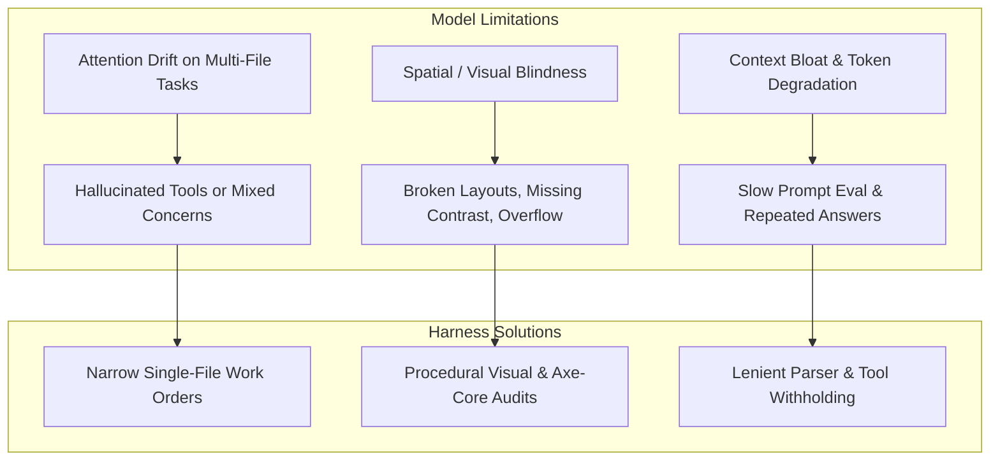
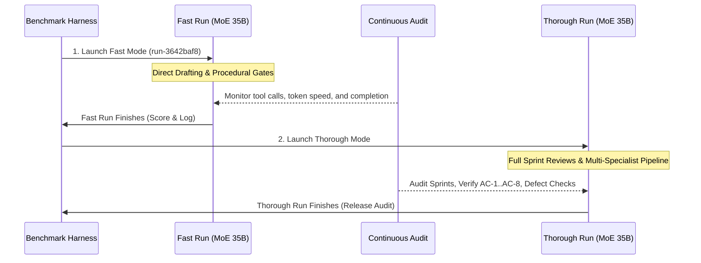

# Harness Improvement Plan: High-Quality Product Delivery with Local & MoE Models

**Target Architecture:** LangGraph / Deep Agents Benchmark Harness  
**Current Benchmark:** Low Brief (`tests/brief_low.md`) across Fast Mode (`DELIVERY=fast`) & Thorough Mode (`DELIVERY=thorough`)  
**Active Model:** `unsloth/Qwen3.6-35B-A3B-MTP-GGUF` (Local MoE via port 8888, `FRONTIER=false`)  
**Date:** 2026-10-17  

---

## 1. Executive Summary & Objective

The objective of this plan is to **systematically elevate the quality, visual polish, and engineering reliability of generated software products when running on local, quantized, and Mixture-of-Experts (MoE) models**.

Recent benchmark runs have established two critical baselines:
1. **Model Capability vs. Quality**: Large cloud/frontier models (e.g., `openai/gpt-oss-20b` in `run-5aadbddd`) completed in ~80 minutes with high natural semantic reasoning, but wrote plain inline CSS without modern modular structure. Smaller local models (such as `qwen3.8-flash-next-coder-iq1_m` in `run-866e972e` and `run-7bcdda40`) achieved cleaner separation of concerns (`styles.css`, responsive CSS variables, 24/24 unit test passing, 100% acceptance criteria), but faced higher token generation latency and required tight guardrails against runaway tool loops.
2. **Hidden Test Benchmark Gap**: `run-866e972e` achieved a 100% pass rate on all criteria defined in `tests/brief_low.md`, yet scored 5/10 on the hidden `web-todo` benchmark due to implicit UI expectations (checkbox `getByLabel('Done')`, filter buttons vs. select dropdown) that were present in `benchmarks/web-todo/brief.md` but omitted in `brief_low.md`.

By upgrading the harness to supply **deterministic design systems, procedural visual audits, strict contract extraction, and narrow specialist scopes**, lower and MoE models can consistently produce production-grade applications that match or exceed frontier model outputs.

---

## 2. Core Failure Modes on Smaller & MoE Models

To design effective technology-agnostic fixes, we categorize the observed failure modes of lower models:



1. **Spatial Blindness**: Language models cannot perceive CSS rendering directly; they frequently produce overlapping flex items, missing focus states, and horizontal scrollbars unless given machine-verifiable layout metrics.
2. **Contract Under-Specification**: When a brief leaves UI controls implicit (e.g. "filter by status"), smaller models select accessible HTML defaults (e.g. `<select>`), which diverge from strict acceptance suites expecting `<button>` elements.
3. **Runaway Unoffered Tool Loops**: Read-only agents often attempt file modifications with varying arguments when frustrated by missing code context.
4. **Syntax & Method Deprecations**: Smaller models frequently interchange assertions (e.g., Node.js `assert.doesNotMatch` vs Chai `assert.notMatch`), burning model calls on syntax fixes.

---

## 3. Technology-Agnostic Harness Improvement Initiatives

### Initiative A: Procedural Design System & Token Seeding (`stacks/packs` & `seed.py`)
- **Concept**: Never force a small model to invent a design system from an empty CSS file.
- **Harness Mechanism**:
  - In `src/app/stacks/packs/_javascript.py` and `src/app/plugins/seed.py`, embed high-quality baseline CSS custom properties in the project scaffold:
    ```css
    :root {
      --font-sans: system-ui, -apple-system, 'Segoe UI', Roboto, sans-serif;
      --color-bg: #f8fafc;
      --color-surface: #ffffff;
      --color-text: #0f172a;
      --color-text-muted: #64748b;
      --color-primary: #2563eb;
      --color-primary-hover: #1d4ed8;
      --color-border: #e2e8f0;
      --radius: 0.5rem;
      --shadow-sm: 0 1px 2px 0 rgb(0 0 0 / 0.05);
      --shadow-md: 0 4px 6px -1px rgb(0 0 0 / 0.1);
    }
    ```
  - Provide modern CSS reset defaults and accessible focus indicators (`:focus-visible`).
- **Impact**: Specialists immediately write beautiful, accessible layouts adhering to modern design standards without wasting context tokens.

### Initiative B: Procedural Visual & Layout Audits (`page_view.py`)
- **Concept**: Ground the UI specialist with concrete layout measurements instead of raw HTML strings.
- **Harness Mechanism**:
  - Automatically invoke `look_at_page` following UI specialist file modifications.
  - Compute layout boundaries via Playwright:
    - Check if `document.documentElement.scrollWidth > window.innerWidth` (flags mobile horizontal overflow).
    - Detect whether clickable targets are smaller than 44x44px.
    - Check for missing `aria-label` or `<label>` associations.
  - Return these computed diagnostics directly into the model's next turn prompt as a feedback notice.

### Initiative C: Contract-Strict Interface Extraction in Specification
- **Concept**: Ensure the architect and technical lead explicitly define UI element selectors, labels, and roles during specification before code generation begins.
- **Harness Mechanism**:
  - In `src/app/agents/principal_architect.py`, ensure `TechnicalSpecificationOutput` requires an explicit `ui_contract` listing every interactive element:
    - Target element tag (e.g. `button`, `input[type="checkbox"]`, `select`).
    - Exact accessible label (`aria-label`, `<label>`, or inner text).
    - Expected ID or data attribute.
- **Impact**: Eliminates test mismatches (like the 5/10 hidden score) by ensuring implementation specialists and acceptance authors share the exact same DOM contract.

### Initiative D: Pre-Execution Linter and Assertion Normalizer Gate
- **Concept**: Catch syntax and assertion errors before launching heavy container runners.
- **Harness Mechanism**:
  - In `src/app/tools/sandbox.py`, run a fast AST/linter check on modified test files.
  - Automatically detect and correct deprecated or mismatched assertion calls (e.g., mapping `assert.notMatch` $\to$ `assert.doesNotMatch` in `node:test`).
  - Provide instant error feedback when invalid syntax is detected without spending test round timeouts.

### Initiative E: Narrow, Single-File Work Orders
- **Concept**: Limit the cognitive load on smaller models by restricting work order tasks to single files.
- **Harness Mechanism**:
  - In `src/app/graph/planned_work.py` and `technical_lead.py`, enforce that a single work order modifies at most one core product file (`app.js`, `index.html`, or `styles.css`) and its paired test.
  - Keep prompt sizes under 4,000 tokens during specialist execution.

---

## 4. Execution & Benchmark Verification Roadmap



### Phase 1: Fast Run Monitoring (`run-3642baf8-34f7-492d-8667-b64a897b1fd7`)
- **Configuration**: `DELIVERY=fast`, `local_only=true`, Model `unsloth/Qwen3.6-35B-A3B-MTP-GGUF`.
- **Key Metrics to Track**:
  - Generation speed (tokens/sec) on MoE architecture.
  - Quality of drafted HTML/JS/CSS.
  - Hidden benchmark score on completion (`loop.sh score`).
- **Action**: When `run-3642baf8` completes, log full scorecard and audit.

### Phase 2: Thorough Mode Verification
- **Configuration**: `DELIVERY=thorough`, `local_only=true`, Model `unsloth/Qwen3.6-35B-A3B-MTP-GGUF`.
- **Execution**: Run `scripts/loop/loop.sh start tests/brief_low.md` with `DELIVERY=thorough`.
- **Focus**:
  - Verify multi-specialist collaboration on MoE model.
  - Confirm Sprint 1 and Sprint 2 pass cleanly without manual interventions.
  - Compare Thorough Mode product architecture against Fast Mode output.

### Phase 3: Transition to Medium Brief
- Once Low Brief passes cleanly in both Fast and Thorough modes on the MoE model, advance the standing benchmark loop to **`tests/brief_medium.md`**.

