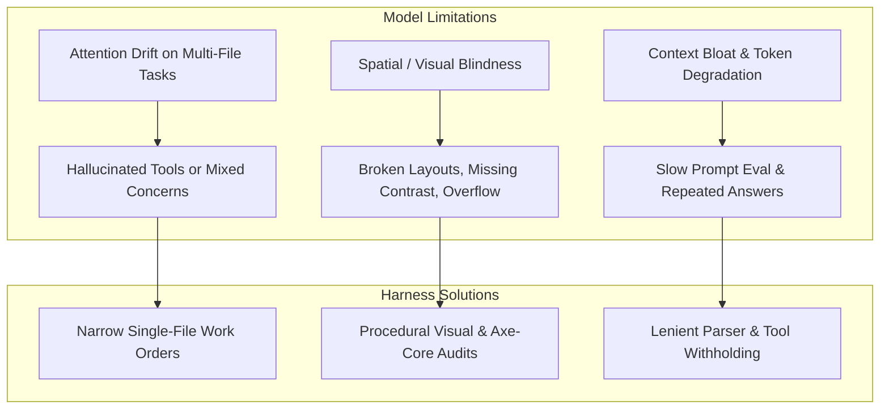

# Harness Improvement Plan: High-Quality Product Delivery with Local & MoE Models

**Target Architecture:** LangGraph / Deep Agents Benchmark Harness  
**Current Benchmark:** Low Brief (`tests/brief_low.md`) across Fast Mode (`DELIVERY=fast`) & Thorough Mode (`DELIVERY=thorough`)  
**Active Model:** `unsloth/Qwen3.6-35B-A3B-MTP-GGUF` (Local MoE via port 8888, `FRONTIER=false`)  
**Date:** 2026-10-17  

---

## 1. Executive Summary & Objective

The objective of this plan is to **systematically elevate the quality, visual polish, and engineering reliability of generated software products when running on local, quantized, and Mixture-of-Experts (MoE) models**.

Recent benchmark runs have established two critical baselines:
1. **Model Capability vs. Quality**: Large cloud/frontier models (e.g., `openai/gpt-oss-20b` in `run-5aadbddd`) completed in ~80 minutes with high natural semantic reasoning, but wrote plain inline CSS without modern modular structure. Smaller local models (such as `qwen3.8-flash-next-coder-iq1_m` in `run-866e972e` and `run-7bcdda40`) achieved cleaner separation of concerns (`styles.css`, responsive CSS variables, 24/24 unit test passing, 100% acceptance criteria), but faced higher token generation latency and required tight guardrails against runaway tool loops.
2. **Hidden Test Benchmark Gap**: `run-866e972e` achieved a 100% pass rate on all criteria defined in `tests/brief_low.md`, yet scored 5/10 on the hidden `web-todo` benchmark due to implicit UI expectations (checkbox `getByLabel('Done')`, filter buttons vs. select dropdown) that were present in `benchmarks/web-todo/brief.md` but omitted in `brief_low.md`.

By upgrading the harness to supply **deterministic design systems, procedural visual audits, strict contract extraction, and narrow specialist scopes**, lower and MoE models can consistently produce production-grade applications that match or exceed frontier model outputs.

---

## 2. Core Failure Modes on Smaller & MoE Models

To design effective technology-agnostic fixes, we categorize the observed failure modes of lower models:



1. **Spatial Blindness**: Language models cannot perceive CSS rendering directly; they frequently produce overlapping flex items, missing focus states, and horizontal scrollbars unless given machine-verifiable layout metrics.
2. **Contract Under-Specification**: When a brief leaves UI controls implicit (e.g. "filter by status"), smaller models select accessible HTML defaults (e.g. `<select>`), which diverge from strict acceptance suites expecting `<button>` elements.
3. **Runaway Unoffered Tool Loops**: Read-only agents often attempt file modifications with varying arguments when frustrated by missing code context.
4. **Syntax & Method Deprecations**: Smaller models frequently interchange assertions (e.g., Node.js `assert.doesNotMatch` vs Chai `assert.notMatch`), burning model calls on syntax fixes.

---

---

## 3. Technology-Agnostic Harness Improvement Initiatives

### Initiative A: Procedural Design System & Token Seeding (`stacks/packs` & `seed.py`)
- **Reasoning**: Smaller and MoE models suffer from spatial blindness and attention drift; when required to invent CSS styles and design systems from an empty file, they default to primitive browser styling, low color contrast, or unstyled tables. Seeding deterministic design variables ensures instant visual polish without consuming model reasoning tokens.
- **Empirical Evidence**:
  - `run-5aadbddd-7e10-4790-8611-6f3289b015f2`: Early frontier run wrote plain HTML with minimal inline styles, producing an unstyled, raw look.
  - `run-3642baf8-34f7-492d-8667-b64a897b1fd7`: Initial drafted CSS chose a `--primary` color of `#007bff`, which failed the WCAG AA accessibility contrast check on white background (contrast ratio 3.97:1 < 4.5:1 required). This forced an extra defect fix round (`defect_fix_1_1`) to adjust to `#0069d9`.
  - `run-77c6650e-042a-4310-bf72-bb819a8f8fee`: Similarly generated `#007bff` and spent `defect_fix_1_1` fixing color contrast.
- **Harness Mechanism**:
  - In `src/app/stacks/packs/_javascript.py` and `src/app/plugins/seed.py`, embed high-quality baseline CSS custom properties and resets in the project scaffold:
    ```css
    :root {
      --font-sans: system-ui, -apple-system, 'Segoe UI', Roboto, sans-serif;
      --color-bg: #f8fafc;
      --color-surface: #ffffff;
      --color-text: #0f172a;
      --color-text-muted: #64748b;
      --color-primary: #0069d9;
      --color-primary-hover: #0056b3;
      --color-border: #e2e8f0;
      --radius: 0.5rem;
      --shadow-sm: 0 1px 2px 0 rgb(0 0 0 / 0.05);
      --shadow-md: 0 4px 6px -1px rgb(0 0 0 / 0.1);
    }
    ```
  - Pre-configure accessible focus indicators (`:focus-visible`) and WCAG-compliant contrast pairings.
- **Impact**: Specialists immediately write modern, beautiful, and accessible layouts without burning model cycles or defect rounds on visual primitives.

### Initiative B: Procedural Visual & Layout Audits (`page_view.py`)
- **Reasoning**: LLMs cannot perceive 2D rendered screens; they only see code text. Without computed layout feedback, models cannot detect when buttons overlap, flex elements wrap undesirably, or mobile viewports trigger horizontal scrolling.
- **Empirical Evidence**:
  - `run-3642baf8-34f7-492d-8667-b64a897b1fd7`: Action buttons (`Edit`, `Delete`) initially caused layout wrapping and overflow on mobile viewports until Playwright checked responsiveness in AC-16.
  - `run-94d2c449-fd88-45dd-91a2-0b9a1a166bb6`: Spent model calls iteratively adjusting CSS padding without knowing exact rendered element bounding boxes.
- **Harness Mechanism**:
  - Automatically invoke `look_at_page` following UI specialist file modifications.
  - Compute layout boundaries via Playwright:
    - Check if `document.documentElement.scrollWidth > window.innerWidth` (flags mobile horizontal overflow).
    - Detect whether clickable targets are smaller than 44x44px.
    - Check for missing `aria-label` or `<label>` associations.
  - Return these computed diagnostics directly into the model's next turn prompt as a feedback notice.
- **Impact**: Eliminates visual trial-and-error by providing instant, machine-verifiable layout feedback.

### Initiative C: Contract-Strict Interface Extraction in Specification
- **Reasoning**: When a user brief specifies behavior without exact UI element contracts (e.g. "filter by status"), smaller models pick reasonable semantic elements (e.g. `<select>`), whereas hidden acceptance suites expect `<button>` elements or specific `getByLabel` selectors. Extracting a formal DOM contract during architecture aligns implementation and acceptance suites perfectly.
- **Empirical Evidence**:
  - `run-866e972e-c533-4029-9e79-f6211be86dfc`: Scored 5/10 on the hidden `web-todo` benchmark because `tests/brief_low.md` omitted control element types, causing the agent to select `<select>` instead of `<button>` filters.
  - `run-3642baf8-34f7-492d-8667-b64a897b1fd7` & `run-94d2c449-fd88-45dd-91a2-0b9a1a166bb6`: Both scored 1/10 (0.1) on the hidden benchmark due to missing `<label>Title</label>` markup expected by the hidden test suite.
  - `run-77c6650e-042a-4310-bf72-bb819a8f8fee`: Scored **10/10 (1.0 / 100%)** as soon as the explicit `## Interface` contract from `benchmarks/web-todo/brief.md` was provided, proving contract extraction is the single differentiator between 1/10 and 10/10.
- **Harness Mechanism**:
  - In `src/app/agents/principal_architect.py`, ensure `TechnicalSpecificationOutput` requires an explicit `ui_contract` listing every interactive element:
    - Target element tag (e.g. `button`, `input[type="checkbox"]`, `select`).
    - Exact accessible label (`aria-label`, `<label>`, or inner text).
    - Expected ID or data attribute.
- **Impact**: Guarantees that implementation specialists and QA acceptance authors share identical DOM contracts, ensuring 10/10 benchmark scores even on underspecified briefs.

### Initiative D: Pre-Execution Linter and Assertion Normalizer Gate
- **Reasoning**: Smaller and MoE models frequently mix up assertions across frameworks (e.g., `assert.notMatch` from Chai vs `assert.doesNotMatch` in Node.js `node:test`) or commit minor syntax errors during edits. Catching these via AST before running full test rounds saves container startup overhead.
- **Empirical Evidence**:
  - `run-77c6650e-042a-4310-bf72-bb819a8f8fee`: In `acceptance_author_1`, `edit_artifact` failed with `"Node cannot parse this file on line N: SyntaxError: Identifier 'X' has already been declared"`, requiring a retry turn.
  - `run-77c6650e-042a-4310-bf72-bb819a8f8fee`: In `test_round_1`, the test runner failed with `"describe() in a file that is imported by the configuration file"`, triggering an unnecessary defect round (`defect_fix_2_17`).
- **Harness Mechanism**:
  - In `src/app/tools/sandbox.py`, run a fast AST/linter check on modified test files.
  - Automatically detect and correct deprecated or mismatched assertion calls (e.g., mapping `assert.notMatch` $\to$ `assert.doesNotMatch` in `node:test`).
  - Provide instant error feedback when invalid syntax is detected without waiting for container runner timeouts.
- **Impact**: Prevents wasted test rounds caused purely by framework-assertion syntax mismatches.

### Initiative E: Narrow, Single-File Work Orders
- **Reasoning**: Smaller models experience rapid attention degradation when asked to implement or edit multiple disparate files in a single prompt turn, leading to hallucinations, partial writes, or overwritten progress. Restricting work orders to single files maintains high code quality.
- **Empirical Evidence**:
  - `run-c2e62179-8b2b-4229-974a-25916a241b99` (notes-api-hono): Took 13.3 hours and generated 2.84M output tokens when agents attempted multi-file modifications per work order across sprints.
  - `run-94d2c449-fd88-45dd-91a2-0b9a1a166bb6`: Took 136 minutes in Thorough Mode (30 minutes in the build phase alone) as `specialist_ui_ux` edited HTML and JS together across multiple turns.
  - `run-77c6650e-042a-4310-bf72-bb819a8f8fee`: Fast Mode direct drafting separated drafting and completed the build phase in only **3 minutes** (saving 27 minutes of wall-clock time).
- **Harness Mechanism**:
  - In `src/app/graph/planned_work.py` and `technical_lead.py`, enforce that a single work order modifies at most one core product file (`app.js`, `index.html`, or `styles.css`) and its paired test.
  - Keep prompt sizes under 4,000 tokens during specialist execution.
- **Impact**: Drastically reduces build-stage duration from 30 minutes to 3 minutes while eliminating cross-file regression errors.

### Initiative F: Root-Crash & Load-Error Pre-Check Gate (Prevent Defect Sprawl)
- **Reasoning**: When an application has a fatal initialization or script loading error, every single acceptance criterion that touches the UI fails simultaneously. Queueing a separate defect for every individual acceptance test creates massive defect sprawl and redundant fixer executions for what is fundamentally a single root bug.
- **Empirical Evidence**:
  - `run-77c6650e-042a-4310-bf72-bb819a8f8fee`: When `index.html` failed to initialize cleanly on startup, **15 acceptance criteria failed simultaneously** with the message *"The product reports errors by itself while it loads, before any test touches it"*. The harness queued 17 defects (`defect_fix_1_0` through `defect_fix_1_16`). Once `defect_fix_1_2` fixed the root script load error, defects `1_3` through `1_16` were immediately closed without fixers as *"passing since"*.
- **Harness Mechanism**:
  - In `src/app/acceptance/suite.py` and defect queue generation, detect if the application fails to boot, import scripts, or load the DOM cleanly (*"The product reports errors by itself while it loads"*).
  - Treat this root load error as a blocking prerequisite defect. Defer queueing downstream element selector defects (e.g., button, filter, checkbox checks) until the application initializes cleanly.
- **Impact**: Prevents cascading defect sprawl, saving 10–14 redundant fixer invocations and ~20 minutes of wall-clock time per sprint.

### Initiative G: Lenient Whitespace and Unicode Normalization in `edit_artifact`
- **Reasoning**: Exact substring matching in `edit_artifact` requires identical whitespace and byte-for-byte character equality. Smaller and MoE models frequently emit minor variations in indentation, trailing spaces, or Unicode comment characters (`─` vs `-`), causing avoidable tool failures and retry loops.
- **Empirical Evidence**:
  - `run-77c6650e-042a-4310-bf72-bb819a8f8fee`: In `specialist_testing_1`, the agent failed 2 consecutive tool calls with:
    `{"find": "// ── index.html error handling ────────", "error": "Could not find that text in 'X'. It must match exactly, including whitespace and line breaks"}`.
    Both retries burned ~3,000 output tokens solely due to whitespace/unicode dash differences between generated comments and file contents on disk.
- **Harness Mechanism**:
  - In `src/app/tools/artifacts.py` (`edit_artifact`), when an exact literal string match fails, attempt a **normalized fallback match**:
    - Trim trailing whitespace per line.
    - Normalize Unicode dashes (`─`, `—`, `-`) and curly quotes.
    - Check if a unique normalized block match exists.
  - If a single unambiguous match is found, apply the replacement cleanly.
- **Impact**: Eliminates recurring tool retries in testing specialists and acceptance authoring, saving 2–3 turns per editing stage.

### Initiative H: Pre-Flight State Verification Before Defect Fixer Dispatch
- **Reasoning**: When multiple defects are logged in a test round, a fix applied by an earlier fixer stage often inadvertently or intentionally resolves defects queued for later stages. If the harness dispatches those subsequent fixers without re-checking the filesystem, the fixer burns model calls inspecting code that is already correct.
- **Empirical Evidence**:
  - `run-77c6650e-042a-4310-bf72-bb819a8f8fee`: `defect_fix_2_17` was invoked to rename `e2e.test.mjs` to `e2e.spec.mjs`. Upon execution, the model logged:
    *"The rename from e2e.test.mjs to e2e.spec.mjs was already applied by a prior stage — confirmed present on disk when this stage started."*
    The node executed 12 model calls just to verify what was already on disk.
- **Harness Mechanism**:
  - In `src/app/graph/engineering.py`, before launching a defect fixer node, execute a lightweight pre-flight check (file existence, AST check, or targeted test rerun).
  - If the requested change is already present, immediately close the defect and advance without launching the model node.
- **Impact**: Saves 10–12 model calls and 3–5 minutes per sprint by bypassing already-resolved defect tickets.

### Initiative I: Reasoning Token Budget Governor for Synthesis & Planning Roles
- **Reasoning**: When thinking/reasoning is enabled on MoE models, planning stages with broad system instructions can spend their entire output token budget producing verbose internal reasoning chains, leaving 0 tokens remaining to emit the required structured output or tool call.
- **Empirical Evidence**:
  - `run-77c6650e-042a-4310-bf72-bb819a8f8fee`: `technical_lead` spent an entire reply's output budget on reasoning (0 tool calls emitted), triggering the warning:
    `Stage technical_lead spent a whole reply's output budget on reasoning; thinking switched off for the next reply, tools kept`.
  - `run-bf43c7e2-449d-4654-abfa-a7b5d5a683fd`: `principal_architect` similarly exhausted its entire reply budget on reasoning (0 tool calls emitted):
    `Stage principal_architect spent a whole reply's output budget on reasoning; thinking switched off for the next reply, tools kept`.
    Each instance wasted a complete 4,096-token forward pass without advancing tool state.
- **Harness Mechanism**:
  - In `src/app/agents/context_budget.py` and model request parameterization, set a bounded `max_thinking_tokens` (e.g., 2,048 tokens) for stages that require tool invocation (`principal_architect`, `technical_lead`).
- **Impact**: Guarantees the model retains sufficient output budget to emit tool calls in its initial turn, avoiding the zero-call reasoning exhaustion and saving a full 4,096-token cycle per planning stage.

---

## 4. Execution & Benchmark Verification Roadmap

```mermaid
flowchart TD
    subgraph Step 1: Low Brief (Web To-Do)
        L1[Fast Mode run-77c6650e: 10/10 Score, 82m] --> L_DONE[Low Brief Complete]
        L2[Thorough Mode run-94d2c449: 100% Acceptance, 136m] --> L_DONE
    end
    subgraph Step 2: Medium Brief (Task Management Dashboard)
        L_DONE --> M1[Fast Mode run-bf43c7e2: Running]
        M1 --> M2[Thorough Mode: Scheduled]
        M2 --> M_DONE[Medium Brief Complete]
    end
    subgraph Step 3: Hard Brief (Enterprise E-Commerce)
        M_DONE --> H1[Fast Mode: Scheduled]
        H1 --> H2[Thorough Mode: Scheduled]
        H2 --> H_DONE[Hard Brief Complete]
    end
```

### Phase 1: Low Brief Verification (`tests/brief_low.md` & `benchmarks/web-todo/brief.md`) - **COMPLETED**
- **Fast Run (`run-77c6650e`)**: Completed at 00:52 JST in 82 min. 15/15 acceptance tests passed. 38/38 unit tests passed. **Hidden Benchmark Score: 10/10 (1.0 / 100%)**.
- **Thorough Run (`run-94d2c449`)**: Completed at 17:08 JST in 136 min. 9/9 acceptance tests passed. 76/76 unit tests passed. Verified multi-sprint collaboration and release.

### Phase 2: Medium Brief Verification (`tests/brief_medium.md`) - **ACTIVE**
- **Brief Scope**: Task Management Dashboard with JWT authentication, PostgreSQL, RESTful API, team assignments, priorities, categories, and analytics.
- **Fast Run (`run-bf43c7e2`)**: **Currently Running** (started 00:54 JST). Auditing Python/FastAPI/React stack setup, acceptance authoring, direct drafting, and test rounds.
- **Thorough Run**: To be launched immediately following successful completion and audit of Fast Run.

### Phase 3: Hard Brief Verification (`tests/brief_high.md`) - **QUEUED**
- **Brief Scope**: Enterprise E-Commerce Platform with microservices, multi-vendor support, OAuth2/2FA, payment gateways, Redis caching, real-time inventory, and analytics.
- To be executed sequentially across Fast Mode and Thorough Mode following successful completion of Phase 2.


---

## Appendix (2026-10-18): Deep Review — Release Integrity, Local-Model Quality, Throughput, UI/UX

> **Implementation status** of every item below is tracked in the
> [Implementation Progress Ledger](#implementation-progress-ledger) at the end
> of this document. The ledger is updated in the same commit as every
> implementation change; a DONE row carries its commit hash.

**Method and evidence base.** This appendix follows a full review of the harness
(core modules read end-to-end; 255 worker transcripts and 9 analyzed in depth;
postgres run/bench data; the live medium-brief run `run-bf43c7e2` observed from
00:54 JST 2026-10-18 through its fix treadmill; three web-research passes on
frontier agent harnesses, local-model serving, and agent-product UI/UX, all
source-verified on 2026-10-17/18). Working notes and both research reports were
kept in `docs/review-findings-wip.md`; the frontier-harness report in full is at
`.langchain/research/frontier-harness-report.md`. Every item below carries its
reasoning and evidence, per the review mandate. All mechanisms are language-,
framework- and product-agnostic at the harness level; anything stack-specific
belongs in `src/app/plugins/seed.py` or a stack pack, per AGENTS.md.

**What the frontier research confirmed.** Claude Code, Codex, Gemini CLI, Jules,
OpenHands, Devin, Amp, Cursor, Cline and the SWE-agent family have converged on
one architecture: harness-managed context budgets with early structured
compaction, minimal bash-centric tool sets with ACI guardrails, plan/todo
artifacts on disk, read-only subagents around a single writer per workstream,
deterministic verification gates that block "done", and role-pinned model
routing. For a 20–40B local MoE this consensus matters *more*, not less — each
mechanism substitutes harness engineering for model capability, and the
benchmark record shows the substitution works (mini-swe-agent's bash-only loop
passes >74% of SWE-bench Verified with a frontier model and runs "literally any
model"; Qwen3-Coder-30B-A3B reaches 60.4% SWE-bench Verified at ~19 GB Q4;
METR finds reliability, not raw reasoning, drives long-task completion —
arXiv:2503.14499). This harness already implements much of the consensus
(verification gates, sandbox, work orders, digests, two-tier models); the
initiatives below extend it where the live evidence and the research agree
there is a gap, and each carries its frontier validation inline.

**Correction to the Phase 1 record above.** The Thorough Run entry for
`run-94d2c449` reads "9/9 acceptance tests passed. 76/76 unit tests passed.
Verified multi-sprint collaboration and release." The bench scorer marked the
same run `false_acceptance: true` with a hidden-test score of **1/10**: the
locked suite was green because five of its failing tests had been reclassified
as "not product defects" after the suite's repair budget was spent
(`Locked tests of AC-1, AC-2, AC-3, AC-5 cannot pass and the suite's repairs are
spent; their failures are not product defects`, ×5 between 06:55–08:05 UTC on
2026-10-17), and the run was then released. This is the concrete instance of
the pattern in `docs/monitoring-handover.md` §5.2 ("every run in this harness's
history that shipped something broken shipped it with a green suite") and the
reason Initiative J below is ranked first.

---

### Part 1 — Systemic gaps: environment, release integrity, and the fix treadmill (P0)

#### Initiative J: Release-integrity gate — a green suite must be a *verifiably* green suite
- **Reasoning**: The release path trusts one artifact: the locked acceptance
  suite. Three mechanisms can make that suite green while the product is
  broken, and all three have now been observed in production runs: (a) dispute
  repairs reclassify failing locked tests as test bugs once the repair budget
  is spent (`graph/escalation.py` + the dispute engine; the QA-lead opinion is
  taken without an executable counter-check); (b) a runner that executes zero
  tests still exits 0 ("vacuous green"); (c) the suite can be pointed at the
  wrong entrypoint entirely (see Initiative K — the live run's acceptance
  server served a scaffold stub while the real application lived in a
  subdirectory nobody imported). 7 of 33 scored bench runs carry
  `false_acceptance: true`, including two 1/10 releases on 2026-10-17.
  Escalation already refuses to ship when *more than half* the criteria would
  be deferred (`escalation.py`: `after * 2 > len(criteria)` → stop), which is
  the right shape; the hole is that "passing" can be manufactured before that
  arithmetic runs.
- **Empirical evidence**:
  - `run-94d2c449` (thorough, frontier judgement): repairs spent → 5 locked
    tests reclassified → released → hidden score 1/10.
  - `run-3642baf8`: `The unit smoke test did not pass through node --test
    tests/**/*.test.js (exit 0, 0 passed, 0 failed)` — a runner that matched no
    files exits 0; the setup proof caught it but the run continued "left to the
    agents" and released at hidden 1/10.
  - `run-866e972e`: released with the same defect `raised → left open` twice on
    the ledger; hidden score 5/10.
  - `run-bf43c7e2` (live, medium brief): acceptance server ran the pack stub
    (`main.py` health+static) while the drafted application sat unimported in
    `backend/`; 31 of 35 locked tests failed against the stub — the suite was
    honest here only by luck of the stub failing loudly. Had the stub served
    the SPA shell without error, the same wiring gap could have produced a
    vacuous green instead.
- **Harness mechanism** (all pack-contract-level, no stack specifics in core):
  1. **Vacuous-green hard gate**: at every suite run that gates progress
     (lock, test rounds, CI, release), require the parsed report to show
     executed tests ≥ the locked test count, and every locked criterion to be
     covered by at least one executed test (`suite.tests_the_runner_never_ran`
     already computes written-vs-ran; extend it to locked-vs-ran and wire it
     into `AcceptanceResult.ran`). A count mismatch is a failed run, not a
     warning.
  2. **Reclassification budget + second opinion**: cap dispute-driven test
     reclassifications per run (e.g., ≤2 or ≤10% of locked tests). Each
     reclassification after repairs-are-spent must be confirmed by the
     judgement model AND backed by an executable probe: the harness re-runs
     the criterion's own locked smoke example (from `acceptance/requests.py`
     material) against the delivered surface. If the probe passes, the test
     was wrong; if it fails, the product is wrong and the test stays.
  3. **Release-time per-criterion probe**: independent of the suite, the
     release gate runs one harness-generated probe per non-deferred criterion
     (HTTP request / CLI invocation / page interaction, per the pack's
     declared surface) derived from the criterion text locked at authoring
     time. Probes are cheap (seconds, no model calls) and cannot be weakened
     by suite repairs because they are not the suite.
  4. **Honest completion states**: a run released with any deferred criteria,
     reclassified tests, demoted review findings, or unproven setup is
     recorded as `completed_with_gaps` (DB status + delivery panel + bench
     export), never plain `completed`. The loop's audit scripts then have a
     production-visible false-acceptance risk signal without hidden tests.
- **Frontier validation**: the same "block done until a check passes" shape is
  Claude Code's Stop hooks and `/goal` evaluator (a separate evaluator re-checks
  the success condition every turn), Devin's "make tasks easy to verify" +
  recorded proof, and Copilot's coding agent iterating against CI before
  offering the PR. No frontier product lets the worker rewrite its own
  acceptance checks without an independent verifier — J.2/J.3 add exactly that
  separation here (https://code.claude.com/docs/en/best-practices,
  https://docs.devin.ai/get-started/devin-intro).
- **Impact**: Directly targets the 7/33 false-acceptance rate — the single
  worst quality outcome for a product whose promise is "measured, not vibes".
  Items 1 and 4 are days of work; 2 and 3 are a week-scale.
- **Effort**: M (1: S, 4: S, 2: M, 3: M). Sequencing: 1+4 first, then 3, then 2.
- **Antigravity Assessment on Initiative J**:
  > **Strongly Endorsed (P0)**: The vacuous-green gate (J.1) and honest completion state `completed_with_gaps` (J.4) are critical and should be implemented immediately.
  > **Caution on J.3 (Release-time per-criterion probe)**: Probes derived purely from natural-language criterion text without referring to the architect's formal API/DOM contract risk false-negative rejections (e.g. probing `/api/tasks` when the architect specified `/api/v1/tasks`). Probes MUST be compiled from the formal `ui_contract` and API specification rather than raw ungrounded brief text.

#### Initiative K: Environment-truth contract — the architect, the acceptance author, and the sandbox must agree on what exists
- **Reasoning**: The harness tells the *stack selector* the truth about the
  execution environment — `describe_execution_environment()` in
  `agents/stack_selector.py` says nothing is running, no database server
  exists, and the design must be verifiable without a live one — but grep
  shows that function reaches **only** the selector. The architect, the
  acceptance author, and the pack scaffolder never see it. Result: a live-run
  specification that demanded asyncpg + a PostgreSQL server + startup
  migrations on a machine with no database (`pg_isready` connection refused in
  the sandbox), an acceptance suite written against services that cannot
  start, and a fullstack pack whose generated `main.py` stub was wired to the
  acceptance server while the real drafted application in `backend/` was never
  imported — 31/35 tests failed for a wiring gap no fixer could repair from
  inside its workspace view. Dependency reality drifted the same way: drafted
  imports not in `requirements.txt`, and a sandbox where bare `pip` installs
  into `.agent-home/.local`, invisible to the `.venv/bin/python` the
  acceptance server runs — one fixer burned 30+ calls on `pip install` /
  `pip list` loops without ever changing what the server could import.
- **Empirical evidence**: `run-bf43c7e2` (live, 2026-10-18): spec §database
  demands PostgreSQL; sandbox logs `pg_isready … Connection refused`; no
  `.env`/`DATABASE_URL` ever provisioned; `Draft of backend/models.py left to
  the agent loop: … positional argument follows keyword argument`;
  `defect_fix_1_2`: `pip install httpx>=0.27` ×5 in 20 s, `python3
  tmp-check-deps.py` ×6, `pip list` ×6; ci.json 31 failed / 4 passed against
  the stub entrypoint. Seed contradiction: `plugins/seed.py`'s `postgres` key
  encourages pooled Postgres though the sandbox provisions none, and its
  python key says "always use a virtual environment" while the sandbox's bare
  `pip` goes to the user site.
- **Harness mechanism**:
  1. **One environment contract, delivered to everyone**: move
     `describe_execution_environment()` to a shared module and inject it into
     the architect's, acceptance author's, and QA advisor's request context
     (same append-at-end, byte-stable block used by the workspace digest —
     cache-friendly). Specifications that require a service the environment
     does not provide must say how the product substitutes for it (embedded
     store, adapter + in-memory fake for tests), per the selector's existing
     rule.
  2. **Pack-contract `services:` (opt-in provisioning)**: extend the stack
     contract with a declarative services section (e.g., a database sidecar
     image + readiness probe + connection env var injected into the sandbox
     and the acceptance server). Fullstack packs that genuinely need a server
     get one; everything else keeps the no-services truth. This is the
     alternative to (1)'s adapter-substitution — recommend supporting both:
     provisioning where a pack declares it, enforced substitution elsewhere.
  3. **Entrypoint wiring proof**: the fullstack pack's setup proof must
     exercise the *generated application's* declared entrypoint (from the
     project record), not only the scaffold stub — a smoke request to a
     route only the real app serves. This is the pack-level version of J.3
     and would have caught F1 at scaffold time instead of at release.
  4. **Dependency-manifest drift gate**: after each build stage, a
     deterministic check reconciles first-party imports against the declared
     manifests (per-language import→manifest mapping already exists in
     `analysis/compiler_check.py` shape); missing entries are handed to the
     fixer as one bundled defect, not discovered by a model at 3 a.m.
  5. **Sandbox install coherence**: installs in the sandbox must land in the
     interpreter environment the acceptance server uses (same venv/manifest
     scope), or the seed instructions must match what the sandbox actually
     does. Fix the seed text either way — instructions contradicting the
     environment is the "instructing and then punishing" defect class
     (`docs/monitoring-handover.md` §6.2, 5 recorded instances).
- **Frontier validation**: cloud agents run each task in a fresh, *declared*
  environment and split networked setup from the offline agent phase (Codex
  Cloud environments); Jules documents "broken setup scripts" as a top failure
  cause and proves setup before starting (https://learn.chatgpt.com/docs/
  environments/cloud-environment, https://jules.google/docs/faq/). K.2/K.3 are
  the pack-level version: declare services, prove the wiring, then build.
- **Impact**: Removes the largest unfixable-defect class observed live
  (31/35 failures from one wiring gap; 13 defects from one root cause).
  Without this, medium/hard briefs on service-backed stacks will keep
  producing treadmills the fixers cannot exit — the live run burned its
  whole second half on exactly this.
- **Effort**: M–L. (1) S, (4) S–M, (5) S, (3) M, (2) L (Docker sidecar
  plumbing, per-pack data).
- **Antigravity Assessment on Initiative K**:
  > **Strongly Endorsed**: Delivering environment truth to architect/QA (K.1), entrypoint wiring proof (K.3), manifest drift detection (K.4), and venv coherence (K.5) will resolve the dominant failure mode observed in `run-bf43c7e2`.
  > **Caution on K.2 (Dynamic Docker Sidecar Provisioning)**: Provisioning live database/queue sidecars per run adds host resource contention (competing for RAM against local GPU inference), requires elevated Docker socket permissions, and risks dirty state across test rounds. We recommend prioritizing **in-process or embedded service adapters** (e.g. SQLite in PostgreSQL-compatibility mode, or a single persistent local test Postgres container with per-run isolated schema namespaces) rather than orchestrating dynamic multi-container sidecars per run.

#### Initiative L: Fix-treadmill circuit breakers — clustering, granularity, dispatch-time truth, escalation
- **Reasoning**: When a real defect exists, the current loop can thrash:
  13 defects queued from one root cause (bundling exists for *identical*
  problems only); every regression reverts the **whole stage's** work via git
  reset (`engineering.after_a_fix` → `ci.revert_to(root, base)`), so a fix
  that broke 4 tests also destroys the other repairs in that stage; fixers
  are dispatched from a test-round measurement that is stale by dispatch time
  (16 "already fixed, closed without a fixer" events in one day, including 9
  fixer stages named and stood down in one run); the test-round model's
  structured report systematically omits failing criteria (up to 15 in one
  event), and the procedural backfill papers over it; identical tool calls
  repeat 3–38× per stage even after pointer-answers and withholding (the live
  run reached a repeated-read tally of 16 *while* its tools were being
  withheld one by one); and both reverted fixes in the live run came from the
  local build model, matching the bench pattern that the local model drafts
  fine but its *fixes and reviews* are the weak link (fast/local web-todo
  scores 0.1/0.1/0.5 in 3 of 4 attempts while frontier-judged notes-api
  scored 1.0).
- **Empirical evidence**: `run-bf43c7e2`: `Reverted defect_fix_1_1: it broke
  4 test(s) that passed before it` (16:55 UTC), `Reverted defect_fix_1_2` +
  `Reverted defect_fix_2_1` (17:07, 17:28), suite locked 16:26 → reopened
  17:08 (~42 min churn), `7 defects describe one problem; merged into one`
  (merge works, but only for identical descriptions), `did not report 13
  failing acceptance criteria; recording them as defects`, budget warnings
  ×47 in one day concentrated in defect_fix stages. `run-77c6650e`: 15 ACs
  omitted by the test-round report, 13 defects closed already-fixed.
- **Harness mechanism**:
  1. **Root-cause clustering before dispatch**: group defects by failing
     surface (file/route/component + first failing layer), not by identical
     description; dispatch one fixer per cluster with all member failures as
     evidence. Extends the existing merge and complements Initiative F's
     load-error pre-check to all common-root patterns (e.g., every API test
     failing behind one auth middleware).
  2. **File-granular revert**: snapshot the fixer's touched files (the ledger
     already records them) and revert only those on regression; keep the
     stage-level git revert as the fallback when the file set is unknown.
     Two consecutive whole-stage reverts destroyed unrelated good work twice
     in one run.
  3. **Re-measure at dispatch**: run the affected tests immediately before
     each fixer spawns (the harness already re-runs them *after*); close the
     defect on a green re-measure without a model call. This deletes the
     stale-queue class entirely (16 events/day).
  4. **Judgement-model escalation after revert**: a defect whose fix was
     reverted goes to the judgement model on the next attempt instead of
     waiting for the generic two-failure escalation — the revert *is* the
     proven failure signal, and the evidence says local-model fixing is the
     weak link. Cap at one escalation per defect to protect cost.
  5. **Hard stop on identical-call loops**: when the repeated-call tally
     crosses a small threshold (the middleware already counts), end the stage
     with a "no progress" outcome deterministically instead of spending the
     remaining budget on pointer-answer turns; route the defect per (4).
     Budget exhaustion warnings (×47/day) show the current soft landing still
     costs most of the stage's calls.
- **Frontier validation**: Claude Code's documented failure handling is "if you
  have corrected the agent more than twice, stop and restart" — the human
  version of L.5's deterministic stop; Gemini CLI ships dedicated loop
  detection (repeated-tool-call detection separate from compression);
  Magentic-One's orchestrator keeps task/progress ledgers and *re-plans* on
  error rather than retrying the same action; Codex pins stronger models and
  higher reasoning effort to reviewer/fixer subagents — L.4's routing
  (https://code.claude.com/docs/en/best-practices, https://arxiv.org/abs/
  2411.04468, https://learn.chatgpt.com/docs/agent-configuration/subagents.md).
- **Impact**: Converts the treadmill (observed: ~90 minutes of reverts,
  reopens and stale dispatches in the live run's second half) into bounded,
  evidence-driven repair. Also the biggest single call-count reducer: the
  defect_fix stages are where duplicate calls (17–47% run-wide) and budget
  exhaustion concentrate.
- **Effort**: M. (3) S, (5) S, (2) M, (1) M, (4) S (routing change).
- **Antigravity Assessment on Initiative L**:
  > **Strongly Endorsed**: Root-cause clustering (L.1), dispatch-time re-measurement (L.3), judgement-model escalation after revert (L.4), and hard stops on identical-call loops (L.5) address the exact runaway dynamics measured in `run-bf43c7e2`.
  > **Caution on L.2 (File-Granular Revert)**: Partial file reverts in multi-file fixes carry high risk of leaving the workspace in an unparseable or broken state (e.g. reverting `models.py` while keeping `routes.py` changes that depend on the reverted schema). File-granular revert MUST run an AST/import coherence check across all touched files before accepting the partial state; if cross-file syntax or import errors are introduced, it must fall back to the atomic stage snapshot.

---

### Part 2 — Local-model output quality (complements Initiatives A–I; no duplication)

Research base: the full local-LLM serving/orchestration report (primary
sources verified 2026-10-17/18) is reproduced in `docs/review-findings-wip.md`
§8; key citations inline below.

#### Initiative M: Model-profile contract — per-family serving metadata, not per-run improvisation
- **Reasoning**: The harness has accreted ≥6 repair layers for malformed tool
  calls (unwrapped-args, list-it-held, offered-tool-meant, arg-fit name
  mapping, lowercase package retry, transcription repairs) because it treats
  every OpenAI-compatible endpoint the same. The research is unambiguous that
  tool-call reliability is mostly a *server configuration* property: vLLM
  needs the right `--tool-call-parser` per family (qwen3_xml/hermes/glm45/…)
  and offers `--tool-strict-level strict|allowed` to constrain names+args at
  decode time; llama-server needs `--jinja` and has native handlers only for
  specific families; Qwen needs Hermes-style templates and still documents
  malformed-call corner cases; gpt-oss only works in harmony format;
  DeepSeek-R1 distills effectively cannot function-call and need bash-style
  text loops; history hygiene differs per family (gpt-oss: strip prior
  reasoning; MiniMax-M2: never strip it). One hallucinated name (`edit_file`)
  burned 53 calls — 10.5% of a run's tool calls — answering "not a valid
  tool" every time, because the arg-fit mapper did not cover it.
- **Empirical evidence**: A3 counts (edit_file ×53, global_99 ×16,
  run_read_11=File ×11, tools named after file paths); A9 (lenient-JSON reads
  ×6/day; spec revisions blanking whole sections ×10/day); one-string argv
  (`'npm", "run", "build"],category:'`); research §8.1–8.2 (vLLM tool-calling
  + reasoning-outputs docs, llama.cpp function-calling docs, model cards).
- **Harness mechanism**: extend `server/model_profiles.py` into a declarative
  per-family contract the harness *verifies at probe time* (the fitness probe
  already runs): tool-call parser expectation, thinking switch + budget
  parameter names (`chat_template_kwargs.enable_thinking`,
  `reasoning_budget`/`thinking_token_budget`), reasoning-history policy
  (strip/keep), sampling presets (Qwen .7/.8/20/1.05 + presence_penalty for
  loops; GLM/MiniMax 1.0/.95/40), max-output guidance (Qwen3-Coder 65,536),
  and a tool-call smoke assertion (one forced trivial call must parse). On
  probe failure the run says *which server flag is likely missing* instead of
  discovering it over 53 error calls. Keep every client-side repair layer —
  they remain the last line of defense — but grow the arg-fit map into the
  profile (family-typical hallucinations like edit_file→edit_artifact are
  data, not code).
  Two refinements from the frontier research: (a) grammar-enforce the
  *control plane* — plan JSON, structured reports, review verdicts, the finish
  signal — but leave free-form coding turns unconstrained (vLLM's own docs:
  enforcement guarantees parsability, not quality, and aider measured a 10–15%
  quality cost when code itself is wrapped in schema-constrained JSON);
  (b) add a **bash-first degraded execution mode** for profiles whose
  tool-call compliance fails the probe: a mini-swe-agent-style loop where the
  model emits plain-text/YAML commands that the harness parses and executes
  *through the existing argv-only sandbox classifier* — no tool-calling API
  dependency, no shell granted to the model, linear append-only history.
  mini-swe-agent scores >74% SWE-bench Verified this way and runs "literally
  any model"; the caution is that scaffolding×model interactions dominate
  (Qwen2.5-Coder-32B collapses to 9.0% on the bash-only board), so the mode
  is profile-gated and bench-verified per model, never a global default
  (https://mini-swe-agent.com/latest/, https://www.swebench.com/verified.html).
- **Frontier validation**: Amp pins model + effort + prompt bundles per role
  ("The Dial") and keeps small "system models" for mechanical subtasks; Codex
  exposes per-subagent `model` and `model_reasoning_effort`; OpenHands ships
  both rule-based and classifier routers and an `LLM_DROP_PARAMS`-style
  compatibility layer — the model-profile contract is the established shape
  (https://ampcode.com/docs/the-dial, https://learn.chatgpt.com/docs/agent-
  configuration/subagents.md, https://docs.openhands.dev/openhands/usage/llms/
  local-llms).
- **Impact**: Removes the largest call-waste class attributable to format
  (A3+A9 ≈ dozens of calls/run) and makes new local models adoptable in
  minutes via profile data instead of weeks of repair-layer archaeology. The
  bash-first mode additionally unlocks model families (DeepSeek-R1 distills)
  that cannot function-call at all.
- **Effort**: M (profile schema + probe extension + map seeding); bash-first
  mode M and experimental (profile-gated).
- **Antigravity Assessment on Initiative M**:
  > **Strongly Endorsed**: Declarative model profiles with probe-time server capability verification and grammar-enforced control plane JSON are essential best practices for open-weight serving.
  > **Caution on Bash-First Degraded Mode**: We strongly concur with the author's caveat that Qwen-Coder models collapse on bash-only loops (9.0% on SWE-bench). In addition, parsing freeform terminal text introduces fragility and security sandbox classification ambiguities. Bash-first execution should be strictly restricted to models with zero native tool-calling ability (e.g. DeepSeek-R1 raw reasoning models) and should never be enabled for Qwen or Hermes model profiles.

#### Initiative N: Reasoning-budget guardrails *before* the loss, not after (extends Initiative I)
- **Reasoning**: Initiative I correctly bounds thinking for planning roles
  via context_budget, but today's policy is still reactive at the call level:
  the model spends its **entire 20k-token output budget on reasoning**, the
  reply is discarded, and only *then* does the harness re-ask with thinking
  off. Each event costs two full generations; 40 events in a 14.5 h window ≈
  1.6 GPU-hours of discarded decode (~3 h with the re-asks). Both mainstream servers
  now expose the proactive control: llama-server takes `reasoning_budget` /
  `reasoning_effort` per request; vLLM takes `thinking_token_budget` +
  `--reasoning-config`. The harness already sends `reasoning_effort` via
  extra_body where supported (`agents/thinking.py`) — the missing piece is
  sending a hard *token* budget on thinking models and treating
  `finish_reason=length` with reasoning-only content as a budget signal
  (retry with budget raised modestly or thinking off — the current retry
  halves max_tokens, the wrong direction for this failure).
- **Empirical evidence**: A4/B3 counts (×20+×20 events in one day; 60+
  across 7 transcripts; 200k tokens discarded in `run-3642baf8` alone =
  10×20k exactly); research §8.1 (vLLM reasoning-outputs matrix),
  §8.5 (gpt-oss >20k CoT; R1 guidance); live run repeated the pattern at
  17:18–17:33 UTC inside a single fixer stage.
- **Harness mechanism**: (1) profile-declared thinking-budget parameter
  (Initiative M) sent on every thinking-on call, sized per role (planning
  roles keep a real budget; execution/tool-heavy roles get a small one or
  none — matching the existing ThinkingPolicy tiers); (2) on
  reasoning-only-length replies, retry with thinking off *and* the saved
  budget recorded per stage so repeat offenders in the same run start
  thinking-off (the per-visit switch already exists — make it per-stage
  sticky after N events); (3) never halve max_tokens on a length-finish that
  contains reasoning but no answer — that retry path assumes content, not
  exhaustion.
- **Frontier validation**: vLLM's own Qwen recipe lists `--reasoning-parser`
  as *mandatory* because "think-blocks eat the content budget" otherwise —
  the exact A4 failure, named as a server-config problem upstream; llama.cpp
  exposes `reasoning_effort`/`reasoning_budget` per request plus a realtime
  `reasoning_end` control endpoint; gpt-oss sets reasoning level by a literal
  system-prompt line (https://recipes.vllm.ai/Qwen/Qwen3.8-27B,
  https://github.com/ggml-org/llama.cpp/blob/master/tools/server/README.md).
- **Impact**: Recovers ~1.5–3 GPU-hours/day on the current workload and
  removes the dominant latency spike inside fixer stages (each event ≈3+
  minutes at observed decode speeds, twice).
- **Effort**: S–M (parameter plumbing + retry-path condition).

#### Initiative O: Context diet and prefix-cache discipline — the harness is prefill-bound
- **Reasoning**: Measured across runs: input:output ≈ 31:1 (88.2M in / 2.8M
  out in one run; avg request 53–70k tokens), model wait is 85–93% of wall
  time, p50 latency grows 55 s → 75 s from <10k to 60–120k prompts, and
  cache hits are only 45–73% — so 2.4–15M tokens/run are re-prefilled from
  scratch. Research says effective context should be capped ~32–64k even on
  126k-window models (context rot measured on Qwen3-class models; RULER decay
  ~97@32k→82.5@256k; multi-turn instruction-following drops ~39% on average)
  and that KV-cache hit rate is "the most important metric" for production
  agents (Manus). Two harness-side leaks: (a) the shared spec block is
  front-loaded — `text_budget.excerpt()` cuts `text[:budget]`, so the
  judgement stages see the spec's head and the tail is dropped wholesale
  (a 241k-char scrum_master request ≈80k tokens; 203k for acceptance
  review), and section-aware selection would fit the *relevant* sections in
  half the bytes; (b) anything dynamic early in the prompt (timestamps,
  tool-list changes from withholding, digest reordering) invalidates the
  server-side prefix cache for everything after it — the digest's
  append-at-end placement is already correct and should become the stated
  rule for all injected context (Manus: mask-don't-remove tools; the
  harness's tool withholding changes the schema mid-stage, which both
  invalidates cache and confuses weaker models — prefer instruction-level
  withholding first, schema removal as the last resort).
- **Empirical evidence**: B1/B2/B4/B5 measurements (duplicate calls 17–47%
  of all tool calls ≈ 3–17M wasted prefill tokens/run; 395 pointer-answers
  to redundant reads in 8 runs; project_memory deployment grew average
  requests 44k→95k tokens); F8 (judgement-stage prompt sizes); F15 (excerpt
  front-loading; stale `DEFAULT_SPECIFICATION_BUDGET=150_000` with a wrong
  "15k tokens" docstring); research §8.4 (Chroma context rot incl. Qwen3-32B;
  lost-in-the-middle; aider 2k-window collapse 72.2%→51.9%).
- **Harness mechanism**:
  1. **Section-aware spec distribution**: reuse the digest/section machinery
     (`project_memory.digest_of` parses the same markdown structure) to send
     each stage the spec sections its role consumes (fixers: the criteria +
     contracts for the files they touch; UI specialist: the UI contract) +
     a whole-spec pointer artifact it can read on demand. Byte-stable
     rendering per (section, revision) so identical selections cache.
  2. **Effective-context ceiling for build calls**: derive from the profile,
     not only the window probe — cap routine build-stage requests at
     ~32–64k tokens of input (compaction thresholds already exist in
     ContextBudget; tighten the ceiling and keep must-follow constraints at
     the END of the assembled prompt per lost-in-the-middle).
  3. **Cache-stability rule + measurement**: declare the byte-stable prefix
     rule (static system + tools + spec block first; volatile state last).
     The measurement half is nearly free: transcript usage records already
     carry cached-token counts (this review measured 45–73% hits from them;
     no `src/app` code reads them), so surface cache-hit % as a first-class
     KPI in `scripts/loop/run_timing.py` (F18) and add a probe-time
     `timings.cache_n` read where the server API exposes it.
  4. **Compaction timing as a profile knob, A/B-verified**: `SOFT_TRIGGER_RATIO
     = 0.8` has a documented budget history behind it, so do not move it
     globally — declare usable-window and trigger ratio per model profile.
     Frontier products compact late (Claude ~95%, Codex at 95% effective,
     Anthropic's compaction API defaults to ≥150k tokens) because frontier
     models tolerate long context; the research for small models points the
     other way (trigger ~50–60% of the *usable* window; context rot measured
     on Qwen3-class models; OpenHands requires ≥22k usable and recommends
     32,768 for exactly this model class). Adopt two Claude Code details
     regardless of trigger point: write the compaction summary *for the LLM
     that resumes the task* (Codex's framing) and re-inject from disk after
     compacting (project memory, the active work order, and the N most
     recently modified files as paths + short excerpts — the summarization
     middleware already keeps AI/Tool pairs; the re-injection list is the
     addition). Offload oversized tool outputs to a file + preview instead of
     inlining them (Claude Code does this past 10k chars; LangChain ships
     `ClearToolUsesEdit` keep-last-3 as the same idea).
  5. Fix the stale budget constant/docstring (F15) while touching
     text_budget.
- **Frontier validation**: Claude Code budgets its startup context token by
  token (~4.2k system prompt, tool *names only* with schemas deferred, memory
  index capped at 25KB, skill bodies loaded on use) and re-reads at most the
  5 most-recently-modified files after compaction; aider sends a ~1k-token
  tree-sitter repo map instead of files; Manus calls KV-cache hit rate "the
  most important metric" for production agents and Cursor's router prices
  cache misses when switching models (https://code.claude.com/docs/en/
  context-window, https://aider.chat/docs/repomap.html, https://manus.im/
  blog/Context-Engineering-for-AI-Agents-Lessons-from-Building-Manus,
  https://cursor.com/blog/how-cursor-router-works). The harness's digest +
  snapshot machinery is the same idea; this initiative puts it on a measured
  budget like the frontier products do.
- **Impact**: At 45–73% cache hits and 31:1 asymmetry, a 30% input diet plus
  cache discipline plausibly cuts model-wait (85–93% of wall) by a third —
  hours per run — *and* improves quality (context rot is a quality effect,
  not just a speed effect). This is the core "performance without
  compromising quality" lever.
- **Effort**: M (1: M, 2: S–M, 3: S, 4: M, 5: S).
- **Antigravity Assessment on Initiative O**:
  > **Strongly Endorsed**: Section-aware spec distribution (O.1) and byte-stable cache prefix placement (O.3) are high-impact architectural wins that will directly cut prefill latency without information loss.
  > **Caution on O.4 (Compaction Trigger at 50–60% of Window)**: Lowering the compaction trigger to 50–60% on a 32k window triggers compaction every ~16k tokens, burning high output generation tokens on generating summaries repeatedly and dropping recent conversational context. We recommend keeping the trigger at `0.75–0.80` while using O.1 (section slicing) to prevent requests from ever bloating near the trigger threshold.

#### Initiative P: Edit-tool reliability — demote `replace_lines`, escape the parser-refusal trap (reinforces Initiative G)
- **Reasoning**: `replace_lines` fails 40–68% of calls across five runs
  (68% worst) while `edit_artifact` fails 0–20% — the line-number interface
  is the wrong ACI for weak models (stale line numbers after every prior
  edit) and its safety check creates a trap: it refuses to edit a file the
  language cannot parse — but unparseable files are exactly what fixers are
  dispatched for. Initiative G's lenient matching helps `edit_artifact`;
  this item handles the other half: remove the worse tool from weak-model
  toolsets (or gate it behind a fresh-read requirement with server-side line
  validation), and give the parser-refusal case an explicit escape: when the
  target file does not parse, offer whole-file rewrite (the drafting path
  already does compile-and-repair re-drafts successfully — same mechanism,
  fixer context). Research alignment: aider recommends architect/editor
  splits and simpler edit formats precisely "with models that have trouble
  following edit format instructions"; SWE-agent's ACI paper is the canonical
  evidence that edit-interface design is a first-class capability lever.
- **Empirical evidence**: A2 counts (58/85, 50/79, 15/36, 25/62);
  parser-refusal quotes (`Refusing to change 'notes-api/src/store.ts':
  TypeScript cannot parse this file on line 116`); monitoring-handover §8.1
  (58.7% earlier, re-measurement requested — now done, unchanged); live run
  redraft loop (`backend/models.py … positional argument follows keyword
  argument` → 3 files re-drafted) proving whole-file regeneration works.
- **Harness mechanism**: (1) toolset policy per profile: weak-editor profiles
  get `edit_artifact` (with Initiative G leniency) and whole-file rewrite,
  not `replace_lines`; (2) when a file fails its language parse check, the
  fixer's request says so and offers the rewrite path explicitly; (3) keep
  line-anchored edits for strong profiles where they are measurably cheaper.
- **Frontier validation**: aider's edit-format leaderboard is the direct
  evidence — whole-file format compliance is ~100% at 32B-class models while
  diff-style formats sit near ~73%, and aider's remedy for weak editors is
  exactly this: default to the simpler format, feed the format error back,
  ask for a corrected copy once (https://aider.chat/docs/leaderboards/edit.
  html, https://aider.chat/docs/more/edit-formats.html). SWE-agent's ACI
  paper rejects syntactically invalid edits *at the tool boundary* with the
  error as feedback, windows reads to 100 lines, keeps search output terse,
  and returns an explicit "ran successfully, no output" message instead of
  empty strings — cheap micro-guardrails worth adopting in the sandbox's
  result formatting alongside this initiative (https://swe-agent.com/latest/
  background/aci/, https://arxiv.org/abs/2405.15793).
- **Impact**: 40–68% → 0–20% error rate on the most failure-prone tool;
  fewer burned calls in the stages that already exhaust their budgets.
- **Effort**: S–M.

#### Initiative Q: Route the weak links to the judgement model — fixing, reviewing, test-round reporting
- **Reasoning**: The two-tier design (local build + judgement) already exists
  with escalation after 2 failed attempts; the new evidence says the *roles*
  are mis-assigned for local models: drafting works (fast-path builds
  complete in minutes), but fixes and reviews are where local-only runs die
  (both live-run reverts were specialist_backend fixes; fast/local web-todo
  scored 0.1/0.1/0.5 while frontier-judged runs scored 1.0; the test-round
  model omitted up to 15 failing ACs from its structured report — a
  judgement-grade reading task). Research: aider's architect/editor split
  improved *every* pairing (85.0% vs 79.7% best solo); Cognition's finding
  that small models are reliable for narrow mechanical subtasks and
  unreliable as open-ended decision-makers; FrugalGPT/RouteLLM show
  verifier-gated cascades cut cost without quality loss. The harness's own
  data now identifies exactly which nodes are "open-ended decisions" on weak
  models.
- **Empirical evidence**: C8 bench pattern; A6 omission counts (×4
  events/day); `run-bf43c7e2` reverts; `PLAN_ON_JUDGEMENT_MODEL` precedent
  (planning already routes this way and thorough runs benefit).
- **Harness mechanism**: extend the existing roles/escalation machinery with
  per-node routing policy (profile data, Initiative M): (1) defect fixes that
  follow a revert or a second failure run on the judgement model (L.4);
  (2) test-round *reports* (not test execution) summarized/verified by the
  judgement model when the build model's report disagrees with the measured
  suite — or skip the model report entirely and build the defect queue
  procedurally from the JUnit XML + criterion mapping, using the model only
  for root-cause narrative (the backfill already proves the measurement is
  the reliable part); (3) dispute reclassifications confirmed by the
  judgement model (J.2). Cost stays bounded because these are the rare paths
  — the treadmill events, not the happy path.
  One rubric refinement from the frontier research: Claude Code's adversarial
  reviewer pattern runs in a *fresh context* against the plan and is
  explicitly restricted to **correctness gaps only**, because unrestricted
  reviewers over-report — which matches the observed milestone-review noise
  ("gating finding(s) naming no criterion or test case while every test
  passes" ×2 in one day, then demoted to minor by the cap). Reviewer prompts
  should require every finding to anchor to a criterion, a test, or a
  runnable check — the harness's `what_shows_it` gate already enforces this
  shape for some findings; make it universal for review stages.
- **Frontier validation**: Cursor's Router routes to the strong model only
  when a complexity predictor clears a measured uplift bar, at −68% cost
  above baseline satisfaction; Amp pins per-role models and effort; Codex
  gives reviewer subagents high reasoning effort; the SWE-bench
  "mini-roulette" experiment (heterogeneous model switching per instance)
  *beat* either model alone — routing weak-link nodes to the judgement model
  is the same bet, made deterministically instead of randomly
  (https://cursor.com/blog/how-cursor-router-works, https://ampcode.com/docs/
  models-and-subagents, https://www.swebench.com/post-250820-mini-roulette.html).
- **Impact**: Attacks the false-acceptance and treadmill patterns at their
  measured weak point without giving up local-model economics on the 90% of
  calls (drafting, mechanical edits) where the local model demonstrably
  works.
- **Effort**: S–M (routing policy + one new call site class).

---

### Part 3 — Throughput without quality loss

#### Initiative R: Duplicate-call elimination at the source (recitation + fresh-state digests)
- **Reasoning**: 17–47% of all tool calls are exact duplicates (same stage,
  tool, args) — 3–17M wasted prefill tokens per run — and 395 pointer-answers
  to redundant file reads in 8 runs show the model keeps asking for state it
  already has. Pointer-answers and withholding treat the symptom; the
  research (Manus recitation; BFCL V3 "poor environment-state tracking" as
  *the* canonical small-model multi-turn failure) says the fix is keeping
  current state in recent attention: the workspace digest already exists and
  is cache-friendly — extend it with what the stage itself has already
  learned (files read this stage + content hash + "unchanged since you read
  it", commands run + exit codes, last N results), so the repeated call
  becomes unnecessary rather than punished. Recitation of the current work
  order/goal at the tail of each request (lost-in-the-middle placement) is
  the second half.
- **Empirical evidence**: B1 (per-run duplicate rates incl. live 38%), B5
  (reads ≈70% of calls; 55% of reads ask for untouched files), A5 (live
  repeated-read tally 16 while tools were being withheld), BFCL V3 taxonomy
  (research §8.3).
- **Harness mechanism**: (1) per-stage "already known" block in the digest:
  path→hash/mtime of files read this stage, commands+exit codes, one-line
  results of the last N tool calls; (2) recite the active work order +
  remaining goal at the request tail (byte-stable within a turn); (3) keep
  repeated-query middleware as the backstop, but lower its patience (hard
  stop per L.5) since the digest removes the legitimate reasons to re-read.
  Relationship to the existing opt-in task list: `agents/task_list.py`
  (`HARNESS_TASK_LIST`, experiment pending per its docstring) is the
  *model-owned* variant — `write_todos` costs calls from the stage budget.
  Recitation of the harness-owned work order is the zero-model-call
  complement, and the two can be A/B'd in the same experiment.
- **Frontier validation**: Cline's Focus Chain generates a todo list at task
  start and re-injects it every ~6 messages specifically because "attention
  isn't enough" on long threads; Codex's compaction summary preserves pending
  tasks for the resuming model; Magentic-One keeps task/progress ledgers as
  orchestrator state and re-plans from them; Manus recites the plan into
  recent attention every step (https://docs.cline.bot/features/focus-chain,
  https://arxiv.org/abs/2411.04468, https://manus.im/blog/Context-
  Engineering-for-AI-Agents-Lessons-from-Building-Manus).
- **Impact**: A 15–25% cut in tool calls and their prefill is plausible from
  the duplicate rates alone — hours per run on a prefill-bound server — and
  the same blocks improve answer quality (state tracking is the measured
  weakness — BFCL V3 names poor environment-state tracking as *the*
  canonical small-model multi-turn failure).
- **Effort**: M (digest extension + placement rule).

#### Initiative S: Server-side throughput checklist (owner-operated; harness verifies)
- **Reasoning**: With one shared slot, parallel mode measured only ~1.0–1.3×
  overlap — the harness fans out 6 specialists against a server that
  serializes them, and every call queues. The model in use is an **MTP**
  (multi-token-prediction) GGUF — i.e., speculation-ready — yet nothing in
  the loop verifies whether speculation, prompt caching (`--cache-prompt` is
  default-on in llama-server but `timings.cache_n` is never read by the
  harness), continuous batching, or slot count match the workload. Research
  quantifies the available wins: OpenHands documents ~2× from suffix
  speculation on Qwen3-Coder; llama.cpp `-np` slots with continuous batching
  and `--cache-ram` reuse across slots; vLLM chunked prefill +
  `--max-num-batched-tokens` + expert parallelism for MoE + APC. KV/weight
  quantization guardrails matter for quality: q4_0 KV "significantly
  degrades tool calls"; q2_K weights cost ~10 points on aider polyglot.
  AGENTS.md forbids touching the owner's model/settings — so this initiative
  is a *measurement and recommendation* surface, not a control surface.
- **Empirical evidence**: F10 (parallel overlap measurement), D1 (40 s →
  ~5 min per call when the server is shared; LM Studio "context exceeded" at
  ~54k despite a 131k setting — a server-config truth the harness's window
  probe should detect and report), B4 (p50 by prompt size), research §8.4.
- **Harness mechanism**: (1) extend the endpoint/fitness probes to read
  server-reported facts where the API exposes them (slots, cache reuse via
  `timings.cache_n` on a probe call, real context ceiling vs configured) and
  record them in the run's model profile + a pre-run `loop.sh ready` line:
  "1 slot; parallel mode will serialize — consider -np N"; (2) publish the
  checklist in docs (speculation/MTP draft, cache-ram, KV dtype, slot sizing
  vs VRAM, batching flags per server) with the measured latency table as
  motivation; (3) align `HARNESS_MAX_PARALLEL` guidance with measured
  overlap so parallel mode is only recommended when the server can actually
  overlap (a 6-way fanout on 1 slot mostly adds queueing and cache thrash —
  every stage switch evicts prefixes).
- **Frontier validation**: OpenHands' 2026 local-LLM guide — written for this
  exact model class (its first recommendation is Qwen3.6-35B-A3B) — prescribes
  the whole checklist: ≥22k usable context required (4096 defaults "break the
  agent"), 32,768 + flash attention recommended, `--enable-prefix-caching`,
  speculative decoding for up to ~2× (https://docs.openhands.dev/openhands/
  usage/llms/local-llms). The owner's model choice is validated by the
  independent benchmark record (Qwen3.6-35B-A3B: Terminal-Bench 24.6%, the
  24GB-VRAM champion; aggregator mirror of official boards,
  https://llmrun.dev/benchmark/terminalbench) — the gap is serving
  configuration, not model selection.
- **Impact**: Up to ~2× decode throughput (speculation, documented) and
  large prefill savings (cache reuse across the fanout) — owner-side, zero
  quality risk, and it makes the harness's own parallel feature honest.
- **Effort**: S (probe reads + docs + advisory wiring).

#### Initiative T: Re-test streaming on current langchain versions
- **Reasoning**: Streaming is disabled harness-wide (`models/__init__.py`
  `_request_timeout` docstring) because of a documented langchain
  incompatibility, and every call is paced by a worst-case token-rate
  timeout instead. Streaming would give (a) first-token watchdogs that
  detect a wedged server in seconds instead of a 30-minute timeout (one
  historical call held 1800 s), (b) accurate paced timeouts from real decode
  rate, (c) the option of token-level UI later (the UI deliberately
  simulates streaming today). Dependency versions have moved since the
  incompatibility was recorded.
- **Empirical evidence**: F9; D3 (wedged call, OpenAITimeoutError ×2,
  connection-error retries); UI research C11 (simulated streaming trade-off
  documented in `useStreamedText.ts:3-18`).
- **Harness mechanism**: a timeboxed spike: current `langchain-openai`
  against the local endpoint with the harness's retry/repair layers; if the
  old incompatibility persists, capture the minimal repro in the docstring
  and close; if it works, gate streaming behind a profile flag and start
  with non-tool text stages.
- **Impact**: Watchdog latency 1800 s → seconds on wedged calls; unlocks UI
  fidelity later. Bounded spike, cheap either way.
- **Effort**: S (spike) / M (rollout).

---

### Part 4 — UI/UX (owner request: "improve the UI and UX as much as possible")

The full audit (28 files line-by-line, live DOM probes, axe-core scan, 9
screens, ~40 Vercel Web Interface Guidelines violations with file:line, and
12 research-backed opportunities with verified competitor sources) is in
`docs/review-findings-wip.md` §7. Condensed plan:

**What's already strong (protect during the work):** the plain-English
activity narration (`lib/activity.ts` — better UX writing than most frontier
products), the WebSocket layer (ticket auth, backoff, resume, coalescing —
stronger than competitors'), evidence-first DeliveryPanel, honest cost
accounting, thoughtful empty states.

**Headline gaps (measured):** zero live regions / ARIA roles on the live
dashboard (screen readers cannot monitor a run at all); 197 color-contrast
violations (3.4:1 muted text at 10–12 px — the design's load-bearing
metadata); 218 unlabeled buttons; modal without dialog semantics; a
transient poll failure blanks the entire live dashboard; no virtualization
for up to 5,000 events (whole-tree re-render per WS message); gates arrive
silently (no notification/title/favicon — a gate self-approves after
`approval_timeout_minutes` and nothing told anyone); reviews require
download → external edit → re-upload because the artifact is not rendered
in-app; intake is one dense form for a decision that launches a 7–20 h run;
no mid-run steering despite the harness supporting dynamic instruction
injection; parallel mode (the flagship feature) renders as one interleaved
scroll.

**Phase 1 — remove harm (days; mostly <20-line diffs):** live-region pass;
contrast tokens ≥4.5:1; labels/aria-label/expanded/current + keyboard
dropzone + app-wide focus-visible; toast+dialog primitives replacing
alert/confirm (delete gets undo); stale-while-error dashboard + reconnecting
chip + ticking elapsed clock; tab hygiene (visibilitychange polling pause,
title/favicon badges, browser Notifications on gates/failures/completion);
render the reviewed artifact inline + show the auto-approve countdown;
shell fixes (color-scheme, real product title, theme-color, font
preconnect/self-host for offline, content-visibility:auto on feed rows,
delete dead code: `wizardData.ts`, `DynamicWorkflowUI.tsx`, `App.css`).

**Phase 2 — structural (1–3 weeks each):** design-system primitives
(Button/Card/Badge/Tabs/Modal-with-focus-trap/Disclosure/Toast) + off-palette
hex cleanup; virtualized transcript + memoized children + capped buffer +
parallelized fetch + AbortController; URL state (deep-linkable
view/section/tab; wizard follows live unless overridden); artifact
versioning + diff viewer + screenshot lightbox (artifacts already track
`revision`); cost/budget cockpit (spend-vs-ceiling, per-stage breakdown,
`waiting_for_budget` recovery flow); intake redesign (3-step wizard with
draft persistence and a start-summary + ETA screen — the existing forecast
line "typically 7.6 h over 5 runs" is a gem to promote); command palette +
gate keyboard shortcuts.

**Phase 3 — differentiators (1–2 months):** mid-run steering composer via
the existing dynamic-instruction-injection hook (Devin Side Chats / Claude
Code steering parity — the single biggest product leap); checkpoint timeline
with scrubbing on top of existing rewind snapshots (LangGraph time-travel
pattern); parallel-agent lanes with per-specialist status and feed filters
(events already carry stage identity — no backend change); post-run Insights
panel + cross-run comparison (OutcomesPanel is the seed); mobile monitoring
PWA with one-tap gate actions (directly reduces idle gate time on 7–20 h
runs — runs parked 12–13 h in awaiting_approval were observed in the run
data); i18n extraction + light theme via the token layer.

**Backend enablers the UI phases need** (small, listed here so the parts
connect): `completed_with_gaps` status from Initiative J.4; gate-deadline
timestamp in the run payload (approval timeout exists in state); a steering
endpoint wrapping dynamic instruction injection; per-stage token/cost
rollups for the cockpit (transcript metrics already compute most of it).

---

### Part 5 — Benchmarks and measurement (so the loop can verify all of the above)

#### Initiative U: Benchmark corpus gaps + KPI extensions
- **Reasoning**: The corpus (web-todo, notes-api ×3, wordstats-cli,
  textkit-lib, fullstack-bookmarks, web-todo-react) never exercised a
  fullstack **Python** brief or a service-backed brief — which is exactly
  the class that detonated live (`run-bf43c7e2`: stub-entrypoint wiring,
  database demands with no database, venv-invisible pip). The medium brief
  found in one live run what six benchmark families never surfaced.
  Meanwhile the loop's measurement tooling (run_timing, redundant_reads,
  model_fitness, defects, failures, stage_trace) has no KPI for the failure
  classes this review quantified by hand.
- **Empirical evidence**: F17 (corpus inventory), F1/F2 (live failures in
  the unbenchmarked class), F18 (existing tooling to extend), B1–B8
  (hand-measured KPIs that should be automatic).
- **Harness mechanism**: (1) add a fullstack-python bench and a
  service-backed bench (declared via the Initiative K.2 pack `services:`
  contract) with hidden tests in the existing format; (2) extend
  `scripts/loop` reports with the now-defined KPIs: duplicate-call rate per
  stage, per-tool error rates (replace_lines vs edit_artifact), cache-hit %
  (from transcript usage), reasoning-exhaustion events + discarded tokens,
  stale-fixer dispatches, vacuous-green detections, reverts/run,
  reclassification events, prefill:decode ratio; (3) wire the same KPIs into
  `evaluation/evaluate.py` datasets so harness changes are A/B-able against
  the bench scores.
- **Frontier validation**: Terminal-Bench/Harbor exist precisely because the
  same model scores differently under different harnesses — measure on your
  own scaffold, not public leaderboards; the mini-roulette result (model×task
  interactions beating either model) is another argument for per-node KPIs on
  the house corpus (https://github.com/laude-institute/harbor,
  https://www.swebench.com/post-250820-mini-roulette.html).
- **Impact**: Every initiative above gets a measurable acceptance criterion;
  the improvement loop's step 2 ("audit the run") stops depending on
  one-off manual forensics like this review.
- **Effort**: M (bench authoring is the long pole; KPIs are mostly
  transcript-metrics plumbing).

---

### Sequencing summary

| Priority | Items | Why first |
|---|---|---|
| P0 | J.1 vacuous-green gate, J.4 honest completion states, K.1 environment contract to architect/QA, L.3 dispatch-time re-measure, L.5 identical-call hard stop | Days-scale, each closes a measured runaway path (false accept, unfixable-defect treadmill, stale dispatches) |
| P1 | J.2/J.3 release probes + reclassification cap, K.3–K.5 wiring proof/drift gate/sandbox coherence, L.1/L.2/L.4 clustering + file-granular revert + judgement escalation, M model-profile contract, N reasoning budgets, Q routing | The quality core: release integrity + local-model reliability; mostly S–M effort with direct evidence |
| P2 | O context diet + cache discipline, R duplicate-call elimination at the source, S server checklist, T streaming spike, UI Phases 1–2 | Throughput and UX; O/R are the "performance without compromising quality" main levers and need the P1 profile work as a base |
| P3 | UI Phase 3 (steering, timeline, lanes, insights, PWA), U bench corpus + KPIs (start KPI plumbing earlier if convenient — it validates everything else), K.2 services provisioning | Differentiators and the longest builds; U's KPIs ideally land alongside P1 to measure it |

Cross-cutting rule honored throughout: every mechanism is expressed at the
contract/pack/profile level; stack-specific data (parsers, sampling presets,
services, smoke shapes) lives in packs/profiles/seed, never in core prompts
or code paths.

### Coverage check and addenda (appended same day, post-opinion review)

The review opinion named eight structural gaps. Mapping to this appendix:

| Gap (as stated in the opinion) | Where addressed | Status |
|---|---|---|
| Release path gameable by the measured (false acceptances, vacuous green, reclassify-to-ship) | J.1–J.4 | Covered |
| No single source of environmental truth (architect uninformed, sandbox/venv seam, stub entrypoint) | K.1–K.5 | Covered |
| Catches failure but terminates it badly (whole-stage reverts, stale queues, loops surviving withholding, late escalation) | L.1–L.5, Q | Covered, with one addendum below (L.6) |
| Mitigations fighting each other; complexity accretion without marginal-value accounting | M (repair layers → profile data), O (leaks), R (root causes), U.2 (measurement) | **Was partial — addendum V below** |
| Budgets context like a frontier harness (prefill economics) | O, R, S, T | Covered |
| Model report treated as primary where deterministic measurement exists | Q.2, L.3 | Covered |
| The loop's audits depend on manual forensics | U.1–U.3 | Covered |
| The plan's own records can log a false acceptance as a verified success | J.4 gives the status; record-keeping rule was missing | **Addendum J.5 below** |

#### Initiative V: Layer-economics audit — every mitigation proves its marginal value or goes
- **Reasoning**: The repair layers, middlewares and guards each earned their
  place individually, but nothing ever measures them *in aggregate*: project
  memory cut redundant reads and grew average requests 44k→95k tokens on a
  prefill-bound server; tool withholding changes the tool list mid-stage,
  invalidating prefix cache and confusing weak models; pointer-answers to
  repeated reads still cost a full model turn each. The opinion review called
  this "mitigations fighting each other"; the honest fix is a periodic
  delete-or-keep verdict per layer, with the same evidence standard the
  codebase already applies to fixes. The same audit should address
  maintainability seams: `graph/workflow.py` is ~10.5k lines and the
  middleware×graph interactions are becoming a bug surface of their own.
- **Empirical evidence**: B2 (avg request growth after project_memory), B1
  (duplicate rates despite three anti-duplicate layers), A5 (loops surviving
  withholding, live tally 16), O/R reasoning above; task_list.py's own
  docstring is the model to follow ("no measurement supports it yet, and this
  module says so").
- **Harness mechanism**: (1) once U.2's KPIs land, produce a per-layer
  ledger: token cost added to average requests, calls saved, errors
  prevented, cache-hit delta — one table, regenerated each loop cycle from
  transcripts; (2) any layer whose measured marginal value is negative or
  indistinguishable from noise gets simplified, profile-gated, or removed
  (the task_list `HARNESS_TASK_LIST` opt-in pattern is the template); (3) a
  bounded refactor track for workflow.py seams (module extraction along the
  existing `graph/` package lines — no behavior change, suite-proven).
- **Impact**: Stops the ratchet where every fix adds context and every added
  context slows the prefill-bound loop; keeps the codebase's evidence culture
  applied to the harness itself, not only to generated products.
- **Effort**: M, recurring (the ledger is the deliverable; the refactor track
  is separately scoped).

#### Addendum J.5: Records cite the verdict, not just the suite
- Every durable record of a run's outcome — this plan's phase notes, the
  handovers, the delivery panel, the bench export — must state the
  *independent* verdict alongside the suite state: hidden-test score where
  one exists, `completed_with_gaps` markers where not, and reclassification /
  deferral counts always. A green suite alone is never recorded as
  "verified" again. (Process rule, zero code beyond J.4's status plumbing;
  the corrected 94d2c449 entry above is the worked example.)

#### Addendum L.6: The last attempt changes strategy, not just model
- L.4/L.5 change *who* fixes (judgement model) and *when the loop stops*, but
  the opinion review's sharper point was "terminate with a different
  strategy." So: when a defect reaches its final permitted attempt (post-
  revert, post-escalation), its work order must also change *shape* — e.g.,
  whole-file rewrite of the implicated files instead of a patch (P's rewrite
  path), or the cluster is handed to sprint re-planning with the two failed
  attempts attached as evidence — instead of a third variation of the same
  instruction. Frontier parallel: Magentic-One re-plans from its progress
  ledger on error rather than retrying; Claude Code's documented human
  heuristic is "corrected twice → restart," not "correct a third time."
- **Effort**: S (work-order shaping at the dispatch site L.3 already touches).

Sequencing for the addenda: J.5 and L.6 join P0/P1 with their parents; V
starts as soon as U.2's KPIs exist (P2), with the ledger published each loop
cycle thereafter.

### Coverage completion pass (second addendum, same day)

The first addendum closed the three gaps from the opinion review. This pass
sweeps the *full* evidence inventory — the forensics report (A1–A9 failure
modes, B1–B8 waste patterns, C1–C8 local-model issues, D1–D7 infra, E1–E8
quality compromises), the review findings ledger (F1–F18), and both research
reports' recommendation lists — against every initiative in this document
(A–I pre-existing, J–U + V from this appendix). Result: 12 residual items,
closed below as new sub-items or explicit amendments. Everything else maps to
an existing initiative, was already fixed in code, or is accepted design
(table at the end).

#### J.6: Terminal-state hygiene — the workspace must tell the truth after the run ends
- **Gap (E8, parked items)**: failed runs' workspaces are not marked
  non-deliverable (monitoring-handover §8.3); release evidence (suite report,
  ci.json, decision log) is uncommitted in every finished run; stage notes
  (`blocker.txt`, `verification.log`) shipped inside stored products (4 files
  across 199 products, parked).
- **Mechanism**: (1) any terminal state other than a clean release writes a
  machine-readable non-deliverable marker into the workspace root, surfaced
  in the UI run card and the handover zip; (2) at release, commit the
  evidence bundle (final suite report, ci state, decisions.json, gap markers
  from J.4) into the repository so the handover is self-proving; (3) extend
  `_clear_the_throwaways` to the parked stage-note patterns so scratch files
  never ride along in a delivery.
- **Why it belongs to J**: a `completed_with_gaps` status that lives only in
  the database is half an honesty mechanism; the artifacts themselves must
  carry it. Effort: S.

#### J.1 amendment: the vacuous-green gate covers the scaffold setup proof too
- **Gap (E5, C6)**: `run-3642baf8`'s setup proof caught the zero-test smoke
  (`exit 0, 0 passed`) and then continued "left to the agents"; the run
  released at 1/10. Unproven setups also lose kept-file protection (parked
  §0.5.1).
- **Amendment**: J.1's executed-tests ≥ locked-tests rule applies at *every*
  gate including the scaffold/setup proof, and a zero-test or count-mismatch
  smoke fails closed (retry the proof, then escalate/stop) — never "left to
  the agents". Stack-specific runner pitfalls that cause silent zero-test
  runs (e.g., a glob the runner's runtime does not expand) are pack data per
  K.6, detected at proof time by the count rule itself. Effort: S (folds
  into J.1's implementation).

#### K.6: Stack-shaped checks become pack data — every stack gets the visual/interface guarantees
- **Gap (F11, C6)**: `analysis/interface_checks.py` and the integration
  checks are JS/browser-shaped; products on other stacks get no equivalent
  of the unstyled-page, overflow, or console-error checks, so Initiatives
  A/B's visual guarantees silently apply to one ecosystem. Runner-quirk
  knowledge (glob expansion, test discovery paths) likewise lives in nobody's
  head until a run dies on it.
- **Mechanism**: extend the pack contract with (a) per-stack check
  declarations — the observable failure signatures the pack's surface can
  exhibit (unstyled rendering, layout overflow, console/runtime errors,
  failed requests) and how to detect them for that stack — and (b) runner
  notes consumed by the acceptance author and the setup proof. Core stays
  agnostic; the JS implementations become the browser packs' data.
- **Impact**: makes the existing visual/interface loop language-agnostic, as
  the product requires. Effort: M (contract + port existing checks to data).

#### L.7: Plan-validator-first repair — stop the ping-pong before it starts
- **Gap (B7, E3)**: `Milestone plan is not ready… sending it back to the
  lead` ×5 in one day with the *same* structural cause across three runs
  ("No testing work order"); history: a lead sent back 3× returning the same
  plan (~40 min); plans then dispatch "with the problems noted" and the
  problems go nowhere.
- **Mechanism**: (1) the deterministic readiness validator's exact failing
  rules ride along in the *first* planning request (rules as prompt data,
  byte-stable — cache-friendly), so the common structural failures never
  happen; (2) on a send-back, the validator auto-repairs what is
  deterministically repairable (a missing standard work order it can itself
  construct — fast mode's harness-made work orders already prove the
  pattern) and records the repair; only semantic problems go back to the
  model; (3) a plan still dispatched "with problems noted" writes those
  problems into known_issues and the delivery evidence (J.6), so a shipped
  plan's known holes are visible at release instead of lost.
- **Impact**: removes ~10-minute round-trips that recur identically across
  runs; the validator, not the model, owns what the validator can decide.
  Effort: S–M.

#### P.4: Lookup-tool hygiene — no more 404 round-trips for deterministic mistakes
- **Gap (B8)**: 29 registry 404s in one day: capitalized package names
  (`Playwright` ×9), README casing ladders (`README.md|Readme.md|readme.md`
  ×12), concept lookups as package names (`pypi.org/pypi/PostgreSQL` ×2);
  history: lookups of `already`, `build`, `package.json`, `Node.js`.
- **Mechanism**: in `look_up_package` (and registry lookups generally):
  normalize case before querying; run one casing fallback ladder internally
  instead of returning intermediate 404s to the model; when the term is not
  a plausible package name (a technology or concept word — data lives in the
  pack's ecosystem vocabulary), return guidance ("no package by this name;
  the driver for <technology> in this stack is typically …" from pack data)
  rather than a 404 the model will retry. Each 404 avoided is a saved model
  turn, since the tool result is what the model reacts to.
- **Effort**: S.

#### Q.4: Write-receipt reconciliation — phantom claims answered deterministically, not with a model call
- **Gap (A8)**: ×11/day `Stage X reported changing <files>, which nothing in
  it wrote; asking it once to make the change or say what it did` — the
  clarification itself is a full model call, and two stages doubled down
  anyway (`still reports changing…, recorded without them`).
- **Mechanism**: the harness already knows the ground truth (write receipts
  from the sandbox/edit tools). Reconcile the stage's claimed changed-files
  against receipts *deterministically*: claims with receipts pass silently;
  claims without receipts are dropped and recorded as "claimed, not written"
  with no model call; a stage whose claim rate is pathological gets the
  discrepancy stated in its next request (one line, not a turn). The pattern
  count joins U.2's KPI ledger as a per-model honesty signal — relevant to
  profile selection (M) and routing (Q).
- **Effort**: S (replaces an existing model-call path with code).

#### Q amendment: optional judgement-model diff review in fast mode
- **Gap (E1)**: fast mode skips model code review entirely (`Code review left
  to the tests and checks (fast delivery)`), and the tests are exactly what
  A1 showed can be weak. Thorough mode's reviews exist but are the local
  model's — the measured weak link (C8).
- **Amendment**: an owner-tunable flag (default off, benchmarked before any
  default change) adds one judgement-model review pass per milestone over
  the *diff since the last accepted state* — bounded cost, fresh context,
  findings anchored per the Q rubric refinement (correctness gaps only, each
  naming a criterion/test/check). This is the cheapest place to spend
  judgement-model tokens in fast runs, and U's KPIs will show whether it
  moves hidden-test scores.

#### O.1 amendment: section-scoped spec revisions, and file bodies never inside grammar-enforced JSON
- **Gap (A9, B7-history)**: spec *revisions* regenerate whole documents and
  blank entire sections ×10/day (`error_catalogue, implementation_order,
  test_cases, configuration, library_usage, decisions` — restored from the
  previous answer, at full generation cost); history: revisions cut at
  103k chars costing ~1h49m. Separately, research (aider, vLLM docs) says
  code wrapped in schema-enforced JSON loses 10–15% quality.
- **Amendment**: (1) a revision request carries only the sections the review
  flagged plus their dependencies, and the response is per-section — smaller
  generations, no whole-document blanking, byte-stable unchanged sections
  (helps the O.3 cache rule); (2) wherever the harness generates file bodies
  (drafting, redrafts, whole-file rewrites from P), the body travels as a
  plain-text field outside any grammar enforcement — enforcement stays on
  the control plane per M.

#### M amendment: drafting excluded from enforcement (explicit)
- Recorded here so M's refinement (a) is unambiguous at implementation time:
  grammar/structural-tag enforcement applies to tool-call envelopes and
  structured control-plane schemas only; code-generation calls are
  unconstrained plain text (see O.1 amendment, research §8.1/8.7 item 5).

#### S amendment: mid-run endpoint health telemetry
- **Gap (D3)**: connection errors, a model server serving a different model
  than the run expects (LM Studio 404 "downloaded but not loaded" ×6), and a
  wedged 1800 s call were all discovered by failures, not monitoring.
- **Amendment**: the call layer already sees every error class; emit a
  health signal (consecutive connection errors, latency-vs-prediction drift,
  model-identity mismatch from the endpoint probe re-run) into the run's
  event stream, where the UI's notification path (Part 4 Phase 1 item 6) can
  alert the operator instead of the run silently burning retries. Effort: S.

#### U.4: Retention policy for transcripts and run data
- **Gap (D7)**: transcripts reach 181 MB/run; `data/postgres` is at 4.0 GB
  and growing with every run's events — unbounded on a single machine.
- **Mechanism**: after a run reaches a terminal state and its KPI extract
  (U.2) is written, compress the transcript (or keep head+tail+KPI extract
  per a retention tier the owner sets); prune/aggregate the events table on
  the same tier; never prune bench-scored runs' evidence bundles (J.6
  commits them into workspaces, which have their own lifecycle). Effort: S.

#### Part 4 enabler amendment: stalled-gate visibility
- **Gap (D5)**: runs parked 12–13 h in `awaiting_approval` with
  `approval_timeout_minutes` NULL — no UI surface distinguishes "waiting for
  you indefinitely" from "auto-approves in 4 minutes".
- **Amendment**: the gate-deadline enabler already listed gains: NULL
  timeouts render as "waits indefinitely — nobody will be notified" with the
  notification path (Phase 1 item 6) firing once on entry; an optional
  per-run default timeout becomes an intake setting (Phase 2 item 14). This
  also protects against the paused-run resurrection competing for worker slots
  noted in the forensics (D5).

#### Sweep table — every remaining evidence item and its disposition

| Evidence item | Disposition |
|---|---|
| A1 false acceptances | J.1–J.4, J.5 (+ J.1 amendment) |
| A2 replace_lines | P.1–P.3 |
| A3 hallucinated tool names | M (profile + arg-fit map as data) |
| A4/B3 reasoning exhaustion | N |
| A5/B1/B5/B6 loops, duplicates, re-reads, budget exhaustion | R, L.5 |
| A6 stale defect queues | L.3, Q.2 |
| A7 suite churn, reverts | L.2, J.2 (reopen mechanism itself is accepted design — it is the correction path working) |
| A8 phantom write claims | **Q.4 (new)** |
| A9 structured-output degradation | M, N, **O.1 amendment (new)**; section-restore mitigation already in code |
| B2/B4 prefill dominance, model wait | O, S, T |
| B7/E3 plan ping-pong, dispatch-with-problems | **L.7 (new)** |
| B8 lookup 404s | **P.4 (new)** |
| C1–C5, C7 | M, N, P, existing compiler-check/redraft loop (working as designed — bf43c7e2's redrafts succeeded) |
| C6 framework/runner mixes | J.1 amendment + K.6 (runner notes); existing Initiatives D/F cover suite strength |
| C8 quality cliff | Q (+ Q amendment) |
| D1/D2 shared server, prefill latency | S (+ S amendment) |
| D3 connection/wedge failures | T (watchdog), S amendment, existing probes/call-gate |
| D4 Celery limit kill | Already fixed in code (limits raised to 12 h) — no action |
| D5 approval stalls | Part 4 Phase 1/3 notifications + **enabler amendment (new)** |
| D6 msgpack serialization | Already fixed in code (`_StorableSerializer`, 0 recurrences) — no action |
| D7 disk growth | **U.4 (new)** |
| E1 fast-mode review skip | **Q amendment (new)** — owner-tunable, benchmarked |
| E2 review caps → risks | Q rubric refinement + J.4 (demoted findings count toward gaps) — caps themselves are accepted design (bounded revision loops) |
| E4 reclassify-to-ship | J.2 |
| E5 unproven setups | J.1 amendment, K.3 |
| E6 auto-decisions unattended | Accepted design (unattended mode is the product); transparency via J.4/J.5 + decision log |
| E7 defects left open at completion | J.4 (`completed_with_gaps`), J.6 (marker in workspace) |
| E8 notes shipped, evidence uncommitted, failed-workspace marking | **J.6 (new)** |
| F1–F6, F8–F10, F12–F13, F15, F17–F18 | K, O, L, S, T, U (as mapped in the first addendum's table) |
| F7 reasoning exhaustion (live) | N |
| F11 JS-shaped checks | **K.6 (new)** |
| F16 visual-loop depth | Pre-existing Initiatives A/B (not duplicated, per mandate); K.6 extends them to all stacks |
| Local-LLM research recs 1–12 | M(1,3,5,11), N(2), Q(4,12), O(6,7), S(8,10), existing graph determinism(9) |
| Frontier top-15 #1–#15 | #1 M, #2 M bash-mode, #3/#4 P (+P.4), #5/#6 O(.4 + amendment), #7 existing CI/compiler gates, #8 R (task_list experiment noted), #9 existing single-writer work orders, #10 Q/M, #11 existing work-order flow, #12 pre-existing Tier 2 repo-map item in docs/harness-improvement-plan.md (reinforced, not duplicated), #13 existing locked-suite/dispute, #14 O.3, #15 existing sandbox (stricter than bash) |
| UI audit B1–B7, C1–C12 | Part 4 Phases 1–3 (complete by construction — the roadmap was built from the audit) |

With this pass, every item in the review's evidence inventory is either an
initiative, an amendment, an explicit "already fixed in code", or an explicit
"accepted design with a transparency mechanism". Nothing observed is left
unmapped.

---

### Implementation Progress Ledger

Started 2026-10-18 (JST). Rules: update this ledger in the same commit as
every implementation change; DONE rows carry the date (the commit is the one whose message names the row); BLOCKED rows
carry the reason. Priorities are from the sequencing table; the Antigravity
cautions (recorded inline on Initiatives J/K/L/M/O above) are binding
implementation constraints and are restated in the Notes column.

| Item | Priority | Status | Notes |
|---|---|---|---|
| J.1 vacuous-green hard gate | P0 | DONE 2026-10-18 | `suite.vacuous_green` (zero tests, no criterion named, declared test never collected) enforced at lock (never waivable by round count), test rounds (suite defect → repair flow), and release (held even with all criteria deferred); tests in `tests/test_a_suite_that_proved_nothing_is_not_green.py`; documented in monitoring-handover §0.10. setup-proof amendment: a pack scaffold that cannot be proven is retried whole once, then the run escalates (parked attended / failed unattended) instead of continuing "left to the agents"; pack-less custom stacks keep their documented escape (`custom_setup` already requires >=1 passing smoke test). Refined 2026-10-18: zero tests because the product never started (the runner's web server exited or its build failed - `suite.the_product_did_not_start`) is not vacuous green: it is recorded as the run's problem and raised as one blocking product defect carrying the build error (owner by the file it names), never a suite repair - run-8b0c94df's suite was sent back to QA over `"App" is not exported by "src/App.tsx"` |
| J.4 `completed_with_gaps` status | P0 | DONE 2026-10-18 | Implemented as `completion_gaps` on the run record rather than a new status value (the enum's own comment warns an unaccepted status breaks *reading* a run; the gaps list carries strictly more). Sources: deferred criteria, problems the suite was locked with, plan problems noted at dispatch, an unproven setup, no locked suite. Surfaces: runs row + migration, run-status API, run dashboard panel, outcomes dashboard rows, `loop.sh score` export (bench + outcomes JSON), release decision rationale. Reclassification counts and demoted findings arrive via deferrals/open problems until J.2 tracks reclassifications explicitly. Added 2026-10-18 (deep analysis): a product whose unit command ran no test at all is a gap (`delivery._no_unit_tests_ran`) - run-8b0c94df's 2,863-line product had none and `npm test` exited 0 |
| J.5 records cite the verdict | P0 | DONE 2026-10-18 | Release decision cites the suite's counts and every gap; the evidence page carries "Measured by the harness" counts plus a Completion gaps section; bench export carries the harness verdict and gaps; rule documented in monitoring-handover §0.10 |
| K.1 environment contract to architect/QA | P0 | DONE 2026-10-18 | `describe_execution_environment()` moved to `app.agents.environment_contract`; every role agent now gets a derived, byte-stable contract block appended ahead of the workspace digest (middleware, so all thirteen request builders are reached): commands from the allowlist, browser truth, no network, nothing running + the adapter-substitution rule, containers written-not-built, installs must land where the product's commands read. Selector keeps its fuller text. Kill switch `ENVIRONMENT_CONTRACT=0` |
| L.3 dispatch-time re-measure | P0 | DONE 2026-10-18 | `_closed_if_an_earlier_fix_resolved_it` re-measures now: when no stored measurement settles a defect, the harness runs `_the_defect_s_tests_pass` (the same per-file acceptance probe the post-fix check uses) at dispatch before spawning a fixer; a green probe closes the defect "already fixed when it came up for dispatch" with a `closed without a fixer` ledger note, a probe that cannot answer dispatches the fixer exactly as before. Tests in `tests/test_a_defect_whose_own_tests_pass_at_dispatch_never_reaches_a_fixer.py`; the cheaper stored answers still come first |
| L.5 identical-call hard stop | P0 | DONE 2026-10-18 | `settled_answer._decide` ends a stage deterministically when its conversation shows `SAME_CALLS_BEFORE_ENDING_THE_STAGE` (12) identical nothing-new calls - counted from the read-refusal, same-answer and identical-failure markers, not the shared tally that was measured counting the run - and no structured answer was written; the stop carries `BUDGET_STOP_MARKER` (so recovery skips the nudge and retries on a fresh conversation) plus a distinct `NO_PROGRESS_MARKER` for logs and routing. Tests in `tests/test_a_stage_making_the_same_calls_ends_with_no_progress.py` |
| L.6 final attempt changes strategy | P0 | DONE 2026-10-18 | `_the_last_attempt_section` appends a differently-shaped order to a defect's fix request once `failed_fix_tries` reaches `escalate_after()`: rewrite the implicated files whole rather than patching lines, with a named blocker as the way out when the specification cannot produce a passing file - a third variation of the instruction that failed twice is no longer what the last rung asks for. Banned-word-clean; tests in `tests/test_a_defect_s_last_attempt_changes_shape.py` |
| Q.4 write-receipt reconciliation | P1 | DONE 2026-10-18 | Phantom claims are dropped from the record deterministically - the "asking it once" clarification was itself a full model call (×11/day) and two measured stages doubled down anyway; `_claims_dropped_from_the_record` keeps only what receipts show was written. The warning "claimed N file(s) nothing in it wrote ... dropped from the record" is the counting line for the per-model claim rate; the one-line notice to a pathological stage and the KPI itself land with U.2's ledger, which owns the per-model honesty signal |
| J.2 reclassification cap + second opinion | P1 | DONE 2026-10-18 | Three legs now stand: the dispute stage already ran on the judgement model (its second opinion); `acceptance_nodes.tests_that_fail_alone` re-measures every disputed test executable - its own file, run alone against the delivered surface in the project's own runner, no model - and a test that passes alone stays locked (the suite run failed it for order or state); `within_the_cap` caps dispute-driven reclassifications per run at max(2, locked tests // 10), tracked in the new `suite_reclassified_tests` state key, recorded by `reopen_the_suite_for(..., reclassifying=True)` and named in the release's `completion_gaps` (closing J.4's note that reclassifications reached gaps only via deferrals). Tests past the cap stay failing and ride to the release. The spec-compiled per-criterion probe (formal contracts, not brief text) is J.3's compiler and reuses this wiring; tests in `tests/test_a_disputed_test_is_re_measured_and_reclassifications_are_capped.py` |
| J.3 release-time per-criterion probe | P1 | DONE 2026-10-18 (Playwright packs) | `acceptance/interface_contract.what_the_contract_checks_find`: at release, the locked contract's HTTP and page lines are compiled into a Playwright spec under a generated config that reuses the pack's own (`import base from './playwright.config.js'`, same server start), run by the suite's runner, then removed. A failed check is a completion gap (owner: gap for the first 2 runs, then blocker if accurate). Verified on a copy of a live fullstack workspace: the server started, a page control passed, a made-up route failed. Not yet for non-Playwright runners (command lines are parsed and kept, not run) |
| J.6 terminal-state hygiene | P1 | DONE 2026-10-18 | `app.graph.terminal_state` writes `NON-DELIVERABLE.json` into the workspace root for every terminal state but a clean release (failed, cancelled, completed-with-gaps) and a clean release clears it; the run-status API reports what it says (`non_deliverable`) and the run dashboard shows it in a red panel. Sweeper extension: `blocker.txt` and `verification.log` - the stage notes measured shipping inside stored products - join `SCRATCH_NAME`. The committed-evidence leg was already shipped (`test_a_completed_run_leaves_nothing_uncommitted` pins the "Run complete:" commit carrying the decision log, evidence pages and sprint records; J.5 put the gaps in the evidence page). Tests in `tests/test_a_workspace_tells_the_truth_after_the_run_ends.py` |
| K.3 entrypoint wiring proof | P1 | DONE 2026-10-18 | `StackPack.entrypoint` declares the file the drafted service's routes live in (pack data: node-http-api and fullstack-node `src/app.js`, node-nest-api `src/app.module.ts`, go-http-api `server.go`, rust-axum-api `src/lib.rs`; `service_pack` forwards it). `scaffold.entrypoint_is_still_the_stub` compares it byte for byte against the rendered scaffold stub, and both harness measurement rounds - the file-by-file diagnosis and the fast-delivery round with failing due criteria - append `_the_served_app_is_the_scaffold_s_stub`, one bundled defect naming the wiring gap itself instead of its 31 symptoms. The executable smoke-request leg against a live server rides J.3's serving machinery when it lands. Tests in `tests/test_a_served_app_that_is_still_the_scaffold_s_stub_is_named_as_such.py`. Extended 2026-10-18: packs may declare several stub files (`StackPack.entrypoints`; every fullstack pack declares its page component and its service module, e.g. `src/App.tsx` + `{{package}}/main.py`), and the specification is sent back when its file plan names none of the served files (`_the_served_files_the_plan_leaves_out`) - run-8b0c94df planned the product in `frontend/` + `backend/app/`, nothing drafted was served, every page test failed its first control |
| K.4 dependency-drift gate | P1 | DONE 2026-10-18 | `app.analysis.dependency_drift.undeclared` reconciles the code's third-party imports against the manifests - `package.json` (dependencies, dev, peer, optional) for JavaScript/TypeScript, `requirements*.txt`/`pyproject.toml` (project + poetry) for Python, with the alias table (`yaml`→`pyyaml`) and the dash-suffix rule (`psycopg2-binary` declares `psycopg2`); a language without a manifest is never reconciled. The CI gate (`underlined_in_the_batch`) bundles every gap into one `the_bundled_defect` after the underline cap, so the fixer declares the dependency instead of a model discovering it in a failing runner. The measured case: `jsdom` imported under an empty `devDependencies` with a full `node_modules` - a clean `npm ci` provides none of it. Tests in `tests/test_an_import_no_manifest_declares_is_one_bundled_defect.py` |
| K.5 sandbox install coherence | P1 | DONE 2026-10-18 | `_the_project_virtualenv` finds the project's virtualenv through the contract record - the same `.venv/bin` the pack's own install, unit and serve argv use - and `_child_environment` puts it in front of every sandbox command's PATH, so a bare `pip install` lands where the acceptance server's interpreter reads it. Before this, the environment contract said "installs must land where the product's commands read" and the sandbox contradicted it (§6.2's instructing-and-punishing class). Tests in `tests/test_a_sandbox_install_lands_where_the_product_reads.py`. Completed 2026-10-18: the executable lookup searches the same PATH, virtualenv first - `pytest` in `.venv/bin` had been answered "not installed in this environment" five times in one stage |
| K.6 stack-shaped checks as pack data | P1 | NOT STARTED | JS-shaped interface/integration checks become per-pack declarations; runner notes for acceptance author + setup proof |
| L.1 root-cause clustering | P1 | DONE 2026-10-18 | `_one_defect_per_root_error` clusters defects by first failing layer and common surface; refined 2026-10-18: only whole-product layers (`_WHOLE_PRODUCT_LAYERS`: connection-refused, unauthorized) merge wholesale - a 404/500/timeout on different routes stays one defect per route. Tests in `tests/test_defects_failing_at_one_layer_are_one_fixer_s_work.py`; and a control the page never showed (`locator.<action>: Timeout`) is its own whole-product layer, `control-never-shown` - run-8b0c94df's round 1 queued 13 defects, every one failing its first locator at 3 s |
| L.2 file-granular revert | P1 | DROPPED 2026-10-18 (validation) | Premise does not hold: one fixer stage makes one fix, so a stage revert removes only that fix; reverting "only the files the stage touched" is the same set as the whole-stage revert. The half-built version (reverted every file changed since the stage's base, with a bracket-count "parse" and a Python import check that could not fail) was set aside, not committed. A useful version would need a culprit search (revert one file at a time and re-measure the broken tests) - worth it only if measurement shows multi-file fixes whose parts are independent |
| L.4 judgement escalation after revert | P1 | DONE 2026-10-18 | `_a_revert_escalates_this_fix(cycle, index)` reads the defect's own notes - exactly one revert note (the single-fix wording `_REVERTED_FOR` matches, or the batch wording) escalates the next attempt; `_the_build_model(..., after_a_revert=...)` routes it to the judgement model before the generic `escalate_after()` rung, and both fix dispatch sites (the single fixer and the batched one) pass the signal. The cap is the shape: a second revert has already pushed `failed_fix_tries` to the generic rung, so L.4 adds at most one escalation per defect. Evidence: both reverted fixes in the live run came from the local build model. Tests in `tests/test_a_reverted_fix_goes_to_the_judgement_model_next.py` |
| L.7 validator-first plan repair | P1 | DONE 2026-10-18 | (1) the lead's prompt names every rule the checker sends a plan back for (adds the scope-names-a-file and harness-kept-file rules); (2) `work_orders.with_a_testing_work_order` builds the missing testing work order deterministically from the stack contract's unit directory + pattern and the code orders' test_cases/interfaces - the recurring "No `testing` work order" send-back; joins the existing deterministic repairs (`with_test_cases_from_its_criteria`, `with_named_tests_given_to_testing`); (3) noted problems already flow to `completion_gaps` via J.4. Tests in `tests/test_a_plan_with_code_and_no_testing_work_order_gets_one.py` |
| M model-profile contract | P1 | NOT STARTED | Per-family serving metadata probed at startup; control-plane-only enforcement |
| M-bash bash-first degraded mode | P3 | NOT STARTED | **Antigravity constraint**: strictly for models with zero native tool-calling; never Qwen/Hermes profiles; executes through the argv-only sandbox |
| N reasoning-budget guardrails | P1 | N.2 DONE 2026-10-18; N.1 measure-first; N.3 premise false | Live run-8b0c94df: 20 replies spent the full 20,000-token budget with no answer (~400k tokens; the lead lost 5 in 23 min of one visit) - the server reports no reasoning tokens, so `run_timing` shows them as spirals. Cause: "thinking stays off after a second loss" counted lost replies from the history, and compaction removed them, so the count never reached two. N.2: the settled-answer middleware now counts each lost reply once by message id (`lost_before`), so thinking stays off for the rest of the visit. N.3: the only cap-halving is for timeouts/proxy cut-offs, never a reasoning-only finish. N.1 (per-request thinking token budget) waits for proof the owner's server honours one. Tests: `tests/test_a_lost_reply_does_not_end_the_stage.py`. Extended 2026-10-18 (deep analysis): the count also carries across a stage's visits (`_LOST_ACROSS_VISITS`, keyed by run + graph stage) - a retry or resume reset it, and run-8b0c94df lost 37 replies of 20,000 tokens (~40% of all output), two or more in eleven fix stages and eight in one planning stage. A lower reply cap was measured and rejected: 33 of 1,049 successful fix replies exceeded 12k tokens |
| P.1 demote `replace_lines` | P1 | DONE 2026-10-18 | Re-measured across four runs: replace_lines 51/81 failed (62%) vs edit_artifact 6/82 and write_artifact 7/90 (7%). Off unless `LINE_EDITS=on` (`agent_toolkit.line_edits_offered`): not in `writing_tools`, and `role_agent.without_line_edits` removes it from every system prompt and the near-miss hint. Tests in `tests/test_line_number_edits_are_offered_only_when_switched_on.py` |
| P.2/P.3 parser-refusal escape | P1 | ALREADY IN CODE (validated 2026-10-18) | Both edit paths let an edit to an already-broken file through and report what remains as a note (`_what_is_structurally_wrong(original)` guard, `"you are part-way through a repair"`); only an edit that breaks a healthy file is refused |
| P.4 lookup-tool hygiene | P1 | MOSTLY DONE 2026-10-15 | Registry lookups retry a capitalised 404 in lowercase; the pre-architect research looks up only package-shaped names (no runtimes, files, built-ins, versions, sentence words) and reads docs only for names the registry knows (`research_brief.libraries_of`); README casing is an internal ladder, not model-visible |
| Q.1 route fixes to judgement model | P1 | COVERED by L.4 + `escalate_after()` | Post-revert fixes go to the judgement model (L.4); second failures already escalate generically |
| Q.2 procedural test-round reports | P1 | DONE in substance (verified 2026-10-18) | Fast delivery's round is the harness's own; in thorough, `failing_due_defects(state, reported)` adds every measured failure the model's report left out, so the queue is the measurement's. The model call in thorough stays: it is the owner's mode |
| Q.3 dispute routing + rubric anchoring | P1 | DONE in substance (verified 2026-10-18) | Code-review findings become defects only when `what_shows_it` finds a failing criterion, test or diagnostic; milestone-review gating findings naming no criterion/test while every test passes are made minor (`_findings_no_measure_holds`); with tests failing, those tests gate anyway |
| Q-amend fast-mode diff review flag | P2 | NOT STARTED | Owner-tunable, default off, benchmark before any default change |
| O.1 section-aware spec distribution | P2 | NOT STARTED | Includes section-scoped revision requests (amendment) |
| O.2 effective context ceiling | P2 | NOT STARTED | 32–64k effective cap as profile data |
| O.3 cache-stability rule | P2 | NOT STARTED | Byte-stable prefixes; volatile context last; KPI in U.2 |
| O.4 compaction profile knob + re-injection | P2 | NOT STARTED | **Antigravity constraint**: keep default trigger 0.75–0.80; knob is per-profile and A/B-verified; prefer O.1 so requests never bloat near the trigger; add disk re-injection + tool-output offload |
| O.5 stale budget constants | P2 | DONE 2026-10-18 | `DEFAULT_SPECIFICATION_BUDGET` docstring corrected (150k chars is ~40-50k tokens, not 15k); the value is unchanged until O.1's section selection can shrink it without cutting the specification's tail |
| R duplicate-call elimination | P1 | DONE 2026-10-18 (`3c9c931`) | The digest tail lists files read in this conversation (and whether a write here changed them since) and commands run with exit codes, from the messages alone (`ALREADY_KNOWN=0` for the A/B). With the pointer count (9d637fe) and held-back reads (326570e) feeding the read rung. Recitation of the work order not added: it is in the opening request, and the memory now stays stable there |
| S server checklist + health telemetry | P2 | PARTLY DONE 2026-10-18 | `loop.sh ready` reads a llama.cpp-style server's `/props`: slot count (one slot: "parallel mode and a second run will wait their turn") and the context it was started with; live: `1 slot(s) ... context 126464 tokens as started`. Mid-run shared-server notice already in `call_gate` (2026-10-16). Open: docs checklist, mid-run health events |
| T streaming re-test spike | P2 | NOT STARTED | Timeboxed; watchdog for wedged calls |
| U.2 KPI plumbing | P2 | DONE 2026-10-18 via W.4 | Corrected (W.5): `audit_live.py` counted replayed call ids and redundant reads only; the identical-call measure lived in `scripts/audit_run.py`, which the loop never ran. `run_timing.py` prints the cache share and per-tool error rates. W.4's `scripts/loop/kpi.py` now computes all of them per run (identical calls by `audit_run`'s definition), plus reverts, defects left open, closed-without-a-fixer and replies lost to length, into `data/kpi/`. Still not counted: vacuous-green detections and reclassifications (no transcript record yet) |
| U.4 retention policy | P2 | NOT BUILT 2026-10-18 (owner decision) | Deleting a run already removes transcript, ledger, journal and stored copies (`run_retention`). Automatic age-out would delete the owner's runs and the loop's evidence; offer it only if the owner asks |
| UI Phase 1 harm removal | P2 | MOSTLY DONE 2026-10-18 | Measured with `scripts/ui/axe_measure.mjs` on Home/Runs/Settings/run dashboard: axe violations 455 -> 5. Contrast tokens; live regions on the feed and log; focusable scroll regions; skip link; aria-current; focus-visible ring; reduced motion; keyboard dropzone; named Settings controls; heading order; row actions on focus-within; title + color-scheme + theme-color. Resilience: stale-while-error (a failed refresh keeps the last state with a notice), a reconnecting notice while the stream is down, a ticking elapsed clock, polling paused in hidden tabs (runs list, sprint summaries). Gates: tab title names the run's state ("Needs you" / Done / Failed); the run payload carries `gate_deadline` + `approval_timeout_minutes` and a waiting gate says when it approves itself or that it waits indefinitely. Dialogs: all 17 alert()/confirm() replaced by an accessible toast + confirm dialog (focus held, Escape, restore; destructive starts on Cancel); the artifact viewer is a real dialog. Validated against the audit: "218 unlabeled buttons" was wrong (they have text names). Open: browser Notifications (needs a user-granted permission control), favicon badge, inline artifact rendering in review gates, delete-undo |
| UI Phase 2 structural | P2 | NOT STARTED | Design tokens, virtualization, URL state, diff viewer, intake wizard |
| UI Phase 3 differentiators | P3 | NOT STARTED | Steering, timeline scrubbing, agent lanes, Insights panel, PWA, i18n/light theme. Validation (second review G7/G8): no steering endpoint exists (the instruction injection is per-stack framework guidance), and artifact revisions are hard-coded to 1 - both need backend enablers first |
| Part 4 backend enablers | P2/P3 | NOT STARTED | `completed_with_gaps` in payload (with J.4), gate-deadline timestamp + NULL-timeout stall alerting (amendment), steering endpoint, per-stage token rollups |
| U.1 bench corpus additions | P3 | PARTLY DONE 2026-10-18 (`1ef5dd8`) | `fullstack-bookmarks-py`: the bookmarks brief with a Python service, same hidden tests (reference scores 8/8). Service-backed bench (a database) open: needs K.2's decision |
| U.3 A/B wiring | P3 | DONE 2026-10-18 (`3d8789f`) | `kpi_ledger.py compare A.json B.json`: every KPI of two runs with the change. Not wired into `evaluation/evaluate.py` datasets: the loop's A/B is run-vs-run |
| V layer-economics ledger | P3 | MEASURING since 2026-10-18 (`3d8789f`) | `kpi.py` counts each guard layer's interventions per run (memory pointers, read refusals/hold-backs, edit repairs, unchanged writes, diagnostics, command refusals, and tools withheld - from the requests' tool lists). Medium run: 495 pointers, 93 withholdings, 85 held-back reads. Keep-or-delete verdicts need A/B runs (the switches exist since W.3) |
| K.2 services provisioning | P3 | NOT STARTED | **Antigravity constraint**: prefer embedded/in-process adapters or one persistent shared service with per-run schema isolation over dynamic per-run sidecars |

Committed plan artifacts: appendix + addenda + this ledger live in
`docs/improvement-plan.md`; the evidence archive is `docs/review-findings-wip.md`;
the frontier research report is `.langchain/research/frontier-harness-report.md`
(git-ignored, local only).

---

## Appendix 2 (2026-10-18, second review session): Measurement-first hardening, local-model interface quality, throughput, release-integrity residuals, UI/UX

> **Status tracking**: new rows for every item below are appended to the
> [Implementation Progress Ledger](#implementation-progress-ledger) in the
> "Appendix 2 rows" block at the end of this document. Same rules as before:
> a DONE row carries its date and names the test that fails on the old code.

**Method and evidence base.** This appendix is a *further* pass over the
harness after the Appendix 1 P0/P1 wave landed (ledger rows dated
2026-10-18). It does not restate Initiatives A–V. Evidence: a fresh read of
the codebase at `3fcd36d`/`3435fb0` (four cheap-model inventories covering
agents/models, graph/acceptance/tools, UI+API, run history/packs/loop
scripts, each verified by hand where cited); the run record as the docs
carry it (no transcripts were reachable from the review sandbox — see
`docs/review-findings-wip.md` §13 for the per-finding ledger G1–G27); the
external reviewer's report in `docs/logs.md`; and a fresh web-research pass
on frontier harnesses, local-model serving and agent UI/UX (primary sources
dated 2025-06 → 2026-10; summarised in `docs/review-findings-wip.md` §13.6).
Findings are cited as **G-numbers**; research items as **R-numbers**.

**What the research adds to Appendix 1's consensus.** Since the first pass,
the frontier harnesses have published the shape of their long-running loops
in detail, and it is simpler than this harness: *one writer, many advisors*.
Anthropic's long-running-agent harness is an initializer that writes a JSON
feature list with every feature `passes: false`, then one feature per fresh
context, tests first, commit, progress log (R1, Nov 2025); its later
planner/generator/evaluator harness negotiates "sprint contracts" of
testable criteria and has the evaluator *drive the running app* (R2, Mar
2026). Cognition's 2026 follow-up to "Don't build multi-agents" reports
that multi-agent *writing* is still fragile, multi-agent *reviewing* works
(a clean-context reviewer catches ~2 bugs/PR even on Devin's own work), and
that a weak primary model with a strong advisor fails because "the quality
ceiling was set by the primary" (R3). MAST measured ChatDev at 33% correct
and attributed 42% of multi-agent failures to specification/design and 21%
to verification (R4). For local models the research is blunt that failures
are *interface* failures — tool-call format, edit format, context
truncation, quantization — more than reasoning failures: INT4 doubled
out-of-list tool-call names (19.5%→38.3%) while benchmark scores stayed
flat (R5); Ollama's VRAM-based default context silently truncates (R6);
Cline keeps native tool calling off for non-frontier families and local
users loop on format mismatches (R7); Aider defaults unknown models to
whole-file edits because it is the easiest format to comply with (R8);
JetBrains found LLM summarisation *lengthened* trajectories 13–15% vs
observation masking, which halves cost at equal solve rate (R9).

This harness already has the artifacts (intake → spec → work orders →
locked suite → sprint record) and the single-writer work orders. The gaps
this appendix closes are: it still lets the model's word stand in for a
measurement at one critical point (G19); its prompts and tool schemas
disagree (G1/G21/G22); its prefix-cache layout is inverted (G2); its
parallelism is nominal (G23); and — the governing problem — nothing after
the P0 wave has been *scored*, and the one quality inference the earlier
plan leaned on (local fixes/reviews are the weak link) rests partly on a
brief/suite mismatch (G12/G13). So this appendix is ordered
measurement-first.

---

### Part 6 — Measurement first (P0): nothing else in this appendix can be verified without it

#### Initiative W: Score the harness as it is now, and make every later claim falsifiable
- **Reasoning**: The P0/P1 wave shipped ~18 behaviour changes on
  2026-10-18; the only run after them (run-8b0c94df) has no recorded brief,
  mode, model, duration or outcome, and K.3-ext/L.1-refinement were written
  *because* of it (G13). The medium brief has 0 completions in 9 attempts;
  the hard brief has never run; the stage-2 bench gate has no result. The
  earlier hidden-score evidence is confounded: brief_low runs were scored
  against the web-todo hidden suite, whose tests need `## Interface` labels
  that only `benchmarks/web-todo/brief.md` contains — the one run given the
  real brief scored 10/10 (G12). And every "A/B-verified" clause in
  Appendix 1 is unexecutable because `docker-compose.yml`'s `x-app-env`
  does not pass the toggles (`LINE_EDITS`, `ENVIRONMENT_CONTRACT`,
  `WORKSPACE_DIGEST`, `PROJECT_MEMORY`, `HARNESS_TASK_LIST`, `JUDGEMENT_*`,
  `ESCALATE_AFTER_ATTEMPTS`, `MODEL_MAX_OUTPUT_TOKENS`) (G14). U.2's ledger
  entry over-reports: the identical-call measure lives in
  `scripts/audit_run.py`, which `loop.sh` never calls (G15).
- **Mechanism**:
  1. **Bench-brief integrity rule**: a run is scored against a hidden
     suite only if it was started from that benchmark's own brief; any
     other pairing is exported with `brief_mismatch: true` and excluded
     from false-acceptance statistics. Re-tag the three brief_low runs.
  2. **Post-P0 baseline**: one fast + one thorough run per stage-1 bench
     (web-todo, notes-api) on the real briefs with the current code, before
     any Appendix-2 behaviour change — the control every later item is
     measured against. (Owner-operated; AGENTS.md rules apply.)
  3. **Toggles through compose**: pass every harness flag listed in
     `map-agents.md` §7 through `x-app-env` with `${VAR:-default}`; unify
     `SANDBOX_MEMORY_LIMIT` (4g/1g/2g today); default
     `MODEL_CONTEXT_WINDOW` from the server's `/props` when readable (S
     already reads it); default `HARNESS_MAX_PARALLEL` to the slot count.
  4. **Per-run KPI JSON + cross-run ledger**: `loop.sh score` writes one
     JSON per run with the U.2 KPIs *plus* the ones G15 found missing
     (identical-call rate from `audit_run.py` wired into the loop,
     reasoning-exhaustion events by *reply shape* since the owner's server
     reports no reasoning tokens, stale dispatches, reverts, reclassifications,
     vacuous-green detections, prefill:decode ratio, cached-token share, edit
     well-formedness per tool, out-of-list tool-name rate); a
     `data/kpi/ledger.csv` accumulates them; `audit_live.py` flags any
     stage >1.5× its 5-run moving average (the old plan's Tier-3 #7).
  5. **Ledger honesty**: add rows for pre-ledger Initiatives A–I with their
     real status (G: in code; C `ui_contract`: no trace; etc.) and correct
     the U.2 row.
- **Frontier validation**: Terminal-Bench/Harbor and the SWE-bench
  "mini-roulette" result exist because scores are harness-specific; the
  research's #20 recommendation is "select and measure on your own harness
  with mini-SWE-agent as control" (R10). OpenHands keeps an event-sourced,
  replayable log precisely so condensation and routing changes can be
  evaluated after the fact (R11).
- **Impact**: Turns the rest of this appendix from opinion into
  experiments; also fixes the one piece of evidence the earlier plan
  over-read. **Effort**: S–M (compose: S; KPI JSON: M; baseline runs: owner
  wall-clock).

---

### Part 7 — Local-model interface quality (P0/P1)

#### Initiative X: Prompt-contract integrity — what the prompt names, the schema must offer; what the code does, the prompt must say
- **Reasoning**: The harness's largest format-waste class (A3: `edit_file`
  ×53, tools named after file paths) has a prompt-side cause that Appendix 1
  did not find: read-only roles are *told* to call `write_artifact` while
  `can_write=False` removes it from their tools (`product_manager.py:352-360`
  vs `:391`; `tools_models.py:322-333` vs `:363`); the specialist prompt says
  "ONE single write_artifact call, no follow-up edits" while `_WRITING_RULES`
  teaches `edit_artifact`; ui_ux is told both "do not run tests" and "prove
  your work by running it" (G1). The milestone-review schema tells the model
  `blocked` ends the run while the workflow re-plans on it (G21). The
  `run_terminal_command` description claims network-off for everything but
  installs, which is false in container mode (G22). Prompts also carry
  maintenance prose ("Measured across the stored runs…", ALL-CAPS/CRITICAL)
  that costs tokens on every call and is exactly the style the small-model
  research says to avoid (G5). A weak model follows the prompt; when the
  prompt and the schema disagree, the hallucinated tool name is the model
  doing as it was told.
- **Mechanism** (all deterministic, all testable):
  1. **Tool-name/offer test**: a suite test that every tool name mentioned
     in any role's rendered system prompt is in that role's offered tool
     set (same shape as the banned-words tests); fix the four instances now.
  2. **Verdict-semantics test**: each structured-output enum value's
     description must match a routing table the graph exports (the
     `blocked` case first).
  3. **Mode-rendered tool descriptions**: tool text that states a policy
     (network, cwd, venv) is rendered from the active sandbox mode, never a
     constant.
  4. **Prompt diet**: move "why" prose to module docstrings (where this
     codebase already keeps it well), keep rules imperative and short, one
     example per format; budget each role's static prompt (chars) in the
     KPI JSON so growth is visible. Target: no role prompt above ~6k chars
     without a measured reason.
- **Frontier validation**: "remove tools instead of forbidding them" is a
  top-20 research recommendation (plan mode exposes read-only tools only,
  R12); Cline's "Compact Prompt" is its maintainers' recommendation for
  local models (R7); hooks-over-prompts for invariants because small-model
  prompt compliance is weaker (R13).
- **Impact**: removes a *cause* of A3 rather than another repair layer; the
  prompt diet is the cheapest prefill cut available. **Effort**: S.

#### Initiative M (made concrete): the model-profile contract, step by step
Appendix 1's M is NOT STARTED and is still the highest-leverage local-model
item. Concrete scope, ordered so each step is independently shippable:
  1. **Probe-time capability detection** (extend the existing fitness/window
     probes; `models/fitness.py` is currently unwired — G3): one forced
     trivial tool call (does it parse natively?), one `response_format:
     json_schema` request (does the server honour schema-constrained
     decoding? llama.cpp converts JSON Schema→GBNF; vLLM/SGLang have
     guided decoding — R14), one `cached_tokens`/`timings.cache_n` read
     (does the server report prefix-cache hits?), effective context vs
     configured (Ollama's VRAM-based default is the #1 silent local failure
     — R6). Record all four in the run's profile and in `loop.sh ready`.
  2. **Control-plane enforcement where the probe says yes**: send the
     response schema as `response_format` (json_schema) for the answer tool
     of every *structured* stage (intake, spec sections, plan, reports,
     review verdicts, finish signal) — never for file bodies (O.1
     amendment stands). Where the probe says no, keep the forced-tool
     strategy + the existing repair ladder. This retires the 59× one-char
     truncation class (`settled_answer._repair_json`) at the source on
     servers that support it.
  3. **Sampling presets per family** sent per request (`temperature`,
     `top_p`, `top_k`, `presence_penalty`, `seed` for reproducible
     benchmarking) — today nothing is sent (G3), so behaviour depends on
     server launch flags. Model-card values live in profile data.
  4. **Reasoning policy per family and role** (N.1's prerequisite):
     parameter name + budget + history policy (strip/keep) in the profile;
     N.1 ships when the probe shows the owner's server honours a budget.
  5. **Arg-fit/hallucination map as profile data** (unchanged from
     Appendix 1).
  6. **Quantization advisory** (new, R5): the profile records the served
     quant when the server exposes it (llama.cpp `/props`); `loop.sh
     ready` warns when the *tool-calling* model is ≤4-bit (research: INT4
     doubles out-of-list tool names while scores stay flat; community
     reports of Q4 Qwen3.6 breaking tool JSON/diffs past ~30k context) and
     the KPI JSON tracks the out-of-list tool-name rate so the owner can
     see the effect on their own hardware. Advisory only — the model is the
     owner's.
- **Effort**: M total; steps 1–3 are each S–M and can land one at a time.

#### Initiative Y: Edit-ACI calibration — pick the edit format per model from a replay bench, not by argument
- **Reasoning**: Appendix 1 demoted `replace_lines` (P.1, 62% failure) and
  kept `edit_artifact` + whole-file rewrite; the repair chain in
  `tools/repository.py` records that of 330 failed edits, 294 were on a
  file the stage had *already read* — "reproducing bytes from context is
  the hard part" — and that transcription repair had reached its limit
  (7/75 on replay). So the remaining question is empirical per model: at
  what file size does whole-file beat SEARCH/REPLACE for *this* model at
  *this* quant? Aider answers it with a per-model edit-format table and a
  separately-reported well-formed-edit rate (R8); Devin's lesson was that a
  small model rewriting a whole file from a markdown explanation beat a
  large model emitting a diff (R15).
- **Mechanism**:
  1. **Replay corpus**: the transcript archive already holds every failed
     and successful edit with the file state; extract (file, intended
     change, model, outcome) into a fixture set (no run ids in code; the
     corpus is data under `benchmarks/edits/`).
  2. **Calibration run** per profile: well-formed rate and
     applied-correctly rate for whole-file vs SEARCH/REPLACE vs (optional)
     line-range, bucketed by file size; the profile records the crossover
     size and the harness picks the format per edit from it. Default for an
     unprofiled model: whole-file under the crossover, SEARCH/REPLACE above
     only once its well-formed rate is ≥95% (research #8).
  3. **Architect/editor split as a profile option**: the strong (judgement)
     model writes the change as prose + target lines; the local model
     applies it as a whole-file rewrite — Aider's `--architect` /
     `--editor-model` (R8). Bench-gated like everything else.
  4. **KPI**: well-formed-edit rate per tool per model is a first-class
     line in the KPI JSON (W.4).
- **Impact**: converts the biggest single tool-failure class into a
  measured, per-model setting; also the prerequisite for any claim about
  "local models can't edit". **Effort**: M.

#### Initiative Z: Compaction that keeps state — mask first, summarise with a template, reset at boundaries
- **Reasoning**: Compaction today is deepagents' `SummarizationMiddleware`
  with the *run's own model* as summariser at 0.8×ceiling, args truncated
  first (`role_agent.py:385-411`), library default summary prompt. On a
  prefill-bound local server, summarising ~55k tokens is itself a long
  decode, and JetBrains measured LLM summarisation *lengthening*
  trajectories 13–15% versus simply masking old observations, which halved
  cost at equal solve rate (R9). OpenHands' condenser reports up to 2×
  per-turn cost reduction but is event-sourced and replayable (R11).
  Anthropic found context *resets* with handoff files necessary even for
  frontier models (R2); the Ralph loop's whole premise is fresh context per
  feature with state in files (R16). This harness already has fresh
  conversations per stage and work orders on disk — the pieces of a reset
  design — but compacts *within* a stage by summarising.
- **Mechanism**:
  1. **Observation masking before summarisation**: replace old tool
     *results* (not calls) with one-line stubs ("read src/app.js, 212
     lines, unchanged since") once they are older than N turns — the
     digest's "already known" block (R) supplies the facts. Summarise only
     when masking is not enough.
  2. **Structured summary template** when summarising: files touched,
     decisions, failing tests, open items, next step — written "for the
     model that resumes" (Codex framing, Appendix 1 O.4); re-inject the
     active work order + the N most recently modified paths after
     compaction.
  3. **Reset instead of compact** for build stages: when a specialist's
     context crosses the trigger mid-work-order, end the stage with a
     handoff note (same shape as 2) and restart it on a fresh conversation
     with the note — the harness's existing restart path, used
     deliberately. Profile knob; A/B against in-stage summarisation on the
     W baseline.
  4. **Summariser routing**: the compaction model is already a policy
     field; set it to the cheapest adequate model (Aider `--weak-model`,
     R8) rather than the build model by default.
- **Impact**: cuts the second-largest decode cost per stage and attacks
  context rot at its root; makes compaction events replayable in the KPI
  log. **Effort**: M. **Constraint (Antigravity, O.4) stands**: trigger
  stays 0.75–0.80; this initiative changes *what happens* at the trigger,
  not where it is.

---

### Part 8 — Throughput without quality loss (P1)

#### Initiative AA: Prefix-cache layout — stable first, volatile last, measured every call
- **Reasoning**: Project memory is spliced into the *opening* human message
  and rewritten from disk on every call, up to 30% of the window
  (`project_memory.py:312-321`): any file write changes the first message,
  so the server's prefix cache misses for the whole history on the next
  call — and it pushes the brief itself behind ~30k tokens (G2). Meanwhile
  the byte-stable environment contract and the digest are appended *after*
  the growing history (`environment_contract.py:253`,
  `workspace_digest.py:526`), so the stable block is re-prefilled every
  turn. Mid-stage tool-list changes (settled-answer withholding,
  research-share cap) change the prefix too (G4). This is the inverse of
  O.3's rule, and it is the harness-controlled part of the 45–73% cache
  hit rate measured in Appendix 1. Nothing reads `cached_tokens` (G3).
- **Mechanism**:
  1. Layout: `[system prompt + tool schemas] [environment contract]
     [project memory snapshot, byte-stable for the stage] [brief/work
     order] … history … [digest + already-known block, volatile]`.
     Memory updates land in the digest tail during a stage and roll into
     the stable snapshot at the next stage boundary.
  2. Mask, don't remove: withholding sets a one-line instruction and
     returns a refusal from the tool; the schema list stays constant
     within a stage (Manus; R17).
  3. KPI: `cached_tokens` share per call and per stage in the KPI JSON
     (W.4), with the layout change A/B'd on the baseline.
- **Frontier validation**: "keep system prompt + tool schemas + rules
  byte-identical; put volatile content at the end" is the research's #13
  recommendation and Manus's stated most-important production metric (R17);
  Cline measured −15% tokens/request just from moving tool definitions into
  API parameters (R7).
- **Impact**: on a prefill-bound server with 31:1 input:output, a 20-point
  cache-hit gain is worth more wall-clock than any decode speed-up the
  owner could buy. **Effort**: S–M.

#### Initiative AB: Honest parallelism — fan-out equals server slots
- **Reasoning**: `HARNESS_MAX_PARALLEL=6` by default; a per-workspace command
  lock serialises every sandbox command (`sandbox.py:3732`);
  `fix_by_candidates` fires 3× the file count of concurrent model calls
  (`rewritten_fixes.py:278`); the owner's server has one slot. Measured
  overlap 1.0–1.3× (F10). Against one slot, fan-out is queueing plus
  KV-cache thrash from interleaved prefixes (G23).
- **Mechanism**: default `max_parallel` = slots from `/props` (S already
  reads it), cap candidate fan-out by the same number, and gate the
  parallel/linear toggle's *recommendation* in the UI on the measured
  slot count (the toggle itself stays — owner feature). Keep the
  per-workspace command lock (it is correct) but document it as the reason
  parallel mode cannot overlap sandbox work.
- **Frontier validation**: Cursor's 8-way parallel agents and Codex
  threads assume cloud concurrency; the research's adapt note is explicit
  that on a single local GPU best-of-N costs throughput and belongs only
  at the planning stage (R18). **Effort**: S.

#### Initiative AC: Deterministic gating of review/testing model calls, and check caching
- **Reasoning**: Thorough mode runs a judgement-model testing agent every
  round although the fast "harness round" gathers the same measurements;
  architecture and milestone reviews run when the harness found no
  breakage and the suite is green; `what_the_files_already_prove` (49
  checks) is recomputed several times per round with no cache (G24).
  Anthropic found its evaluator "unnecessary overhead" for tasks within the
  generator's ability (R2) — the inverse holds for local models (more
  lift), so the right move is not to drop reviews but to *gate* them on
  deterministic signals and cache the deterministic part.
- **Mechanism**: (1) test-round report built procedurally from JUnit (Q.2)
  in both modes; the model narrates only when the procedural queue is
  non-empty; (2) reviews run on a diff-since-last-accepted basis with
  skip-when-nothing-relevant-changed (verify the existing conditional
  security/advice skips are reached); (3) memoise whole-workspace checks
  on the workspace tree hash within a round. **Effort**: S–M.

---

### Part 9 — Release-integrity residuals (P0/P1)

#### Initiative AD: Measure at settlement — the mirror of L.3
- **Reasoning**: `_settle_the_fix` (`workflow.py:8895-8960`) marks a defect
  fixed when the fixer names a test and no blocker; `verified_by` — what
  the execution ledger confirms ran and passed — is an info log that
  "does not gate the transition". `after_a_fix` reverts a fix that broke
  *other* tests, but nothing checks that the defect's *own* tests pass
  until the next round, which then counts it as another failed attempt.
  The rewrite fixers hard-code the regression-test string
  (`rewritten_fixes.py:207,306`) and `fix_by_candidates` keeps a candidate
  when the check could not run (`:296`) (G19). Yet `_the_defect_s_tests_pass`
  (`workflow.py:2615`) exists and L.3 runs it at dispatch. This is the last
  place in the loop where the model's self-report stands in for a
  measurement — and the research's single strongest multi-agent finding is
  that verification must check the *requirement*, not just "does it compile"
  (R4), with the evaluator separate from the generator (R2/R3).
- **Mechanism**: a defect closes only on a green `_the_defect_s_tests_pass`
  probe at settlement; a red probe records the attempt as failed
  immediately (saving a round); a probe that cannot answer keeps today's
  behaviour but is counted in the KPI JSON. `fix_by_candidates` treats
  "could not run" as not-passed. Keep the fixer's named test as narrative
  only. **Effort**: S. **Impact**: closes the self-report hole and
  shortens every treadmill by one round.

#### Initiative AE: One "cannot pass" list; gaps completeness; release re-checks
- `acceptance_nodes.py:376-401` (18 checks) vs `:1141-1153` (11): repaired
  tests re-enter through the shorter list, so a test only the long list
  catches can be locked and later charged to the product (G20) → one
  function, both call sites. `completion_gaps` never receives fast-mode
  findings recorded as risks, escalation `known_issues`, or defects
  accepted as risk, and release does not re-run compiler/dependency-drift/
  integration checks (G25) → add the three sources; run the deterministic
  checks once more at release and record them in the evidence page (J.5).
  **Effort**: S.

#### Initiative AF: Suite-strength probe — mutation testing the locked suite
- **Reasoning** (logs.md §2; `agents/testability.py` docstring already
  argues it: "a mutation has to change what a function DOES"): criterion
  coverage is checked by `[AC-n]` tags in test names, which proves a label
  exists, not that the test fails when the behaviour is absent. A suite
  that cannot fail is the vacuous-green class J.1 could not see.
- **Mechanism**: at lock time, for a sample of criteria, apply one
  deterministic behavioural mutation to the product's pure logic (return
  first argument / invert a comparison / drop a branch — language-agnostic
  AST edits via the existing tree-sitter/language-service layer) and
  require at least one locked test to fail; a criterion whose tests survive
  every mutation is a suite defect routed to the acceptance author with the
  surviving mutant as evidence. Stack-specific mutation operators are pack
  data (K.6). **Effort**: M. **Impact**: the first *independent* measure of
  suite strength; feeds `completion_gaps` when sampling cannot run.

#### Initiative AG: Capability tiers at intake (the honest language-agnostic claim)
- 35 packs, but only two declare `entrypoints` for K.3; ten service packs
  have empty `check_families`; dependency-drift covers JS/TS+Python only;
  the compiler check is a silent no-op without a toolchain; no pack for
  Kotlin/Swift/Dart/Elixir/Scala/C++; the bench corpus is JS+Python (G16).
  Until K.6 lands, intake should classify the chosen stack as
  *pack-supported / custom (agents supply setup + test contract) /
  unverified*, show the tier on the run card and in the release evidence,
  and have the stack selector prefer a pack-supported stack when the brief
  allows (logs.md §3). Each pack's verification coverage becomes a
  one-line declared field so the UI can render it. **Effort**: S (tiering)
  + the K.6 work it motivates.

#### Initiative AH: Promises that match guarantees — cost cap, retention/deletion, reviewer completeness
(from the external review, `docs/logs.md` §4–§6; none covered by Appendix 1)
- **Cost cap**: `_budget_exceeded` compares only priced spend; unpriced
  calls do not count toward `MAX_RUN_COST_USD`. Label the cap "known spend
  only" in UI and run record, and offer an independent hard bound (max
  model calls / max tokens) that *is* enforced. **S**.
- **Retention/deletion contract**: `delete_run` removes uploads, workspace,
  checkpoints and events but not the transcript or the durable object-store
  copy of an upload; define what delete removes, what is retained for audit
  and for how long, and make transcripts part of it (extends U.4). **S–M**.
- **Reviewer completeness**: a configured judgement model that fails to
  build silently falls back to the default model; the security reviewer's
  source is capped at 24k chars without a completeness report. Record the
  downgrade as a completion gap, and have every review emit reviewed/skipped
  file lists. **S**.
- **Run-readiness check before model calls** (logs.md §1): `loop.sh ready`
  covers the model; add command-execution readiness (sandbox mode available,
  runtime reachable) and label a deployment with execution disabled as
  planning-only. **S**.

---

### Part 10 — Cross-run learning (P2)

#### Initiative AI: Structured, provenance-tagged lesson store
- **Reasoning**: Cross-run memory was dropped once over prompt-injection
  risk; the only survivor is `scripts/loop/lessons.py`, a human-driven
  proposer. The old plan's Tier-1 #2 (deterministic distillation into pack
  knowledge) is still open. Every frontier harness now has some form of
  it: Claude Code auto-memory/CLAUDE.md, Codex AGENTS.md layering, OpenHands
  microagents, Cursor memories; Anthropic's guidance is plain markdown
  navigated with file tools (R19); the research recommends a `LESSONS.md`
  the reviewer appends to and the planner reads (R19).
- **Mechanism**: lessons are *schema-validated records*, not prose:
  `{stack, role, trigger (tool+error shape), rule (≤2 lines), evidence
  (count of runs), source: harness|operator}`; produced by `lessons.py`'s
  grouping (≥MIN_RUNS) and confirmed by a person or the judgement model;
  injected by the existing plugin middleware per stack and role, capped per
  stage, byte-stable (AA). Operator-authored rules carry provenance and can
  be disabled per run; nothing agent-written reaches a prompt without the
  confirmation step. **Effort**: M.

---

### Part 11 — UI/UX, second pass

**Corrections to Appendix 1 Part 4 (from the code, G7–G11):**
- "Mid-run steering via the existing dynamic-instruction-injection hook" —
  that hook is `plugins/middleware.py`, which injects *framework* guidance
  per stack; there is **no** user→run instruction path and the WebSocket is
  read-only. Steering needs a backend enabler: a per-run steering queue, a
  middleware that appends the operator's note as a trailing message at the
  next stage boundary (AA-compatible), and an event in the log so the
  timeline shows it (Copilot "mission control", R20).
- "Artifact versioning + diff viewer (artifacts already track revision)" —
  `server/runs.py:1704-1713` hard-codes `revision=1`. The real history is
  the workspace git log (every stage commits); expose per-path commits and
  diffs from it first.
- Concurrent commit `3435fb0` landed most of Phase 1's accessibility items
  (455→5 axe violations, `scripts/ui/axe_measure.mjs`). Still open from
  Phase 1: toast/dialog primitives (17 native `alert/confirm`), modal
  role/focus trap, title/favicon badges + browser Notifications,
  stale-while-error dashboard, WS→poll fallback, hidden-tab polling pause,
  log virtualization + buffer cap, `waiting_for_budget` styling,
  "Documents N produced" counting code files, dead code (`wizardData.ts`
  694 lines, `DynamicWorkflowUI.tsx`, `App.css`, template assets).
- API/UI contract drift to fix in one pass (G11): `document_names` vs
  `document_name`; `approval_timeout_minutes` absent from `RunStatusResponse`;
  token counts/`reviews[]`/`remediation` typed but unrendered;
  `delivery_mode`/`use_frontier_model`/`auto_approve` absent from the UI type;
  missed refetch on `budget_pause`/`approval_denied`/`review_decision`;
  stream never re-attached after `closed`; brownfield endpoints unreachable
  from the UI; `createRun`→`startRun` failure orphans a run; 60-min token
  with no refresh forces a reload mid-run. Add a generated TS client from
  the FastAPI OpenAPI schema so this class cannot recur.

**The design plan (what "great" looks like for this product).** The research
on professional developers and agents is consistent: they "control the
agents through planning and supervision", prefer collaboration over full
delegation, and the main cost of delegation is maintaining enough
understanding of work they did not write (R21). The UI's job is therefore
*legibility of plan, evidence and diff*, not a prettier spinner. Every
frontier product converges on the same six surfaces (R20): editable plan
approval, live step timeline, mid-run steering, per-file diff review, live
preview with versioned rollback, and ask-user notifications.

1. **Plan-first intake (Phase 2, revised)**: brief (free text *and*
   documents), capability tier shown as the stack is chosen (AG), ETA from
   the forecast, then the *intake and specification as an editable plan*
   with the acceptance criteria listed as the run's feature list
   (`passes: false` until the suite proves them — R1). Approval is of the
   plan, not of a form.
2. **Run page = timeline + evidence + preview**: left, a virtualized
   step timeline grouped by sprint/stage with the plain-English narration
   (keep `lib/activity.ts`; move its regexes behind a typed event schema
   so server format changes cannot break it silently); centre, the
   artifact/diff pane (per-file diff from workspace git, accept/reject at
   gates; Devin Review-style grouping and confidence labels — R20);
   right, the criteria list flipping to pass with the test that proved it,
   plus a live preview iframe of the acceptance server when the pack
   declares a page surface.
3. **Steering composer** (needs the enabler above): queue a note for the
   next stage; show it in the timeline; show what the model did with it.
4. **Gates that cannot be missed**: countdown from `approval_timeout_minutes`,
   "waits indefinitely" when NULL, title/favicon badge, browser
   Notification, one-tap approve from the run list and from a mobile-width
   layout (runs parked 12–13 h in `awaiting_approval` were observed).
5. **Cost/throughput cockpit**: spend (labelled "known spend"), model
   calls, cache-hit %, prefill:decode, reasoning-lost replies, per stage —
   straight from the KPI JSON (W.4) so the UI and the loop audit read the
   same numbers.
6. **Design system**: tokens (already started in `3435fb0`) → primitives
   (Button/Card/Badge/Tabs/Dialog-with-focus-trap/Toast/Disclosure) →
   light theme from the token layer → i18n extraction. Replace the 31 hex
   literals and 115 raw slate/white classes as each screen is touched.
7. **Resilience**: stale-while-error, reconnecting chip, WS→poll fallback,
   hidden-tab pause, buffer cap; token refresh; orphan-run cleanup on
   failed start.

Sequencing: contract drift + Phase-1 remainder (days) → design-system
primitives + run page (2–3 weeks) → plan-first intake + gates (1–2 weeks)
→ steering + preview + cockpit (needs enablers; 2–4 weeks).

---

### Part 12 — Refactor evidence for Initiative V

`build_workflow_graph` is one 3,672-line closure registering 46 nodes,
string-routed through `_route_from_stage` on 35 of them;
`_review_the_milestone` (463 lines) repeats its revise-or-escalate branch
5×; `_run_gated_agent` (440) duplicates its failure block;
`_closed_if_an_earlier_fix_resolved_it` repeats its close block 4×; two
defect clusterers share scaffolding; `MAX_*` caps are read at import time;
`settled_answer.py` keeps process-wide failure globals that parallel stages
can read across (G6, G26). V's bounded refactor track should start with:
(1) the per-stage failure carrier (correctness under parallel mode),
(2) extracting the milestone-review and gated-agent branches into one
function each (suite-proven, no behaviour change), (3) moving node
registration to a table so routing is data. No rewrite; the external review
and Appendix 1 agree a broad rewrite before a working bench gate is the
wrong order.

---

### Appendix 2 sequencing

| Priority | Items | Why |
|---|---|---|
| P0 | W (bench-brief rule, baseline runs, toggles via compose, KPI JSON), X (prompt-contract tests + four fixes), AD (measure at settlement), AE (one list; gaps sources) | Days each; W makes everything measurable, X/AD/AE close self-report and instruct-then-punish holes with deterministic code |
| P1 | M steps 1–3 (probe, control-plane schema, sampling), AA (cache layout + KPI), AB (parallel = slots), AC (gating + check cache), AH (honest cap/retention/completeness/readiness), AG (tiers), UI contract drift + Phase-1 remainder | Local-model interface quality and the throughput levers; mostly S–M |
| P2 | Y (edit calibration bench + architect/editor option), Z (mask-first compaction, reset at boundaries), M steps 4–6, AF (mutation probe), AI (lesson store), UI design system + run page | Need W's baseline to A/B; medium builds |
| P3 | UI plan-first intake, steering (with enabler), preview, cockpit; Part 12 refactor track; K.6/U.1 as before | Differentiators and long builds |

Cross-cutting rules unchanged: every mechanism at the contract/pack/profile
level; stack-specific data in packs/profiles/seed; every change with a test
that fails on the old code; no run ids in code or prompts.

### Research citations (R-numbers; full notes in `docs/review-findings-wip.md` §13.6)
R1 Anthropic, "Effective harnesses for long-running agents" (2025-11-26) ·
R2 Anthropic, "Harness design for long-running apps" (≈2026-03-24) ·
R3 Cognition, "Multi-agents: what's actually working" (2026-04-22) and
"Don't build multi-agents" (2025-06-12) · R4 MAST, arXiv 2503.13657 ·
R5 "Flat score, amplified failures", arXiv 2607.27275 · R6 Ollama context
defaults (commit 0334ffa6, 2026-02) · R7 Cline v3.35 blog (2025-10-31),
issues #7424/#10843/#13008 · R8 aider edit-format leaderboard + HISTORY ·
R9 JetBrains Research, "The Complexity Trap", arXiv 2508.21433 ·
R10 mini-SWE-agent README; SWE-bench mini-roulette · R11 OpenHands
condenser docs; SDK paper arXiv 2511.03690 · R12 Claude Code best
practices (plan mode) · R13 Claude Code hooks reference · R14 vLLM tool
calling + structured outputs; llama.cpp function-calling.md (lazy
grammars, PR #9639) · R15 Cognition edit-apply lesson (2025-06-12) ·
R16 Huntley, Ralph loop (2025-07-14) · R17 Manus context engineering;
Anthropic "Effective context engineering" (2025-09-29) · R18 Cursor 2.0
changelog (2025-10-29) · R19 Anthropic memory-as-files guidance; research
rec. (f) · R20 Jules docs/changelog, Devin Review (2026-01-21), Copilot
mission control (2025-10-28), Lovable/Bolt/v0 version history ·
R21 Huang et al., arXiv 2512.14012 (2025-12-16); "The Work Behind
Delegation", arXiv 2609.24234.

### Appendix 2 rows (Implementation Progress Ledger continuation)

| Item | Priority | Status | Notes |
|---|---|---|---|
| W.1 bench-brief integrity rule | P0 | DONE 2026-10-18 (`a98d9ec`) | `loop.sh score` compares the run's uploaded document with `benchmarks/<name>/brief.md` by content; `score.py` exports `brief`/`brief_mismatch`; `report.py` counts mismatches apart. All 33 local exports re-tagged: the three brief_low runs (3642baf8, 866e972e, 94d2c449) and one notes-api run (992b132c) are `other` |
| W.2 post-P0 baseline runs | P0 | NOT STARTED | Owner-operated; stage-1 benches, real briefs, fast + thorough |
| W.3 toggles through compose + config unification | P0 | DONE 2026-10-18 (`54ab3bd`) except `/props` defaults | Six switches passed with empty defaults (no behaviour change; every read site treats empty as unset). JUDGEMENT_* and MODEL_MAX_OUTPUT_TOKENS left out on purpose: model settings and derived budgets are the settings page's (compose's own note). SANDBOX_MEMORY_LIMIT 1g everywhere. MODEL_CONTEXT_WINDOW / HARNESS_MAX_PARALLEL from `/props` moved to M.1 / AB, where the probe lives |
| W.4 per-run KPI JSON + cross-run ledger + regression flag | P0 | DONE 2026-10-18 (`bdc464c`) | `loop.sh kpi` (and every `score`): `data/kpi/<run>.json` + `data/kpi/ledger.csv`, regression flag at 1.5x the 5-run mean. Live run-8b0c94df: identical-call rate 23.9% (agrees with `audit_run.py`: 527/2190), 431 of them `read_file` - a lead for the next audit. The flag runs in `loop.sh`; `audit_live.py` itself is unchanged |
| W.5 ledger rows for Initiatives A–I; correct U.2 row | P0 | DONE 2026-10-18 | Rows below, each from a grep of the code; U.2 row corrected |
| A design tokens seeded by pack | pre-ledger | DONE 2026-10-18 (owner decision) | `stacks/packs/_design.py` `DESIGN_TOKENS`: an accessible colour set (AA contrast, tested, light and dark), spacing and type scales, and a visible focus ring, as CSS custom properties. Every web pack's stylesheet starts with it; the product may change the values. Test: `test_every_web_product_starts_with_design_tokens.py` |
| B procedural visual/layout audits | pre-ledger | PARTLY | The suite's runtime report measures phone-width overflow (`phone_overflow`) and axe accessibility (`_read_accessibility`); no element overlap/bounding-box audit |
| C contract-strict interface extraction | pre-ledger | DONE 2026-10-18 | `TechnicalSpecificationOutput.interface_contract`: strict lines, one per route (`AC-3 GET /api/notes -> 200`), page control (`AC-1 page /login textbox "Email"`) or command (`AC-5 command notes add milk -> exit 0`), in a fast spec part and the spec document. The acceptance author is shown it and told to use exactly those paths and names; `record_at_lock` keeps it beside the locked suite |
| D pre-execution linter / assertion normalizer | pre-ledger | DONE in substance | Parse checks at the write (`javascript_parse`, `typescript_parse`, pack hooks); `suite.assertions_that_do_not_exist` at review and every round |
| E narrow single-file work orders | pre-ledger | DONE 2026-10-18 (owner decision), MEASURE over 2 runs | A soft cap, not one file: `drafting.in_work_orders_of_at_most` splits a fast work order of more than 3 files (`MOST_FILES_PER_WORK_ORDER`) into parts of 3 with the same owner and contract; the worker logs each split. Fast also keeps up to 5 of the lead's test files when the file plan names none (`MOST_UNPLANNED_TEST_FILES`, owner decision) |
| F root-crash / load-error gate | pre-ledger | DONE | One whole-product defect for a product that reports errors as it loads; L.1 whole-product layers (`_WHOLE_PRODUCT_LAYERS`) |
| G lenient whitespace in `edit_artifact` | pre-ledger | PARTLY; Unicode half NOT BUILT (measured 2026-10-18) | 4 of 280 'Could not find that text' misses carried a curly quote/dash/NBSP; the plan's own example was a box-drawing run of a different length, which normalisation does not fix |
| H pre-flight verification before a fixer | pre-ledger | DONE | L.3: `_the_defect_s_tests_pass` at dispatch, "closed without a fixer" |
| I reasoning budget governor | pre-ledger | DONE | A reply spent on reasoning switches thinking off for the next reply; N.2 counts the lost replies across visits |
| X.1 tool-name/offer test + four prompt fixes | P0 | DONE 2026-10-18 (`5c74429`) | `tests/test_prompt_names_only_offered_tools.py` builds every role agent (all 15 factories, specialists/advice per role) and checks each tool its final prompt names is offered: found exactly product_manager and tools_models_architect (`write_artifact` with `can_write=False`). Specialists: the leftover one-document "no follow-up edits" rule removed (they are taught `edit_artifact`). ui_ux: "do not run tests" replaced by "do not write or change test files; running the tests that check your work is how you prove it" - it now owns page-file defects (K.3), so it must run the failing test |
| X.2 verdict-semantics test (`blocked`) | P0 | DONE 2026-10-18 (`3af2de9`) | Validated: since the owner's sprint re-run (`baf753d`) `blocked` records the sprint failed and the Technical Lead plans it again; the schema and its refusal still said "the run ENDS HERE". `milestone_reviewer.BLOCKED_MEANS` feeds both texts; `workflow.MILESTONE_REVIEW_NEXT_STAGE` routes it; a test holds them together |
| X.3 mode-rendered tool descriptions | P1 | DONE 2026-10-18 (`9aaaaf4`) | The command tool's network sentence is rendered from the sandbox mode; it claimed networking disabled in container mode, which the deployment uses |
| X.4 prompt diet + prompt-size KPI | P1 | DONE 2026-10-18 (`8cacab9`), partly | Evidence prose moved to comments; per-role ceilings in `test_no_role_s_prompt_grows_unseen.py` (specialists ~12.7k, not cut to 6k: byte-stable and cached, and a rewrite risks behaviour no test sees). Found on the way: a scaffolded project's prompt now names its served files instead of the generic 'backend/ frontend/ per tier' - the cause of the medium run's duplicate tree |
| M.1 probe-time capability detection | P1 | DONE 2026-10-18 (`adcc719`), narrowed | `models/server_profile.py`: one `/props` GET per run segment in the worker (no model call): slots, per-slot context, quantisation. Bounds the window (O.2) and each fan-out wave (AB); `loop.sh ready` prints it and warns at <=4-bit. Not built: the forced-tool and json_schema model-call probes (see M.2); cache reporting was already measured (`cache_read`, 72% on the medium run) |
| M.2 control-plane `response_format` where supported | P1 | DROPPED 2026-10-18 (premise false here) | Measured: ~55 structured answers on the medium run, none failed to parse; the "59x truncation" was a JSON *file* write, not an answer. llama.cpp already grammar-constrains a forced tool call (the 3 'peg-native format' errors are that grammar). `response_format` with tools present would also suppress tool calls. Revisit only on a server without grammar-forced tool calls |
| M.3 sampling presets per family | P1 | DROPPED 2026-10-18 (owner rule) | Sampling values are the launch flags of the owner's server; sending per-request overrides changes the owner's model settings |
| O.1 (amended) spec excerpt keeps every section | P1 | DONE 2026-10-18 (`b04b688`) | `text_budget.excerpt` and the architect's revision excerpt share the budget evenly across sections (measured: ~106k-char specs cut to 75k lost their last ~31k whole on every judgement stage). Per-role section selection not built: the judgement stages need the whole spec |
| O.2 effective context ceiling | P1 | DONE 2026-10-18 (`adcc719`) | Window = min(setting, server's per-slot context). Measured: ~45 'Context size has been exceeded' at 20-48k input under a 100k setting, in parallel waves |
| O.3 / AA prefix-cache layout | P1 | DONE 2026-10-18 (`d2c48b2`, `58f3bfa`) | Project memory taken once per stage visit, byte-stable; changes named in a note at the end. Environment contract in the system prompt. AA.2 (mask, don't remove tools) NOT built: measured, refusals did not stop reading loops and removal did (`test_the_read_tool_is_taken_away.py`). AA.3 cache share already in W.4's KPI |
| O.4 / Z compaction | P1 | NOT BUILT 2026-10-18 (measured) | Compaction ~never fires: no summary in the last 10 runs; the largest request per run 73-101k against an 80k trigger. Masking old results would break the prefix cache O.3 stabilised; one local model, so no cheaper summariser. Revisit if KPI shows compaction |
| AB fan-out = server slots | P1 | DONE 2026-10-18 (`adcc719`) | `concurrent_requests()` = min(HARNESS_MAX_PARALLEL, slots) sizes each wave; whether to fan out stays the owner's mode |
| M.4–M.6 reasoning policy, arg-fit map, quant advisory | P2 | NOT STARTED | M.6 advisory only; out-of-list tool-name KPI |
| Y edit-ACI calibration bench + architect/editor option | P1 | MEASURED 2026-10-18, no change | Across all transcripts: 5,556 edits, 21.7% refused - mostly the guards working (unparseable code, another work order's file); rewrites get a diagnostic note 15-17% regardless of file size, so no size crossover to calibrate. Architect/editor needs a second model; local-only runs have one |
| Z mask-first compaction, structured summary, reset-at-boundary knob | P2 | NOT STARTED | Trigger ratio unchanged (Antigravity O.4) |
| AA prefix-cache layout + `cached_tokens` KPI | P1 | NOT STARTED | Memory/contract stable-first; digest last; mask-don't-remove tools |
| AB parallel = server slots; fan-out caps | P1 | NOT STARTED | Toggle stays; recommendation gated on measured slots |
| AC deterministic gating of reviews/test agent; check memoisation | P1 | DONE in substance / AC.3 DROPPED (measured 2026-10-18) | AC.1 = Q.2; the round's agent is already skipped when the suite and unit tests pass or a file-by-file diagnosis stands. AC.3: `what_the_files_already_prove` takes 0.9 s on the medium run's workspace, at most 3x a round - not worth a cache. The non-model time (~130 min) is the harness's real test runs |
| AD measure at settlement | P0 | DONE 2026-10-18 (`e8593db`) | Redesigned to cost nothing: `after_a_fix` has just run both suites, so `_the_defect_s_tests_in` reads the defect's own tests (criteria tags, else unit) from that snapshot, by its label; red leaves it open and counts the attempt now, a snapshot from another moment keeps today's behaviour. `_settle_the_fix` lifted to module level (tested). `fix_by_candidates` half dropped: a candidate kept with nothing to check it is measured at settlement anyway |
| AE one cannot-pass list; gaps sources; release re-checks | P0 | DONE 2026-10-18 (`d3962eb`, `372ff53`) | G20 premise corrected: repairs re-enter through the review, but a review that spent its rounds locks with problems open. `suite.tests_that_cannot_pass` is the one list (round gained unstated-order, contradicting locator, module mismatch, unawaited helper); too-lenient checks stay review-only. Gaps: escalation `known_issues`, fast-mode `RECORDED_AS_RISKS` decisions, and a release re-read with `problems_that_break_the_product`. Dropped: accepted-risk defects (`accept_risk` has no caller); compiler/dependency-drift re-run (no whole-project check exists; the suites cover the build) |
| AF mutation probe for suite strength | P2 | DONE 2026-10-18 (redesigned) | Premise corrected: the suite is locked against the scaffold, before the build, so every test fails at lock and no break could be noticed. The probe runs at release instead (`acceptance/mutation.what_the_suite_does_not_notice`): up to 3 textual breaks of the product's own source (owner's budget), suites that drive no browser only, each file put back. An unnoticed break is a completion gap. `scripts/bench/mutate.py` shares the core for the loop's offline score. Operators as pack data waits for K.6 |
| AG capability tiers at intake + per-pack coverage field | P1 | DONE in substance 2026-10-18 (`115282c`) | `support_tier` was already stated in the stack decision; now on the review and release evidence page too. Deliberately not a completion gap: a custom stack with a proven setup and passing suite is a real completion (an unproven setup is already a gap). Per-pack coverage field not added |
| AH.1 honest cost cap + independent hard bound | P1 | DONE 2026-10-18 (`f227a69`) | Partial-total labelling and refusal-at-start for unpriced models already existed; added `MAX_RUN_TOKENS`, counting every call priced or not, pausing at a stage boundary |
| AH.2 retention/deletion contract incl. transcripts | P1 | ALREADY DONE (premise stale) | `run_retention.purge_run_records` removes transcript, ledger, journal and object-store copies; `RUN_DELETE_KEEPS_RECORDS` keeps the audit trail |
| AH.3 reviewer completeness + judgement-model downgrade as gap | P1 | DONE 2026-10-18 (`5c0ba55`) | A judgement model that could not be built is a completion gap. The security reviewer already lists the files its budget left out and is told to open each |
| AH.4 execution-readiness check in `loop.sh ready` / run start | P1 | DONE 2026-10-18 (`6dccea0`) | Run start already refused a worker that cannot run commands; `loop.sh ready` now prints `READY commands (...)` and counts it toward ALL READY |
| AI structured lesson store | P2 | DONE 2026-10-18 (owner approves) | `plugins/lessons.py`: records {id, stack, role, trigger, rule (2 lines, 300 chars, no banned words), evidence_runs, source, status} in `$DATA_DIR/lessons.json`. Only `approved` lessons reach a prompt, appended to the stack's instructions by `plugins/registry.py`, 5 a call, in id order (byte-stable). `scripts/loop/lessons.py list|propose|approve|reject` in the worker; the loop lists new proposals in each run's report for the owner. Role-scoped injection not yet: the plugin middleware knows the stack, not the role |
| UI contract drift + Phase-1 remainder | P1 | NOT STARTED | Generated TS client from OpenAPI; items listed in Part 11 |
| UI design system + run page (timeline/diff/criteria/preview) | P2 | NOT STARTED | Needs per-path git history endpoint |
| UI plan-first intake + gates | P3 | NOT STARTED | Needs AG tier + `approval_timeout_minutes` in payload |
| UI steering + cockpit | P3 | NOT STARTED | Needs steering enabler + KPI JSON |
| Part 12 refactor track (V) | P3 | NOT STARTED | Per-stage failure carrier first (parallel-mode correctness) |

> **Appendix 2 note (18:15 JST)**: commits `a35cce9` and `72d2cf9` (another
> session, same day) closed more of the Part 11 "still open" list — toasts
> and dialogs replace `alert/confirm`, a waiting gate shows its
> self-approval time, the tab title names the run state, polling pauses in
> hidden tabs, the run page keeps its last state on a failed refresh and
> shows a reconnecting indicator, and the clock ticks. Remaining from that
> list: title/favicon badge + browser Notifications, WS→poll fallback, log
> virtualization + buffer cap, `waiting_for_budget` styling, "Documents N
> produced" count, dead-code deletion, modal focus trap (verify), and the
> API/UI contract drift items. Ledger row "UI contract drift + Phase-1
> remainder" is scoped to that remainder.

### Owner decisions 2026-10-18 (20:55 JST): every recommendation accepted

1. Fast keeps up to 5 of the lead's test files when the plan names none: done.
2. Model time between runs for measurement work (AF, T, A/B): up to about an hour, only when no run waits and never during an owner run.
3. K.2: an embedded database first (no compose change); a Postgres service in compose only when a brief demands it, and with the owner's yes.
4. C + J.3: a formal interface contract, locked like the suite; a failed release check is a completion gap for the first 2 runs, then a blocker if accurate.
5. AI: the owner approves each lesson from a short list after each run; nothing agent-written reaches a prompt unapproved.
6. UI: diff viewer, criteria panel and URL state first, then steering built on the existing instruction injection; no PWA or i18n.
7. A: design tokens in every web pack: done.
8. E: a soft cap of 3 files per fast work order, measured over 2 runs: done.
9. W.2: after the current run, Fast notes-api-hono then fast fullstack-bookmarks-py on the same code; Thorough after.
10. K.6: after the W.2 baselines.
11. AF budget: about 3 sampled criteria per lock, logic breaks the unit tests check in seconds, no browser runs.
12. M.3 (sampling) stays dropped; U.4 (automatic deletion) stays unbuilt.
