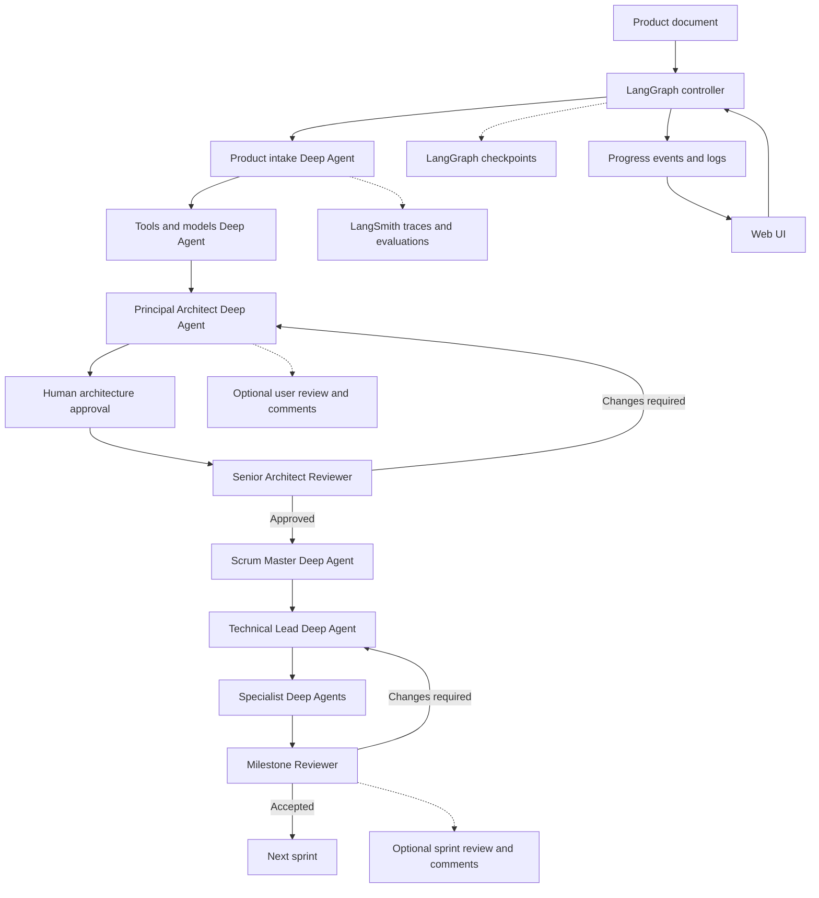

# Agentic Product Development Workflow: Step-by-Step Build Plan

## Purpose

This document explains how to build this repository into a reusable agentic product-development workflow. The workflow accepts a product document and coordinates product discovery, tool/model selection, architecture, review, sprint planning, implementation, testing, documentation, and release review.

The goal is not to make one agent pretend to be an entire engineering organization. The goal is to create a controlled system in which:

- **LangChain** provides model adapters, prompts, tools, structured output, and integrations.
- **Deep Agents** provide capable role workers with planning, subagents, filesystem access, skills, context management, and human approval support.
- **LangGraph** controls the durable, stateful process and enforces mandatory gates.
- **LangSmith** provides tracing, datasets, evaluators, debugging, and deployment visibility.

The workflow also provides a web control plane. A user can upload a product document, start or resume a run, inspect every stage log and artifact, optionally review generated outputs, and watch meaningful progress. Live progress is configurable: users may choose event streaming, periodic polling, or a lightweight spinner with the latest known stage.

The existing The Hub documents are example inputs and outputs. The runtime workflow must remain product-agnostic.

## How To Use This Plan

Follow one numbered step at a time. Before changing code:

1. Read the current step and its learning goal.
2. Inspect the files named by the step.
3. Make only the changes listed in that step.
4. Run the focused validation for that step.
5. Read the validation result and explain what it proves.
6. Record decisions, assumptions, and remaining questions.
7. Do not begin the next step until the current step passes its gate.

The implementation assistant must explain the plan before editing and explain the result after validation. It must not silently implement future steps.

## Target Architecture



LangGraph owns the arrows and gates. Deep Agents perform complex work inside selected nodes. This separation prevents an LLM from deciding that a required review can be skipped.

## Repository Structure To Build

```text
src/app/
  main.py                    Command-line entry point
  config.py                  Environment and model configuration
  state.py                   Typed workflow state and artifact contracts
  documents.py               Product-document and repository readers
  models.py                  LM Studio/provider model factory
  agents/
    product_manager.py       Product intake Deep Agent
    tools_models.py          Tools and models Deep Agent
    principal_architect.py   Technical specification Deep Agent
    reviewer.py              Architecture and milestone review agents
    scrum_master.py          Sprint planning Deep Agent
    technical_lead.py        Sprint coordination Deep Agent
    specialists.py           UI, database, backend, testing, documentation, security roles
  graph/
    workflow.py              LangGraph controller and routing
    interrupts.py            Human approval payloads and resume handling
  tools/
    repository.py            Safe repository inspection tools
    artifacts.py              Controlled artifact read/write tools
    validation.py             Test, lint, and type-check tools
    decisions.py              ADR and decision-log tools

web/
  upload/                   Product-document upload and run creation
  runs/                     Run status, stage logs, artifacts, and review panel
  components/               Progress, approval, comments, and error components

server/
  api.py                    Web API for runs, artifacts, reviews, and events
  events.py                 SSE or WebSocket event publishing; polling fallback
  runs.py                   Run lifecycle and resume endpoints

docs/
  product-intake.md          Generated product understanding
  tools-and-models.md        Generated technology selection
  technical-specification.md Generated architecture plan
  architecture-decisions.md  Durable decision records
  architecture-review.md     Independent review result
  implementation-plan.md     Sprint plan and acceptance evidence
  generated/                  Per-run artifacts, if selected by configuration
  workflow-development-plan.md This guide

tests/
  test_documents.py
  test_state_contracts.py
  test_graph_routing.py
  test_approval_interrupts.py
  test_agent_contracts.py
  test_evaluation_rules.py
  test_review_loops.py
  test_bug_remediation.py
  test_progress_events.py
  test_web_api.py
```

Do not create every file at once. Create files only when their step introduces the concept they explain.

# Phase 0: Establish The Learning Contract

## Step 0.1: Confirm the product and runtime boundary

**Learning goal:** Understand the difference between Copilot customization and the Python application.

Read:

- `.github/copilot-instructions.md`
- `docs/development-workflow.md`
- `docs/workflow-development-plan.md`
- The current repository file tree
- Any supplied product documents

Confirm:

- `.github/agents/*.agent.md` are instruction/persona files for Copilot, not runtime agents.
- The runtime application has not been implemented yet.
- The previous generated Python prototype was intentionally removed.
- The next implementation work must create the runtime foundation described in Step 1.1.

**Gate:** Write a short status note in the implementation discussion or session summary before Step 1.

# Phase 1: Foundation And Configuration

## Step 1.1: Define dependencies and environment configuration

**Learning goal:** Learn why model configuration must be isolated from business workflow code.

Add or verify:

- `deepagents`
- `langgraph`
- `langchain-core`
- Provider integration such as `langchain-openai`
- `python-dotenv`
- `python-docx` if DOCX input is required
- A test dependency such as `pytest`

Use compatible version ranges after checking the installed environment and current official documentation. Do not guess versions or add unrelated packages.

Create `src/app/config.py` with a typed settings object. It should read:

- `OPENAI_BASE_URL`
- `OPENAI_API_KEY`
- `OPENAI_MODEL`
- `LANGSMITH_TRACING`
- `LANGSMITH_ENDPOINT`
- `LANGSMITH_API_KEY`
- `LANGSMITH_PROJECT`
- Artifact directory
- Approval and filesystem permission settings

For LM Studio, use its OpenAI-compatible URL such as `http://localhost:1234/v1`. The local API key is only a placeholder accepted by LM Studio. Never use it as a production credential.

**Beginner documentation requirement:** Explain what each setting controls, which values are safe defaults, which values are secrets, and what fails when a required value is missing.

**Validation:**

```bash
.langchain/bin/python -m compileall -q src
.langchain/bin/python -c "from app.config import load_settings; print(load_settings().model_name)"
```

**Gate:** Configuration loads without exposing secret values, and missing required settings produce an actionable error.

## Step 1.2: Create the typed workflow state

**Learning goal:** Understand state as the shared contract between graph nodes.

Create `src/app/state.py` containing typed structures for:

- Product input metadata
- Repository context
- Current stage
- Artifact references
- Review status
- Sprint status
- Assumptions and risks
- Human approval requests
- Error and retry information

Prefer structured models such as Pydantic models or typed dictionaries. Avoid passing unstructured strings when a downstream node needs predictable fields.

Document each field’s purpose, producer, consumer, and failure meaning.

**Validation:** Add tests that construct valid state and reject missing required values.

**Gate:** Every graph node has a known input/output contract.

# Phase 2: Safe Context And Tools

## Step 2.1: Read product documents safely

**Learning goal:** Separate deterministic file reading from model reasoning.

Create `src/app/documents.py` to read:

- `.docx` product documents
- Markdown documents
- Plain text documents

Return normalized text plus source metadata. Do not ask an LLM to guess how to decode a binary DOCX file.

Add limits for file size and extracted text length. Record truncation explicitly when it occurs.

**Validation:** Test DOCX, Markdown, text, missing file, unsupported extension, and oversized content.

**Gate:** The document reader produces deterministic, testable input.

## Step 2.2: Create safe repository inspection tools

**Learning goal:** Understand why agents should receive narrow tools instead of unrestricted shell access.

Create tools for:

- Listing relevant repository files
- Reading selected text files
- Searching text
- Reading dependency and configuration metadata
- Writing only approved artifact paths
- Running approved validation commands

Do not provide unrestricted delete, network, credential, or deployment tools at this stage.

Every tool description must state:

- When the agent should use it
- Each argument’s meaning
- The return value
- Errors it can produce
- Security restrictions

**Validation:** Unit-test path restrictions, ignored directories, missing files, and write boundaries.

**Gate:** A tool cannot read secrets accidentally or write outside its assigned artifact directory.

# Phase 3: Build One Deep Agent

## Step 3.1: Create the Product Manager Deep Agent

**Learning goal:** Understand a Deep Agent as a role worker, not as the whole workflow.

Create `src/app/agents/product_manager.py` using the current Python Deep Agents API, typically `create_deep_agent`.

The agent should receive:

- Product document text
- Repository context
- Safe document and repository tools
- A focused system prompt
- A structured response schema

The agent should produce:

- Product name
- Users and stakeholders
- Problems and desired outcomes
- Core workflows
- MVP candidates
- Deferred scope
- Constraints
- Evidence versus assumptions
- Success measures
- Open questions

Do not let this first agent modify application source code. It may write only its intake artifact after approval or through a controlled artifact tool.

**Validation:** Run it against a small representative product brief and inspect the actual output structure before writing extraction logic. This follows the repository’s LangSmith evaluator rule.

**Gate:** The output validates against the intake schema and the artifact can be inspected by a human.

## Step 3.2: Add human approval for artifact writes

**Learning goal:** Understand interrupts, checkpointing, and resume behavior.

Configure Deep Agents or LangChain human-in-the-loop middleware so artifact writes pause before execution. Add a LangGraph checkpointer. Use a stable `thread_id` when resuming.

The approval payload should identify:

- Agent and stage
- Proposed file path
- Proposed content summary
- Risk level
- Allowed decisions: approve, edit, reject

Never approve a write based only on the model’s confidence statement.

**Validation:** Test approve, edit, reject, process restart, and resume with the same thread ID.

**Gate:** The workflow pauses safely and resumes without redoing completed work.

## Step 3.3: Add optional user review sessions

**Learning goal:** Understand the difference between a mandatory safety approval and an optional collaborative review.

After an agent produces an artifact, the workflow may enter a `user_review` stage when the run configuration enables it. The user must be able to see the artifact, add comments, request changes, approve it, or skip the review. Skipping this session must be recorded as an explicit decision; it must not look like approval was given.

Use a typed review request containing:

- Run and thread identifiers
- Stage and artifact identifier
- Review status: `pending`, `approved`, `changes_requested`, or `skipped`
- User comments and timestamps
- Reviewer identity
- Revision number

When the user requests changes, route the comments back to the same role agent with the previous artifact and review comments. The agent creates a new revision rather than overwriting history. Limit the number of automatic reruns and pause with an actionable error if the limit is reached.

Configure review policy independently for at least:

- Technical specification completion
- Each sprint completion

**Validation:** Test review enabled, review skipped, approval, comments causing a rerun, multiple revisions, stale review submissions, and review-rerun limits.

**Gate:** Optional review behavior is deterministic, auditable, resumable, and cannot bypass mandatory automated tests or architecture gates.

# Phase 4: Add The Planning And Architecture Roles

## Step 4.1: Add Tools and Models Architect

**Learning goal:** Learn how technology choices should be evidence-based.

Create a Deep Agent that consumes product intake and repository evidence and produces `docs/tools-and-models.md`.

It must compare:

- Frameworks
- Model providers and model roles
- Databases and storage
- Queue and job systems
- Authentication
- Observability
- Testing tools
- Deployment options

For every choice, record capability, compatibility, quality, latency, cost, privacy, licensing, operational burden, alternative, and replacement criteria.

**Gate:** No implementation dependency is added solely because the agent named it. The choice must be approved and recorded.

## Step 4.2: Add Principal Architect

Produce `docs/technical-specification.md` and update ADRs. The specification must cover:

- Product scope
- Component boundaries
- Domain model
- API and event contracts
- Data flows
- Security and privacy
- Reliability and observability
- Testing
- Deployment
- Open questions
- Acceptance criteria

Every material decision gets an ADR with context, alternatives, decision, detailed rationale, trade-offs, consequences, and validation evidence.

**Gate:** The specification is complete enough for independent review.

## Step 4.3: Add Senior Architect Reviewer

The reviewer must return structured output:

- `approved` or `changes_required`
- Findings by severity
- Evidence
- Required remediation
- Approval conditions
- Accepted risks

The LangGraph controller must route rejected work back to the Principal Architect and approved work forward to sprint planning.

**Gate:** Free-form text cannot bypass the review gate.

# Phase 5: Sprint Planning And Execution

## Step 5.1: Add Scrum Master

The Scrum Master consumes approved architecture and creates independent vertical sprints. Each sprint has:

- Goal and user value
- In-scope and out-of-scope work
- Dependencies
- Acceptance criteria
- Test strategy
- Security checks
- Documentation work
- Risks
- Rollback or recovery notes

Do not plan all implementation details before architecture approval.

## Step 5.2: Add Technical Lead

The Technical Lead selects exactly one sprint and creates a small milestone. It delegates only the required specialist work and integrates the results.

The Technical Lead must not:

- Execute multiple unreviewed sprints
- Hide failing tests
- Change approved architecture silently
- Accept undocumented assumptions
- Allow unrestricted specialist access

## Step 5.3: Add specialist Deep Agents

Create focused workers for:

- UI and UX
- Database and migrations
- Backend services and APIs
- Testing and quality engineering
- Documentation and code explanation
- Security and reliability

Each worker receives only the contract and context it needs. Each returns changed files, decisions, tests, documentation, risks, and blockers.

**Beginner documentation requirement:** Every non-obvious code block must explain purpose, inputs, outputs, control flow, failure behavior, security assumptions, and relevant terminology. Comments should explain reasons rather than restate syntax.

## Step 5.4: Add the per-sprint test and bug-remediation loop

**Learning goal:** Understand that testing is part of every sprint, not a final phase after all implementation.

For every sprint, create a test plan before implementation begins. The sprint cannot be accepted until the following loop completes:

1. Specialists implement the smallest vertical increment.
2. The Test Engineer runs unit, integration, contract, end-to-end, accessibility, and security tests applicable to that increment.
3. Failures become tracked defects with severity, reproduction steps, expected behavior, actual behavior, affected files, owner, and regression test requirement.
4. The Technical Lead routes each defect to the responsible specialist.
5. The specialist fixes the defect and adds or updates a regression test.
6. The Test Engineer reruns the failing test and the relevant regression suite.
7. The Milestone Reviewer verifies that the fix did not violate contracts, security controls, or acceptance criteria.
8. The Technical Lead records accepted defects or blocks the sprint when risk is not acceptable.

Each sprint must define a maximum remediation cycle or escalation rule. A repeated failure must not cause an endless agent loop. Preserve test output and defect history as sprint evidence.

**Required sprint evidence:** test commands, pass/fail results, defect list, remediation commits or files, regression tests, unresolved risks, and reviewer result.

**Gate:** No sprint is accepted with failing mandatory tests, unowned defects, missing regression coverage, or undocumented accepted risk.

# Phase 6: Web Control Plane

## Step 6.1: Add product-document upload

**Learning goal:** Understand the web UI as a control plane for a durable workflow, not as a second workflow engine.

Create a web application and API that allow a user to:

- Select a supported product-document file.
- Upload it with size and extension validation.
- Create a run with a generated run ID and stable thread ID.
- Select optional settings such as user review sessions and progress mode.
- Start, pause, cancel, or resume a run where the configured policy permits it.

The server, not the browser, must validate file type, file size, ownership, and run permissions. Store the original document outside executable paths and avoid exposing arbitrary filesystem paths to the browser.

**Validation:** Test supported and unsupported files, size limits, duplicate submissions, unauthorized access, cancelled uploads, and resume after page refresh.

## Step 6.2: Add run status, logs, and artifacts

**Learning goal:** Understand how users observe a long-running agent workflow.

Expose a run view with:

- Current stage and plain-language meaning, such as “The architecture reviewer is checking security and feasibility.”
- Overall progress based on completed workflow stages, not false token-level percentages.
- Stage history with start time, end time, status, duration, retry count, and error summary.
- Expandable log entries with severity, role, tool name, safe input/output summary, and correlation ID.
- Links to generated artifacts and artifact revisions.
- Review requests, comments, decisions, and rerun history.
- Clear states for queued, running, waiting for review, paused, changes requested, failed, cancelled, and completed.

Never send API keys, raw credentials, unrestricted prompts, or sensitive document content to browser logs. Redact or summarize tool inputs and outputs before publishing events.

**Validation:** Test log ordering, refresh behavior, failed stages, retries, redaction, artifact access control, and concurrent viewers.

## Step 6.3: Add configurable live progress

**Learning goal:** Understand event-driven updates and graceful degradation.

Support a user-selectable progress mode:

- **Live events:** Server-Sent Events or WebSockets deliver stage, log, review, and artifact events.
- **Polling:** The browser periodically requests the latest run snapshot when streaming is unavailable or disabled.
- **Spinner mode:** The UI shows a stable spinner, current meaningful stage, and last-updated time without pretending to display live events.

Use one canonical run-event schema regardless of transport. Events should include run ID, event ID, sequence number, timestamp, stage, event type, human-readable message, and safe metadata. The client must handle reconnects, duplicate events, out-of-order events, and expired cursors.

**Validation:** Test live connection, reconnect, polling fallback, opted-out spinner mode, duplicate events, delayed events, and a completed run while the browser is disconnected.

## Step 6.4: Add optional review panels

Add a review panel for technical specification completion and a reusable review panel for sprint completion. The panel must show the artifact revision, allow comments, and present explicit actions:

- Approve
- Request changes
- Skip optional review

The browser submits a decision to the server, and the server resumes the LangGraph thread. The UI must show that the workflow is waiting and must not claim completion until the graph confirms the decision.

**Gate:** The web UI is an observer and controlled input surface; it cannot directly mutate workflow state or bypass server-side gates.

# Phase 7: Review, Evaluation, And Operations

## Step 7.1: Add milestone review

The Milestone Reviewer checks correctness, contracts, migrations, authorization, data isolation, accessibility, tests, documentation, security, and regression risk.

The milestone is accepted only when:

- No blocking or major findings remain
- Focused tests pass
- Documentation is updated
- The Technical Lead records acceptance

## Step 7.2: Add security and reliability review

Review:

- Tenant or ownership isolation
- Tool permissions
- Prompt and data leakage
- Secrets
- External integrations
- Filesystem writes
- Command execution
- Timeouts and retries
- Checkpoint recovery
- Audit trails
- Retention and deletion

Use local-only exceptions explicitly. Do not let development shortcuts become production defaults.

## Step 7.3: Add LangSmith tracing

Follow `.github/skills/langsmith-trace/SKILL.md` before implementing tracing.

Use tracing to preserve:

- Workflow run name
- Agent role
- Stage
- Product identifier without sensitive content
- Thread ID
- Decision or review status
- Parent/child hierarchy
- Tool calls and latency

Never log API keys, raw credentials, or unnecessary sensitive product content.

Query complete traces first when debugging. Use individual runs only for focused analysis.

## Step 7.4: Create datasets and evaluators

Follow `.github/skills/langsmith-dataset/SKILL.md` before creating datasets and `.github/skills/langsmith-evaluator/SKILL .md` before creating evaluators.

Evaluation datasets should cover:

- Clear product documents
- Ambiguous product documents
- Conflicting requirements
- Missing constraints
- Unsupported technologies
- Security-sensitive workflows
- Review rejection and correction cases

Evaluate separately:

- Requirement coverage
- Assumption labeling
- Tool/model decision quality
- Architecture completeness
- Review accuracy
- Sprint acceptance quality
- Beginner explanation quality
- Tool-use safety

Inspect actual agent outputs and traces before writing extraction or evaluator code. Each evaluator should return one metric.

# Phase 8: Deployment And Maintenance

## Step 8.1: Add persistent storage

Replace in-memory checkpointing with a production checkpointer only after the graph behavior is correct. Keep long-term product artifacts in an application-owned store, separate from short-term graph checkpoints.

Document:

- Checkpoint retention
- Thread identity
- Resume behavior
- Artifact versioning
- Access control
- Backup and deletion

## Step 8.2: Add deployment support

Choose deployment only after the local workflow is reliable. Define:

- Runtime environment
- Model endpoint
- Secret management
- Persistent checkpointer
- Artifact storage
- Worker execution
- Logging and metrics
- Cost limits
- Failure recovery

Do not deploy agents with unrestricted repository or shell access.

## Step 8.3: Maintain the workflow

When LangChain, LangGraph, or Deep Agents APIs change:

1. Read current official documentation.
2. Check local skills and dependency versions.
3. Update the tools/models ADR.
4. Run focused compatibility tests.
5. Update the teaching documentation.
6. Do not silently change behavior in the middle of a sprint.

# Definition Of Done

The workflow is complete only when:

- A supplied product document can start a run.
- A web UI can upload a supported product document and create, start, pause, cancel, resume, and inspect a run.
- The graph persists state and resumes after interruption.
- Each role has a focused prompt, tools, and structured contract.
- Architecture and milestone gates are deterministic and auditable.
- Human approval protects artifact writes and high-impact actions.
- Optional review sessions are configurable for technical specification completion and sprint completion, with comments, revisions, reruns, skip decisions, and limits.
- Every sprint records test evidence, owned defects, regression tests, remediation results, and unresolved risks.
- The UI exposes sanitized logs, artifact revisions, review state, and meaningful current-stage progress.
- Progress supports live events, polling, and an opted-out spinner mode using one canonical event schema.
- Specialists work within explicit boundaries.
- Tests cover happy paths, rejection paths, failures, retries, and permissions.
- LangSmith traces are useful without exposing secrets.
- Datasets and evaluators measure output quality.
- Generated code and documentation are understandable to beginners.
- Decisions, risks, assumptions, and validation evidence are durable artifacts.
- The workflow remains reusable for products other than The Hub.

## Current Starting Point

The repository currently contains the workflow documentation, Copilot role definitions, product documents, and local development environment, but no runtime application source. The correct next implementation step is **Step 1.1: Define dependencies and environment configuration**. Do not add all Deep Agent roles at once. First establish configuration and prove that one well-defined runtime component can be understood, tested, and safely changed.
