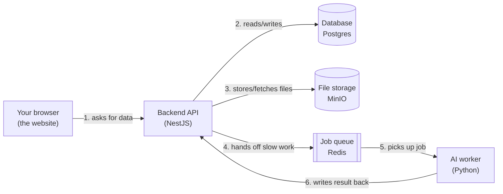

# The Hub: Plain-English Glossary and Concept Guide

**Read this file first if you're new to any part of this stack.** The other three
planning docs (`the-hub-implementation-plan.md`, `the-hub-engineering-checklist.md`,
`the-hub-sprint-breakdown.md`) use a lot of terms without explaining them, because
they're written for people who already know backend/frontend development. This file
explains those terms in order, with analogies, so someone with basic programming
knowledge (you can write a function, use `if` statements, maybe built a small script)
can follow along and actually build the thing.

Nothing here is Hub-specific trivia — these are standard tools used across the
software industry. Learning them here is a transferable skill, not a one-off.

---

## 0. The one-paragraph mental model

The Hub is a website. People use it to record a short video explaining a decision,
the site automatically turns that video into a written transcript and summary using
AI, other people read/watch it and leave comments, and then a designated approver
clicks "Approve" or "Reject." Under the hood there are four separate programs
running at once (a website, an API server, a database, and an AI worker), talking
to each other over the network. The rest of this document explains what each of
those programs is and why it exists separately instead of being "just one big app."

Keep this picture in your head. Every glossary term below is a label on one of
these boxes or arrows.

---

## 1. Environment and tooling

- **Terminal / shell / Bash** — the text-based window where you type commands
  instead of clicking icons. Every command in these docs is meant to be typed into
  a terminal.
- **Linux** — the operating system this project assumes you're developing on
  (Ubuntu is a common Linux flavor). Commands like `apt install` are
  Linux-specific package-manager commands.
- **Git** — the tool that tracks changes to code over time and lets multiple
  people work on the same project without overwriting each other. A **repository**
  ("repo") is a project folder tracked by Git. `the-hub/` is the repo.
- **Node.js** — a program that lets you run JavaScript/TypeScript outside a web
  browser (e.g., on a server). Both the backend (NestJS) and frontend (Next.js) run
  on Node.js. "Node 20" means version 20 of Node.js.
- **npm** — Node's package manager. `npm install` downloads the code libraries a
  project depends on (listed in `package.json`) into a `node_modules/` folder.
- **Python / venv** — Python is the language the AI worker is written in. A
  **virtual environment (venv)** is an isolated folder of Python packages specific
  to one project, so different projects' dependencies don't collide.
- **Docker** — a tool that packages a piece of software together with everything
  it needs to run (its own mini operating system slice) into a **container**, so it
  runs identically on any machine. Instead of installing Postgres directly on your
  laptop, you run "the Postgres container."
  - An **image** is the packaged blueprint (e.g., `postgres:16-alpine`).
  - A **container** is a running instance of an image.
  - A **volume** is a folder on your real disk that a container uses for
    permanent storage, so data survives even if the container restarts.
  - A **port** is a numbered "door" a program listens on for network traffic
    (e.g., Postgres listens on port `5432`). `"5432:5432"` in Docker Compose means
    "connect port 5432 on my laptop to port 5432 inside the container."
- **Docker Compose** — a tool that starts and connects *multiple* containers at
  once from one config file (`docker-compose.yml`), so `docker compose up` boots
  your whole database + cache + storage stack with one command instead of four.
- **Healthcheck** — a small command Docker runs periodically inside a container
  (e.g., "can I ping this database?") to know whether it's actually ready to use,
  not just "started."

---

## 2. Backend / API concepts

- **API (Application Programming Interface)** — the set of URLs a program exposes
  so other programs (like a website) can ask it to do things or fetch data,
  instead of a human clicking buttons. "Hitting an endpoint" means sending a
  request to one of those URLs.
- **REST / endpoint** — a common convention for designing APIs where each URL
  ("endpoint") represents a resource, and the HTTP **method** says what to do to
  it: `GET` (read), `POST` (create), `PATCH`/`PUT` (update), `DELETE` (remove).
  Example: `POST /api/v1/threads` creates a new thread.
  `GET /api/v1/threads/:id` fetches one thread, where `:id` is a placeholder for
  the thread's actual ID.
- **JSON** — a simple text format for structured data, e.g.
  `{"title": "Ship v2", "status": "DRAFT"}`. Almost everything sent between the
  browser, the backend, and the AI worker is JSON.
- **NestJS** — the framework the backend API is built with. It's a structured way
  of organizing a Node.js/TypeScript server into small, testable pieces (see
  below) instead of one giant file.
  - A **module** is a folder/unit that groups related code (e.g., the `threads`
    module holds everything about creating and reading threads).
  - A **controller** defines the actual URLs/endpoints and what HTTP method they
    respond to. It doesn't contain business logic itself — it hands off to a service.
  - A **service** contains the actual logic (e.g., "how do I create a thread and
    save it to the database?").
  - A **DTO (Data Transfer Object)** is a small class describing exactly what
    fields a request body must contain (e.g., `CreateThreadDto` requires `title`
    and `workspaceId`). NestJS uses DTOs to automatically reject bad requests.
  - **Dependency injection** — instead of a service manually creating the things
    it needs (like a database connection), NestJS hands ("injects") them in
    automatically. You mostly just need to know it's why constructors in NestJS
    code look like `constructor(private readonly prisma: PrismaService) {}`.
  - A **guard** is code that runs before a request reaches your logic to check
    "is this person allowed to do this?" (used for login checks and permissions).
- **Swagger / OpenAPI** — an auto-generated, browsable web page listing every API
  endpoint, what data it expects, and what it returns. NestJS can generate this
  automatically from your code, which is very useful for a beginner testing the API
  without writing a frontend first.
- **Status codes** — a 3-digit number every API response includes: `200 OK`
  (success), `201 Created`, `202 Accepted` (request understood, work continues in
  background), `400 Bad Request` (you sent invalid data), `401 Unauthorized` (not
  logged in), `403 Forbidden` (logged in, but not allowed), `404 Not Found`.

---

## 3. Database concepts

- **Relational database** — a database that stores data in tables made of rows and
  columns, where tables can reference each other (e.g., a `Comment` row references
  which `Thread` it belongs to). **PostgreSQL** ("Postgres") is the specific
  relational database this project uses.
- **Schema** — the definition of what tables exist and what columns/types they
  have. In this project the schema is written once in `schema.prisma` and Prisma
  generates the actual database tables from it.
- **Model** — in Prisma, a `model` block is the definition of one table (e.g.,
  `model Thread { ... }` becomes a `Thread` table with one row per thread).
- **Migration** — a recorded, versioned change to the database schema (e.g.,
  "add a `status` column to the `Thread` table"). Running a migration applies that
  change to the real database. Migrations let a team share schema changes safely
  instead of everyone hand-editing the database.
- **ORM (Object-Relational Mapper)** — a library that lets you read/write database
  rows using normal code instead of writing raw SQL by hand. **Prisma** is the ORM
  this project uses; e.g. `prisma.thread.create({ data: {...} })` inserts a row.
- **Foreign key / relation** — a column that points to another table's row, used
  to represent "this Comment belongs to this Thread." Prisma expresses this as a
  relation field (e.g., `thread Thread @relation(...)`) rather than a raw column.
- **Enum** — a fixed list of allowed text values for a field (e.g., a thread's
  `status` can only ever be one of `DRAFT`, `PROCESSING`, `IN_REVIEW`, `APPROVED`,
  `REJECTED`, `REOPENED`, `ARCHIVED` — never some other string).
- **JSON / JSONB column** — a database column that stores a whole JSON object
  instead of a single value, useful for flexible AI output (e.g., the AI summary's
  bullet points) that doesn't need its own table.
- **UUID** — a long random unique ID (like `550e8400-e29b-41d4-a716-...`) used
  instead of simple incrementing numbers for primary keys, so IDs can be generated
  safely by any part of the system without colliding.

---

## 4. Storage, queues, and background jobs

- **Object storage** — a simple "put a file in, get a file out by name" storage
  system for large binary files (videos, images), as opposed to a relational
  database (which is bad at storing huge files efficiently). **MinIO** is the
  object storage this project runs locally; it speaks the same protocol as Amazon
  S3, which is why the client library is called `@aws-sdk/client-s3` even though
  no AWS account is involved.
- **Presigned URL** — a temporary, single-use upload/download link generated by
  the backend that lets the browser upload a file *directly* to MinIO/S3, without
  the file ever passing through the API server. This matters because API servers
  are bad at handling multi-gigabyte file uploads in memory — the presigned URL
  lets the browser talk straight to storage instead.
- **Queue / job / worker** — when a task is slow (like AI transcription, which can
  take a minute or more), you don't want the user's browser to just sit there
  waiting for a single API request to finish. Instead:
  - The API adds a small note ("please transcribe file X for thread Y") to a
    **queue** — a waiting line of tasks.
  - A separate **worker** program constantly watches the queue and picks up
    ("consumes") jobs one at a time, doing the actual slow work.
  - The part of the code that adds a task to the queue is called the
    **producer**; the part that processes it is the **consumer**.
  - **Redis** is the fast in-memory database used to hold the queue.
  - **BullMQ** is the Node.js library used to create/manage queues on top of
    Redis, with retry logic, job status, etc. built in.
- **Job status transitions** — a job typically moves through
  `queued → processing → succeeded` or `queued → processing → failed`. The backend
  should update the related Thread's status as the job moves through these states,
  so the UI can show "Processing your video…".
- **Retry / dead-letter** — if a job fails (e.g., the AI service was briefly
  down), a **retry** automatically tries it again a few times. If it keeps
  failing, it's moved to a **dead-letter** state — a "give up and flag for a human"
  bucket — instead of retrying forever.
- **Idempotent** — a job is idempotent if running it twice by accident produces
  the same end result as running it once (e.g., it doesn't create two duplicate
  transcripts). Worth aiming for, because retries mean a job might run more than once.
- **Webhook** — a URL one service calls automatically to notify another service
  that something happened (e.g., the AI worker "calls back" the backend API when
  transcription is done, instead of the backend having to keep asking "are you done
  yet?").

---

## 5. AI concepts

- **Transcription** — converting spoken audio into written text.
  **Whisper** is an open-source speech-to-text model (made by OpenAI) that this
  project runs to transcribe uploaded videos.
- **LLM (Large Language Model)** — an AI model (like GPT, Claude, or DeepSeek)
  that takes text in and produces text out, used here to turn a raw transcript into
  a short summary, key points, and action items.
- **Prompt** — the instructions you send an LLM describing what you want it to do.
  A **system prompt** is the standing instruction that shapes how the model
  behaves for every request (see the example in the implementation plan).
- **Structured output / JSON schema** — instead of letting the LLM reply with
  free-form prose, you instruct it to reply in a specific JSON shape (e.g.
  `{"summary": [...], "actionItems": [...]}`) so your code can reliably read the
  result without guessing at formatting.
- **Risk level** — a simple AI-assigned label (e.g., low/medium/high) meant to
  flag decisions that might need more careful review — a nice-to-have signal, not
  a guarantee.

---

## 6. Frontend concepts

- **Next.js** — the framework used to build the website (built on top of
  **React**). It handles routing (which URL shows which page), rendering, and
  talking to the backend API.
- **React / component** — React builds UIs out of small, reusable pieces called
  **components** (e.g., a `CommentForm` component, a `ThreadCard` component) that
  each manage their own little piece of the page.
- **SSR (Server-Side Rendering)** — generating the page's HTML on the server
  before sending it to the browser, so the page appears faster and works better
  for search engines/slow devices, instead of shipping a blank page that fills in
  after JavaScript loads.
- **Tailwind CSS** — a CSS framework where you style elements by adding utility
  class names directly in your markup (e.g. `className="p-4 rounded bg-white"`)
  instead of writing separate `.css` files.
- **State** — data a component remembers between renders (e.g., "is the recorder
  currently recording?"). In React this is usually managed with the `useState`
  hook, as seen in the recording code sample in the implementation plan.
- **MediaRecorder / WebRTC APIs** — built-in browser APIs (no extra library
  needed) that let a web page ask for permission to record the screen, webcam, or
  microphone, and turn that into a saveable video file entirely client-side.

---

## 7. Security and auth concepts

- **Authentication vs. authorization** — *authentication* is proving who you are
  (logging in). *Authorization* is checking what you, specifically, are allowed to
  do (can you approve this particular thread?).
- **JWT (JSON Web Token)** — a signed, tamper-proof piece of text the backend
  gives a user after login, which the browser then sends with every request
  (`Authorization: Bearer <token>`) to prove who it is without logging in again on
  every click.
- **RBAC (Role-Based Access Control)** — granting permissions based on a user's
  role (Admin, Contributor, Reviewer, Guest — see the implementation plan §5.2)
  rather than configuring access per-person.
- **CORS** — a browser security rule that blocks a web page from calling an API on
  a different domain unless that API explicitly allows it. You'll configure this
  on the backend so the frontend is allowed to call it.
- **CSP (Content Security Policy)** — a header the backend/frontend sends telling
  the browser which sources of scripts/frames/images are trusted, reducing the
  damage a malicious script or embedded page could do.
- **Sandboxed iframe** — an `<iframe>` with a `sandbox` attribute that strips away
  most default permissions (pop-ups, top-level navigation, unrestricted scripts)
  from embedded content, used here for the optional "live prototype preview"
  feature so an embedded page can't do something unexpected to the main site.
- **Secrets / `.env` files** — passwords, API keys, and tokens should never be
  hard-coded into source files or committed to Git. Instead they're placed in a
  local `.env` file (which stays out of Git via `.gitignore`) and read at runtime
  as environment variables. `.env.example` is a checked-in *template* showing which
  variable names are needed, with placeholder (non-secret) values.

---

## 8. Product/workflow vocabulary specific to The Hub

- **Workspace** — a container for a team's threads (think: a Slack workspace or a
  Trello board's parent org). Users and threads belong to a workspace.
- **Thread / Decision Thread** — the core object in the product: one specific
  decision under discussion, bundling its context, video, transcript, AI summary,
  comments, and approval state together.
- **Attachment** — a file (usually a video) uploaded to a thread. A thread may
  have zero or more attachments.
- **Approval** — a single reviewer's recorded decision (approve or reject) on a
  thread. Multiple approvals can exist per thread (one per approver).
- **ADR (Architectural Decision Record)** — a standard industry term for a short,
  permanent written record of a technical decision and why it was made. A
  resolved Decision Thread is meant to double as an ADR.
- **Role** — see §7 (RBAC). This project's four roles are `ADMIN`, `CONTRIBUTOR`,
  `REVIEWER`, `GUEST` — defined precisely in the implementation plan §5.2.

---

## 9. How to use the other three documents

Read them in this order:

1. **`the-hub-implementation-plan.md`** — the "what and why." Product vision,
   requirements, the data model, the API design, and the architecture. Read this
   fully before writing any code — it's the source of truth other docs point back to.
2. **`the-hub-engineering-checklist.md`** — the "in what order, and how do I know
   I'm done." Broken into 13 milestones, each with a checklist and a clear
   "definition of done." Good for tracking progress day-to-day.
3. **`the-hub-sprint-breakdown.md`** — the same roadmap regrouped into 12
   sprint-sized chunks with deliverables and exit criteria, useful if you're
   planning work in sprints/time-boxes rather than strict milestones.

Whenever any of those three files uses a term you don't recognize, it's probably
defined above — search this file (Ctrl+F) for the word.
