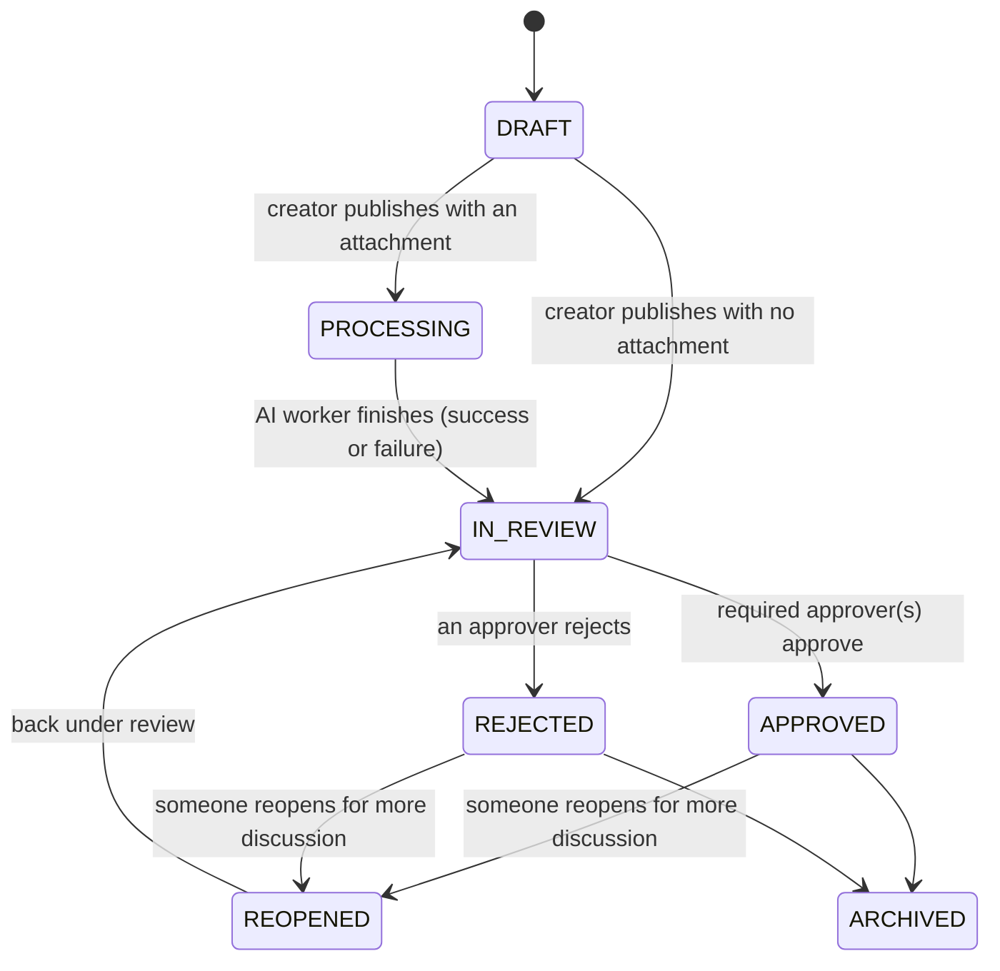
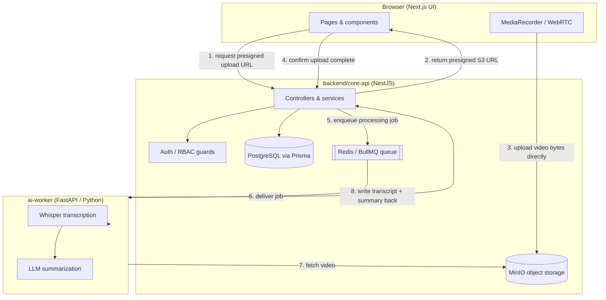

# The Hub: Product Brief and Implementation Plan

> This plan is intentionally narrowed to a realistic MVP for The Hub: an
> asynchronous collaboration and decision workflow for teams who need to capture
> context, review decisions, and approve outcomes without live meetings.
>
> **New to any of the tools or terms below?** Read
> [`the-hub-glossary.md`](./the-hub-glossary.md) first — it explains every piece
> of jargon (Docker, Prisma, presigned URLs, queues, JWTs, etc.) in plain
> English. This document assumes you've either read it or already know the terms.
>
> **This is the single source of truth.** Where the source material (the two
> `.docx` documents in this folder) disagreed with itself — different lists of
> thread statuses, different sets of user roles — this document picks one
> canonical version and uses it consistently. The
> [`the-hub-engineering-checklist.md`](./the-hub-engineering-checklist.md) and
> [`the-hub-sprint-breakdown.md`](./the-hub-sprint-breakdown.md) docs have been
> updated to match. If you ever see a mismatch between those docs and this one,
> **this document wins.**

---

## 1. Product vision

The Hub helps teams turn fragmented decision-making into a structured workflow.

Instead of decisions being spread across meetings, chat threads, recordings, and
email chains, users can:

- create a decision thread,
- add context such as video, notes, and attachments,
- generate AI-assisted transcripts and summaries,
- comment on specific moments or decisions,
- track approval status,
- resolve the decision with a clear audit trail.

The key value is not just recording meetings; it is creating a durable, reviewable
decision record that reduces friction and improves accountability. A resolved
thread is meant to double as an **ADR (Architectural Decision Record)** — a
permanent, searchable "why did we decide this?" document that teams often mean to
write but rarely do, because The Hub generates most of it automatically from the
recording.

---

## 2. Core product problem

Teams lose time when decision points are buried in:

- recorded discussions,
- chat messages,
- scattered docs,
- ad hoc approvals,
- informal verbal alignment.

The Hub solves this by turning those conversations into structured, searchable
decision threads.

### 2.1 Why not just use Loom, Tactiq, or a Zoom AI note-taker?

Worth understanding before you build this, so you know what you're actually
optimizing for:

- **Async video tools** (Loom, Claap, Tella, Vidyard) are good at recording and
  sharing a video with timestamped comments and an AI summary — but each video is
  treated as an independent, one-off artifact. There's no formal "this decision is
  now approved" workflow, and no state machine tracking whether a decision is
  still open.
- **AI meeting assistants** (Tactiq, Krisp, Echo) are good at transcribing and
  summarizing *live* calendar meetings (Zoom, Meet, Teams) — but they're bolted
  onto existing meeting tools, not a decision-tracking system in their own right.

Neither category gives you: a **required-approver workflow**, a formal
**Draft → Processing → Review → Approved/Rejected → Archived** lifecycle per
decision, and a permanent, workspace-searchable **ADR-style record** of what was
decided and why. That combination — video + AI summary + formal sign-off +
durable record — is the gap this product fills. It's a niche B2B product for
engineering teams, IT consultancies, and systems integrators who need traceable
decisions for audits and long-term maintainability, not a general-purpose video
messaging tool.

Keep this differentiation in mind if you're ever tempted to cut the approval
workflow "to save time" — it's the part that makes this a different product
category, not just another Loom clone.

---

## 3. Target users

### Primary users
- product managers
- engineering leads
- ops and project owners
- leadership reviewers
- cross-functional stakeholders

### Typical use cases
- product decision review
- execution approvals
- policy or process review
- engineering readiness discussions
- stakeholder alignment before launch

---

## 4. MVP scope

The MVP should focus on the decision loop only. Do not build the full platform
before validating the core workflow.

### In scope for MVP
- create a decision thread
- add title, context, tags, and metadata
- upload video or supporting file
- AI transcript generation
- AI summary of the key points and decision
- comment timeline with timestamps
- reviewer/approver assignment
- approve or reject a decision
- mark thread as resolved or reopened
- basic notification and activity visibility

### Deliberately out of scope for MVP

These ideas are real, and several come directly from the product research (see
§17 below for the full list) — they're just sequenced *after* the MVP proves the
core loop is useful, so early effort isn't spent on things nobody has validated
they need yet:

- multi-workspace enterprise administration (multi-tenant "Organizations")
- broad plugin/integration ecosystem (Jira, Slack, GitHub, etc.)
- complex analytics dashboards
- external SSO/SAML and SCIM provisioning
- full-text/semantic search and a knowledge graph between threads
- **ephemeral live prototype embedding via secure tunnels** (Tailscale
  Funnel/WireGuard) — a distinctive idea from the product research, but it adds a
  whole extra moving part (tunnel infrastructure, iframe sandboxing, domain
  validation) that isn't needed to prove the core "record → summarize → approve"
  loop
- multi-language transcription/localization
- full production-grade security hardening (SSO, audit-log export, compliance
  logging)
- multi-region deployment

---

## 5. Product requirements

### 5.1 Decision states (canonical)

Use explicit decision states instead of generic status labels, so the workflow is
unambiguous for both the backend (`ThreadStatus` enum) and the UI (status badges).



| Status | Plain-English meaning |
|---|---|
| `DRAFT` | The creator is still writing it and hasn't published it for others to see yet. |
| `PROCESSING` | Published, and an attached video is being transcribed/summarized by the AI worker. The thread is visible but the AI panel shows a "processing…" state. |
| `IN_REVIEW` | AI output (if any) is ready. Reviewers can comment, and approvers can approve or reject. |
| `APPROVED` | At least one required approver approved it, and nobody has rejected it. |
| `REJECTED` | An approver rejected it. |
| `REOPENED` | An approved or rejected thread was reopened for further discussion — moves back to `IN_REVIEW` once someone acts on it again. |
| `ARCHIVED` | Finished and read-only; kept for the historical/searchable record. |

> **Why this replaces the shorter 5-value list some earlier notes used**
> (`DRAFT, PROCESSING, OPEN, RESOLVED, ARCHIVED`): that shorter version was fine as
> a first sketch, but it collapses "approved" and "rejected" into a single
> `RESOLVED` value, which makes it harder to build clear UI (a green "Approved"
> badge vs. a red "Rejected" badge) and harder to query ("show me everything that
> was rejected this month"). The 7-value table above is what the checklist and
> sprint breakdown documents both build against — treat it as final.

For MVP, keep the approval rule simple: **any one approval closes the thread as
`APPROVED`, and any one rejection closes it as `REJECTED`.** A "requires N of M
named approvers" policy engine is a reasonable v2 feature, not an MVP requirement
— don't build it now.

### 5.2 Roles

Keep the set of roles small and match it exactly to the `Role` enum stored in the
database (see §9.1) — don't invent extra "soft" roles that don't exist as a
database value, since that's how the two source documents drifted out of sync.

| Role (DB enum value) | What they can do |
|---|---|
| `ADMIN` | Everything below, plus manage workspace members and settings. |
| `CONTRIBUTOR` | Create threads ("Creator"), upload attachments, comment. Can also approve/reject on any thread they're a member of — see note below. |
| `REVIEWER` | Read threads and comment. Cannot create threads and cannot approve/reject. |
| `GUEST` | Read-only access to specific threads that were explicitly shared with them. Cannot comment or approve. |

**Note on "Creator" and "Approver":** these are not separate database roles —
they're just *what someone did on a specific thread*. Whoever creates a thread is
its creator (any `CONTRIBUTOR` or `ADMIN`). Whoever leaves an `Approval` record on
a thread is one of its approvers (any `CONTRIBUTOR` or `ADMIN` with access to that
thread, for MVP — see the simplified approval rule in §5.1). This keeps the
permission model small: 4 roles total, checked with a NestJS guard, instead of a
larger role list that doesn't map to anything in the database.

### 5.3 Privacy and consent

Because the app can capture recordings and sensitive decision content, privacy
should be a product requirement:

- clear consent before recording or upload
- retention policy for media and transcripts
- PII redaction where possible
- access control per workspace or team
- auditable action history

---

## 6. Technical strategy

### 6.1 Architecture overview

The current repo structure is already aligned to a sensible layered architecture:

- `infra/` — Dockerized infrastructure services
- `backend/core-api` — NestJS backend and business logic
- `frontend/` — Next.js UI
- `ai-worker/` — Python worker for transcription and summarization
- `docs/` — project notes and architecture documentation



### 6.2 Recommended stack, and why each piece was chosen

| Layer | Technology | Why this one, in plain terms |
|---|---|---|
| Frontend | Next.js (React) + Tailwind CSS | Server-side rendering means pages load fast, and React gives direct, plugin-free access to the browser's built-in recording APIs (MediaRecorder/WebRTC). |
| Backend API | NestJS (TypeScript) | An opinionated structure (modules/controllers/services — see the glossary) that keeps a growing codebase organized, plus built-in support for auto-generated API docs (Swagger) and permission guards. |
| Database + ORM | PostgreSQL + Prisma | Postgres is a mature, reliable relational database with JSON column support for the flexible AI output. Prisma generates type-safe database code straight from the schema file, which catches a whole class of bugs (misspelled field names, wrong types) before the code even runs. |
| Object storage | MinIO (S3-compatible) | Lets large video files be uploaded directly from the browser to storage (via a presigned URL — see glossary) instead of routing multi-gigabyte uploads through the API server. Speaks the same protocol as Amazon S3, so the same code would work against real AWS S3 later with just a config change. |
| Queue / broker | Redis + BullMQ | Video processing and AI calls are slow (seconds to minutes). Queuing that work means the API can respond instantly ("got it, processing") instead of making the user's browser hang waiting. |
| AI worker | FastAPI (Python) + Whisper + an LLM | Python has the best-supported libraries for Whisper transcription. Keeping it as a separate service means the AI logic can be swapped (local model vs. a cloud LLM API) without touching the main backend. |

This is a practical stack for a lean MVP without overengineering.

### 6.3 Important implementation note

The current backend packages already include Prisma and BullMQ rather than
TypeORM (an alternative ORM you may see referenced in older notes). **Use Prisma
consistently — do not mix ORM patterns.**

Recommended backend dependencies (already present in
[`backend/core-api/package.json`](../backend/core-api/package.json) as of this
writing):

```bash
npm install @nestjs/config @nestjs/swagger swagger-ui-express @nestjs/bullmq bullmq ioredis @aws-sdk/client-s3 prisma @prisma/client
```

Use Prisma schema and migrations instead of TypeORM configuration.

---

## 7. Repository setup and environment

### 7.1 Current structure

This repo is already close to the desired setup. Checked items already exist;
unchecked items are what you'll create in later sprints.

```text
the-hub/
  infra/                    ✅ docker-compose.yml exists (Postgres, Redis, MinIO)
  backend/
    core-api/                ✅ NestJS app scaffolded, dependencies installed
      src/                   ✅ default Nest app (app module/controller/service)
      prisma/                ⬜ schema.prisma — you'll add this in Sprint 2
  frontend/                  ⬜ Next.js app — not created yet, Sprint 9
  ai-worker/                 ⬜ FastAPI app — not created yet, Sprint 6
  docs/                      ⬜ empty — architecture notes go here as you build
  .github/                   ✅ this planning doc set
```

A beginner tip: don't try to build all of these at once. The whole point of the
sprint breakdown is that you build `infra/` first, prove it works, *then* build
the backend, prove that works, and so on — one working layer at a time.

### 7.2 Local environment

The environment should be set up in this order:

1. install Linux dependencies and Node/Python tooling
2. install Docker and Docker Compose
3. start infrastructure services
4. initialize backend dependencies
5. scaffold database schema
6. build API endpoints for thread creation and upload
7. connect AI worker
8. build frontend pages and flow
9. validate end-to-end workflow

---

## 8. Infrastructure plan

### 8.1 Docker Compose services

The repo's actual [`infra/docker-compose.yml`](../infra/docker-compose.yml)
already defines the three infrastructure services the MVP needs:

- `postgres` for main application data
- `redis` for job queue and messaging
- `minio` for object storage

(An `ai-worker` service and a dev-only `pgadmin`/`redis-insight` container can be
added to this file later, once those pieces exist — no need to add them now.)

### 8.2 Current service layout

This is the actual content of `infra/docker-compose.yml` today — copy nothing,
it's already there; this is just so you know what you're looking at:

```yaml
services:
  postgres:
    image: postgres:16-alpine
    container_name: hub-postgres
    restart: unless-stopped
    environment:
      POSTGRES_USER: postgres
      POSTGRES_PASSWORD: postgres
      POSTGRES_DB: hub
    ports:
      - "5432:5432"
    volumes:
      - postgres_data:/var/lib/postgresql/data
    healthcheck:
      test: ["CMD-SHELL", "pg_isready -U postgres"]
      interval: 5s
      timeout: 5s
      retries: 5

  redis:
    image: redis:7-alpine
    container_name: hub-redis
    restart: unless-stopped
    command: redis-server --save 60 1 --loglevel warning
    ports:
      - "6379:6379"
    volumes:
      - redis_data:/data
    healthcheck:
      test: ["CMD", "redis-cli", "ping"]
      interval: 5s
      timeout: 5s
      retries: 5

  minio:
    image: minio/minio:latest
    container_name: hub-minio
    restart: unless-stopped
    command: server /data --console-address ":9001"
    environment:
      MINIO_ROOT_USER: minioadmin
      MINIO_ROOT_PASSWORD: minioadmin
    ports:
      - "9000:9000"
      - "9001:9001"
    volumes:
      - minio_data:/data

volumes:
  postgres_data:
  redis_data:
  minio_data:
```

Note the default MinIO credentials (`minioadmin` / `minioadmin`) — fine for local
development, but this is exactly the kind of value that must be changed and moved
to a real secret store before any non-local deployment (see §13).

### 8.3 Local validation — the exact commands

Run these from the repo root, in order, and don't move on to backend work until
every one of them succeeds:

```bash
# 1. Start everything in the background
cd infra
docker compose up -d

# 2. Check that all three containers report "healthy" (not just "running")
docker compose ps
# Expect a HEALTHY status (or STATUS containing "healthy") for all 3 services.
# It can take ~10-15 seconds after startup before healthchecks pass.

# 3. Confirm Postgres is actually accepting connections
docker exec hub-postgres pg_isready -U postgres
# Expect: "accepting connections"

# 4. Confirm Redis responds
docker exec hub-redis redis-cli ping
# Expect: PONG

# 5. Open the MinIO web console in a browser
#    URL: http://localhost:9001
#    Login: minioadmin / minioadmin
#    Expect: the MinIO dashboard loads with no buckets yet — that's normal.
```

**Common problems and fixes:**

- `port is already allocated` — something else on your machine is already using
  port 5432, 6379, 9000, or 9001. Either stop that other program, or change the
  left-hand side of the port mapping in `docker-compose.yml` (e.g. `"5433:5432"`)
  and update the connection strings in your `.env` files to match.
- `permission denied` running `docker` — on Linux, your user account may not be
  in the `docker` group yet. Run `sudo usermod -aG docker $USER`, then log out and
  back in.
- Containers show `unhealthy` after a minute — check logs for the specific
  service: `docker compose logs postgres` (swap the service name as needed).

Once all checks above pass, you should be able to state:

- PostgreSQL reachable on localhost:5432
- Redis ping responds with `PONG`
- MinIO console opens on localhost:9001
- backend can connect to Postgres and Redis (verified in Sprint 2)
- AI worker can reach MinIO (verified in Sprint 6)

---

## 9. Backend plan

### 9.1 Domain model (canonical Prisma schema)

This is the reconciled schema — small enough to build in Sprint 2, but shaped so
later sprints (uploads, comments, approvals) don't require restructuring it. Save
this as `backend/core-api/prisma/schema.prisma`:

```prisma
datasource db {
  provider = "postgresql"
  url      = env("DATABASE_URL")
}

generator client {
  provider = "prisma-client-js"
}

enum Role {
  ADMIN
  CONTRIBUTOR
  REVIEWER
  GUEST
}

enum ThreadStatus {
  DRAFT
  PROCESSING
  IN_REVIEW
  APPROVED
  REJECTED
  REOPENED
  ARCHIVED
}

enum AttachmentStatus {
  UPLOADING
  READY
  FAILED
}

enum ApprovalDecision {
  APPROVED
  REJECTED
}

model Workspace {
  id        String   @id @default(uuid())
  name      String
  createdAt DateTime @default(now())

  users   User[]
  threads Thread[]
}

model User {
  id          String   @id @default(uuid())
  email       String   @unique
  name        String
  role        Role     @default(CONTRIBUTOR)
  workspaceId String
  workspace   Workspace @relation(fields: [workspaceId], references: [id], onDelete: Cascade)

  threadsCreated Thread[]   @relation("ThreadCreator")
  comments       Comment[]
  approvals      Approval[]
  createdAt      DateTime   @default(now())
}

model Thread {
  id          String       @id @default(uuid())
  title       String
  description String?
  status      ThreadStatus @default(DRAFT)

  workspaceId String
  workspace   Workspace @relation(fields: [workspaceId], references: [id], onDelete: Cascade)
  creatorId   String
  creator     User      @relation("ThreadCreator", fields: [creatorId], references: [id])

  // AI output — stored directly on the thread; no separate table needed for MVP
  transcript String? @db.Text
  aiSummary  Json?    // { bullets: string[], actionItems: [...], riskLevel: "low"|"medium"|"high" }

  attachments Attachment[]
  comments    Comment[]
  approvals   Approval[]

  createdAt DateTime @default(now())
  updatedAt DateTime @updatedAt
}

model Attachment {
  id         String           @id @default(uuid())
  threadId   String
  thread     Thread           @relation(fields: [threadId], references: [id], onDelete: Cascade)
  storageKey String           // e.g. "threads/123/recording.webm" — the MinIO object key
  fileName   String
  mimeType   String
  size       Int              // bytes
  status     AttachmentStatus @default(UPLOADING)
  createdAt  DateTime         @default(now())
}

model Comment {
  id               String   @id @default(uuid())
  threadId         String
  thread           Thread   @relation(fields: [threadId], references: [id], onDelete: Cascade)
  authorId         String
  author           User     @relation(fields: [authorId], references: [id])
  content          String
  timestampSeconds Int?     // optional link to a moment in the attached video
  createdAt        DateTime @default(now())
}

model Approval {
  id        String           @id @default(uuid())
  threadId  String
  thread    Thread           @relation(fields: [threadId], references: [id], onDelete: Cascade)
  userId    String
  user      User             @relation(fields: [userId], references: [id])
  decision  ApprovalDecision
  createdAt DateTime         @default(now())

  @@unique([threadId, userId]) // one decision per person per thread — prevents duplicate approvals
}
```

**Reading this if Prisma is new to you:** each `model` block becomes a database
table. `@id @default(uuid())` means "primary key, auto-generate a random unique
ID." `@relation(...)` describes a foreign key to another table. `@@unique([...])`
creates a database-level rule enforcing that combination of columns can only
appear once — that's literally what stops the same person from approving the same
thread twice (Milestone 8 / Sprint 8's "prevent duplicate approval" requirement).

After creating this file, generate the client and apply it to your local database:

```bash
cd backend/core-api
npx prisma migrate dev --name init
npx prisma generate
```

`migrate dev` creates and applies a migration (see glossary) against your local
Postgres container, and `generate` regenerates Prisma's type-safe query client
based on the schema.

### 9.2 Core APIs for MVP

Implement these endpoints first, in roughly this order (this order matches the
sprint breakdown):

| Method & path | What it does |
|---|---|
| `POST /api/v1/workspaces` | Create a workspace |
| `POST /api/v1/threads` | Create a decision thread |
| `GET /api/v1/threads` | List threads (for the workspace the caller belongs to) |
| `GET /api/v1/threads/:id` | Get one thread's full detail, including attachments, comments, and approvals |
| `POST /api/v1/threads/:id/upload-url` | Get a presigned URL to upload an attachment directly to MinIO |
| `POST /api/v1/threads/:id/confirm-upload` | Tell the backend the upload finished; triggers AI processing |
| `POST /api/v1/threads/:id/comments` | Add a comment |
| `POST /api/v1/threads/:id/approve` | Record an approval |
| `POST /api/v1/threads/:id/reject` | Record a rejection |

### 9.3 API request/response examples

Concrete enough to test with a REST client (Postman, Insomnia, or `curl`) before
any frontend exists:

**1. Request a presigned upload URL**

```
POST /api/v1/threads/:id/upload-url
Authorization: Bearer <JWT>
```
Request body:
```json
{
  "fileName": "screen-recording.webm",
  "contentType": "video/webm"
}
```
Response (`200 OK`):
```json
{
  "uploadUrl": "http://localhost:9000/hub-media/threads/123/screen-recording.webm?X-Amz-Signature=...",
  "storageKey": "threads/123/screen-recording.webm"
}
```

**2. Confirm the upload and kick off AI processing**

```
POST /api/v1/threads/:id/confirm-upload
```
Request body:
```json
{
  "storageKey": "threads/123/screen-recording.webm",
  "fileName": "screen-recording.webm",
  "mimeType": "video/webm",
  "size": 8345213
}
```
Response (`202 Accepted` — "accepted" because the real work hasn't finished yet,
it's just been queued):
```json
{
  "threadId": "123",
  "status": "PROCESSING",
  "message": "Media stored. AI analysis dispatched to worker queue."
}
```

### 9.4 Upload flow

The upload flow should be simple and reliable:

1. frontend requests a presigned upload URL from the backend
2. frontend uploads the file directly to MinIO using that URL
3. backend stores attachment metadata and enqueues a processing job
4. AI worker downloads the file and processes it
5. backend stores the transcript and summary, and updates the thread's status
6. frontend refreshes the thread detail view (see §12 for how)

This keeps large media off the API server and reduces backend memory load — the
video bytes never pass through NestJS at all, only the small JSON messages
describing where the file lives.

Here's roughly what step 1 and 2 look like from the browser side, using nothing
but built-in browser APIs (no extra library needed for the upload itself):

```typescript
// Direct-to-MinIO upload routine (frontend)
async function uploadVideoToStorage(threadId: string, videoBlob: Blob) {
  // 1. Ask the backend for a presigned URL
  const res = await fetch(`/api/v1/threads/${threadId}/upload-url`, {
    method: 'POST',
    headers: { 'Content-Type': 'application/json' },
    body: JSON.stringify({ fileName: 'recording.webm', contentType: 'video/webm' }),
  });
  const { uploadUrl, storageKey } = await res.json();

  // 2. Upload the raw bytes directly to MinIO — this request does NOT go to
  //    our backend at all, it goes straight to storage.
  await fetch(uploadUrl, {
    method: 'PUT',
    headers: { 'Content-Type': 'video/webm' },
    body: videoBlob,
  });

  // 3. Tell the backend the upload is done, so it can enqueue AI processing
  await fetch(`/api/v1/threads/${threadId}/confirm-upload`, {
    method: 'POST',
    headers: { 'Content-Type': 'application/json' },
    body: JSON.stringify({ storageKey, fileName: 'recording.webm', mimeType: 'video/webm', size: videoBlob.size }),
  });
}
```

### 9.5 Queue strategy

Use BullMQ + Redis for asynchronous processing:

- `video-processing` queue — the only queue needed for MVP
- (post-MVP: split into separate `transcription`, `summary-generation`, and
  `notification` queues once you need to scale or monitor them independently —
  don't do this upfront)

This is important because AI processing is slow and should not block the API
request. Here's roughly what the "producer" side (added when an upload is
confirmed) and "consumer" side (the worker that processes the job) look like in
NestJS:

```typescript
// video-queue.processor.ts — the consumer side, running inside the backend process
import { Processor, WorkerHost } from '@nestjs/bullmq';
import { Job } from 'bullmq';
import { PrismaService } from '../prisma/prisma.service';
import { AiInferenceClient } from '../ai/ai-inference.client';

@Processor('video-processing')
export class VideoProcessingConsumer extends WorkerHost {
  constructor(
    private readonly prisma: PrismaService,
    private readonly aiClient: AiInferenceClient,
  ) {
    super();
  }

  async process(job: Job<{ threadId: string; storageKey: string }>): Promise<void> {
    const { threadId, storageKey } = job.data;

    // 1. Ask the AI worker service to transcribe + summarize
    const { transcript, summary } = await this.aiClient.analyzeVideo(storageKey);

    // 2. Save the result and flip the thread into IN_REVIEW
    await this.prisma.thread.update({
      where: { id: threadId },
      data: {
        transcript,
        aiSummary: summary,
        status: 'IN_REVIEW',
      },
    });
  }
}
```

A beginner note: the *producer* side is much smaller — it's just one line,
usually right inside the `confirm-upload` endpoint's service method:
`await this.videoQueue.add('process', { threadId, storageKey });`. Adding a job to
a queue returns almost instantly; the slow work happens later, inside the
consumer above, on its own schedule.

---

## 10. AI worker plan

### 10.1 Responsibilities

The AI worker should only do background inference tasks:

- download the attachment from MinIO
- extract audio from the video
- transcribe with Whisper
- send the transcript to an LLM for summarization
- return a structured summary JSON
- store results or emit a completion event back to the backend

### 10.2 Input and output contracts

Example request (sent from the backend's queue consumer to the AI worker):

```json
{
  "storageKey": "threads/123/video.mp4",
  "threadId": "123"
}
```

Example response:

```json
{
  "transcript": "...",
  "summary": {
    "decision": "...",
    "keyPoints": ["..."],
    "riskLevel": "medium",
    "actionItems": ["..."]
  }
}
```

### 10.3 The summarization prompt

The AI worker sends the raw transcript to an LLM with instructions to reply in a
strict, parseable JSON shape — this matters because free-form prose from an LLM is
hard to reliably display in a UI, but a fixed JSON shape can be rendered the same
way every time. Example system prompt:

```python
SYSTEM_PROMPT = """
You are an expert technical project manager and solutions architect.
Analyze the following raw meeting transcript. Produce a valid, parseable JSON object with no preamble or markdown ticks.

Expected JSON Schema:
{
  "executiveSummary": [
    "String: Bullet 1 describing the core problem/proposal",
    "String: Bullet 2 describing the technical implementation choice",
    "String: Bullet 3 describing the risks, timeline, or next steps"
  ],
  "actionItems": [
    {
      "task": "String: Actionable task statement",
      "suggestedAssignee": "String: Name of person mentioned or null",
      "priority": "HIGH | MEDIUM | LOW"
    }
  ],
  "keyDecisions": [
    "String: Explicit technical decisions agreed upon"
  ]
}
"""
```

Whichever LLM you call (a local model or a cloud API), always validate that the
response is actually parseable JSON matching this shape before saving it — LLMs
occasionally ignore formatting instructions, and a corrupt `aiSummary` field will
break the UI. If parsing fails, treat it the same as any other AI failure (§10.4).

### 10.4 Failure handling

The plan should explicitly include:

- job retry behavior
- a `failed` thread/attachment state, shown clearly in the UI — never leave a
  thread silently stuck on "processing" forever
- a fallback summarization strategy (e.g., if the LLM call fails but
  transcription succeeded, still save the transcript and mark only the summary as
  failed — partial success beats total failure)
- a manual override path (a human can paste in a summary or retry the job)
- clear UI state: processing, failed, retrying

AI output should never silently fail. If you only build one piece of error
handling in this whole worker, make it "the user always sees an honest status,"
not "the AI usually works."

---

## 11. Frontend plan

### 11.1 Core screens for MVP

Build the UI in this sequence:

1. `/workspaces` or workspace switcher
2. `/threads` list page
3. `/threads/new` create thread page
4. `/threads/:id` detail page
5. approve/reject action flow

### 11.2 Thread detail experience

The thread detail page should show:

- title and context
- decision status (a badge using the 7 statuses from §5.1)
- attachment/video player
- transcript panel
- AI summary panel
- comments timeline
- approver list
- approval actions

### 11.3 Media recording flow

The frontend should support:

- start recording from the browser
- capture mic + screen
- stop and validate recording
- upload to storage
- show upload progress
- handle permission errors gracefully (the browser will ask the user for
  screen/mic permission — if they deny it, show a clear message, don't just fail
  silently)

Keep this feature behind a simple UX flow rather than a large feature bundle.
Here's the core of it — everything here is a built-in browser API, no extra
library required:

```typescript
// hooks/useMediaRecorder.ts
import { useState, useRef } from 'react';

export function useMediaRecorder() {
  const [recording, setRecording] = useState(false);
  const mediaChunks = useRef<Blob[]>([]);
  const mediaRecorderRef = useRef<MediaRecorder | null>(null);

  const startRecording = async () => {
    // 1. Ask the browser for permission to capture the screen (+ system audio)
    const screenStream = await navigator.mediaDevices.getDisplayMedia({
      video: true,
      audio: true,
    });

    // 2. Ask separately for microphone audio
    const micStream = await navigator.mediaDevices.getUserMedia({
      audio: true,
    });

    // 3. Combine both into one stream to record together
    const combinedStream = new MediaStream([
      ...screenStream.getVideoTracks(),
      ...micStream.getAudioTracks(),
    ]);

    mediaRecorderRef.current = new MediaRecorder(combinedStream, {
      mimeType: 'video/webm; codecs=vp9',
    });

    mediaChunks.current = [];
    mediaRecorderRef.current.ondataavailable = (event) => {
      if (event.data.size > 0) mediaChunks.current.push(event.data);
    };

    mediaRecorderRef.current.start(1000); // collect data in 1-second chunks
    setRecording(true);
  };

  const stopRecording = (): Promise<Blob> => {
    return new Promise((resolve) => {
      if (!mediaRecorderRef.current) return;

      mediaRecorderRef.current.onstop = () => {
        const completeBlob = new Blob(mediaChunks.current, { type: 'video/webm' });
        setRecording(false);
        resolve(completeBlob);
      };

      mediaRecorderRef.current.stop();
    });
  };

  return { recording, startRecording, stopRecording };
}
```

This hook produces a `Blob` (an in-browser file) that gets passed straight into
`uploadVideoToStorage()` from §9.4.

---

## 12. Real-time and notifications

This is useful but should be implemented after the core workflow works.

### Recommended MVP approach: polling

The simplest thing that works: while a thread is `PROCESSING`, have the frontend
re-fetch `GET /api/v1/threads/:id` every few seconds (e.g. `setInterval`, or a
data-fetching library's built-in polling option) until the status changes. This
needs zero new backend infrastructure and is completely fine for an MVP's traffic
level.

- simple polling for thread status updates
- background refresh after upload and processing

### Later phase additions (not MVP)

- SSE (Server-Sent Events) or WebSocket updates pushed to the client the instant
  a thread changes, instead of the client asking repeatedly
- browser notifications
- email or in-app @mentions

Do not make real-time push updates a blocking dependency for the initial product
validation — polling is a legitimate, simple engineering choice here, not a
shortcut you'll regret.

---

## 13. Security and hardening

Security should be included from the beginning, but not overbuilt for the first
release.

### Minimal security requirements for MVP
- validate upload ownership (a user can only get an upload URL for a thread they
  can access)
- restrict media type and size (reject anything that isn't an expected video/
  image MIME type, and cap file size — see the checklist for specifics)
- authorization checks per thread on every endpoint, not just some of them
- avoid arbitrary external URLs in embeds — this only becomes relevant if/when
  the live-prototype-preview feature from the product research (§4) is built; if
  it is, validate the URL against an explicit allowlist pattern before ever
  rendering it in an iframe, e.g.:

```typescript
// components/PrototypeEmbed.tsx — illustrative example if/when this feature is built
interface PrototypeEmbedProps {
  url: string;
}

export function PrototypeEmbed({ url }: PrototypeEmbedProps) {
  // Only allow known-safe tunnel domains — never render an arbitrary URL
  const isValidTunnel = /^https:\/\/[a-zA-Z0-9-]+\.(ts\.net|internal\.domain)/.test(url);

  if (!isValidTunnel) {
    return (
      <div className="p-4 border rounded bg-yellow-50 text-yellow-800">
        Invalid or untrusted prototype URL. Only authorized secure tunnels are permitted.
      </div>
    );
  }

  return (
    <div className="w-full h-[600px] border rounded-lg overflow-hidden">
      <iframe
        src={url}
        title="Ephemeral Prototype Preview"
        className="w-full h-full border-0"
        sandbox="allow-scripts allow-same-origin allow-forms"
        loading="lazy"
      />
    </div>
  );
}
```

- sanitize transcript display content (never render AI-generated or user text as
  raw HTML — treat it as plain text/Markdown, not executable markup)
- CSP for the frontend
- environment secrets in `.env` files (never committed to Git) or a secure secret
  store — see the glossary's "Secrets" entry

### Later improvements
- SSO
- RBAC policy refinements beyond the 4 basic roles
- audit trail export
- data retention rules
- compliance-grade logging

---

## 14. Milestones

Three planning documents describe this roadmap at three different levels of
detail — they describe the *same* plan, just chunked differently, so pick
whichever granularity suits how you like to track work:

| This section (coarse) | Engineering checklist (medium) | Sprint breakdown (fine) |
|---|---|---|
| Milestone 1: Local foundation | Milestones 1–2 | Sprints 1–2 |
| Milestone 2: Thread and upload flow | Milestones 3–4 | Sprints 3–4 |
| Milestone 3: AI processing | Milestones 5–6 | Sprints 5–6 |
| Milestone 4: review and approval | Milestones 7–8 | Sprints 7–8 |
| Milestone 5: validation and polish | Milestones 9–13 | Sprints 9–12 |

### Milestone 1: Local foundation

- Docker infra running
- Postgres, Redis, MinIO ready
- backend project bootstrapped
- Prisma schema initialized
- local dev workflow documented

### Milestone 2: Thread and upload flow

- thread CRUD endpoints
- upload URL generation
- MinIO upload integration
- thread detail API
- basic frontend pages

### Milestone 3: AI processing

- AI worker service
- Whisper transcription
- LLM summary generation
- queue processing and status updates

### Milestone 4: review and approval

- comments and timestamps
- approver assignments
- approve/reject state transitions
- basic notifications

### Milestone 5: validation and polish

- manual QA of thread flow
- fix edge cases and retries
- improve UX feedback
- add final product polish

---

## 15. Acceptance criteria for MVP

A release candidate is ready when the following are true:

- a user can create a thread with context and attachment
- the system stores the thread and media metadata
- the AI worker processes the uploaded file and returns transcript + summary
- thread comments can be added and displayed
- approvers can approve or reject the thread
- thread lifecycle status updates correctly, using the 7-state model in §5.1
- the app works reliably on local Docker-based infrastructure

---

## 16. Recommended next steps

1. Read [`the-hub-glossary.md`](./the-hub-glossary.md) if any term above was
   unfamiliar.
2. Open [`the-hub-sprint-breakdown.md`](./the-hub-sprint-breakdown.md) and start
   at Sprint 1 — it walks through the exact commands for the steps in §8.3.
3. Define the Prisma schema in §9.1 exactly as written — don't improvise field
   names, since later sprints assume this shape.
4. Implement the Postgres + Redis + MinIO contracts in Docker (already scaffolded
   — see §8).
5. Build the thread API first, before AI integration.
6. Add AI processing once the thread flow is stable.
7. Then build UI screens and approval actions.
8. Validate the full loop end-to-end before adding extras.

---

## 17. Post-MVP roadmap (from the product research — not to build yet)

The product research explored a fuller product vision beyond this MVP. None of
this should be started until the MVP's core loop (create → upload → AI
transcribe/summarize → discuss → approve/reject) has been used and validated by
real users. Recorded here so the ideas aren't lost, and so a later planning pass
doesn't have to re-derive them:

- **Search and knowledge graph** — full-text search (Postgres full-text search,
  or Elasticsearch/OpenSearch at larger scale) across transcripts, summaries, and
  comments; semantic search via embeddings; a graph of relationships between
  threads ("depends on", "supersedes", "reverts").
- **Integrations and automation** — connectors to Jira/Linear/GitHub Issues to
  turn extracted action items into real tickets; calendar/Zoom/Teams integration
  so live meetings can also become Decision Threads; outbound webhooks and a
  rules engine triggered when a thread reaches `APPROVED`/`ARCHIVED`.
- **Analytics** — workspace-level dashboards (threads created, average video
  length, approval latency, watch-completion rate) and per-thread analytics
  (unique viewers, completion percentage).
- **Enterprise/compliance** — SSO/SAML, SCIM provisioning, configurable data
  retention and legal-hold flags, automatic PII/secret redaction in transcripts,
  full audit logging of access/edits/approvals/exports.
- **Localization** — multi-language transcription (Whisper supports this
  natively) and multilingual summarization; localized UI.
- **Collaboration enhancements** — inline annotation directly on transcript text
  or prototype UI elements; threaded comment replies with open/resolved states;
  a distinct "Decision Owner" vs. "Stakeholder" designation per thread.
- **Ephemeral live prototype embedding** — the secure-tunnel + sandboxed-iframe
  feature described in §4 and §13, letting a reviewer interact with a developer's
  locally running app from inside a thread.
- **Configurable AI pipelines** — per-workspace choice of AI model (local vs.
  cloud), custom prompt templates, and thresholds for auto-accepting vs.
  requiring manual review of AI output.

---

## 18. Final recommendation

The best path is to build a narrow but strong MVP around a single workflow:

create thread → upload context → AI transcribe + summarize → discuss → approve or
reject.

That workflow is the core product value and the highest-leverage path to learning
quickly. Everything else — including the genuinely good ideas in §17 — should be
staged after the MVP proves usefulness.

This version keeps the original technical direction, but tightens scope, reduces
risk, resolves the inconsistencies between the earlier drafts, and aligns the plan
with the actual repo and dependencies already in place.
